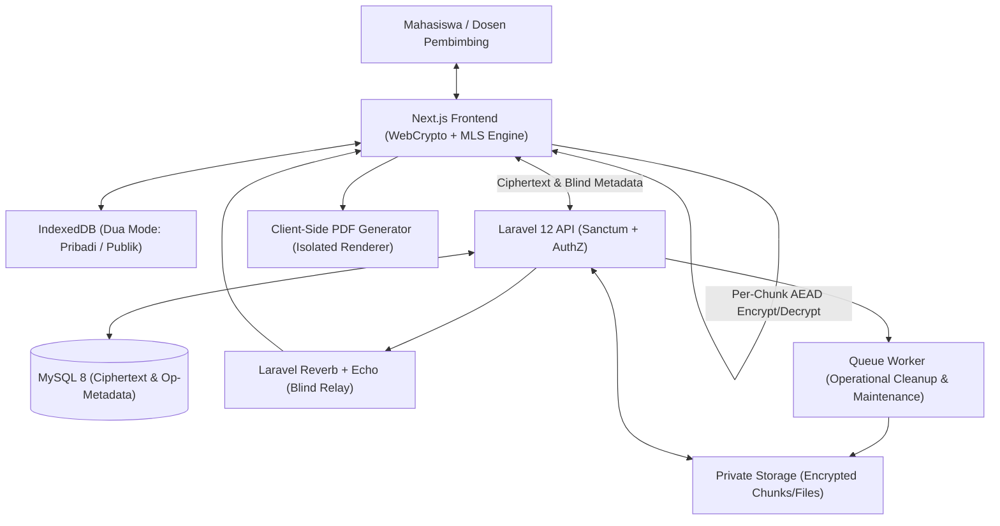
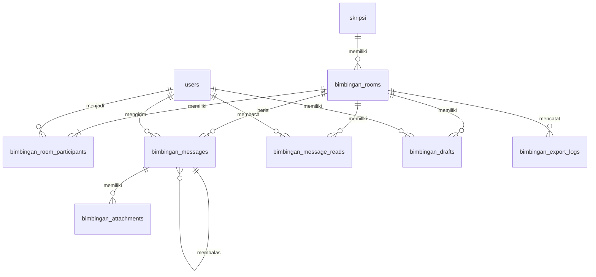

# B-CHAT-04 — DESAIN TEKNIS
## Sistem Bimbingan Online Chat Real-Time UNUHA
**Status:** Draft desain teknis — Bagian 1  
**Acuan:** B-CHAT-01 (spesifikasi kebutuhan yang disetujui) dan B-CHAT-03 (audit kesiapan teknis)  
**Batas pekerjaan:** Desain dan analisis saja. Tidak ada implementasi.

---

# 1. Tujuan desain

Merancang arsitektur teknis dan struktur data untuk fitur Bimbingan Online Chat Real-Time yang:

1. Memisahkan percakapan Proposal dan Skripsi.
2. Menyediakan ruang privat antara satu mahasiswa dan satu dosen pembimbing.
3. Mendukung dua dosen pembimbing Skripsi melalui ruang percakapan yang terpisah.
4. Memastikan Admin tidak dapat membaca atau mengakses konten percakapan.
5. Mempertahankan tabel `bimbingan` sebagai logbook formal yang terpisah.
6. Mendukung pesan real-time, lampiran PDF/DOCX, status baca, draf, dan antrean offline.
7. Menjaga riwayat percakapan dosen lama setelah pergantian pembimbing sesuai hak akses historis.
8. Tidak merusak fitur dan perubahan kode yang sudah ada.

# 2. Arsitektur sistem yang diusulkan

## 2.1 Komponen utama

| Komponen | Tanggung jawab |
|---|---|
| Next.js 14 | Antarmuka chat, manajemen kunci E2EE lokal, enkripsi/dekripsi per chunk, validasi format dan struktur berkas lokal serta penolakan berkas makro, penanganan metadata terenkripsi, pratinjau PDF dalam renderer terisolasi, Link Preview client-side best-effort, dan pengelolaan IndexedDB dua mode (pribadi/publik). |
| Laravel 12 API | Autentikasi sesi Sanctum, otorisasi peran dan keanggotaan ruang, penyimpanan metadata operasional biner, orkestrasi sesi upload bertahap (resumable), verifikasi transfer best-effort terhadap bytes ciphertext yang diterima, dan relay pesan MLS. Tidak memiliki akses membaca plaintext pesan, nama file asli, MIME asli, atau kunci dekripsi. |
| MySQL 8 | Penyimpanan data operasional: metadata ruang, keanggotaan, riwayat ciphertext pesan, posisi baca, metadata teknis lampiran (storage path acak, checksum operasional hasil kalkulasi server, ukuran biner, status upload transfer), dan backup snapshot terenkripsi. |
| Laravel Reverb | Pengiriman peristiwa real-time (ciphertext broadcast) kepada peserta ruang yang berwenang. |
| Laravel Echo | Koneksi WebSocket aman dan penerimaan event ciphertext pada frontend. |
| Queue Worker | Pekerjaan latar belakang server non-inspektif: penghapusan operasional berkas chunk sementara yang kedaluwarsa/dibatalkan, dispatch notifikasi tanpa konten (blind push notification), dan pemeliharaan antrean outbox. |
| Private File Storage | Penyimpanan biner lampiran terenkripsi (ciphertext chunk / file terenkripsi) yang tidak dapat diakses melalui URL publik, dilindungi melalui middleware otorisasi unduhan Laravel. |
| Client File Validator | Pustaka validasi format, struktur kontainer dasar, dan penolakan berkas makro pada Next.js klien sebelum enkripsi dan setelah dekripsi (menggantikan peran antivirus server yang tidak dapat membaca ciphertext). |
| IndexedDB + WebCrypto | Penyimpanan riwayat pesan terenkripsi lokal, draf lokal terenkripsi, antrean offline, dan state kunci kriptografi lokal terproteksi (mendukung mode pribadi dan mode publik dengan batasan keamanan lingkungan yang transparan). |

## 2.2 Alur komunikasi pesan

1. Pengguna menulis pesan pada Next.js.
2. Frontend memvalidasi masukan dasar dan membuat identitas unik untuk pengiriman pesan.
3. Laravel memverifikasi sesi Sanctum, peran, keanggotaan ruang, dan status ruang.
4. Laravel menyimpan pesan ke MySQL melalui transaksi.
5. Setelah transaksi berhasil, Laravel menjadwalkan atau mengirim peristiwa broadcast.
6. Reverb menyampaikan peristiwa kepada peserta ruang yang berwenang.
7. Frontend penerima memperbarui tampilan pesan dan status percakapan.
8. Jika koneksi terputus, frontend melakukan sinkronisasi ulang melalui API ketika koneksi pulih.

**Prinsip utama:** MySQL merupakan sumber kebenaran pesan. WebSocket hanya sarana pemberitahuan perubahan, bukan tempat penyimpanan pesan. Kegagalan broadcast tidak boleh menghapus atau membatalkan pesan yang sudah berhasil disimpan.

## 2.3 Pemisahan pekerjaan sinkron dan asinkron

- **Sinkron:** autentikasi, pemeriksaan hak akses, validasi, penyimpanan pesan, dan respons API.
- **Asinkron:** pemindaian malware, notifikasi tambahan, pembuatan PDF, dan pekerjaan lain yang tidak harus selesai sebelum API merespons.
- **Real-time:** pemberitahuan pesan baru, perubahan status baca, dan indikator koneksi.
- **Lokal:** penyimpanan draf, antrean offline, serta cache riwayat terenkripsi.

Peristiwa pesan baru hanya boleh dipublikasikan setelah data pesan berhasil di-commit. Strategi pengiriman event yang tahan terhadap kegagalan antara commit database dan broadcast perlu ditetapkan lebih rinci pada desain backend.

## 2.4 Diagram arsitektur konseptual

Catatan: Seluruh proses inspeksi dokumen, rendering PDF, dan dekripsi metadata terjadi di sisi klien (FE). Komponen server (API, DB, REV, FILE) hanya memproses ciphertext dan metadata operasional biner tanpa akses ke plaintext.

# 3. Prinsip desain ruang percakapan

## 3.1 Model ruang privat terpisah

Setiap ruang hanya melibatkan:

- Satu mahasiswa.
- Satu dosen pembimbing.

Contoh untuk satu mahasiswa:

| Tahap | Peserta | Ruang |
|---|---|---|
| Proposal | Mahasiswa + Pembimbing Proposal | Ruang Proposal |
| Skripsi | Mahasiswa + Pembimbing Skripsi 1 | Ruang Skripsi Pembimbing 1 |
| Skripsi | Mahasiswa + Pembimbing Skripsi 2 | Ruang Skripsi Pembimbing 2 |

Ruang Proposal dan Skripsi tidak digabung, meskipun dosen pembimbingnya sama.

Ruang baru dibuat ketika pesan pertama berhasil disimpan ke server. Penetapan dosen saja tidak otomatis membuat ruang percakapan.

## 3.2 Pergantian dosen pembimbing

- Ruang dosen lama tetap tersimpan dan diarsipkan sesuai aturan pergantian pembimbing.
- Dosen lama hanya mempertahankan akses historis yang memang diberikan kepadanya.
- Dosen baru memperoleh ruang terpisah.
- Pesan, lampiran, dan draf tidak dipindahkan ke ruang dosen baru.
- Mahasiswa tetap dapat membaca riwayat ruang lama sesuai ketentuan B-CHAT-01.

## 3.3 Siklus hidup ruang

Status konseptual ruang:

- `active`: percakapan dapat digunakan.
- `archived`: percakapan hanya dapat dibaca dan lampiran yang memenuhi syarat tetap dapat diunduh.
- `reopened`: ruang arsip dibuka kembali oleh dosen yang berwenang.

Arsip akibat Sempro atau ujian Skripsi tidak otomatis dibatalkan jika status akademik kemudian dikoreksi mundur. Pembukaan kembali harus melalui tindakan yang berwenang.

# 4. Rancangan konseptual database

## 4.1 Prinsip umum

1. Tabel `bimbingan` yang ada tetap digunakan untuk logbook formal.
2. Chat menggunakan tabel baru dan relasi tersendiri.
3. Relasi ke tabel yang sudah ada harus mengikuti struktur aktual hasil verifikasi, bukan asumsi nama kolom atau primary key.
4. Seluruh ruang dan pesan harus memiliki batas akses yang dapat diverifikasi.
5. Penghapusan pesan harus membuat konten dan lampirannya tidak dapat diakses kembali.
6. Operasi pengiriman harus mendukung idempotensi agar satu tindakan pengguna tidak menghasilkan pesan ganda.

## 4.2 Tabel yang diusulkan

### A. `bimbingan_rooms`

Menyimpan identitas dan status ruang percakapan.

| Kolom konseptual | Fungsi |
|---|---|
| `id` | Primary key ruang. |
| `skripsi_id` | Referensi skripsi terkait. |
| `tahap` | Tahap `proposal` atau `skripsi`. |
| `assignment_id` | Referensi penugasan pembimbing yang menjadi dasar ruang; nama dan relasi final mengikuti skema aktual. |
| `status` | Status ruang: active, archived, reopened. |
| `archived_at` | Waktu pengarsipan. |
| `reopened_at` | Waktu pembukaan kembali. |
| `created_at`, `updated_at` | Timestamp. |

**Aturan:** identitas ruang harus mengikat satu penugasan pembimbing tertentu, bukan hanya `skripsi_id` dan `tahap`. Ini mencegah dua pembimbing Skripsi tergabung ke satu ruang.

### B. `bimbingan_room_participants`

Menyimpan peserta dan hak akses historis ruang.

| Kolom konseptual | Fungsi |
|---|---|
| `id` | Primary key. |
| `room_id` | Referensi ruang. |
| `user_id` | Referensi akun peserta. |
| `participant_role` | `mahasiswa` atau `dosen`. |
| `joined_at` | Awal keanggotaan. |
| `access_ended_at` | Akhir akses jika keanggotaan dihentikan. |
| `access_type` | Akses aktif atau historis. |
| `created_at`, `updated_at` | Timestamp. |

**Aturan:** Admin tidak pernah menjadi peserta ruang melalui mekanisme normal. Hak akses harus diperiksa pada setiap permintaan API, broadcast, pratinjau, pencarian, dan unduhan.

### C. `bimbingan_messages`

Menyimpan pesan percakapan.

| Kolom konseptual | Fungsi |
|---|---|
| `id` | Primary key pesan. |
| `room_id` | Referensi ruang. |
| `sender_id` | Akun pengirim. |
| `client_message_uuid` | Identitas unik pengiriman dari klien untuk idempotensi. |
| `message` | Isi teks; boleh kosong jika pesan hanya berisi lampiran. |
| `reply_to_id` | Referensi pesan yang dibalas, nullable. |
| `edited_at` | Waktu terakhir pesan disunting. |
| `deleted_at` | Penanda penghapusan. |
| `created_at`, `updated_at` | Timestamp. |

**Aturan:**
- Pengiriman pesan teks saja, lampiran saja, atau kombinasi keduanya harus didukung.
- Kombinasi `room_id`, `sender_id`, dan `client_message_uuid` harus mencegah penyimpanan duplikat.
- Batas waktu edit dihitung berdasarkan waktu server saat pesan dibuat.
- Pesan yang dihapus tidak boleh mengembalikan konten melalui sinkronisasi, pencarian, atau broadcast terlambat.

### D. `bimbingan_attachments`

Menyimpan metadata operasional dan status transfer lampiran terenkripsi. Server TIDAK menyimpan nama file asli (`original_name`) maupun `mime_type` spesifik dalam bentuk plaintext.

| Kolom konseptual | Tipe / Format | Fungsi |
|---|---|---|
| `id` | `BIGINT UNSIGNED PK` | Primary key lampiran. |
| `message_id` | `BIGINT UNSIGNED FK` | Referensi ke pesan terenkripsi pemilik lampiran. |
| `file_uuid` | `CHAR(36) UNIQUE` | Pengidentifikasi unik lampiran untuk pengacakan nama fisik. |
| `storage_path` | `VARCHAR(255)` | Lokasi berkas biner ciphertext pada penyimpanan privat (menggunakan UUID, tanpa nama asli). |
| `mime_type` | `VARCHAR(100)` | Tipe konten generik server (selalu diset `application/octet-stream`). |
| `encrypted_metadata` | `TEXT / BLOB` | Metadata sensitif terenkripsi (nama file asli, MIME asli, ukuran plaintext asli) yang hanya dapat didekripsi oleh peserta ruang. |
| `ciphertext_size` | `BIGINT UNSIGNED` | Ukuran data biner ciphertext yang disimpan di server (termasuk tag/overhead). |
| `ciphertext_hash` | `CHAR(64) NULL` | Checksum operasional hasil perhitungan mandiri server dari bytes ciphertext yang diterima untuk deteksi kerusakan transfer dan referensi integritas penyimpanan (at-rest). Definisi kanonikal pada sistem chunk ditunda ke B-CHAT-06. |
| `total_chunks` | `INT UNSIGNED` | Jumlah chunk biner yang membentuk lampiran (1 jika non-chunked). |
| `upload_status` | `ENUM` | Status operasional transfer upload: `pending`, `uploading`, `completed`, `cancelled`, `failed`. Status ini hanya mencatat kelengkapan transfer biner di server dan BUKAN status verifikasi kriptografi. |
| `deleted_at` | `TIMESTAMP NULL` | Penanda soft-delete lampiran. |
| `created_at`, `updated_at` | `TIMESTAMP` | Waktu pembuatan dan pembaruan catatan. |

**Aturan dan Batasan Operasional vs Kriptografi:**
- Format asli yang didukung: PDF dan DOCX (divalidasi dan diidentifikasi di klien). Berkas makro (.docm/.dotm) ditolak mutlak.
- Batas ukuran file asli (plaintext): Maksimal 10 MB per file, maksimal 5 file per pesan, maksimal 25 MB gabungan per pesan.
- Pemeriksaan Transfer Server: Pencocokan hash klien dan server merupakan pemeriksaan transfer best-effort yang dapat membantu mendeteksi kerusakan data tidak disengaja. Pemeriksaan ini tidak menjamin deteksi manipulasi, tidak membuktikan autentisitas pengirim, dan tidak membuktikan validitas plaintext. Hash hasil perhitungan mandiri server disimpan sebagai referensi untuk pemeriksaan ulang integritas penyimpanan (*at-rest integrity*).
- Pemisahan Status: `upload_status = completed` hanya berarti seluruh chunk biner telah diterima lengkap di server. Status ini tidak membuktikan verifikasi tag AES-GCM, AAD, manifest, atau identitas pengirim.
- Verifikasi Klien: Klien penerima bertanggung jawab penuh memverifikasi autentikasi tag AES-GCM independen per chunk, manifest, dan mendekripsi `encrypted_metadata`. Status verifikasi kriptografi dikelola di sisi klien dan rincian arsitekturnya dirancang pada B-CHAT-06.
- Jika pesan dihapus, akses terhadap seluruh lampiran terenkripsi terkait harus segera dicabut.

### E. `bimbingan_message_reads`

Menyimpan posisi baca peserta.

| Kolom konseptual | Fungsi |
|---|---|
| `id` | Primary key. |
| `room_id` | Referensi ruang. |
| `user_id` | Akun pembaca. |
| `last_read_message_id` | Pesan terakhir yang benar-benar telah terlihat oleh pembaca. |
| `read_at` | Waktu pembaruan posisi baca. |
| `created_at`, `updated_at` | Timestamp. |

**Aturan:** membuka ruang atau memulihkan posisi scroll tidak otomatis menandai pesan sebagai terbaca. Posisi baca hanya diperbarui ketika pesan benar-benar tampil pada layar penerima sesuai aturan B-CHAT-01.

### F. `bimbingan_drafts`

Menyimpan draf yang disinkronkan antarperangkat.

| Kolom konseptual | Fungsi |
|---|---|
| `id` | Primary key. |
| `room_id` | Referensi ruang. |
| `user_id` | Pemilik draf. |
| `device_id` | Identitas perangkat atau sesi perangkat. |
| `encrypted_payload` | Muatan draf terenkripsi. |
| `revision` | Versi draf. |
| `updated_at` | Waktu perubahan terakhir. |
| `created_at` | Waktu pembuatan. |

Tabel pendukung versi atau konflik draf mungkin diperlukan untuk mempertahankan kedua versi saat terjadi konflik. Struktur finalnya ditentukan setelah mekanisme enkripsi dan sinkronisasi lintas perangkat dirancang.

### G. `bimbingan_export_logs`

Mencatat aktivitas ekspor PDF tanpa menyimpan isi percakapan.

| Kolom konseptual | Fungsi |
|---|---|
| `id` | Primary key. |
| `room_id` | Ruang yang diekspor. |
| `user_id` | Pengguna yang meminta ekspor. |
| `status` | Berhasil atau gagal. |
| `requested_at` | Waktu permintaan. |
| `completed_at` | Waktu penyelesaian. |

Log ini tidak boleh menyimpan isi pesan, isi lampiran, atau salinan PDF. Akses Admin terhadap isi percakapan dan audit ekspor tetap dibatasi sesuai spesifikasi privasi.

# 5. Relasi konseptual

Diagram ini merupakan model logis. Nama tabel, nama kolom, tipe data, foreign key, indeks, dan aturan cascade final harus disesuaikan setelah pemeriksaan skema aktual.

# 6. Batasan keamanan database

1. Setiap pesan harus terhubung dengan satu ruang yang valid.
2. Setiap pengirim harus menjadi peserta ruang yang sah.
3. Setiap lampiran harus terhubung dengan pesan yang valid.
4. Draf hanya dapat diakses pemiliknya.
5. Posisi baca hanya dapat diubah oleh akun pembaca terkait.
6. Admin tidak memperoleh hak baca melalui relasi skripsi, role, atau endpoint administratif.
7. Ruang dosen lama dan dosen baru harus tetap terisolasi.
8. Penghapusan dan perubahan status file harus konsisten dengan status pesan.
9. Pembuatan ruang dan pesan pertama harus dilakukan secara atomik agar tidak meninggalkan ruang kosong akibat kegagalan penyimpanan pesan.

# 7. Hal yang didelegasikan ke Desain Teknis Lanjutan (B-CHAT-06)

Berikut adalah keputusan teknis spesifik yang belum difinalisasi dan dialihkan pembahasannya ke B-CHAT-06:

- Mekanisme pengikatan kriptografis (*cryptographic binding*) antara identitas pengirim MLS, pesan kontrol, manifest berkas, dan chunk lampiran.
- Spesifikasi mekanisme autentikasi manifest lampiran (evaluasi tanda tangan digital klien vs sub-kunci HMAC vs Merkle tree).
- Definisi kanonikal representasi byte biner dan skema pencatatan checksum chunk vs gabungan file pada sistem chunking (`bimbingan_attachment_chunks`).
- Arsitektur pemisahan status operasional transfer server (`upload_status`) dan status verifikasi kriptografis di sisi klien penerima.
- Model derivasi kunci file/chunk AES-256-GCM, format biner Additional Authenticated Data (AAD), dan protokol pencegahan *nonce reuse*.
- Penentuan ukuran chunk default (misal 512 KB, 1 MB, atau 2 MB) dan parameter upload bertahap.
- Penetapan angka konfigurasi teknis server (batas request per chunk, buffer overhead ciphertext, `upload_max_filesize`, `post_max_size`, dan `memory_limit`) berdasarkan hasil pengujian chunking riil.
- Perancangan mekanisme proteksi material kunci lokal di IndexedDB (WebAuthn/biometrik/PIN).
- Struktur persis payload `encrypted_metadata` lampiran (skema serialisasi JSON/Protobuf/CBOR).
- Format DDL MySQL 8 final dan indeks kinerja untuk tabel `bimbingan_attachments` dan `bimbingan_attachment_chunks`.
- Kebijakan retensi dan cron job penghapusan operasional chunk upload yang kedaluwarsa atau dibatalkan.

# 8. Batas pekerjaan bagian ini

Bagian ini belum mengizinkan:
- Membuat atau mengubah file.
- Membuat migrasi atau model.
- Mengubah database.
- Mengubah konfigurasi CORS, Sanctum, atau Reverb.
- Memasang paket Composer atau NPM.
- Menjalankan pengujian, build, atau deployment.
- Melakukan perubahan Git.

Semua aktivitas tersebut memerlukan persetujuan implementasi tersendiri setelah desain teknis selesai dan disetujui.