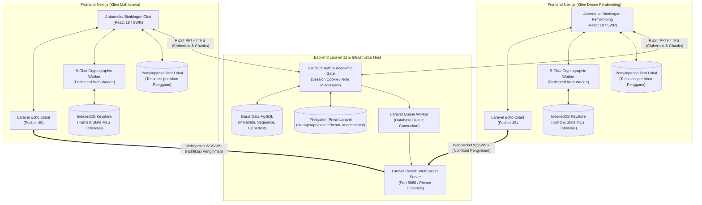
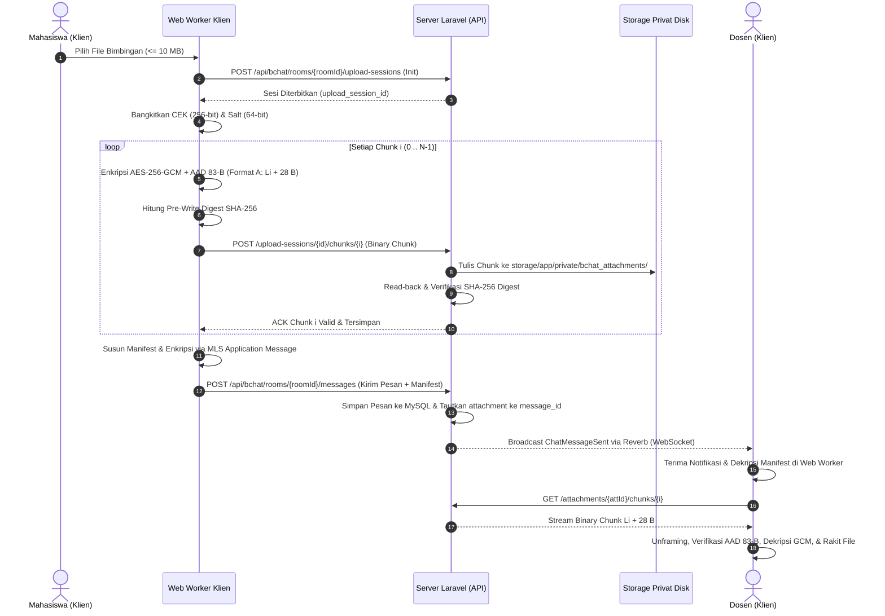
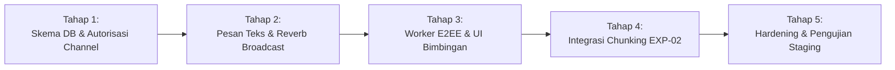

# B-CHAT-09 — RANCANGAN ARSITEKTUR INTEGRASI E2EE
## DESAIN INTEGRASI SISTEM BIMBINGAN ONLINE CHAT REAL-TIME E2EE
### SISTEM INFORMASI MANAJEMEN SKRIPSI UNUHA

**Status Dokumen:** DOKUMEN RANCANGAN ARSITEKTUR RESMI (REVISI PRESISI PENUTUPAN GERBANG DESAIN)  
**Mode Operasi:** CONTROLLED DOCUMENT REVISION — ZERO CODE EXECUTION — ZERO APPLICATION MUTATION  
**Tahap Proyek:** Gerbang Desain Integrasi E2EE (B-CHAT-09)  
**Dokumen Pendahulu Acuan:**
1. [B-CHAT-01_Spesifikasi_Kebutuhan_Fitur_Bimbingan_Online.md](file:///d:/Aplikasi/laragon/www/sistem_manajamen_skripsi/B-CHAT-01_Spesifikasi_Kebutuhan_Fitur_Bimbingan_Online.md)
2. [B-CHAT-04_Rancangan_Teknis.md](file:///d:/Aplikasi/laragon/www/sistem_manajamen_skripsi/B-CHAT-04_Rancangan_Teknis.md)
3. [B-CHAT-05_Spesifikasi_Final_E2EE.md](file:///d:/Aplikasi/laragon/www/sistem_manajamen_skripsi/B-CHAT-05_Spesifikasi_Final_E2EE.md)
4. [B-CHAT-06C.1_Laporan_Koreksi_Terbatas_Gerbang_1.md](file:///d:/Aplikasi/laragon/www/sistem_manajamen_skripsi/B-CHAT-06C.1_Laporan_Koreksi_Terbatas_Gerbang_1.md)
5. [B-CHAT-06D_Mandat_Eksekusi_Terbatas_Gerbang_2.md](file:///d:/Aplikasi/laragon/www/sistem_manajamen_skripsi/B-CHAT-06D_Mandat_Eksekusi_Terbatas_Gerbang_2.md)
6. [B-CHAT-07A_Laporan_Eksekusi_EXP-01.md](file:///d:/Aplikasi/laragon/www/sistem_manajamen_skripsi/B-CHAT-07A_Laporan_Eksekusi_EXP-01.md)
7. [B-CHAT-08A.5_Final_Editorial_Precision_Closure_EXP-02.md](file:///d:/Aplikasi/laragon/www/sistem_manajamen_skripsi/B-CHAT-08A.5_Final_Editorial_Precision_Closure_EXP-02.md)
8. [B-CHAT-08D.2_Final_Technical_Precision_Correction_EXP-02.md](file:///d:/Aplikasi/laragon/www/sistem_manajamen_skripsi/B-CHAT-08D.2_Final_Technical_Precision_Correction_EXP-02.md)  
**Tanggal Pembaruan:** 5 November 2026  

---

> [!IMPORTANT]
> **PANDUAN KLASIFIKASI STATUS KEPUTUSAN ARSITEKTURAL:**  
> Seluruh poin rancangan di dalam dokumen ini diberi label status eksplisit:
> - **`SUDAH DISETUJUI`**: Keputusan teknis/bisnis yang telah disahkan secara definitif oleh Pemilik Proyek.
> - **`KANDIDAT UTAMA EVALUASI DISETUJUI — PEMENANG FINAL BELUM DIPUTUSKAN`**: Penetapan pendekatan kandidat utama untuk diuji secara komparatif terhadap pembanding resmi sebelum penetapan keputusan final.
> - **`REKOMENDASI`**: Usulan teknis dari tim pengembang yang dinilai paling aman dan optimal, namun belum disahkan secara formal.
> - **`BELUM DIPUTUSKAN`**: Keputusan strategis yang merupakan hak prerogatif eksklusif Pemilik Proyek.
> - **`MEMERLUKAN VALIDASI TEKNIS`**: Pilihan arsitektural yang membutuhkan pembuktian empiris / evaluasi tolok ukur lanjutan sebelum dipastikan.

---

## 1. PENDAHULUAN DAN BATASAN OPERASIONAL SERVER

Rancangan arsitektur B-CHAT-09 merupakan jembatan desain yang menghubungkan hasil eksperimen kriptografi prototipe (EXP-01 dan EXP-02) dengan basis kode produksi Sistem Informasi Manajemen Skripsi UNUHA (Laravel 12 dan Next.js 14).

### 1.1. Definisi Operasional: Server-Blind Plaintext and Content-Key Access
Dokumen ini secara resmi menggantikan istilah *Zero-Knowledge Server* yang terlalu luas dengan batasan operasional yang presisi secara ilmiah:
$$\mathbf{Server\text{-}Blind\ Plaintext\ and\ Content\text{-}Key\ Access}$$

Prinsip ini membedakan secara tegas antara **sasaran arsitektur yang telah disetujui**, **status pembuktian teknis implementasi**, dan **metadata operasional yang tetap diamati server**:

1. **Sasaran Arsitektur yang Telah Disetujui `[SUDAH DISETUJUI]`:**  
   Sistem bimbingan chat dirancang secara arsitektural dengan sasaran bahwa server backend Laravel, basis data MySQL, dan server WebSocket Reverb **TIDAK PERNAH** menerima, menyimpan, atau memiliki akses terhadap:
   - Plaintext isi pesan teks obrolan.
   - Plaintext nama berkas lampiran asli maupun tipe MIME asli berkas.
   - Kunci privat identitas pengguna (*Identity Private Key* Ed25519).
   - Kunci simetris enkripsi konten (*Content Encryption Key* / CEK AES-256-GCM).
   - Kunci rahasia grup obrolan TreeKEM MLS.

2. **Status Pembuktian Teknis Implementasi `[MEMERLUKAN VALIDASI TEKNIS]`:**  
   Prinsip *Server-Blind* ini ditegaskan sebagai **sasaran arsitektur (*architectural design target*)**, dan **SAMA SEKALI BUKAN MERUPAKAN JAMINAN PRODUKSI YANG SUDAH TERBUKTI**. Pembuktian bahwa seluruh rantai implementasi kode produksi (Laravel Controller, FormRequest, Eloquent ORM, middleware, queue worker, serialization Next.js, Web Worker kriptografi, dan filesystem privat) benar-benar steril dari kebocoran plaintext atau material kunci **belum dilakukan dan secara mutlak memerlukan validasi teknis formal sebelum sistem dideklarasikan siap produksi**.

3. **Metadata Operasional yang Tetap Diamati Server:**  
   Server secara inheren **tetap mengamati, memvalidasi, dan mengelola metadata operasional** yang mutlak diperlukan untuk otorisasi akses akademik, penjaminan integritas transmisi, dan perutean (*routing*):
   - Identitas pengirim dan penerima (`user_id`, peran akademik mahasiswa/dosen).
   - Pengenal ruang obrolan (`room_uuid`) dan pengenal skripsi terkait (`skripsi_id`).
   - Waktu pengiriman dan penerimaan pesan (*server timestamps*).
   - Ukuran paket ciphertext pesan dan ukuran paket chunk lampiran biner ($L_i + 28\text{ B}$).
   - Jumlah berkas lampiran dan nomor indeks chunk.
   - Alamat IP koneksi klien dan status koneksi WebSocket Reverb.

---

## 2. DIAGRAM ARSITEKTUR SISTEM TERINTEGRASI



> [!NOTE]
> **Kardinalitas Komunikasi pada Diagram Arsitektur:**  
> Diagram di atas merepresentasikan interaksi pada satu ruang obrolan pasangan bimbingan (*pairwise room*). Sesuai keputusan kardinalitas yang telah disetujui:
> - **Tahap Proposal:** Terdiri dari 1 room bimbingan (Mahasiswa $\leftrightarrow$ Dosen Pembimbing Proposal).
> - **Tahap Skripsi:** Terdiri dari 2 room terpisah (Room A: Mahasiswa $\leftrightarrow$ Pembimbing 1, dan Room B: Mahasiswa $\leftrightarrow$ Pembimbing 2), di mana masing-masing room memiliki kanal WebSocket Reverb, kunci/grup MLS, dan riwayat pesan mandiri yang terisolasi total.

---

## 3. ENAM PILAR RANCANGAN ARSITEKTUR DETAIL

### PILAR A: Arsitektur Room dan Keanggotaan Akademik

#### 1. Pemisahan Identitas Skripsi dan Identitas Room `[SUDAH DISETUJUI]`
- Identitas akademik skripsi ([`skripsi.id_skripsi`](file:///d:/Aplikasi/laragon/www/sistem_manajamen_skripsi/manajemen_skripsi/app/Models/Skripsi.php)) dipisahkan secara tegas dari identitas kriptografis ruang obrolan (`bchat_rooms.room_uuid`).
- Satu entitas skripsi dapat memiliki relasi ke satu atau beberapa room obrolan bergantung pada struktur penetapan dosen pembimbing.

#### 2. Kardinalitas Room dan Jumlah Anggota `[SUDAH DISETUJUI]`
Struktur kardinalitas ruang obrolan bimbingan skripsi UNUHA secara resmi telah ditetapkan dengan model **Room Terpisah Berbasis Pasangan Akademik (*Pairwise Separate Rooms*)**:
1. **Tahap Proposal Skripsi (Satu Pembimbing):**
   - Menggunakan **satu room** bimbingan yang menghubungkan Mahasiswa dengan Dosen Pembimbing Proposal (2 anggota).
2. **Tahap Skripsi Penuh (Dua Pembimbing):**
   - Menggunakan **dua room terpisah**:
     - **Room A:** Mahasiswa $\leftrightarrow$ Dosen Pembimbing 1 / Pembimbing Utama (2 anggota).
     - **Room B:** Mahasiswa $\leftrightarrow$ Dosen Pembimbing 2 / Pembimbing Pendamping (2 anggota).
3. **Kemandirian dan Isolasi Setiap Room:**
   - Setiap room menghubungkan tepat satu mahasiswa dengan satu dosen pembimbing.
   - Setiap room memiliki keanggotaan (*membership*), riwayat pesan (*message history*), basis data pesan, dan grup kriptografi MLS (*MLS TreeKEM group*) mandiri yang terisolasi total satu sama lain.
   - Pembimbing 1 dan Pembimbing 2 tidak berada dalam satu grup kriptografis obrolan yang sama, sehingga kunci ratchet dan alur pesan masing-masing pembimbing terjaga kerahasiaan dan independensinya.
4. **Dampak Terisolasi Pergantian Pembimbing:**
   - Pergantian salah satu pembimbing hanya memengaruhi room terkait sesuai prosedur perubahan keanggotaan MLS (`RemoveProposal`, `AddProposal`, `Commit`), tanpa memengaruhi atau mereset grup MLS pada room pembimbing lainnya.
5. **Prasyarat SK Pembimbing yang Sah Tetap Berlaku:**
   - Pembentukan room (baik 1 room pada tahap proposal maupun 2 room pada tahap skripsi) tetap mensyaratkan Surat Keputusan (SK) penetapan pembimbing yang sah dan disahkan secara resmi oleh Kaprodi dan Dekan sebagai prasyarat mutlak (lihat Butir 3).

#### 3. Prasyarat Pembuatan Room Bimbingan `[SUDAH DISETUJUI]`
Room obrolan bimbingan **TIDAK BOLEH** dibuat saat pengajuan judul baru diajukan atau saat pengajuan pembimbing masih dalam status draf/menunggu penetapan. Room **HANYA DAPAT DIBUAT** setelah penetapan pembimbing memenuhi seluruh persyaratan resmi akademik:
1. Status pengajuan pada [`pengajuan_dospem`](file:///d:/Aplikasi/laragon/www/sistem_manajamen_skripsi/manajemen_skripsi/app/Models/PengajuanDospem.php) telah berubah menjadi `ditetapkan`.
2. Surat Keputusan (SK) Dosen Pembimbing resmi telah diterbitkan dan disahkan secara administratif (ditandatangani Kaprodi dan Dekan).
3. Akun dosen dan mahasiswa terdaftar aktif pada basis data pengguna.

#### 4. Kebijakan Pergantian Dosen Pembimbing dan Batas Forward Secrecy `[SUDAH DISETUJUI]` (Kebijakan) / `[MEMERLUKAN VALIDASI TEKNIS]` (Implementasi MLS)
Apabila terjadi pergantian pembimbing melalui revisi SK Dekan:
1. **Pencabutan Akses Kanal Jaringan Dosen Lama:**  
   Dosen lama dicabut seketika dari otorisasi kanal WebSocket Reverb (`rooms.{roomId}`) dan hak akses endpoint REST API ruang bersangkutan pada level otentikasi/middleware server backend.
2. **Prosedur Keanggotaan Kriptografis MLS (Remove/Add/Commit):**  
   - Penghapusan pembimbing lama dan penambahan pembimbing baru **harus mengikuti prosedur protokol MLS (RFC 9420) yang benar**.
   - Setiap perubahan keanggotaan grup **harus menghasilkan Epoch baru** melalui urutan proposal dan komitmen yang valid: klien (Mahasiswa) menerbitkan operasi `RemoveProposal` untuk mengeluarkan pembimbing lama, `AddProposal` untuk memasukkan pembimbing baru, dan `Commit` yang memajukan Epoch MLS ($E \leftarrow E + 1$).
   - Dosen lama yang telah dikeluarkan tidak lagi menerima pembaruan TreeKEM dan tidak memiliki materi kunci untuk mendekripsi pesan-pesan pada Epoch baru ($E_{new}$).
   - Dosen baru yang baru bergabung diinisialisasi pada Epoch baru dan **tidak otomatis memperoleh kunci epoch sebelumnya ($E_{old}$)**, karena kunci enkripsi percakapan masa lalu diturunkan dari ratcheting satu arah yang tidak dapat dihitung mundur oleh anggota baru (*Forward Secrecy*).
3. **Pemisahan Kriptografi vs Kebijakan Retensi Riwayat dan Ciphertext:**  
   - **Ketidakmampuan memperoleh kunci epoch lama TIDAK BOLEH DISAMAKAN dengan penghapusan ciphertext atau penghapusan riwayat lama.** Seluruh rekaman ciphertext pesan masa lalu tetap tersimpan secara fisik di basis data server (`bchat_messages`).
   - Kebijakan hak akses terhadap riwayat bimbingan masa lalu, durasi retensi penyimpanan ciphertext lama, serta prosedur pemulihan perangkat (*device recovery* / *historical key escrow*) **harus ditentukan secara terpisah melalui tata kelola akademik UNUHA, dan bukan implikasi otomatis dari sifat kriptografi MLS**.
4. **Status Validasi Teknis Forward Secrecy:**  
   - Mekanisme *Forward Secrecy* dan *Post-Compromise Security* ini merupakan **desain berbasis spesifikasi RFC 9420**, dan **HINDARI KLAIM bahwa Forward Secrecy telah terbukti sebelum implementasi MLS nyata divalidasi secara teknis**.
   - Keberhasilan eksekusi siklus `Remove/Add/Commit` di lingkungan peramban Web Worker berstatus **`MEMERLUKAN VALIDASI TEKNIS`** (sejalan dengan evaluasi modul Rust-WASM pada Pilar B).
5. **Kontinuitas Akademik:**  
   Dosen baru memantau progres akademik masa lalu melalui tabel logbook bimbingan resmi ([`bimbingan`](file:///d:/Aplikasi/laragon/www/sistem_manajamen_skripsi/manajemen_skripsi/app/Models/Bimbingan.php)) yang tersimpan secara terpisah di basis data akademik.

#### 5. Siklus Hidup Room (*Lifecycle*) `[REKOMENDASI]`
- `PENDING_OFFICIAL_SK`: Menunggu legalitas SK penetapan dosen pembimbing.
- `ACTIVE`: Masa bimbingan reguler (pengiriman pesan dan berkas dibuka penuh).
- `FROZEN_SEMPRO` `[REKOMENDASI]`: Dibekukan sementara saat masa penilaian seminar proposal.
- `FROZEN_SIDANG` `[REKOMENDASI]`: Dibekukan sementara saat masa pendaftaran/sidang skripsi.
- `ARCHIVED_READONLY`: Skripsi dinyatakan lulus/yudisium. Room beralih ke arsip baca lokal permanen; server menolak pengiriman pesan baru.
- `TERMINATED`: Mahasiswa mengundurkan diri, drop-out, atau ganti judul skripsi total.

---

### PILAR B: Arsitektur MLS (Messaging Layer Security - RFC 9420)

#### 1. Status Evaluasi Engine Kriptografi: Rust-WASM `[MEMERLUKAN VALIDASI TEKNIS]` (Sesuai OD-01)
- **Koreksi Faktual atas Laporan EXP-01:**  
  Ditegaskan secara jujur dan transparan bahwa **EXP-01 baru merupakan pengujian simulator logika JavaScript dan modul stub WASM tiruan, dan BELUM membuktikan implementasi protokol MLS RFC 9420 standar industri secara utuh**.
- Pemilihan pustaka Rust-WASM resmi (seperti `openmls` atau `mls-rs`) berstatus **`MEMERLUKAN VALIDASI TEKNIS`**. Diperlukan evaluasi tolok ukur tersendiri untuk menguji kompatibilitas bundle WASM, footprint memori Web Worker di Next.js 14, dan stabilitas serialisasi TLS syntax RFC 9420.

#### 2. Pengikatan Identitas MLS dengan Akun Akademik UNUHA `[REKOMENDASI]`
Untuk mencegah serangan penyamaran (*impersonation*) dan *Man-in-the-Middle*:
1. **Struktur Kredensial Kriptografis:**  
   Kredensial MLS memuat data identitas akademik: `user_id`, peran (`mahasiswa`/`dosen`), dan nomor induk (`NIM`/`NIDN`), yang diikat ke Identity Public Key (Ed25519).
2. **Pencegahan Impersonasi Unggah KeyPackage:**  
   Endpoint `POST /api/bchat/key-packages` diproteksi oleh middleware `auth:sanctum`. Server memverifikasi bahwa `user_id` pada kredensial KeyPackage identik 100% dengan ID pengguna yang terautentikasi (`$request->user()->id`).
3. **Pencegahan Penggunaan Ulang KeyPackage (*Anti-Replay*):**  
   Setiap KeyPackage yang diambil oleh anggota room ditandai `is_consumed = true` bersama timestamp konsumsi. Server menolak penggunaan ulang KeyPackage yang sama untuk inisialisasi sesi grup baru.
4. **Pemisahan Peran Autentikasi:**  
   Autentikasi channel WebSocket Reverb **HANYA** mengendalikan izin koneksi jaringan (*transport network gate*) dan **SAMA SEKALI BUKAN MERUPAKAN PENGGANTI** autentikasi identitas MLS. Keabsahan pengirim pesan dibuktikan secara independen oleh verifikasi tanda tangan digital Ed25519 pada payload MLS.
5. **Kebijakan Perangkat Klien:**  
   Rancangan awal merekomendasikan **Single Active Device per User Account `[REKOMENDASI]`** guna menghindari kompleksitas sinkronisasi *multi-device state tree* pada versi perdana.

---

### PILAR C: Arsitektur Pesan, Idempotensi, dan Delivery

#### 1. Format Envelope Pesan Klien $\rightarrow$ Server `[SUDAH DISETUJUI]`

```json
{
  "message_uuid": "550e8400-e29b-41d4-a716-446655440000",
  "room_uuid": "11111111-1111-4111-8111-111111111111",
  "epoch": 1,
  "generation": 0,
  "content_type": 1,
  "ciphertext_payload": "<base64_mls_ciphertext>",
  "client_sent_at": "2026-11-05T21:50:00.000Z"
}
```

#### 2. Idempotensi Pengiriman Deterministik `[SUDAH DISETUJUI]`
Untuk menjamin keamanan transmisi di atas jaringan seluler yang tidak stabil:
1. **Retry Identik (Safe Retry):**  
   Jika server menerima permintaan dengan `message_uuid` yang telah ada, dan terbukti memiliki `room_uuid`, `sender_id`, serta **fingerprint payload (hash SHA-256 ciphertext) yang identik 100%**, server memperlakukannya sebagai percobaan ulang jaringan yang sah $\rightarrow$ mengembalikan respons sukses HTTP 200 (ACK) tanpa membuat baris baru di database dan tanpa menyiarkan ulang ke Reverb.
2. **Penolakan Konflik Integritas (Replay Conflict):**  
   Jika server menerima `message_uuid` yang sama namun memiliki payload ciphertext, room, atau pengirim yang berbeda, server **WAJIB MENOLAK** permintaan tersebut dengan galat `HTTP 409 Conflict`.

#### 3. Penomoran `server_sequence` Monotonik per Room `[MEMERLUKAN VALIDASI TEKNIS]`
Penomoran urutan pesan per room mempertahankan status **`MEMERLUKAN VALIDASI TEKNIS`** dan **TIDAK MENETAPKAN implementasi teknis final sebelum pembuktian empiris**:
1. **Keamanan terhadap Transaksi Bersamaan (*Concurrent Transactions*):**  
   Alokasi nomor urut `server_sequence` per room harus aman secara mutlak terhadap kondisi balapan (*race condition*) ketika beberapa anggota room mengirim pesan secara simultan di bawah konkurensi tinggi.
2. **Ketiadaan Nomor Duplikat (*Zero Duplicates*):**  
   Sistem wajib menjamin secara absolut tidak ada nomor sequence duplikat di dalam satu room yang sama (diperkuat oleh konstrain unik basis data `UNIQUE KEY uk_room_sequence (room_id, server_sequence)`).
3. **Keandalan Prosedur Reconnect (*Lossless Catch-Up*):**  
   Mekanisme sinkronisasi rekoneksi klien (`GET /api/bchat/rooms/{roomId}/messages?after_sequence={lastKnownSequence}`) harus dapat mengambil seluruh pesan yang terlewat secara akurat dan lengkap tanpa risiko kehilangan pesan yang telah berhasil tersimpan di basis data server.
4. **Pemisahan Konseptual `server_sequence` vs Urutan MLS:**  
   Urutan `server_sequence` (mencerminkan urutan kedatangan fisik di server) **DILARANG DISAMAKAN** dengan urutan kriptografis ratchet MLS `(epoch, generation)`. Penanganan kedatangan acak (*out-of-order arrival*) pada rantai kunci MLS dikelola secara mandiri di buffer penahan Web Worker klien (lihat Butir 5).
5. **Kewajiban Pengujian Konkurensi pada MySQL 8:**  
   Mekanisme transaksi dan penguncian basis data yang dipilih (misalnya baris kontrol transaksional `SELECT ... FOR UPDATE` pada `bchat_rooms` vs tabel counter sekuensial terpisah) **harus dibuktikan secara empiris melalui pengujian beban konkurensi pada MySQL 8 (InnoDB engine)** guna mengukur latensi penguncian (*lock latency*), risiko *deadlock*, dan degradasi *throughput* sebelum ditetapkan sebagai implementasi produksi final.

#### 4. Definisi Tiga Tingkat Status Pesan (*Receipts*) `[SUDAH DISETUJUI]`
- **`SENT`:** Ciphertext pesan telah divalidasi dan berhasil disimpan permanen di basis data MySQL server.
- **`DELIVERED`:** Klien penerima mengonfirmasi bahwa ciphertext telah diterima dari WebSocket/sinkronisasi dan lolos validasi framing awal pada tingkat aplikasi.
- **`READ`:** Pesan telah berhasil didekripsi di Web Worker penerima dan telah ditampilkan pada viewport antarmuka obrolan yang sedang aktif dan fokus.
- *Rekomendasi:* Sinyal status baca (*read receipt*) dikirimkan sebagai pesan kontrol yang dilindungi enkripsi MLS `[REKOMENDASI]`.

#### 5. Pemisahan `server_sequence` vs Urutan Ratchet MLS `[SUDAH DISETUJUI]`
- Nomor `server_sequence` mencerminkan urutan kedatangan pesan pada server penyimpanan fisik.
- Klien peramban **WAJIB** memproses dekripsi berdasarkan pasangan urutan kriptografis `(epoch, generation)`.
- Jika pesan dengan `generation` lebih tinggi tiba mendahului pesan sebelumnya (*network out-of-order*), klien menampung pesan tersebut pada buffer penahan (*holding buffer*) hingga pesan yang hilang tiba dan ratchet state dapat dimajukan secara sekuensial.

#### 6. Jaminan Pengiriman Sistem `[SUDAH DISETUJUI]`
Sistem menjamin keandalan pengiriman **At-Least-Once Delivery dengan Deduplikasi Klien & Server**. Sistem secara sadar menolak klaim naif *Exactly-Once* pada lingkungan jaringan terdistribusi.

---

### PILAR D: Arsitektur Lampiran Berkas dan Upload Session (Integrasi EXP-02)

#### 1. Kepatuhan Penuh Parameter Kanonikal EXP-02 `[SUDAH DISETUJUI]`
Seluruh parameter yang telah disahkan pada B-CHAT-08A.5, B-CHAT-08C.4, dan B-CHAT-08D.2 diberlakukan secara mutlak:
- **Ukuran Chunk Standar ($C$):** Tepat $1.048.576\text{ byte}$ ($1\text{ MiB}$).
- **Batas Berkas Tunggal ($S$):** Maksimum $10.000.000\text{ byte}$ ($10\text{ MB}$, $1 \le N \le 10$ chunk). Berkas $0\text{ byte}$ ditolak mutlak.
- **Batas Gabungan per Pesan:** Maksimum $25.000.000\text{ byte}$ ($25\text{ MB}$).
- **Batas Jumlah Berkas:** Maksimum $5$ berkas per pengiriman pesan.
- **Struktur AAD Kanonikal:** Tepat **83 Byte** (Magic Header `UNH1`, Version `0x0001`, Domain `0x02`, 4 UUID biner mentah 16-byte, uint32be chunk index, total chunks, dan plaintext length).
- **Framing Format Simpan:** **Format A ($L_i + 28\text{ Byte}$)**:
  $$\text{Paket Simpan} = \text{Nonce}\ (12\text{ B}) \parallel \text{Ciphertext}\ (L_i\text{ B}) \parallel \text{AuthTag}\ (16\text{ B})$$
- **Batas Percobaan Retry I/O:** $K_{\text{io\_retry}} = 1$ pada berkas yang sama dari buffer RAM tersimpan.
- **Disiplin Nonce Reuse:** Dilarang keras mengenkripsi ulang dengan pasangan (CEK, Nonce) yang sama.

#### 2. Evaluasi Komparasi Kunci Lampiran OD-17 `[KANDIDAT UTAMA EVALUASI DISETUJUI — PEMENANG FINAL BELUM DIPUTUSKAN]`
Berdasarkan mandat pembaruan keputusan Pemilik Proyek, status arsitektur distribusi Content Encryption Key (CEK) untuk berkas lampiran ditetapkan sebagai berikut:
1. **Pendekatan B sebagai Kandidat Utama Evaluasi (`KANDIDAT UTAMA EVALUASI DISETUJUI`):**  
   Kunci CEK dibangkitkan secara acak murni 256-bit menggunakan CSPRNG di memori klien per berkas lampiran, kemudian dibungkus dan didistribusikan melalui payload manifest lampiran yang dilindungi enkripsi pesan aplikasi MLS (*MLS Application Message*).
2. **Pendekatan A sebagai Pembanding Resmi:**  
   Kunci CEK diturunkan secara deterministik dari state rahasia grup MLS melalui fungsi eksportir (`MLS-Exporter`). Pendekatan ini tetap dipertahankan sebagai tolok ukur pembanding resmi (*benchmark baseline*).
3. **Parameter Kriptografi Bersama:**  
   Kedua pendekatan tetap memberlakukan algoritma simetris kanonikal **AES-256-GCM**, struktur AAD 83-byte, tag autentikasi 16-byte, framing Format A ($L_i + 28\text{ B}$), dan pemotongan chunk 1 MiB sesuai spesifikasi EXP-02.
4. **Batasan Sikap Ilmiah:**  
   Dokumen ini **TIDAK MENYATAKAN bahwa Pendekatan B sudah terbukti lebih aman atau siap produksi**. Penetapan Pendekatan B sebagai kandidat utama didasarkan pada pertimbangan arsitektural terkait isolasi kunci per berkas dan kemudahan penanganan arsip lintas-epoch. Keputusan pemenang final tetap **BELUM DIPUTUSKAN** dan secara mutlak menunggu hasil evaluasi teknis komparatif.

| Dimensi Evaluasi | Pendekatan A: MLS Exporter Secret (Pembanding Resmi) | Pendekatan B: CSPRNG Encrypted via MLS Message (Kandidat Utama Evaluasi) |
| :--- | :--- | :--- |
| **Sumber Nilai Kunci CEK** | Diturunkan secara deterministik dari state rahasia grup MLS via `MLS-Exporter(label="bchat-attachment-cek", context, length=32)`. | Dibangkitkan secara acak murni 256-bit via CSPRNG di memori klien per berkas lampiran. |
| **Penyampaian Kunci ke Penerima** | Implisit; anggota grup yang sah menurunkan kunci yang sama dari epoch MLS yang bersangkutan. | Eksplisit; kunci CEK dibungkus di dalam payload manifest lampiran yang dienkripsi via MLS Application Message. |
| **Keterikatan Epoch MLS** | Kunci terikat langsung pada Epoch pengiriman. Jika state epoch hilang, penurunan kunci memerlukan kalkulasi ulang KDF dari arsip epoch. | Kunci terisolasi penuh per lampiran. Selama manifest terenkripsi tersimpan, berkas dapat didekripsi tanpa ketergantungan epoch lanjutan. |
| **Karakteristik Komputasi Klien** | Memerlukan pemanggilan fungsi KDF eksportir MLS grup pada setiap lampiran. | Memerlukan pembangkitan CSPRNG dan enkripsi kunci simetris di dalam manifest. |
| **Status Keputusan Proyek** | **PEMBANDING EVALUASI RESMI** | **KANDIDAT UTAMA EVALUASI DISETUJUI** *(Pemenang final belum diputuskan)* |

#### 3. Resolusi Alur Konseptual dan Skema Upload Session `[SUDAH DISETUJUI]`
Mengoreksi inkonsistensi skema sebelumnya di mana chunk diunggah sebelum pesan tercipta:
1. **Pemisahan Identitas Upload Session:**  
   `upload_session_id` (UUID v4) dibangkitkan saat sesi unggah dimulai, independen dari keberadaan pesan.
2. **Kelonggaran Kolom `message_id`:**  
   Pada tabel `bchat_attachments`, kolom `message_id` bernilai **`NULLABLE`** saat upload session dibuka, dan baru ditautkan ke ID pesan setelah pesan obrolan yang memuat manifest berhasil disimpan permanen.
3. **Tujuh Tahap Siklus Hidup Unggah Lampiran:**
   - *Tahap 1 (Inisialisasi):* Klien meminta sesi: `POST /api/bchat/rooms/{roomId}/upload-sessions` $\rightarrow$ Server menerbitkan `upload_session_id`.
   - *Tahap 2 (Enkripsi & Streaming):* Web Worker memotong berkas per 1 MiB, mengenkripsi dengan AAD 83-byte dan framing Format A ($L_i + 28\text{ B}$), dan menghitung digest SHA-256 pre-write.
   - *Tahap 3 (Transmisi Chunk):* Klien mengunggah chunk biner: `POST /api/bchat/upload-sessions/{sessionId}/chunks/{index}`.
   - *Tahap 4 (Verifikasi Penyimpanan Server):* Server menulis ke filesystem privat, membaca ulang (*read-back*), memverifikasi panjang dan hash SHA-256, lalu mencatatnya di `bchat_attachment_chunks`.
   - *Tahap 5 (Penyusunan Manifest):* Klien menyusun Manifest Lampiran (memuat `attachment_uuid`, `total_size`, `chunk_hashes_sha256`, dan nama/tipe file terenkripsi).
   - *Tahap 6 (Enkripsi Manifest via MLS):* Manifest dienkripsi secara E2EE ke dalam payload pesan MLS.
   - *Tahap 7 (Komitmen Pesan):* Klien mengirim pesan `POST /api/bchat/rooms/{roomId}/messages`. Server menyimpan pesan dan menautkan `attachment_id` ke `message_id`.



#### 4. Pemulihan Lima Lapisan Keabsahan Data (L-1 s.d. L-5) `[SUDAH DISETUJUI]`
Mengukuhkan kembali secara formal hierarki validasi EXP-02:
- **L-1 (Framing Wire):** Ukuran chunk tepat $L_i + 28\text{ byte}$ ($12\text{ B Nonce} + L_i\text{ B Cipher} + 16\text{ B Tag}$).
- **L-2 (Pengikatan Sesi):** Kesesuaian 9 metadata non-rahasia pada level artefak pengujian.
- **L-3 (Integritas Penyimpanan):** Komparasi digest SHA-256 pre-write terhadap read-back buffer sebelum pengiriman/retry.
- **L-4 (Autentikasi Kriptografis):** Verifikasi Tag Autentikasi 128-bit AES-GCM dengan AAD 83-byte kanonikal melalui `crypto.subtle.decrypt`.
- **L-5 (Validasi Manifest & Perakitan):** Validasi konsistensi struktur keseluruhan berkas ($\sum L_i = S$). Ditegaskan bahwa **persamaan $\sum L_i = S$ hanyalah salah satu syarat konsistensi akumulatif, bukan bukti autentikasi manifest**. Keabsahan manifest hanya dijamin melalui autentikasi payload pesan MLS.

---

### PILAR E: Arsitektur Real-Time (Laravel Reverb & Echo)

#### 1. Pemanfaatan Infrastruktur yang Tersedia `[SUDAH DISETUJUI]`
- Memanfaatkan paket resmi [`laravel/reverb`](file:///d:/Aplikasi/laragon/www/sistem_manajamen_skripsi/manajemen_skripsi/config/reverb.php) v1.12 dan modul klien [`src/lib/echo.ts`](file:///d:/Aplikasi/laragon/www/sistem_manajamen_skripsi/frontend_manajemen_skripsi/src/lib/echo.ts) yang telah terpasang dan terkonfigurasi.
- Transport: WebSocket native (`ws://` / `wss://`) pada port 8080.

#### 2. Ketepatan Semantik Properti `$afterCommit` `[SUDAH DISETUJUI]`
- Event `ChatMessageSent` menyertakan `public bool $afterCommit = true;`.
- Penegasan Teknis: Properti ini menginstruksikan framework Laravel untuk menahan penyiaran event ke socket Reverb hingga transaksi database MySQL utama berhasil di-*commit*. Namun, hal ini **tidak otomatis menyelesaikan seluruh kendala konkurensi terdistribusi** jika terjadi kegagalan soket jaringan Reverb.

#### 3. Pemisahan Peran Database/API vs WebSocket Reverb `[SUDAH DISETUJUI]`
- **Basis Data MySQL / REST API:** Merupakan **Satu-satunya Sumber Kebenaran Persisten (*Single Source of Truth / SSOT*)**.
- **Laravel Reverb:** Bertindak murni sebagai **Kanal Notifikasi dan Penyiaran Sementara (*Transient Delivery Channel*)**. Jika koneksi WebSocket terputus, pesan tetap aman tersimpan di basis data dan dapat disinkronkan kembali.

#### 4. Prosedur Rekoneksi dan Sinkronisasi Ulang `[SUDAH DISETUJUI]`
Saat koneksi Reverb tersambung kembali setelah terputus:
1. Klien mengirim permintaan sinkronisasi:  
   `GET /api/bchat/rooms/{roomId}/messages?after_sequence={lastKnownSequence}`.
2. Server mengembalikan seluruh rekaman ciphertext yang terlewat.
3. Klien memproses ciphertext tersebut secara berurutan di Web Worker untuk memajukan ratchet MLS ke kondisi terkini.

#### 5. Penanganan Kedaluwarsa Sesi Sanctum `[REKOMENDASI]`
- Jika endpoint otorisasi channel `/broadcasting/auth` merespons HTTP 401/419 (Sanctum cookie expired):
  - Sistem **dilarang melakukan reload peramban secara mendadak** yang dapat menghapus buffer state kunci di memori RAM.
  - Klien memunculkan dialog re-otentikasi latar belakang yang aman atau memperbarui token CSRF dengan persetujuan pengguna. State kunci lokal tetap terlindungi selama proses otentikasi ulang berlangsung.

#### 6. Pemisahan Kanal Siaran Obrolan vs Notifikasi `[SUDAH DISETUJUI]`
- **Kanal Obrolan (`private-rooms.{roomId}`):** Khusus membawa payload pesan terenkripsi E2EE untuk anggota yang sedang aktif membuka layar obrolan room.
- **Kanal Notifikasi Akademik ([`private-users.{userId}.notifications`](file:///d:/Aplikasi/laragon/www/sistem_manajamen_skripsi/manajemen_skripsi/routes/channels.php)):** Khusus membawa notifikasi ringkasan (judul event, lonceng badge) tanpa membocorkan isi pesan terenkripsi.

---

### PILAR F: Keamanan, Privasi, dan Batasan Klaim Kriptografi

#### 1. Batas Realistis Perlindungan Penyimpanan Klien `[REKOMENDASI]`
1. **IndexedDB Keystore:**  
   Kunci privat identitas dan state TreeKEM disimpan di IndexedDB peramban lokal (`bchat_keystore`).
2. **Keterbatasan `CryptoKey extractable: false`:**  
   Meskipun kunci diimpor dengan flag `extractable: false`, perlindungan ini **TIDAK MENGHILANGKAN RISIKO** serangan *Cross-Site Scripting* (XSS). Skrip berbahaya yang berhasil dieksekusi di bawah *same-origin* peramban tetap dapat memanggil API Web Crypto untuk mendekripsi atau menandatangani pesan secara tidak sah. Proteksi XSS pada aplikasi Next.js/Laravel tetap menjadi prasyarat keamanan mutlak.

#### 2. Perlindungan dan Isolasi Draf Obrolan Lokal `[SUDAH DISETUJUI]` (Persyaratan) / `[MEMERLUKAN VALIDASI TEKNIS]` (Detail & Mekanisme)
1. **Penyimpanan Draf Mandiri Lokal `[SUDAH DISETUJUI]`:**  
   Teks draf pesan yang sedang diketik disimpan secara eksklusif pada media penyimpanan lokal peramban klien dengan pemisahan namespace terisolasi per akun pengguna (`bchat_draft_{userId}_{roomUuid}`).
2. **Larangan Pengiriman ke Server `[SUDAH DISETUJUI]`:**  
   Draf pesan **DILARANG KERAS** dikirimkan ke server backend Laravel dalam bentuk apa pun, termasuk sebagai sinyal *autosave*, *background draft sync*, atau *typing preview*. Server hanya menerima data saat pengguna menekan tombol kirim secara sadar.
3. **Persyaratan Perlindungan/Enkripsi Penyimpanan Lokal `[SUDAH DISETUJUI]`:**  
   Perlindungan dan enkripsi penyimpanan lokal draf merupakan **persyaratan arsitektur yang SUDAH DISETUJUI**, bukan sekadar rekomendasi, guna memitigasi risiko pembacaan draf oleh pengguna lain pada stasiun kerja bersama (*Shared PC*) seperti laboratorium komputer kampus UNUHA.
4. **Detail Teknologi dan Mekanisme Pengelolaan Kunci `[MEMERLUKAN VALIDASI TEKNIS]`:**  
   Meskipun persyaratan enkripsi draf lokal telah disetujui, **detail teknologi kriptografi klien, mekanisme derivasi/pengelolaan kunci (misal: pengikatan kunci simetris AES-GCM dengan sesi login aktif atau Web Crypto API), serta implementasi konkretnya berstatus `MEMERLUKAN VALIDASI TEKNIS`**.
5. **Keterbatasan terhadap XSS dan Keamanan Browser:**  
   Sebagaimana halnya keystore IndexedDB (Butir 1 di atas), perlindungan enkripsi draf lokal memiliki batas inheren terhadap kompromi lingkungan peramban: serangan *Cross-Site Scripting* (XSS) pada domain yang sama (*same-origin*) tetap berpotensi mengakses memori RAM atau mengeksekusi fungsi dekripsi klien. Oleh karena itu, proteksi XSS pada tingkat aplikasi frontend Next.js dan backend Laravel tetap merupakan prasyarat keamanan mutlak yang tidak dapat digantikan oleh enkripsi penyimpanan lokal.

#### 3. Realitas Batasan Pembersihan Memori (*Memory Hygiene*) `[SUDAH DISETUJUI]`
- Fungsi pembersihan memori seperti `buffer.fill(0)` dan penghapusan referensi objek diakui secara jujur sebagai **upaya terbaik (*best-effort cleanup*)**.
- Disiplin ini tidak memberikan jaminan absolut penghapusan memori pada tingkat fisik perangkat keras, karena adanya optimasi internal *Garbage Collector* V8 engine, manajemen alokasi memori runtime, dan mekanisme *virtual memory paging* sistem operasi host.

#### 4. Disiplin Audit Logging Bebas Plaintext `[SUDAH DISETUJUI]`
- Berkas log Laravel ([`storage/logs/laravel.log`](file:///d:/Aplikasi/laragon/www/sistem_manajamen_skripsi/manajemen_skripsi/storage/logs/laravel.log)), log Reverb, dan monitoring server **DILARANG KERAS** mencatat plaintext pesan, kunci CEK, salt, kunci privat, atau binary dump AAD.
- Log hanya diizinkan mencatat atribut non-kriptografis: `event_code`, `room_uuid`, `sender_id`, `message_uuid`, `epoch`, ukuran berkas, status HTTP, dan waktu pemrosesan.

#### 5. Peniadaan Klaim Keamanan Absolut `[SUDAH DISETUJUI]`
Dokumen ini menghapus seluruh klaim keamanan yang berlebihan (seperti "mutlak", "100% aman", atau jaminan ketiadaan kebocoran tanpa syarat). Seluruh jaminan keamanan disajikan secara objektif sebagai **jaminan berbatas komputasi (*computationally bounded security*)** dengan asumsi ketahanan matematis primitif kriptografi standar (AES-GCM, SHA-256, Ed25519) serta kepatuhan ketat terhadap aturan operasional *nonce non-reuse*.

---

## 4. RANCANGAN SKEMA BASIS DATA MYSQL KONSEPTUAL

Rancangan tabel basis data MySQL yang telah diselaraskan dengan alur upload session dan penomoran room:

```sql
-- 1. Tabel Ruang Obrolan Bimbingan
CREATE TABLE bchat_rooms (
    id BIGINT UNSIGNED AUTO_INCREMENT PRIMARY KEY,
    room_uuid CHAR(36) NOT NULL UNIQUE,
    skripsi_id BIGINT UNSIGNED NOT NULL,
    pembimbing_ke TINYINT UNSIGNED NOT NULL DEFAULT 1, -- 1: Pembimbing Utama, 2: Pembimbing Pendamping
    dosen_id BIGINT UNSIGNED NOT NULL,
    status ENUM('PENDING_OFFICIAL_SK', 'ACTIVE', 'FROZEN_SEMPRO', 'FROZEN_SIDANG', 'ARCHIVED_READONLY', 'TERMINATED') DEFAULT 'PENDING_OFFICIAL_SK',
    current_epoch INT UNSIGNED DEFAULT 1,
    welcome_message LONGBLOB NULL,
    created_at TIMESTAMP NULL,
    updated_at TIMESTAMP NULL,
    FOREIGN KEY (skripsi_id) REFERENCES skripsi(id_skripsi) ON DELETE CASCADE,
    FOREIGN KEY (dosen_id) REFERENCES dosen(id_dosen) ON DELETE RESTRICT,
    INDEX idx_skripsi_pembimbing (skripsi_id, pembimbing_ke)
);

-- 2. Tabel Pre-Key Pool Pengguna (KeyPackage MLS)
CREATE TABLE bchat_key_packages (
    id BIGINT UNSIGNED AUTO_INCREMENT PRIMARY KEY,
    user_id BIGINT UNSIGNED NOT NULL,
    key_package_hash VARCHAR(64) NOT NULL UNIQUE,
    key_package_data LONGBLOB NOT NULL,
    is_consumed BOOLEAN DEFAULT FALSE,
    consumed_at TIMESTAMP NULL,
    created_at TIMESTAMP NULL,
    FOREIGN KEY (user_id) REFERENCES users(id) ON DELETE CASCADE,
    INDEX idx_user_available_keys (user_id, is_consumed)
);

-- 3. Tabel Pesan Obrolan Terenkripsi
CREATE TABLE bchat_messages (
    id BIGINT UNSIGNED AUTO_INCREMENT PRIMARY KEY,
    server_sequence BIGINT UNSIGNED NOT NULL,
    message_uuid CHAR(36) NOT NULL UNIQUE,
    room_id BIGINT UNSIGNED NOT NULL,
    sender_id BIGINT UNSIGNED NOT NULL,
    epoch INT UNSIGNED NOT NULL,
    generation INT UNSIGNED NOT NULL,
    content_type TINYINT UNSIGNED NOT NULL DEFAULT 1, -- 1: Text, 2: Attachment Manifest, 3: Control Receipt
    ciphertext_payload LONGBLOB NOT NULL,
    payload_hash_sha256 CHAR(64) NOT NULL, -- Untuk verifikasi idempotensi dan dedup
    client_sent_at TIMESTAMP NOT NULL,
    created_at TIMESTAMP NULL,
    FOREIGN KEY (room_id) REFERENCES bchat_rooms(id) ON DELETE CASCADE,
    FOREIGN KEY (sender_id) REFERENCES users(id) ON DELETE CASCADE,
    UNIQUE KEY uk_room_sequence (room_id, server_sequence),
    INDEX idx_room_epoch_gen (room_id, epoch, generation)
);

-- 4. Tabel Metadata Sesi Unggah dan Lampiran Berkas
CREATE TABLE bchat_attachments (
    id BIGINT UNSIGNED AUTO_INCREMENT PRIMARY KEY,
    attachment_uuid CHAR(36) NOT NULL UNIQUE,
    upload_session_id CHAR(36) NOT NULL UNIQUE,
    room_id BIGINT UNSIGNED NOT NULL,
    sender_id BIGINT UNSIGNED NOT NULL,
    message_id BIGINT UNSIGNED NULL, -- NULLABLE saat upload berlangsung, diisi saat commit pesan
    total_bytes BIGINT UNSIGNED NOT NULL,
    total_chunks INT UNSIGNED NOT NULL,
    status ENUM('UPLOADING', 'COMPLETED', 'FAILED_ABANDONED') DEFAULT 'UPLOADING',
    created_at TIMESTAMP NULL,
    updated_at TIMESTAMP NULL,
    FOREIGN KEY (room_id) REFERENCES bchat_rooms(id) ON DELETE CASCADE,
    FOREIGN KEY (sender_id) REFERENCES users(id) ON DELETE CASCADE,
    FOREIGN KEY (message_id) REFERENCES bchat_messages(id) ON DELETE CASCADE
);

-- 5. Tabel Potongan Chunk Berkas Terenkripsi
CREATE TABLE bchat_attachment_chunks (
    id BIGINT UNSIGNED AUTO_INCREMENT PRIMARY KEY,
    attachment_id BIGINT UNSIGNED NOT NULL,
    chunk_index INT UNSIGNED NOT NULL,
    payload_length INT UNSIGNED NOT NULL,
    storage_path VARCHAR(255) NOT NULL,
    storage_hash_sha256 CHAR(64) NOT NULL,
    created_at TIMESTAMP NULL,
    FOREIGN KEY (attachment_id) REFERENCES bchat_attachments(id) ON DELETE CASCADE,
    UNIQUE KEY uk_attachment_chunk (attachment_id, chunk_index)
);
```

---

## 5. RENCANA IMPLEMENTASI BERTAHAP & KRITERIA PENERIMAAN



### Tahap 1: Fondasi Basis Data, Model, dan Kanal Autorisasi Reverb
- **Ruang Lingkup:**
  - Migrasi tabel `bchat_rooms`, `bchat_key_packages`, `bchat_messages`, `bchat_attachments`, dan `bchat_attachment_chunks`.
  - Pendaftaran kanal otorisasi `rooms.{roomId}` di [`routes/channels.php`](file:///d:/Aplikasi/laragon/www/sistem_manajamen_skripsi/manajemen_skripsi/routes/channels.php) dengan validasi SK penetapan pembimbing resmi.
  - Event `ChatMessageSent` dengan disiplin transaksional `$afterCommit = true`.
- **Kriteria Penerimaan:**
  - Otorisasi channel hanya menerima mahasiswa pemilik skripsi dan dosen pembimbing yang terdaftar pada SK sah. Percobaan akses peran lain menghasilkan HTTP 403.

### Tahap 2: API Perpesanan Ciphertext & Penyiaran Reverb
- **Ruang Lingkup:**
  - Endpoint `POST /api/bchat/rooms/{roomId}/messages` dengan validasi idempotensi payload hash.
  - Penomoran `server_sequence` monotonik per room yang aman dari konkurensi (wajib divalidasi melalui pengujian beban konkurensi MySQL 8).
  - Endpoint sinkronisasi pemulihan `GET /api/bchat/rooms/{roomId}/messages?after_sequence=...`.
- **Kriteria Penerimaan:**
  - Retry transmisi dengan payload dan UUID yang sama menghasilkan idempotensi aman tanpa duplikasi baris.
  - Replay attack dengan UUID sama dan payload berbeda ditolak dengan HTTP 409 Conflict.
  - Pengujian beban konkurensi membuktikan alokasi sequence per room bebas dari duplikasi dan bebas dari deadlock.

### Tahap 3: Web Worker Kriptografi Klien & Antarmuka Chat Obrolan
- **Ruang Lingkup:**
  - Modul Web Worker Next.js (`bchat-crypto.worker.ts`) untuk komputasi enkripsi/dekripsi teks.
  - Penggantian antarmuka mockup statis pada [`dashboardmahasiswa/bimbingan/page.tsx`](file:///d:/Aplikasi/laragon/www/sistem_manajamen_skripsi/frontend_manajemen_skripsi/src/app/%28app%29/%28dashboard%29/dashboardmahasiswa/bimbingan/page.tsx) dan [`dashboarddosen/pembimbing_skripsi/page.tsx`](file:///d:/Aplikasi/laragon/www/sistem_manajamen_skripsi/frontend_manajemen_skripsi/src/app/%28app%29/%28dashboard%29/dashboarddosen/pembimbing_skripsi/page.tsx).
  - Penyimpanan draf lokal per akun di media penyimpanan lokal peramban dengan proteksi enkripsi sisi klien.
- **Kriteria Penerimaan:**
  - Mahasiswa dan dosen dapat saling berkirim pesan teks terenkripsi secara real-time.
  - Inspeksi jaringan peramban (DevTools Network) membuktikan bahwa muatan yang ditransmisikan murni ciphertext biner tanpa kebocoran plaintext.
  - Draf lokal tersimpan terenkripsi secara terisolasi per akun dan tidak bocor antar-pengguna pada stasiun kerja bersama.

### Tahap 4: Integrasi Chunking Lampiran E2EE (Porting EXP-02)
- **Ruang Lingkup:**
  - Porting modul kanonikal EXP-02 ([`chunker.js`](file:///d:/Aplikasi/laragon/www/sistem_manajamen_skripsi/scratch/bchat_prototype/exp02_chunking_aad/chunker.js), [`aad.js`](file:///d:/Aplikasi/laragon/www/sistem_manajamen_skripsi/scratch/bchat_prototype/exp02_chunking_aad/aad.js), [`crypto.js`](file:///d:/Aplikasi/laragon/www/sistem_manajamen_skripsi/scratch/bchat_prototype/exp02_chunking_aad/crypto.js)) ke Web Worker frontend dengan implementasi distribusi CEK OD-17 (Pendekatan B sebagai kandidat utama evaluasi vs Pendekatan A sebagai pembanding resmi).
  - API upload session: `POST /upload-sessions` dan `POST /upload-sessions/{id}/chunks/{index}`.
  - Penyimpanan chunk pada direktori privat `storage/app/private/bchat_attachments/` dengan verifikasi SHA-256 pre-write vs read-back.
  - Rekonstruksi out-of-order dan isolasi kegagalan staging pada sisi penerima.
- **Kriteria Penerimaan:**
  - Berkas skripsi hingga 10 MB berhasil dienkripsi, diunggah per chunk 1 MiB, dan dirakit kembali di sisi penerima dengan kecocokan SHA-256 100%.
  - Seluruh batas kuota (10 MB/file, 25 MB/pesan, maks 5 file, tolak 0 byte) ditegakkan secara fail-closed.
  - Evaluasi teknis komparatif OD-17 terlaksana dengan metrik empiris sebelum penentuan pemenang final.

### Tahap 5: Pengerasan Keamanan, Circuit Breaker, dan Validasi Akhir
- **Ruang Lingkup:**
  - Penegakan circuit breaker failure threshold pada klien.
  - Penanganan session abandonment dan rotasi parameter sesi.
  - Pengujian terintegrasi pada lingkungan staging Laragon.
- **Kriteria Penerimaan:**
  - Tidak ada kebocoran memori atau desinkronisasi sequence saat pengujian beban bertahap.
  - Alur pergantian dosen pembimbing dan pembekuan room berfungsi sesuai spesifikasi.

---

## 6. MATRIKS KEPUTUSAN DESAIN TERKLASIFIKASI RESMI

| No | Area Keputusan Desain | Ringkasan Penetapan Teknis | Klasifikasi Status Resmi |
| :---: | :--- | :--- | :---: |
| 1 | **Prinsip Server-Blind Access** | Sasaran arsitektur: server tidak menerima plaintext pesan, nama file asli, maupun kunci privat/CEK, dengan metadata operasional tetap diamati (`SUDAH DISETUJUI`). Pembuktian implementasi nyata bebas kebocoran belum dilakukan dan membutuhkan validasi (`MEMERLUKAN VALIDASI TEKNIS`). | `SUDAH DISETUJUI` (Sasaran) / `MEMERLUKAN VALIDASI TEKNIS` (Pembuktian) |
| 2 | **Pemisahan Identitas Skripsi & Room** | `skripsi.id_skripsi` terpisah dari `bchat_rooms.room_uuid`. | `SUDAH DISETUJUI` |
| 3 | **Prasyarat Pembuatan Room** | Room hanya dibuat setelah SK penetapan pembimbing sah diterbitkan (Kaprodi & Dekan). | `SUDAH DISETUJUI` |
| 4 | **Pergantian Pembimbing & Forward Secrecy** | Kebijakan pergantian pembimbing via prosedur MLS Remove/Add/Commit disetujui; dosen baru tidak otomatis memiliki kunci epoch lama (`SUDAH DISETUJUI`). Ketidakmampuan kunci $\ne$ penghapusan ciphertext. Kebijakan riwayat ditentukan terpisah. Implementasi teknis MLS berstatus `MEMERLUKAN VALIDASI TEKNIS`. | `SUDAH DISETUJUI` (Kebijakan) / `MEMERLUKAN VALIDASI TEKNIS` (Implementasi MLS) |
| 5 | **Parameter Kanonikal EXP-02** | Chunk 1 MiB, File 10 MB, Pesan 25 MB, Maks 5 file, AAD 83-B, Tag 16-B, Framing Format A ($L_i + 28\text{ B}$). | `SUDAH DISETUJUI` |
| 6 | **Pemisahan 5 Lapisan Keabsahan** | L-1 Framing, L-2 Sesi, L-3 Storage SHA-256, L-4 GCM AEAD, L-5 Manifest Assembly. | `SUDAH DISETUJUI` |
| 7 | **Alur Upload Session & Message Link** | Chunk diunggah pada upload session mandiri; `message_id` nullable dan ditautkan saat commit pesan. | `SUDAH DISETUJUI` |
| 8 | **Infrastruktur Reverb & Echo** | Menggunakan paket Reverb v1.12 dan Laravel Echo yang telah tersedia di repositori. | `SUDAH DISETUJUI` |
| 9 | **Idempotensi Pesan Deterministik** | Retry identik (UUID & payload hash sama) diterima aman; konflik (UUID sama, payload beda) ditolak HTTP 409. | `SUDAH DISETUJUI` |
| 10 | **Jaminan Delivery Sistem** | At-Least-Once Delivery dengan Client/Server Deduplication (menolak klaim naif Exactly-Once). | `SUDAH DISETUJUI` |
| 11 | **Penyimpanan Draf Obrolan Lokal** | Draf disimpan di penyimpanan lokal peramban terisolasi per akun; dilarang dikirim ke server sebelum tombol kirim ditekan secara sadar. | `SUDAH DISETUJUI` |
| 12 | **Kardinalitas Room & Jumlah Anggota** | Tahap proposal: 1 room (1 pembimbing); Tahap skripsi: 2 room terpisah (2 pembimbing). Setiap room menghubungkan 1 mahasiswa dan 1 dosen pembimbing dengan keanggotaan, riwayat pesan, dan grup MLS mandiri. Pergantian pembimbing hanya berdampak pada room terkait. Prasyarat SK pembimbing sah tetap berlaku. | `SUDAH DISETUJUI` |
| 13 | **Komparasi Kunci Lampiran OD-17** | Pendekatan B (CSPRNG via payload manifest terenkripsi MLS) ditetapkan sebagai kandidat utama evaluasi; Pendekatan A (MLS Exporter) sebagai pembanding resmi. Kedua pendekatan menggunakan AES-256-GCM. Penetapan tidak menyatakan Pendekatan B sudah terbukti lebih aman/siap produksi. Pemenang final menunggu evaluasi teknis komparatif. | `KANDIDAT UTAMA EVALUASI DISETUJUI — PEMENANG FINAL BELUM DIPUTUSKAN` |
| 14 | **Engine MLS Rust-WASM (OD-01)** | Kandidat utama Rust-WASM di Web Worker; memerlukan pembuktian RFC 9420 nyata di Next.js 14. | **`MEMERLUKAN VALIDASI TEKNIS`** |
| 15 | **Penomoran Monotonik `server_sequence`** | Alokasi sequence per room aman dari transaksi konkuren, tanpa duplikasi, mendukung reconnect lossless, terpisah dari urutan MLS, dan wajib dibuktikan via pengujian konkurensi MySQL 8. Belum ada implementasi final. | **`MEMERLUKAN VALIDASI TEKNIS`** |
| 16 | **Disiplin Single Active Device per User** | Kebijakan pembatasan 1 perangkat aktif per akun pada versi perdana untuk menyederhanakan pohon kunci. | `REKOMENDASI` |
| 17 | **Pembekuan Room saat Sempro/Sidang** | Status `FROZEN_SEMPRO` dan `FROZEN_SIDANG` saat evaluasi akademik berlangsung. | `REKOMENDASI` |
| 18 | **Sinyal Kontrol Receipts Terenkripsi** | Read receipt dikirim sebagai pesan kontrol terenkripsi di dalam kanal obrolan. | `REKOMENDASI` |
| 19 | **Persyaratan Enkripsi Draf Lokal** | Persyaratan enkripsi penyimpanan lokal draf untuk stasiun kerja bersama disetujui (`SUDAH DISETUJUI`). Detail teknologi kriptografi, mekanisme kunci, dan implementasinya berstatus `MEMERLUKAN VALIDASI TEKNIS`. | `SUDAH DISETUJUI` (Persyaratan) / `MEMERLUKAN VALIDASI TEKNIS` (Detail & Mekanisme) |

---

```
========================================================================================
STATUS ARSITEKTUR: REVISI PRESISI RANCANGAN ARSITEKTUR B-CHAT-09 LENGKAP
MODE OPERASI     : CONTROLLED DOCUMENT REVISION — ZERO APPLICATION MUTATION
STATUS KEPUTUSAN : KARDINALITAS ROOM DISETUJUI — KANDIDAT UTAMA OD-17 DISETUJUI
========================================================================================
```

