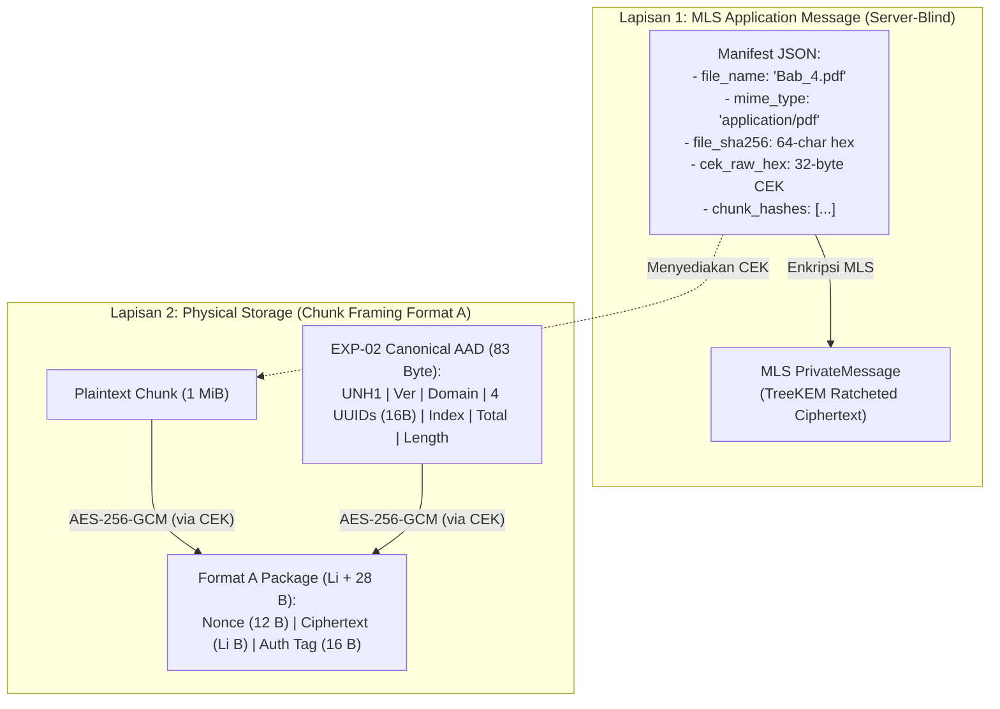
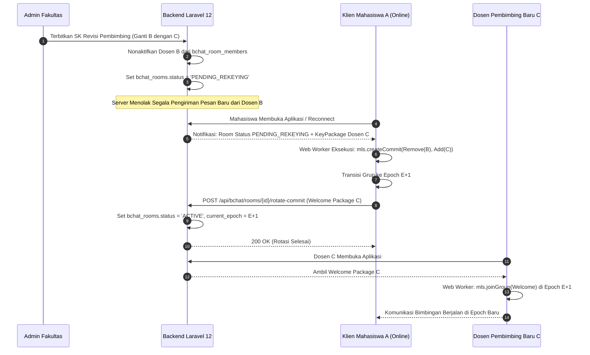

# B-CHAT-11A — AUDIT KOREKSI SPESIFIKASI INTEGRASI E2EE
## AUDIT KRITIS, ANALISIS DISKREPANSI, DAN USULAN KOREKSI TERHADAP DOKUMEN B-CHAT-11
### SISTEM INFORMASI MANAJEMEN SKRIPSI UNIVERSITAS NAHDLATUL ULAMA CIBITUNG (UNUHA)

**Status Dokumen:** DOKUMEN AUDIT KOREKSI RESMI (GERBANG SPESIFIKASI)  
**Dokumen yang Diaudit:** [`B-CHAT-11_Spesifikasi_Integrasi_E2EE.md`](file:///d:/Aplikasi/laragon/www/sistem_manajamen_skripsi/B-CHAT-11_Spesifikasi_Integrasi_E2EE.md)  
**Dokumen Referensi:** B-CHAT-01, B-CHAT-04, B-CHAT-05, B-CHAT-08A.5, B-CHAT-08D.2, B-CHAT-09, B-CHAT-10 Tahap 1G, EXP-02, OD-17.  
**Mode Operasi:** `STRICTLY READ-ONLY — AUDIT DAN USULAN KOREKSI — ZERO IMPLEMENTATION MUTATION`  
**Tanggal Penerbitan:** 6 November 2026  

---

> [!IMPORTANT]
> **BATASAN OPERASIONAL AUDIT B-CHAT-11A:**  
> 1. Dokumen ini adalah **AUDIT TERARAH DAN USULAN KOREKSI** terhadap dokumen B-CHAT-11.
> 2. Dokumen B-CHAT-11 **TIDAK DIUBAH ATAU DITIMPA SECARA LANGSUNG** pada tahapan ini.
> 3. Dilarang keras melakukan implementasi, penulisan kode sumber, pembuatan migrasi, instalasi dependensi, atau mutasi basis data pada basis kode Laravel 12 (`manajemen_skripsi/`) maupun Next.js 14 (`frontend_manajemen_skripsi/`).
> 4. Seluruh diskrepansi, kelemahan konseptual, dan ketidakpastian teknis diklasifikasikan secara transparan menggunakan status baku: `PASS`, `CORRECTION REQUIRED`, `PARTIAL`, `UNVERIFIED`, dan `OPEN`.

---

## 1. RINGKASAN EKSEKUTIF

Audit teknis B-CHAT-11A dilakukan secara mendalam untuk menyaring, mengoreksi, dan menyempurnakan dokumen spesifikasi integrasi [B-CHAT-11](file:///d:/Aplikasi/laragon/www/sistem_manajamen_skripsi/B-CHAT-11_Spesifikasi_Integrasi_E2EE.md) sebelum dokumen tersebut dijadikan rujukan implementasi bertahap.

Meskipun B-CHAT-11 telah berhasil meletakkan fondasi arsitektur yang komprehensif, audit menemukan sejumlah kelemahan konseptual kritis, asumsi prematur, dan diskrepansi teknis pada tujuh area inti:
1. **Penyimpanan Draf Lokal (Kelemahan Kritis - CORRECTION REQUIRED):** Penggunaan token sesi Sanctum/cookie sebagai sumber derivasi kunci draf lokal bertentangan dengan sifat cookie Sanctum yang `HttpOnly`, merusak kemampuan pemulihan draf offline saat sesi kedaluwarsa, dan mengaburkan batas antara penyimpanan lokal terproteksi dengan sinkronisasi server.
2. **Retensi Kunci Epoch MLS (Asumsi Prematur - CORRECTION REQUIRED & OPEN):** Penetapan sepihak nilai `retainKeysForEpochs: 1` tanpa pengujian empiris lalu lintas jaringan riil berisiko tinggi memicu pembuangan pesan sah (*legitimate message drop*) akibat jitter jaringan atau pesan tiba di luar urutan (*out-of-order packets*).
3. **Sequence Monotonik Pesan (Klaim Berlebihan - CORRECTION REQUIRED):** Klaim penomoran sequence yang "gapless" tidak realistis pada basis data relasional (MySQL 8 InnoDB) yang rentan terhadap rollback transaksi, deadlock, dan kegagalan jaringan.
4. **Identitas MLS dan CA Laravel (Ambiguitas Kredensial - CORRECTION REQUIRED):** Asumsi bahwa wireformat JSON custom otomatis kompatibel dengan mekanisme otentikasi kredensial MLS RFC 9420 mengabaikan struktur baku `BasicCredential` dan ketiadaan spesifikasi pengelolaan kunci privat CA di host Laravel.
5. **Manifest Lampiran dan Binding CEK (Klarifikasi Dua Lapisan - PARTIAL & OPEN):** Perlu penegasan pemisahan mutlak antara Lapisan 1 (Manifest E2EE terenkripsi di dalam pesan MLS) dan Lapisan 2 (Framing biner Format A dengan AAD 83-byte EXP-02 pada chunk storage).
6. **Pergantian Dosen Pembimbing (Ketergantungan Klien Online - CORRECTION REQUIRED):** Menemukan paradoks bahwa server *server-blind* tidak dapat mengeksekusi re-keying atau transisi epoch TreeKEM saat Admin mengubah SK jika mahasiswa sedang offline, sehingga memerlukan perancangan *state machine* transisi `PENDING_REKEYING`.
7. **Pemulihan Perangkat dan Akun (Pemisahan Tanggung Jawab - CORRECTION REQUIRED):** Menegaskan pemisahan tegas antara pemulihan akun akademik (via Sanctum) dan pemulihan riwayat pesan terenkripsi masa lalu yang tidak dapat dipulihkan oleh server tanpa backup kunci lokal.

---

## 2. MATRIKS TUJUH AREA AUDIT

| Area Audit | Fokus Pemeriksaan | Status Audit | Kebutuhan Tindak Lanjut |
| :---: | :--- | :---: | :--- |
| **Audit A** | **Penyimpanan & Pemulihan Draf Lokal** | **`CORRECTION REQUIRED`** | Ganti derivasi sesi Sanctum dengan IndexedDB CryptoKey non-extractable terisolasi per `[user_id, room_uuid]`. |
| **Audit B** | **Retensi Kunci Epoch MLS** | **`OPEN`** | Batalkan penetapan prematur `retainKeysForEpochs: 1`; kembalikan ke status `OPEN` hingga uji jitter jaringan selesai. |
| **Audit C** | **Sequence Monotonik & Transaksi InnoDB** | **`CORRECTION REQUIRED`** | Hapus klaim "gapless"; terapkan jaminan *Strictly Monotonically Increasing* dengan penanganan deadlock retry. |
| **Audit D** | **Identitas MLS & CA Ed25519 Laravel** | **`CORRECTION REQUIRED`** | Selaraskan format JSON dengan RFC 9420 BasicCredential; spesifikasikan manajemen kunci privat CA (0600) & rotasi. |
| **Audit E** | **Manifest Attachment & Binding CEK** | **`PARTIAL`** | Tegaskan arsitektur dua lapisan: Manifest di dalam payload MLS, chunking biner terikat AAD 83-byte EXP-02. |
| **Audit F** | **Alur Pergantian Dosen Pembimbing** | **`CORRECTION REQUIRED`** | Definisikan status `PENDING_REKEYING` untuk menangani kondisi mahasiswa offline saat SK pembimbing berganti. |
| **Audit G** | **Pemulihan Perangkat & Akun** | **`CORRECTION REQUIRED`** | Pisahkan pemulihan akun dari pemulihan riwayat E2EE; rancang protokol pendaftaran perangkat baru & re-keying. |

---

## 3. TEMUAN DAN BUKTI MENDALAM (AUDIT A s.d G)

### 3.1. Audit A — Penyimpanan dan Pemulihan Draf Lokal

#### Temuan Masalah pada B-CHAT-11 (Bagian 8.2):
Dokumen B-CHAT-11 Bagian 8.2 menyatakan:
> *"Kunci enkripsi draf diturunkan dari sesi Sanctum aktif via HKDF (`SubtleCrypto.deriveKey`), sehingga saat pengguna logout atau sesi berakhir, draf terenkripsi tidak lagi dapat didekripsi."*

#### Analisis Dampak Teknis & Bukti Diskrepansi:
1. **Aksesibilitas Cookie Sanctum SPA:**  
   Backend Laravel pada repositori ini menggunakan otentikasi Sanctum berbasis cookie sesi (`laravel_session` dan `XSRF-TOKEN`). Cookie sesi `laravel_session` memiliki atribut `HttpOnly`, yang secara sengaja dirancang oleh browser agar **TIDAK DAPAT DIAKSES** oleh skrip JavaScript sisi klien (`document.cookie`). Upaya menurunkan kunci draf dari sesi Sanctum via Web Cryptography API di frontend Next.js secara teknis **MUSTAHIL DILAKUKAN** tanpa membocorkan token ke JavaScript.
2. **Kehilangan Draf Saat Sesi Kedaluwarsa / Offline:**  
   Persyaratan bisnis B-CHAT menetapkan bahwa draf harus bertahan saat browser ditutup atau koneksi terputus. Jika kunci draf diikat pada sesi server, maka ketika sesi login kedaluwarsa (misal saat mahasiswa mengetik draf skripsi panjang secara offline), draf lokal akan terkunci permanen dan tidak dapat didekripsi saat koneksi kembali.
3. **Pemisahan Konsep Autosave vs Sinkronisasi Server:**  
   Autosave lokal harus sepenuhnya terpisah dari siklus hidup otentikasi server. Draf lokal **DILARANG KERAS** dikirimkan ke server secara otomatis.

#### Usulan Koreksi Konseptual:
- **Penyimpanan Kunci Lokal Non-Extractable:**  
  Klien membangkitkan `CryptoKey` simetris AES-GCM 256-bit lokal dengan parameter `extractable: false`:
  ```javascript
  const localDraftKey = await crypto.subtle.generateKey(
    { name: 'AES-GCM', length: 256 },
    false, // Non-extractable: raw key bytes tidak dapat diekstrak oleh script/XSS
    ['encrypt', 'decrypt']
  );
  ```
  Kunci ini disimpan langsung di IndexedDB terdedikasi (`bchat_keystore`) pada object store `device_keystore`.
- **Pemisahan Namespace Akun & Room:**  
  Kunci entri draf di IndexedDB menggunakan compound index: `[user_id, room_uuid]`. Jika mahasiswa A logout dan mahasiswa B login di komputer laboratorium yang sama, kueri hanya memfilter `user_id` milik mahasiswa B. Draf milik mahasiswa A tetap tersimpan terisolasi dan tidak terlihat oleh mahasiswa B.
- **Siklus Hidup Pembersihan Draf:**  
  Draf dihapus dari IndexedDB hanya pada dua kondisi sadar:
  1. Pengguna menekan tombol "Kirim" dan pesan berhasil diproses oleh Web Worker.
  2. Pengguna menekan tombol "Hapus Draf / Batalkan".
- **Penanganan Kegagalan & XSS:**  
  Jika terjadi korupsi penyimpanan lokal, antarmuka menyediakan konfirmasi pembersihan draf rusak tanpa mengganggu keystore MLS utama. Proteksi terhadap XSS ditegakkan melalui Content Security Policy (CSP) tanpa `unsafe-eval` dan sanitasi DOMPurify.

---

### 3.2. Audit B — Retensi Kunci Epoch MLS (`retainKeysForEpochs`)

#### Temuan Masalah pada B-CHAT-11 (Bagian 4.5 & Bagian 11.1):
Dokumen B-CHAT-11 Bagian 4.5 menetapkan konfigurasi sepihak:
> *"spesifikasi ini memperketat konfigurasi retensi: `retainKeysForEpochs: 1`"*

#### Analisis Dampak Teknis & Bukti Diskrepansi:
1. **Penetapan Prematur Tanpa Validasi Jaringan:**  
   Audit Tahap 1G Bagian 7.3 mencatat bahwa nilai bawaan `ts-mls` adalah `retainKeysForEpochs: 4`. Memotong nilai ini menjadi 1 tanpa pengujian jaringan riil merupakan langkah prematur.
2. **Risiko Pembuangan Pesan Sah (*Legitimate Message Drop*):**  
   Dalam protokol MLS RFC 9420 §7.7, pesan aplikasi yang dikirimkan pada Epoch $E$ dapat tiba di penerima setelah penerima memproses paket Commit yang memajukan grup ke Epoch $E+1$ (akibat latensi jaringan seluler atau konkurensi). Jika `retainKeysForEpochs` bernilai 1, maka ketika grup berpindah lagi ke Epoch $E+2$, pesan yang tertinggal dari Epoch $E$ akan ditolak mentah-mentah dengan error `"Cannot process message, epoch too old"`.
3. **Pembedaan Konseptual Replay vs Retensi Epoch:**  
   Pencegahan serangan *replay* pada `ts-mls` ditegakkan oleh **Generation Ratchet** di dalam epoch terkait (`Desired gen in the past`). Nilai `retainKeysForEpochs` mengatur seberapa jauh ke belakang node kunci epoch disimpan untuk mendekripsi pesan yang tertunda secara sah, **bukan untuk mencegah replay pesan yang sudah pernah didekripsi**.

#### Usulan Koreksi Konseptual:
- Status `retainKeysForEpochs` **DIKEMBALIKAN SECARA RESMI KE STATUS `OPEN`**.
- Spesifikasi B-CHAT-11 tidak boleh mengunci angka `1` sebagai standar final produksi. Nilai bawaan (antara 2 hingga 4) harus dievaluasi secara empiris pada pengujian jaringan berlatensi tinggi pada Fase 2 implementasi.
- Dokumen wajib membedakan secara tegas definisi:
  - *Key Retention Policy*: Toleransi penerimaan pesan out-of-order lintas-epoch.
  - *Replay Protection*: Penolakan pesan yang sudah dikonsumsi via ratchet generasi.
  - *Forward Secrecy*: Perlindungan percakapan masa lalu terhadap kebocoran kunci saat ini.
  - *Post-Compromise Security (PCS)*: Pemulihan kerahasiaan masa depan via Key Update Commit.

---

### 3.3. Audit C — Sequence Monotonik dan Transaksi Pesan (`server_sequence`)

#### Temuan Masalah pada B-CHAT-11 (Bagian 5.2):
Dokumen B-CHAT-11 Bagian 5.2 menyatakan:
> *"Jaminan urutan monotonik naik tanpa celah (gapless monotonic per room)."*

#### Analisis Dampak Teknis & Bukti Diskrepansi:
1. **Kemustahilan Jaminan *Gapless* pada Basis Data ACID:**  
   Dalam MySQL 8 InnoDB, jika sebuah transaksi mengunci baris room dengan `SELECT ... FOR UPDATE`, menaikkan counter `current_sequence = current_sequence + 1`, lalu melakukan operasi `INSERT` ke tabel `bchat_messages`, tetapi kemudian transaksi mengalami kegagalan (misalnya: koneksi jaringan putus di tengah jalan, disk storage penuh, atau pelanggaran foreign key) sehingga terjadi `ROLLBACK`, maka sequence tersebut dapat hilang atau memicu inkonsistensi jika counter telah dialokasikan.
2. **Bahaya Desinkronisasi Klien:**  
   Jika klien mengasumsikan urutan *gapless* ketat ($1, 2, 3, 4, 5$), maka ketika terjadi celah (misal pesan urutan 2 di-rollback sehingga urutan menjadi $1, 3, 4$), klien penerima akan mengira bahwa pesan 2 hilang di jaringan dan terus-menerus mengirimkan permintaan re-sinkronisasi ke server (*infinite sync loop*).
3. **Risiko Deadlock pada Konkurensi Tinggi:**  
   Penguncian baris room via `FOR UPDATE` saat Mahasiswa dan Dosen mengirim pesan secara bersamaan dapat memicu deadlock InnoDB (`MySQL Error 1213: Deadlock found when trying to get lock`).

#### Usulan Koreksi Konseptual:
- Ubah jaminan sequence dari *Gapless Monotonic* menjadi:  
  **Strictly Monotonically Increasing per Room ($S_{i+1} > S_i$, dengan toleransi celah non-kritis akibat rollback transaksi gagal)**.
- **Mekanisme Penanganan Deadlock & Retry Transaksional di Laravel:**
  ```php
  // Transaksi Aman Deadlock dengan Retry Otomatis
  return DB::transaction(function () use ($roomId, $messageData) {
      // 1. Kunci baris room secara eksklusif
      $room = BChatRoom::where('id', $roomId)->lockForUpdate()->firstOrFail();
      
      // 2. Alokasikan sequence berikutnya
      $nextSequence = $room->current_sequence + 1;
      $room->current_sequence = $nextSequence;
      $room->save();

      // 3. Simpan pesan dengan sequence teralokasi
      return BChatMessage::create([
          'room_id' => $roomId,
          'server_sequence' => $nextSequence,
          // ... field lainnya
      ]);
  }, 3); // 3x percobaan retry otomatis jika terjadi InnoDB Deadlock
  ```
- **Pemeriksaan Idempotensi Pra-Locking:**  
  Server memeriksa keunikan `message_uuid` dan kesesuaian `payload_hash_sha256` **sebelum** mengambil lock `FOR UPDATE` untuk meminimalkan durasi penguncian baris.

---

### 3.4. Audit D — Identitas MLS dan CA Ed25519 Laravel

#### Temuan Masalah pada B-CHAT-11 (Bagian 3.4):
B-CHAT-11 memodelkan penandatanganan kredensial akademik oleh backend Laravel, tetapi menyamakan payload JSON custom dengan sertifikat resmi tanpa merinci keselarasan dengan RFC 9420 atau pengelolaan kunci CA.

#### Analisis Dampak Teknis & Bukti Diskrepansi:
1. **Struktur Kredensial RFC 9420 pada `ts-mls`:**  
   RFC 9420 Bagian 5.2 mendefinisikan tipe kredensial: `Basic` (ID 1) dan `X509` (ID 2). `ts-mls` v1.6.4 mengimplementasikan `BasicCredential` di mana field `identity` adalah buffer biner `Uint8Array`.
2. **Ketiadaan Spesifikasi Pengelolaan Kunci Privat CA:**  
   B-CHAT-11 belum menetapkan bagaimana kunci privat CA disimpan pada host server Laravel, bagaimana izin akses berkas diatur, serta bagaimana prosedur rotasi dilakukan jika kunci CA bocor.

#### Usulan Koreksi Konseptual:
- **Standarisasi Kredensial MLS:**  
  Gunakan `credentialType: 'basic'` dengan muatan `identity` berupa representasi biner kanonis (atau string JSON terkompresi) yang diverifikasi oleh `authService.validateCredential`.
- **Pengelolaan Kunci Privat Otoritas CA UNUHA:**
  - Kunci privat CA disimpan di path terisolasi: `storage/app/secure/ca/unuha_bchat_ca_ed25519.key`.
  - Izin akses filesystem dikunci ke `chmod 0600` (hanya dapat dibaca oleh user proses PHP-FPM / CLI server).
  - Dilarang keras menaruh kunci privat CA pada file `.env` atau commit repository Git.
- **Prosedur Pemulihan Kebocoran Kunci CA (*CA Compromise Recovery*):**  
  Jika kunci CA terkompromi:
  1. Administrator menerbitkan kunci CA baru dengan versi inkremental (`ca_version: 2`).
  2. Kunci publik baru didistribusikan ke klien Next.js via endpoint konfigurasi terverifikasi.
  3. Kunci lama dicatat pada daftar pencabutan darurat.
  4. Seluruh ruang obrolan diwajibkan melakukan *re-keying / credential refresh* pada siklus epoch berikutnya.

---

### 3.5. Audit E — Manifest Attachment dan Binding CEK

#### Temuan Masalah pada B-CHAT-11 (Bagian 6.3 & Bagian 6.4):
B-CHAT-11 telah mencantumkan AAD 83-byte EXP-02, tetapi belum merinci pemisahan arsitektur antara metadata manifest di dalam MLS dengan framing biner potongan chunk pada penyimpanan fisik.

#### Analisis Dampak Teknis & Bukti Diskrepansi:
Perlu penegasan tegas bahwa pengikatan kriptografis terjadi pada **dua lapisan berbeda yang saling mengunci**:
1. **Lapisan 1 (Manifest E2EE di dalam MLS Application Message):**  
   Membawa informasi rahasia yang server tidak boleh tahu: nama berkas asli, tipe MIME asli, hash SHA-256 berkas utuh, dan kunci simetris CEK 256-bit.
2. **Lapisan 2 (Framing Chunk Biner di Filesystem Privat Server):**  
   Setiap potongan chunk 1 MiB dienkripsi menggunakan CEK dengan AAD kanonis 83-byte EXP-02 yang mengikat `room_uuid`, `message_uuid`, `attachment_uuid`, `upload_session_id`, `chunk_index`, `total_chunks`, dan `plaintext_length`.



#### Usulan Koreksi Konseptual:
- Dokumentasikan arsitektur dua lapisan ini secara eksplisit pada Bagian 6 B-CHAT-11.
- Pertahankan status integrasi EXP-02 dengan MLS sebagai: **`OPEN (Desain Konseptual Disetujui, Validasi Implementasi Bersyarat)`**.

---

### 3.6. Audit F — Pergantian Dosen Pembimbing (Prosedur Rotasi TreeKEM)

#### Temuan Masalah pada B-CHAT-11 (Bagian 3.7):
B-CHAT-11 mengasumsikan pergantian dosen pembimbing dapat langsung dieksekusi secara instan di dalam grup MLS.

#### Analisis Dampak Teknis & Bukti Diskrepansi:
1. **Paradoks Server-Blindness:**  
   Backend Laravel tidak memegang kunci grup MLS. Ketika Admin Fakultas memperbarui SK pembimbing di sistem akademik (mengganti Dosen Pembimbing B dengan Dosen Pembimbing C), **server tidak dapat memajukan epoch TreeKEM atau membuat paket Welcome untuk Dosen C**.
2. **Ketergantungan Sisi Klien Mahasiswa:**  
   Dalam ruang pairwise (2 anggota: Mahasiswa A dan Dosen B), satu-satunya entitas yang memiliki hak dan kunci untuk mencabut Dosen B dan menambahkan Dosen C adalah **Mahasiswa A**. Jika Mahasiswa A sedang tidak aktif (offline), grup MLS belum dapat bertransisi ke Epoch baru.

#### Usulan Koreksi Konseptual:
Rancang **State Machine Transisi Rotasi Pembimbing Berpasangan**:



- **Penebalan Batas Ruang Pairwise:**  
  Tegaskan secara eksplisit bahwa rotasi pembimbing pada Room 1 (Pembimbing Utama) **SAMA SEKALI TIDAK BERDAMPAK** pada keanggotaan, state, atau riwayat pesan pada Room 2 (Pembimbing Pendamping).

---

### 3.7. Audit G — Pemulihan Perangkat dan Akun (*Device & Account Recovery*)

#### Temuan Masalah pada B-CHAT-11 (Bagian 4.6 & Bagian 11.1):
B-CHAT-11 menetapkan disiplin *Single Active Device per User*, namun belum mendefinisikan apa yang terjadi ketika perangkat fisik pengguna hilang, dicuri, rusak, atau browser storage dibersihkan.

#### Analisis Dampak Teknis & Bukti Diskrepansi:
1. **Ketidakmungkinan Pemulihan Riwayat oleh Server:**  
   Karena prinsip *Server-Blind Plaintext Access*, server tidak memiliki kunci privat TreeKEM klien. Jika IndexedDB klien terhapus (misal clear cache atau laptop hilang), server **TIDAK BISA MEMULIHKAN KUNCI ENKRIPSI PESAN MASA LALU**.
2. **Pemisahan Konseptual yang Mutlak:**  
   B-CHAT-11 harus membedakan secara tegas antara:
   - **Pemulihan Akun Akademik (*Account Access Recovery*):** Berhasil login kembali ke SIM Skripsi menggunakan kredensial akun / SSO.
   - **Pemulihan Riwayat Pesan E2EE (*Historical Plaintext Recovery*):** Membaca kembali pesan-pesan terenkripsi lama.

#### Usulan Koreksi Konseptual:
- **Protokol Pendaftaran Perangkat Baru & Reinitialisasi Room:**
  1. Pengguna login di perangkat baru via otentikasi Sanctum.
  2. Perangkat baru membangkitkan pasangan kunci MLS baru dan mengunggah KeyPackage baru yang ditandatangani CA.
  3. Sesi perangkat lama dicabut di server (`is_active = false`).
  4. Karena perangkat baru tidak memegang kunci privat epoch masa lalu, pesan-pesan lama diberi label visual pada antarmuka:  
     `"Pesan terenkripsi dengan kunci perangkat sebelumnya (Tidak dapat didekripsi pada perangkat ini)"`.
  5. Untuk melanjutkan percakapan ke depan, ruang obrolan melakukan inisialisasi ulang keanggotaan (*Re-keying / Re-initialization*) agar pesan-pesan baru di masa depan terenkripsi dengan kunci perangkat baru.
  6. Dokumen mencatat opsi lanjutan di masa depan: penyediaan mekanisme *Encrypted Cloud Keystore Backup* yang dilindungi kata sandi pemulihan (*Recovery Passphrase*) pengguna (berstatus `OPEN`).

---

## 4. USULAN KOREKSI SPESIFIKASI B-CHAT-11

Berdasarkan hasil audit di atas, diusulkan revisi resmi pada draf B-CHAT-11 mendatang:

| Bagian B-CHAT-11 | Klausul Saat Ini | Usulan Teks Koreksi Baru | Alasan Perubahan |
| :--- | :--- | :--- | :--- |
| **Bagian 3.4** *(Identitas & CA)* | Penandatanganan kredensial JSON tanpa rincian spesifikasi kunci CA. | Menetapkan kunci privat CA disimpan di `storage/app/secure/ca/` dengan `chmod 0600`, dan menetapkan prosedur pemulihan kebocoran CA. | Mencegah pembobolan kunci CA dan menjamin kepatuhan RFC 9420 BasicCredential. |
| **Bagian 3.7** *(Rotasi Pembimbing)* | Mahasiswa diasumsikan langsung mengeksekusi commit rotasi seketika. | Menambahkan status transisi `PENDING_REKEYING` untuk mengakomodasi jeda waktu saat mahasiswa sedang offline ketika SK terbit. | Menghormati batasan server-blindness; server tidak bisa mengeksekusi commit TreeKEM sendiri. |
| **Bagian 4.5** *(Retensi Kunci)* | Ditetapkan bernilai 1 epoch (`retainKeysForEpochs: 1`). | Mengembalikan status retensi epoch ke **`OPEN`** dan mempertahankan nilai bawaan aman (2 s.d 4) hingga uji jitter selesai. | Mencegah *legitimate message drop* akibat latensi seluler atau paket out-of-order RFC 9420 §7.7. |
| **Bagian 4.6** *(Perangkat Aktif)* | Disiplin perangkat tunggal tanpa rincian pemulihan kunci. | Memisahkan *Account Recovery* dari *E2EE Historical Plaintext Recovery*, serta merinci protokol re-keying perangkat baru. | Kejujuran ilmiah bahwa server tidak bisa memulihkan kunci privat klien yang hilang di IndexedDB. |
| **Bagian 5.2** *(Sequence Monotonik)* | Mengklaim jaminan "gapless monotonic per room". | Mengubah jaminan menjadi **Strictly Monotonically Increasing per Room** dengan toleransi celah non-kritis pasca-rollback. | Mencegah infinite sync loop pada klien saat transaksi InnoDB mengalami rollback atau retry. |
| **Bagian 6.3 & 6.4** *(Manifest & CEK)* | Penggabungan deskripsi manifest dan framing chunk. | Menegaskan pemisahan **Lapisan 1** (Manifest E2EE di dalam MLS) dan **Lapisan 2** (Framing biner 83-byte EXP-02 di storage). | Menjamin kepatuhan penuh terhadap standar AAD kanonis EXP-02 tanpa modifikasi format. |
| **Bagian 8.2** *(Draf Lokal)* | Kunci draf diturunkan dari sesi Sanctum via HKDF. | Menggunakan **CryptoKey AES-GCM non-extractable** di IndexedDB lokal terisolasi per `[user_id, room_uuid]`. | Sanctum session cookie bersifat `HttpOnly` (tidak bisa dibaca JS); draf harus tetap bisa didekripsi offline. |

---

## 5. KEPUTUSAN YANG SUDAH DISEPAKATI DAN TIDAK BOLEH BERUBAH

Audit B-CHAT-11A secara mutlak mempertahankan keputusan arsitektural yang telah disetujui sebelumnya:
1. **Prinsip Server-Blind Plaintext Access:** Server backend, Reverb, dan database tidak pernah memiliki akses terhadap plaintext pesan maupun kunci simetris CEK (`SUDAH DISETUJUI`).
2. **Kardinalitas Pairwise Room:** Tahap proposal 1 room (1 pembimbing); Tahap skripsi 2 room terpisah (2 pembimbing). Perubahan pada satu room tidak boleh berdampak pada room lain (`SUDAH DISETUJUI`).
3. **Prasyarat SK Pembimbing yang Sah:** Ruang obrolan bimbingan tidak boleh aktif tanpa adanya penetapan SK resmi yang sah dari Kaprodi dan Dekan (`SUDAH DISETUJUI`).
4. **Format AAD Kanonis EXP-02 Tepat 83 Byte:** Format biner 83-byte persis dengan header `UNH1` dan parameter big-endian tidak boleh diubah atau diganti format string (`SUDAH DISETUJUI`).
5. **Parameter Kuota Berkas Lampiran:** Maksimal 10 MiB per berkas, maksimal 5 berkas per pesan, total maksimal 25 MiB per pesan, potongan chunk 1 MiB, dan batas retry I/O $K_{\text{io\_retry}} = 1$ (`SUDAH DISETUJUI`).
6. **Penyimpanan Draf Eksklusif di Klien:** Draf pesan disimpan secara lokal dan dilarang dikirimkan ke server sebelum tombol kirim ditekan secara sadar (`SUDAH DISETUJUI`).
7. **Status Keputusan OD-17:** Status distribusi kunci lampiran ditegaskan tetap: **`KANDIDAT UTAMA EVALUASI DISETUJUI — PEMENANG FINAL BELUM DIPUTUSKAN`** (Pendekatan B kandidat utama evaluasi, Pendekatan A pembanding resmi).

---

## 6. REKONSILIASI OPEN ITEMS & BATASAN TEKNIS

Seluruh item terbuka diperbarui statusnya berdasarkan temuan audit B-CHAT-11A:

| Kode Item | Deskripsi Kebutuhan Teknis | Status Audit B-CHAT-11A | Rencana Penyelesaian |
| :---: | :--- | :---: | :--- |
| **OPEN-01** | Integrasi AAD 83-Byte EXP-02 dengan MLS | **`OPEN`** | Wajib divalidasi pada **Fase 4** melalui porting modul [`aad.js`](file:///d:/Aplikasi/laragon/www/sistem_manajamen_skripsi/scratch/bchat_prototype/exp02_chunking_aad/aad.js) ke Web Worker. |
| **OPEN-02** | Implementasi CA Ed25519 di Backend Laravel | **`OPEN`** | Wajib dirancang dengan izin filesystem `chmod 0600` pada **Fase 1**. |
| **OPEN-03** | Penyetelan Parameter Retensi Kunci (`retainKeysForEpochs`) | **`OPEN`** | Status dipertahankan terbuka; nilai final ditetapkan pasca-uji jitter jaringan pada **Fase 2**. |
| **OPEN-04** | Protokol Sinkronisasi CRL & Batas Toleransi Offline (72 Jam) | **`OPEN`** | Diuji mekanisme fail-secure saat offline melampaui 72 jam pada **Fase 1 & 5**. |
| **OPEN-05** | Keputusan Final OD-17 (Pendekatan B vs Pendekatan A) | **`OPEN`** | Status tetap: `KANDIDAT UTAMA EVALUASI DISETUJUI — PEMENANG FINAL BELUM DIPUTUSKAN`. |
| **OPEN-06** | Interoperabilitas Sekunder OpenMLS-WASM | **`OPEN`** | `ts-mls` v1.6.4 dijadikan kandidat utama homogen; OpenMLS dicatat sebagai evaluasi sekunder. |
| **OPEN-07** | Persistensi State Lengkap MLS via IndexedDB | **`PASS`** | Terbukti pada Tahap 1F menggunakan `decodeGroupState(raw, 0)`. |
| **OPEN-08** | Strategi Pemulihan Perangkat & Akun Baru | **`OPEN`** | Dirancang via protokol re-keying dan pelabelan unreadable history pada **Fase 2**. |
| **OPEN-09** | Kebijakan Retensi Arsip Dokumen Digital Skripsi | **`OPEN`** | Menunggu keputusan resmi universitas / Surat Edaran Rektorat UNUHA. |

---

## 7. URUTAN KOREKSI DOKUMEN B-CHAT-11

Untuk memastikan transisi yang tertib dan terkendali, revisi terhadap dokumen B-CHAT-11 direkomendasikan mengikuti urutan logis:
1. **Langkah 1: Perbaikan Bagian 8.2 (Draf Lokal):** Menghapus klausul derivasi token sesi Sanctum dan menggantinya dengan spesifikasi IndexedDB CryptoKey non-extractable terisolasi.
2. **Langkah 2: Perbaikan Bagian 4.5 & Bagian 11.1 (Retensi Kunci):** Mengoreksi klausul `retainKeysForEpochs` dari nilai final 1 menjadi status `OPEN` dengan penjelasan toleransi jitter RFC 9420 §7.7.
3. **Langkah 3: Perbaikan Bagian 5.2 (Sequence Monotonik):** Menghapus kata "gapless" dan menggantinya dengan jaminan *Strictly Monotonically Increasing* serta menambahkan pola retry deadlock transaksi Laravel.
4. **Langkah 4: Penyempurnaan Bagian 3.4 (CA Signer Laravel):** Menambahkan spesifikasi lokasi penyimpanan kunci privat CA (`0600`) dan prosedur rotasi kunci jika terkompromi.
5. **Langkah 5: Penyempurnaan Bagian 3.7 (Rotasi Pembimbing):** Menyisipkan diagram alur transisi `PENDING_REKEYING` untuk menangani jeda waktu mahasiswa offline.
6. **Langkah 6: Penyempurnaan Bagian 4.6 (Pemulihan Perangkat):** Merinci pemisahan antara pemulihan akun Sanctum dengan pemulihan riwayat percakapan E2EE.
7. **Langkah 7: Penegasan Bagian 6 (Manifest & AAD 83-Byte):** Menyematkan diagram arsitektur dua lapisan (Lapisan 1 MLS Manifest vs Lapisan 2 EXP-02 Framing Chunk).

---

## 8. REKOMENDASI TAHAP BERIKUTNYA

Berdasarkan hasil audit B-CHAT-11A, Antigravity merekomendasikan:

### **PILIHAN TINDAKAN: MELAKUKAN PEMBARUAN TERKONTROL PADA DOKUMEN B-CHAT-11 (B-CHAT-11 REVISI 1)**
Setelah usulan audit B-CHAT-11A ini ditinjau dan disetujui oleh Pemilik Proyek, langkah berikutnya adalah menerbitkan revisi terkontrol pada dokumen utama `B-CHAT-11_Spesifikasi_Integrasi_E2EE.md` untuk mengadopsi ketujuh poin koreksi di atas.

### Kriteria Kesiapan Implementasi:
Implementasi kode sumber (Fase 1) baru boleh dimulai **SETELAH** dokumen B-CHAT-11 selesai direvisi dan disahkan secara formal oleh Pemilik Proyek.

---

## 9. KRITERIA PENUTUPAN MANDAT B-CHAT-11A

Audit B-CHAT-11A dinyatakan selesai secara tuntas dengan bukti:
- Ketujuh area audit telah diperiksa, dianalisis kelemahannya, dan diberikan usulan koreksi yang dapat dipertanggungjawabkan secara ilmiah.
- Dokumen audit `B-CHAT-11A_Audit_Koreksi_Spesifikasi.md` telah berhasil disimpan di root direktori proyek.
- Dokumen utama B-CHAT-11 tidak diubah secara langsung (`zero document mutation on B-CHAT-11`).
- Basis kode aplikasi Laravel 12 dan Next.js 14 terverifikasi steril dari segala perubahan (`git status` bersih terhadap mutasi aplikasi utama).
- Pekerjaan dihentikan dalam mode **`STRICTLY READ-ONLY`** dan diserahkan untuk ditinjau oleh Pemilik Proyek.

```
================================================================================
STATUS DOKUMEN : AUDIT KOREKSI SPESIFIKASI B-CHAT-11A LENGKAP & DISERAHKAN
MODE OPERASI   : STRICTLY READ-ONLY — ZERO CODE EXECUTION — ZERO DB MUTATION
AREA AUDIT     : 7 AREA INTI TELAH DIPERIKSA & DIBERIKAN USULAN KOREKSI
DOKUMEN UTAMA  : B-CHAT-11 TIDAK DIUBAH (MENUNGGU PERSETUJUAN PEMILIK PROYEK)
STATUS IZIN    : AUDIT SAJA. BELUM ADA IZIN IMPLEMENTASI APLIKASI UTAMA.
================================================================================
```

