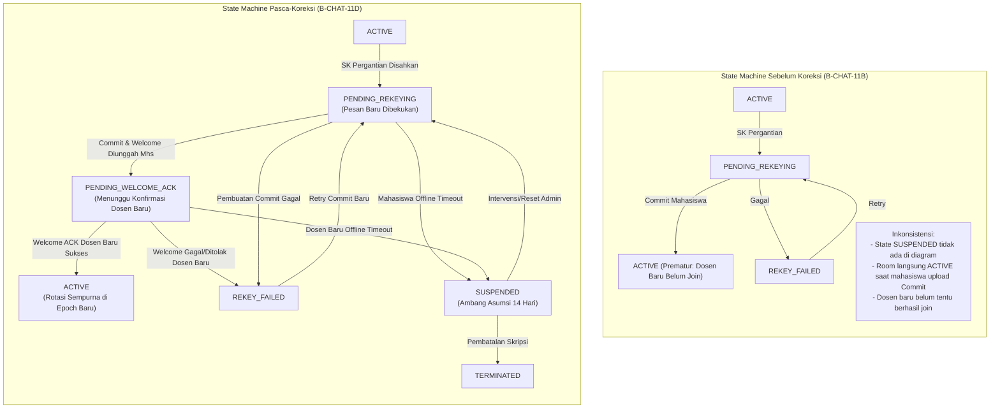
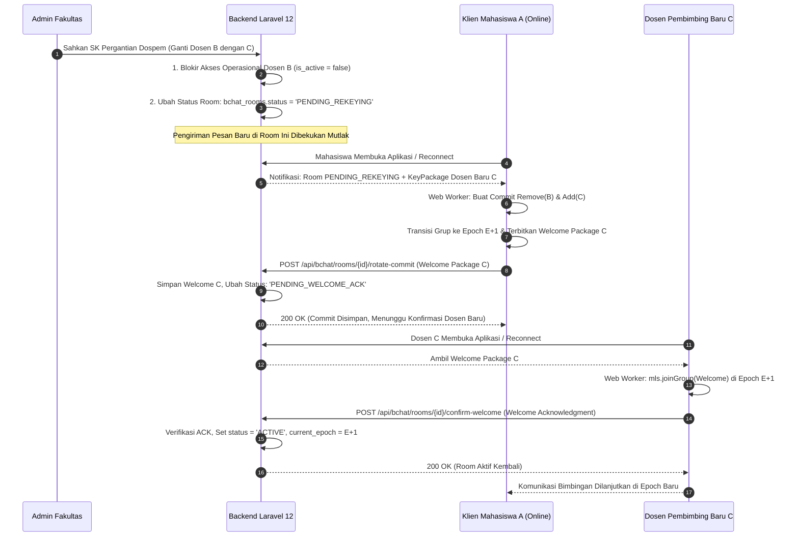

# B-CHAT-11D — LAPORAN FINALISASI MINOR SPESIFIKASI INTEGRASI E2EE
## REKONSILIASI AKHIR DAN PENYELARASAN DOKUMEN SPESIFIKASI INTEGRASI BIMBINGAN ONLINE CHAT
### SISTEM INFORMASI MANAJEMEN SKRIPSI UNIVERSITAS NAHDLATUL ULAMA CIBITUNG (UNUHA)

**Nomor Dokumen:** B-CHAT-11D-REP-01  
**Tanggal Penerbitan:** 6 November 2026  
**Status Dokumen:** FINAL DAN TERVERIFIKASI  
**Mode Operasi:** `DOCUMENT-ONLY — STRICTLY LIMITED — ZERO IMPLEMENTATION MUTATION`  
**Dokumen Terkait:**
1. [`B-CHAT-11_Spesifikasi_Integrasi_E2EE.md`](file:///d:/Aplikasi/laragon/www/sistem_manajamen_skripsi/B-CHAT-11_Spesifikasi_Integrasi_E2EE.md) (Dokumen Spesifikasi Utama yang Telah Difinalisasi)
2. [`B-CHAT-11A_Audit_Koreksi_Spesifikasi.md`](file:///d:/Aplikasi/laragon/www/sistem_manajamen_skripsi/B-CHAT-11A_Audit_Koreksi_Spesifikasi.md) (Dokumen Audit Pendahulu — Utuh)
3. [`B-CHAT-11B_Laporan_Revisi_Spesifikasi.md`](file:///d:/Aplikasi/laragon/www/sistem_manajamen_skripsi/B-CHAT-11B_Laporan_Revisi_Spesifikasi.md) (Dokumen Historis Revisi — Utuh)
4. [`B-CHAT-11C_Audit_Final_Konsistensi.md`](file:///d:/Aplikasi/laragon/www/sistem_manajamen_skripsi/B-CHAT-11C_Audit_Final_Konsistensi.md) (Dokumen Audit Final Acuan — Utuh)

---

## 1. RINGKASAN PERUBAHAN

Laporan ini menandai penyelesaian **Mandat B-CHAT-11D**, yaitu pelaksanaan koreksi minor terarah terhadap dokumen spesifikasi teknis arsitektur [`B-CHAT-11_Spesifikasi_Integrasi_E2EE.md`](file:///d:/Aplikasi/laragon/www/sistem_manajamen_skripsi/B-CHAT-11_Spesifikasi_Integrasi_E2EE.md) berdasarkan hasil temuan independen pada audit [`B-CHAT-11C_Audit_Final_Konsistensi.md`](file:///d:/Aplikasi/laragon/www/sistem_manajamen_skripsi/B-CHAT-11C_Audit_Final_Konsistensi.md).

Tujuan utama dari tahap finalisasi minor ini adalah:
1. Menghilangkan seluruh klaim *overclaim* teknis yang belum terbukti secara penuh (khususnya mengenai persistensi IndexedDB pada OPEN-07).
2. Menyelaraskan model *state machine* pergantian dosen pembimbing antara narasi tekstual, diagram status Mermaid, dan alur protokol sequence diagram, termasuk penegasan status `SUSPENDED` dan kewajiban *Welcome Acknowledgment* dari Dosen Baru sebelum ruang obrolan kembali aktif.
3. Menegaskan batasan antara konstanta teknis bawaan pustaka (*default library implementation constants*) dengan kebijakan keamanan produksi resmi UNUHA.
4. Memastikan tidak ada ambang waktu asumsi (seperti CRL 72 jam dan batas timeout 14 hari) yang diklaim sebagai keputusan final tanpa persetujuan Pemilik Proyek.
5. Menerbitkan *erratum* formal atas kemunculan angka "1.000 generasi" pada laporan historis B-CHAT-11B tanpa mengubah berkas historis tersebut.

Seluruh proses dijalankan dengan kepatuhan mutlak terhadap prinsip **`DOCUMENT-ONLY — STRICTLY LIMITED`**: tidak ada baris kode Laravel, Next.js, basis data MySQL, konfigurasi, dependensi, maupun repositori Git yang disentuh.

---

## 2. DAFTAR BAGIAN B-CHAT-11 YANG DIPERBAIKI

Berikut adalah rincian bagian-bagian dalam dokumen [`B-CHAT-11_Spesifikasi_Integrasi_E2EE.md`](file:///d:/Aplikasi/laragon/www/sistem_manajamen_skripsi/B-CHAT-11_Spesifikasi_Integrasi_E2EE.md) yang telah dikoreksi secara presisi:

| Bagian Dokumen | Judul Bagian | Ringkasan Koreksi yang Diterapkan |
| :---: | :--- | :--- |
| **Metadata** | Header Dokumen (Baris 5 & 16) | Mengubah status dokumen menjadi `DOKUMEN SPESIFIKASI TEKNIS INTEGRASI FINAL (REVISI MINOR B-CHAT-11D)` dan menambahkan rujukan terhadap B-CHAT-11C. |
| **3.5** | Protokol Pencabutan Kredensial (CRL) & Toleransi Offline | Mengubah status heading menjadi **`[OPEN — BELUM DISETUJUI]`**. Menegaskan bahwa ambang 72 jam adalah asumsi perancangan awal (`ASUMSI DESAIN`) dan merupakan jendela kerentanan pencabutan (*revocation exposure delay window*), bukan jaminan keamanan mutlak. |
| **3.6** | Siklus Hidup Ruang Obrolan (*State Machine*) | Memperbarui diagram Mermaid: menyertakan state `SUSPENDED`, status perantara `PENDING_WELCOME_ACK`, transisi timeout mahasiswa/dosen offline, transisi retry `REKEY_FAILED`, dan intervensi Admin. |
| **3.7** | Alur Pergantian Dosen Pembimbing (Rotasi MLS) | Memperbarui sequence diagram dan narasi: menambahkan langkah *Welcome Acknowledgment* oleh Dosen Baru C sebelum status room menjadi `ACTIVE`. Menegaskan pembedaan 3 operasi mutlak (pemblokiran server, penghapusan MLS, dan konfirmasi join). Menegaskan ambang batas 14 hari sebagai `ASUMSI DESAIN / OPEN`. |
| **4.4** | Persistensi State IndexedDB & Hook Rehidrasi | Mengubah status heading menjadi **`[OPEN — MENUNGGU VALIDASI FASE 2]`**. Menegaskan bahwa `decodeGroupState(rawBytes, 0)` hanya membuktikan deserialisasi di memori; persistensi atomik multi-store, mitigasi crash, dan isolasi akun di IndexedDB tetap berstatus **`OPEN`**. |
| **4.5** | Pengelolaan Epoch dan Retensi Kunci | Menjelaskan bahwa nilai default pustaka `ts-mls@1.6.4` (`retainKeysForGenerations: 10`, `maximumForwardRatchetSteps: 200`, `retainKeysForEpochs: 4`) adalah konstanta implementasi internal library, **bukan kebijakan keamanan produksi UNUHA**. Status retensi final tetap **`OPEN — PERLU EKSPERIMEN`**. |
| **4.6** | Pemulihan Perangkat dan Akun | Menyelaraskan heading menjadi **`[ASUMSI DESAIN & KANDIDAT EVALUASI]`** agar konsisten dengan status kebijakan single active device. |
| **7.2** | Definisi Skema Tabel Konseptual `bchat_rooms` | Menambahkan nilai enum `'PENDING_WELCOME_ACK'` pada kolom `status` tabel `bchat_rooms` agar selaras dengan *state machine* Bagian 3.6. |
| **11.1** | Daftar OPEN Items Wajib (OPEN-04 & OPEN-07) | Mengoreksi status **OPEN-04** menjadi **`OPEN — BELUM DISETUJUI`** dan status **OPEN-07** menjadi **`OPEN`** (dicabut dari kategori DISETUJUI). |
| **12** | Kriteria Penutupan Mandat | Memutakhirkan kriteria penutupan untuk Mandat B-CHAT-11D. |

---

## 3. STATUS OPEN-07 SETELAH KOREKSI

Berdasarkan temuan audit B-CHAT-11C Bagian 3.4, klaim sebelumnya yang menandai OPEN-07 sebagai `DISETUJUI` telah dicabut dan dikoreksi:

### A. Status Klasifikasi: **`OPEN — MENUNGGU VALIDASI FASE 2`**

### B. Batasan Bukti dan Justifikasi:
1. **Bukti yang Sah:**  
   Pengujian B-CHAT-10 Tahap 1F membuktikan bahwa pemanggilan `mls.decodeGroupState(stateBytes, 0)` berhasil mendeserialisasi struktur data `GroupState` dari buffer biner ke memori Web Worker tanpa galat offset.
2. **Keterbatasan yang Belum Terbukti:**  
   Keberhasilan deserialisasi di memori **TIDAK SAMA** dengan keandalan persistensi at-rest pada media penyimpanan peramban (IndexedDB). Area teknis berikut belum terbukti dan secara eksplisit tetap berstatus **`OPEN`**:
   - **Persistensi Atomik Multi-Store:** Belum ada mekanisme transaksi atomik terpadu yang menjamin penulisan bersamaan ke store `mls_group_states`, `device_keystore`, dan `drafts` berhasil seluruhnya atau dibatalkan seluruhnya (*all-or-nothing*).
   - **Ketahanan Terhadap Crash:** Perilaku sistem saat peramban crash mendadak atau perangkat restart di tengah operasi penulisan IndexedDB belum diuji dan berisiko menghasilkan *partial write* (buffer terpotong).
   - **Penanganan Korupsi Buffer:** Pustaka `ts-mls` tidak memiliki mekanisme auto-repair untuk buffer biner yang rusak/terpotong, yang akan memicu eksepsi fatal saat deserialisasi.
   - **Konsistensi State MLS vs Data Pesan:** Protokol rekonsiliasi jika terjadi desinkronisasi antara counter epoch/sequence MLS dengan riwayat pesan lokal di IndexedDB belum dirancang.
   - **Isolasi Akun pada Perangkat Bersama:** Penggunaan compound index `[user_id, room_uuid]` pada store `mls_group_states` wajib diimplementasikan untuk mencegah kebocoran state antar-pengguna pada komputer laboratorium bersama.

Dengan koreksi ini, **OPEN-07 tidak lagi berada dalam daftar keputusan yang disetujui**, melainkan ditempatkan sebagai deliverable pengujian kritis pada **Fase 2 Implementasi**.

---

## 4. STATE MACHINE SEBELUM DAN SESUDAH KOREKSI

Penyelarasan menyeluruh dilakukan terhadap siklus hidup ruang obrolan (*room lifecycle state machine*) pada Bagian 3.6 dan alur pergantian dosen pembimbing pada Bagian 3.7.

### 4.1. Perbandingan State Machine



### 4.2. Diagram Sequence Alur Rotasi Pembimbing Terkoreksi (Bagian 3.7)



### 4.3. Pembedaan Tiga Domain Operasi Kritis
Koreksi B-CHAT-11D menegaskan pemisahan konseptual tiga tahapan yang tidak boleh disamakan:
1. **Pemblokiran Akses Server (Operasional):**  
   Dijalankan seketika oleh backend pada basis data (`is_active = false`), memutus izin dosen lama pada REST API dan Reverb. Operasi ini **bukan** pencabutan kriptografis.
2. **Penghapusan Anggota MLS (Kriptografis):**  
   Dijalankan oleh klien mahasiswa melalui pembentukan proposal *Remove* dan *Commit TreeKEM*, merotasi path secret dan epoch secret ke $E+1$. Kunci baru ini tidak dapat diakses dosen lama (Forward Secrecy / Post-Compromise Security).
3. **Konfirmasi Keberhasilan Anggota Baru (Welcome Acknowledgment):**  
   Dosen baru memproses paket Welcome, mendekripsi parameter grup, memvalidasi ratchet tree, dan mengirimkan *Welcome Acknowledgment* ke server. Ruang obrolan **dilarang** kembali `ACTIVE` sebelum tahap ketiga ini selesai terverifikasi.

---

## 5. PENEGASAN STATUS ANGKA DAN KEBIJAKAN WAKTU

Untuk mencegah asumsi perancangan awal bermutasi menjadi klaim kebijakan produksi, seluruh parameter waktu dan retensi ditegaskan statusnya secara rigid:

### 5.1. Nilai Bawaan Pustaka Generation Ratchet (`ts-mls@1.6.4`)
- **Fakta Kode Fisik:** Pemeriksaan pada [`keyRetentionConfig.js:2-6`](file:///d:/Aplikasi/laragon/www/sistem_manajamen_skripsi/scratch/bchat_prototype/exp04_mls_comparison/node_modules/ts-mls/dist/src/keyRetentionConfig.js#L2-L6) menunjukkan nilai bawaan implementasi:
  * `retainKeysForGenerations: 10`
  * `maximumForwardRatchetSteps: 200`
  * `retainKeysForEpochs: 4`
- **Penegasan Status:** Nilai 10 dan 200 adalah **konstanta bawaan library pihak ketiga**, **BUKAN kebijakan keamanan produksi UNUHA**.
- **Status Kebijakan:** **`OPEN — PERLU EKSPERIMEN`**. Angka final retensi generasi dan forward step window akan ditentukan setelah pengujian jitter jaringan, pesan tertunda (*out-of-order delivery*), dan ketahanan replay pada Fase 2.

### 5.2. Toleransi Sinkronisasi CRL Offline (72 Jam)
- **Penegasan Status:** **`OPEN — BELUM DISETUJUI`**.
- Angka 72 jam adalah asumsi desain perancang (`ASUMSI DESAIN`) dan belum pernah disahkan melalui Keputusan Rektor / Dekan UNUHA.
- Secara kriptografis, 72 jam adalah *revocation exposure delay window* (jendela potensi risiko kebocoran pesan jika dosen dicabut saat mahasiswa sedang offline), bukan jaminan perlindungan mutlak. Mekanisme *fail-secure* akan diuji pada Fase 1 & Fase 5.

### 5.3. Ambang Timeout Rekeying Mahasiswa Offline (14 Hari)
- **Penegasan Status:** **`ASUMSI DESAIN / OPEN`**.
- Angka 14 hari sebelum room berpindah dari `PENDING_REKEYING` atau `PENDING_WELCOME_ACK` ke status `SUSPENDED` adalah batas toleransi sementara dan belum menjadi regulasi akademik resmi.

---

## 6. ERRATUM ATAS KLAIM 1.000 GENERASI DI LAPORAN B-CHAT-11B

Dokumen laporan historis [`B-CHAT-11B_Laporan_Revisi_Spesifikasi.md`](file:///d:/Aplikasi/laragon/www/sistem_manajamen_skripsi/B-CHAT-11B_Laporan_Revisi_Spesifikasi.md) dipertahankan utuh tanpa modifikasi sesuai aturan integritas audit. Bagian ini menerbitkan **ERRATUM RESMI** terhadap dokumen tersebut:

```
================================================================================
ERRATUM FORMAL TERHADAP DOKUMEN B-CHAT-11B (Nomor Dokumen: B-CHAT-11B-REP-01)
================================================================================
Lokasi Teks      : B-CHAT-11B Bagian 3, Area B, Butir 3 (Baris 66).
Kutipan Teks     : "...dengan batas generasi ratchet tree anti-replay 
                   (maksimal 1.000 generasi) untuk mendeteksi pesan duplikat."

STATUS RALAT     : INVALID / DIBATALKAN (ERRATUM)

KETERANGAN DAN FAKTA AUDIT:
1. Klaim angka "maksimal 1.000 generasi" TIDAK DIDUKUNG oleh bukti fisik sumber 
   kode pustaka ts-mls@1.6.4, standar RFC 9420, maupun dokumen spesifikasi 
   utama B-CHAT-11.
2. Sumber kode fisik ts-mls@1.6.4 (keyRetentionConfig.js) menetapkan nilai 
   default retainKeysForGenerations = 10 dan maximumForwardRatchetSteps = 200.
3. Mengasumsikan batas 1.000 generasi berisiko fatal terhadap pemrosesan pesan 
   tertunda: ts-mls akan melempar ValidationError("Desired generation too far 
   in the future") jika selisih generasi melampaui 200 langkah.
4. Nilai 1.000 generasi DILARANG KERAS dijadikan acuan perancangan atau 
   implementasi. Nilai konfigurasi generasi tetap berstatus OPEN - PERLU EKSPERIMEN 
   menunggu hasil uji empiris Fase 2.
================================================================================
```

---

## 7. MATRIKS KEPUTUSAN ARSITEKTURAL AKHIR

Berikut adalah matriks klasifikasi status keputusan arsitektural proyek pasca-finalisasi minor B-CHAT-11D:

### 7.1. Keputusan yang Telah `DISETUJUI` (Definitif)
1. **Prinsip *Server-Blind Plaintext & Content-Key Access*:** Server tidak pernah mengetahui plaintext pesan, CEK lampiran, kunci privat identitas, maupun rahasia TreeKEM.
2. **Kardinalitas Pairwise 1-on-1 Room:** Tiap mahasiswa memiliki ruang terpisah untuk Dospem 1 dan Dospem 2. Ruang Proposal satu room, Ruang Skripsi dua room independen.
3. **Format AAD Kanonis 83-Byte EXP-02:** Struktur biner Format A ($L_i + 28\text{ B}$) dipertahankan persis 83 byte tanpa perubahan.
4. **Batas Kuota Desimal Lampiran:** Maksimal 10.000.000 byte (~10 MB) per berkas, maksimal 5 berkas, dan total 25.000.000 byte (~25 MB) per pesan bimbingan.
5. **Algoritma Simetris Lampiran:** AES-256-GCM, CEK 256-bit acak CSPRNG, Nonce 96-bit (8B salt + 4B index), Tag 128-bit, potongan chunk 1 MiB ($1.048.576\text{ byte}$).
6. **Alokasi Urutan Monotonik Server Transaksional:** Penomoran sequence *Strictly Monotonically Increasing* ($S_{i+1} > S_i$) per room menggunakan isolasi row `SELECT ... FOR UPDATE` MySQL 8 InnoDB dengan *retry loop* 3x; klaim *gapless* dihapus mutlak.
7. **Pemisahan Draf Lokal vs Outbox:** Draf lokal terenkripsi `CryptoKey` AES-GCM 256-bit non-extractable di IndexedDB dengan compound key `[user_id, room_uuid]` dan tidak pernah dikirim ke server sebelum tombol kirim ditekan.
8. **Infrastruktur Transport:** REST API / MySQL sebagai sumber data persisten dan Laravel Reverb WebSocket untuk pengiriman real-time.

### 7.2. Keputusan Berstatus `KANDIDAT EVALUASI` (Pilihan Utama yang Sedang Diuji)
1. **Pustaka Engine MLS Utama:** `ts-mls` v1.6.4 (kandidat evaluasi utama, bukan library produksi permanen).
2. **Pustaka Engine MLS Pembanding:** OpenMLS-WASM v0.9.2 (kandidat evaluasi cadangan).
3. **Distribusi CEK Lampiran:** OD-17 Pendekatan B (Ephemeral CEK via MLS Application Message) berstatus `KANDIDAT UTAMA EVALUASI DISETUJUI — PEMENANG FINAL BELUM DIPUTUSKAN`.
4. **Distribusi CEK Pembanding:** OD-17 Pendekatan A (MLS Key Exporter) dipertahankan sebagai pembanding resmi.
5. **Kebijakan Perangkat:** Kebijakan Single Active Device per akun.

### 7.3. Keputusan Berstatus `OPEN` (Menunggu Pengujian / Regulasi)
1. **OPEN-01:** Integrasi buffer biner AAD 83-byte EXP-02 dengan pipeline Web Worker `ts-mls` (Fase 4).
2. **OPEN-02:** Implementasi backend Laravel CA Signer Ed25519 dengan hak akses `0600` (Fase 1).
3. **OPEN-03:** Penyetelan nilai konfigurasi retensi kunci epoch (`retainKeysForEpochs`) pasca-uji jitter (Fase 2).
4. **OPEN-04:** Protokol sinkronisasi CRL dan ambang toleransi offline (72 jam) (`OPEN — BELUM DISETUJUI`).
5. **OPEN-05:** Pengesahan pemenang akhir OD-17 (Pendekatan B vs Pendekatan A) pasca-evaluasi Fase 4.
6. **OPEN-06:** Evaluasi translasi wireformat antara Rust OpenMLS dan TypeScript `ts-mls`.
7. **OPEN-07:** Penanganan persistensi atomik multi-store IndexedDB, mitigasi crash, dan isolasi multi-akun (Fase 2).
8. **OPEN-08:** Protokol pendaftaran perangkat baru dan penandaan visual riwayat pesan unreadable (Fase 2).
9. **OPEN-09:** Kebijakan retensi dan pembersihan arsip digital ciphertext dokumen skripsi UNUHA.

---

## 8. PEMERIKSAAN DAN KONFIRMASI INTEGRITAS LINGKUNGAN

Sebagai bentuk pertanggungjawaban teknis atas batasan mandat B-CHAT-11D:
- **Kode Aplikasi (Laravel & Next.js):** Tidak ada modifikasi kode pada berkas di [`manajemen_skripsi/`](file:///d:/Aplikasi/laragon/www/sistem_manajamen_skripsi/manajemen_skripsi/) maupun [`frontend_manajemen_skripsi/`](file:///d:/Aplikasi/laragon/www/sistem_manajamen_skripsi/frontend_manajemen_skripsi/).
- **Basis Data:** Tidak ada file migration atau seeder baru yang dibuat, dan tidak ada query basis data yang dieksekusi.
- **Konfigurasi & Dependensi:** File `package.json`, `composer.json`, `.env`, serta lockfile tidak dimodifikasi.
- **Git Repository:** Tidak ada operasi staging, commit, push, atau checkout.
- **Dokumen Historis:** Berkas [`B-CHAT-11A_Audit_Koreksi_Spesifikasi.md`](file:///d:/Aplikasi/laragon/www/sistem_manajamen_skripsi/B-CHAT-11A_Audit_Koreksi_Spesifikasi.md), [`B-CHAT-11B_Laporan_Revisi_Spesifikasi.md`](file:///d:/Aplikasi/laragon/www/sistem_manajamen_skripsi/B-CHAT-11B_Laporan_Revisi_Spesifikasi.md), dan [`B-CHAT-11C_Audit_Final_Konsistensi.md`](file:///d:/Aplikasi/laragon/www/sistem_manajamen_skripsi/B-CHAT-11C_Audit_Final_Konsistensi.md) dipertahankan 100% utuh tanpa perubahan byte.

---

## 9. STATUS PENUTUPAN MANDAT B-CHAT-11D

Dengan diselesaikannya seluruh koreksi minor pada dokumen spesifikasi utama dan penerbitan laporan pendamping ini, seluruh kewajiban **Mandat B-CHAT-11D** dinyatakan **SELESAI SECARA TUNTAS (COMPLETED)**.

Dokumen [`B-CHAT-11_Spesifikasi_Integrasi_E2EE.md`](file:///d:/Aplikasi/laragon/www/sistem_manajamen_skripsi/B-CHAT-11_Spesifikasi_Integrasi_E2EE.md) kini telah mencapai tingkat kematangan dan konsistensi tertinggi sebagai **SPESIFIKASI ACUAN RESMI PERANCANGAN INTEGRASI**.

Sesuai ketentuan penutup mandat:
> **"STATUS OTORISASI: HANYA REVISI DOKUMEN. TIDAK ADA IZIN IMPLEMENTASI APLIKASI ATAU PERUBAHAN DATABASE. TUNGGU TINJAUAN PEMILIK PROYEK."**

Seluruh aktivitas mandiri dihentikan. Sistem menunggu tinjauan dan arahan resmi dari **Pemilik Proyek** sebelum melangkah ke perencanaan implementasi bertahap (Fase 1).

```
================================================================================
STATUS MANDAT   : SELESAI SECARA TUNTAS (COMPLETED)
DOKUMEN UTAMA   : B-CHAT-11_Spesifikasi_Integrasi_E2EE.md (FINAL B-CHAT-11D)
DOKUMEN LAPORAN : B-CHAT-11D_Laporan_Finalisasi_Spesifikasi.md
MODE OPERASI    : DOCUMENT-ONLY — ZERO IMPLEMENTATION MUTATION
STATUS IZIN     : MENUNGGU PENINJAUAN & KEPUTUSAN RESMI PEMILIK PROYEK
================================================================================
```

