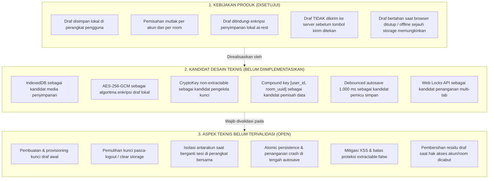
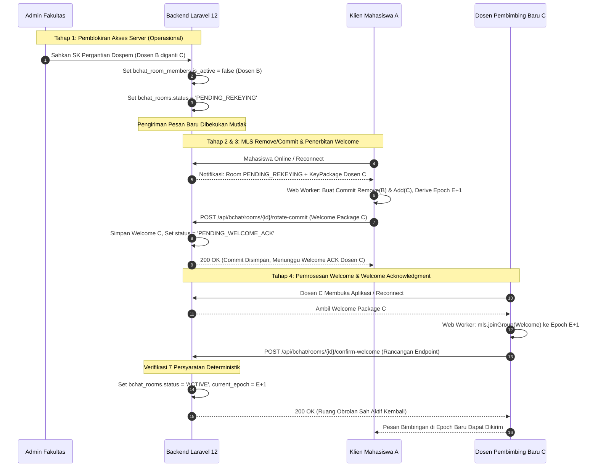

# B-CHAT-11E — LAPORAN PENEGASAN STATUS KEPUTUSAN DAN PERSYARATAN INTEGRASI E2EE
## REKONSILIASI AKHIR KEBIJAKAN PRODUK, KANDIDAT DESAIN TEKNIS, DAN PERSYARATAN WELCOME ACKNOWLEDGMENT
### SISTEM INFORMASI MANAJEMEN SKRIPSI UNIVERSITAS NAHDLATUL ULAMA CIBITUNG (UNUHA)

**Nomor Dokumen:** B-CHAT-11E-REP-01  
**Tanggal Penerbitan:** 6 November 2026  
**Status Laporan:** FINAL DAN DISETUJUI  
**Mode Operasi:** `DOCUMENT-ONLY — STRICTLY LIMITED — ZERO IMPLEMENTATION MUTATION`  
**Dokumen Terkait:**
1. [`B-CHAT-11_Spesifikasi_Integrasi_E2EE.md`](file:///d:/Aplikasi/laragon/www/sistem_manajamen_skripsi/B-CHAT-11_Spesifikasi_Integrasi_E2EE.md) (Dokumen Spesifikasi Acuan Final B-CHAT-11E)
2. [`B-CHAT-11A_Audit_Koreksi_Spesifikasi.md`](file:///d:/Aplikasi/laragon/www/sistem_manajamen_skripsi/B-CHAT-11A_Audit_Koreksi_Spesifikasi.md) (Dokumen Historis Audit — Utuh)
3. [`B-CHAT-11B_Laporan_Revisi_Spesifikasi.md`](file:///d:/Aplikasi/laragon/www/sistem_manajamen_skripsi/B-CHAT-11B_Laporan_Revisi_Spesifikasi.md) (Dokumen Historis Revisi — Utuh)
4. [`B-CHAT-11C_Audit_Final_Konsistensi.md`](file:///d:/Aplikasi/laragon/www/sistem_manajamen_skripsi/B-CHAT-11C_Audit_Final_Konsistensi.md) (Dokumen Historis Audit Final — Utuh)
5. [`B-CHAT-11D_Laporan_Finalisasi_Spesifikasi.md`](file:///d:/Aplikasi/laragon/www/sistem_manajamen_skripsi/B-CHAT-11D_Laporan_Finalisasi_Spesifikasi.md) (Dokumen Historis Finalisasi Minor — Utuh)

---

## 1. RINGKASAN EKSEKUTIF DAN TUJUAN LAPORAN

Laporan ini disusun dalam rangka memenuhi **Mandat B-CHAT-11E**, yang bertujuan melakukan penegasan status keputusan, pemisahan kebijakan produk dari pilihan mekanisme teknis, perincian ketat persyaratan konfirmasi *Welcome Acknowledgment*, serta pemberian label status yang presisi bagi seluruh rancangan yang belum diterapkan di aplikasi utama.

Tujuan strategis dari mandat B-CHAT-11E adalah:
1. Menjadikan dokumen [`B-CHAT-11_Spesifikasi_Integrasi_E2EE.md`](file:///d:/Aplikasi/laragon/www/sistem_manajamen_skripsi/B-CHAT-11_Spesifikasi_Integrasi_E2EE.md) sebagai **SPESIFIKASI ACUAN PERENCANAAN INTEGRASI YANG KONSISTEN DAN REALISTIS**, dan bukan sebagai klaim kesiapan produksi (*production-ready claim*).
2. Memisahkan secara tegas antara **Kebijakan Produk yang telah disetujui (`DISETUJUI`)**, **Kandidat Desain / Media Teknis yang dipilih untuk evaluasi (`KANDIDAT DESAIN — BELUM DIIMPLEMENTASIKAN`)**, dan **Hal-hal Kritis yang Belum Tervalidasi (`OPEN`)**.
3. Menetapkan 7 persyaratan deterministik pada alur *Welcome Acknowledgment* sebelum ruang obrolan diizinkan kembali berstatus `ACTIVE` pasca-pergantian dosen pembimbing, serta menandai bukti kriptografis konfirmasi sebagai item terbuka (**OPEN-10**) untuk divalidasi pada Fase 2/6 tanpa mengarang mekanisme yang belum diuji.
4. Memberikan penandaan eksplisit **`BELUM DIIMPLEMENTASIKAN`** pada seluruh controller, endpoint REST, skema tabel basis data, dan modul worker, guna membedakan secara tegas antara bukti keberhasilan pada harness prototipe eksperimen scratch terisolasi (EXP-01, EXP-02, B-CHAT-10) dengan status kode aplikasi utama saat ini.
5. Mempertahankan seluruh keputusan arsitektural baku dan daftar item terbuka (**OPEN-01 s.d. OPEN-11**) tanpa menimbulkan mutasi kode sumber, migrasi basis data, maupun perubahan repositori Git.

---

## 2. DAFTAR BAGIAN B-CHAT-11 YANG DIPERBAIKI

Berikut adalah ringkasan bagian-bagian dalam dokumen [`B-CHAT-11_Spesifikasi_Integrasi_E2EE.md`](file:///d:/Aplikasi/laragon/www/sistem_manajamen_skripsi/B-CHAT-11_Spesifikasi_Integrasi_E2EE.md) yang telah disesuaikan secara terarah:

| Nomor Bagian B-CHAT-11 | Judul Bagian | Ringkasan Penyesuaian Teknis & Penegasan Status |
| :---: | :--- | :--- |
| **Metadata & Panduan** | Header Dokumen & Panduan Status Klausul (Baris 5 & 23–35) | Memperbarui status dokumen menjadi `DOKUMEN SPESIFIKASI TEKNIS INTEGRASI ACUAN FINAL (REVISI B-CHAT-11E)`. Menambahkan klasifikasi **`BELUM DIIMPLEMENTASIKAN`** dan menegaskan batasan dokumen sebagai acuan perencanaan integrasi, bukan bukti kesiapan produksi. |
| **3.7** | Alur Pergantian Dosen & Ketentuan Transisi | Menyusun ulang ketentuan rotasi menjadi **4 operasi independen** (Pemblokiran Server, Remove/Commit MLS, Add/Welcome Package, dan Welcome Acknowledgment). Merinci **7 persyaratan ketat Welcome Acknowledgment** mengikat tuple `(user_id, room_uuid, confirmed_epoch)`. Menandai endpoint `POST /confirm-welcome` sebagai rancangan `BELUM DIIMPLEMENTASIKAN` dan format bukti kriptografisnya sebagai **`OPEN`** (OPEN-10). |
| **5.0** | Spesifikasi Protokol Pesan Obrolan | Menambahkan catatan peringatan bahwa modul controller (`BChatMessageController`), endpoint REST (`POST /messages`), broadcast Reverb, dan tabel pesan merupakan rancangan yang **`BELUM DIIMPLEMENTASIKAN`** pada aplikasi utama. |
| **6.0** | Spesifikasi Protokol Lampiran Berkas | Menambahkan catatan bahwa framing AAD 83-byte dan algoritma chunking terbukti pada prototipe EXP-02, namun endpoint sesi unggah dan storage privat server merupakan rancangan yang **`BELUM DIIMPLEMENTASIKAN`** pada aplikasi utama. |
| **7.0 & 7.1** | Persistensi Basis Data & Rancangan Skema (ERD) | Mempertegas heading dan peringatan bahwa seluruh 9 tabel `bchat_*` merupakan rancangan skema konseptual (`ASUMSI DESAIN — BELUM DIIMPLEMENTASIKAN`) dan belum ada migrasi yang dijalankan ke basis data proyek. |
| **8.1, 8.2, 8.3, 8.5** | Spesifikasi Draf Pesan Lokal & Outbox | Mereorganisasi Bagian 8 menjadi pemisahan 3 domain: (1) Kebijakan Produk Draf Lokal (`DISETUJUI`), (2) Kandidat Desain Media & Mekanisme Teknis (`KANDIDAT DESAIN — BELUM DIIMPLEMENTASIKAN`), (3) 6 Aspek Terbuka Persistensi & Keamanan Draf (`OPEN`). Menandai sinkronisasi Web Locks API sebagai `KANDIDAT DESAIN — BELUM DIIMPLEMENTASIKAN`. |
| **10.0** | Rencana Implementasi Bertahap | Menambahkan catatan bahwa rencana Fase 1–6 dan kriteria penerimaannya berstatus **`RENCANA KERJA — BELUM DIIMPLEMENTASIKAN`** (tolok ukur fase mendatang, bukan fitur yang sudah tersedia saat ini). |
| **11.1** | Rekonsiliasi OPEN Items | Menambahkan dua item terbuka baru: **OPEN-10** (Format Bukti Kriptografis Welcome ACK pada API `ts-mls`) dan **OPEN-11** (Siklus Hidup, Provisioning, dan Isolasi Kunci Draf Lokal di IndexedDB). |
| **12.0** | Kriteria Penutupan Mandat | Memutakhirkan kriteria penutupan untuk Mandat B-CHAT-11E. |

---

## 3. MATRIKS BARU KEBIJAKAN DRAFT, KANDIDAT TEKNIS, DAN ITEM OPEN

Sesuai instruksi Koreksi A pada Mandat B-CHAT-11E, bagian draf lokal dipisahkan secara tegas ke dalam tiga kategori hierarki:



### 3.1. Penegasan Status Klausul Draf:
1. **Kebijakan Produk Tetap `DISETUJUI`:** Pemilik Proyek telah menyetujui secara definitif bahwa pengguna berhak atas draf lokal yang aman, terenkripsi, terisolasi, dan tidak bocor ke server sebelum tombol kirim ditekan.
2. **Mekanisme Penyimpanan BUKAN Solusi Produksi Tervalidasi:** Pilihan IndexedDB, AES-256-GCM, `CryptoKey` non-extractable, dan compound key diklasifikasikan secara jujur sebagai **`KANDIDAT DESAIN — BELUM DIIMPLEMENTASIKAN`**. Pilihan ini merupakan rancangan arsitektural yang akan diuji coba pada Fase 5.
3. **Penyimpanan Item Terbuka (OPEN):** Seluruh risiko kegagalan crash, pergantian sesi di komputer laboratorium bersama, dan mitigasi XSS tetap terbuka dan diakui secara transparan pada klausul 8.3 dan Tabel OPEN-11.

---

## 4. PERSYARATAN WELCOME ACKNOWLEDGMENT DAN BATAS VALIDASINYA

### 4.1. Alur Deterministik Pergantian Dosen Pembimbing
Koreksi B pada Mandat B-CHAT-11E menyusun alur pertukaran Welcome menjadi empat tahapan terpisah:



### 4.2. Tujuh Persyaratan Wajib Welcome Acknowledgment
Sebelum status room dapat beralih dari `PENDING_WELCOME_ACK` menjadi `ACTIVE`, backend Laravel wajib memverifikasi secara deterministik:
1. **Target Room Valid:** Dosen baru menerima dan memproses Welcome package yang khusus ditujukan untuk `room_uuid` tersebut.
2. **Pemrosesan MLS Client Sukses:** Fungsi `mls.joinGroup(...)` pada Web Worker Dosen Baru telah berhasil dieksekusi tanpa galat kriptografis (*zero join exception*).
3. **Pengikatan Identitas & Konteks (Tuple Binding):** Konfirmasi terikat secara mutlak pada tuple parameter:
   $$\mathbf{Binding\ Tuple} = \langle \text{user\_id},\ \text{room\_uuid},\ \text{confirmed\_epoch} \rangle$$
   di mana `user_id` diverifikasi melalui autentikasi sesi Sanctum aktif milik Dosen Baru.
4. **Pencegahan Replay Lintas Room & Lintas Epoch:** Konfirmasi ditolak tegas (`403 Forbidden` / `422 Unprocessable Entity`) jika mencoba menggunakan ACK room lain atau mengonfirmasi epoch yang tidak sesuai dengan record server.
5. **Penanganan Idempoten:** Pengiriman ulang konfirmasi dengan tuple yang identik menghasilkan respons `200 OK` tanpa memicu mutasi status ganda atau galat state machine.
6. **Verifikasi Status Prasyarat Rekeying:** Backend menolak permintaan jika status room saat itu bukan `PENDING_WELCOME_ACK` atau jika pemanggil bukan anggota dosen baru yang sah pada room tersebut.
7. **Pencegahan Aktivasi Prematur:** Ruang obrolan **DILARANG KERAS** kembali berstatus `ACTIVE` hanya karena dosen baru telah terdaftar di database atau karena Welcome package telah diunggah oleh mahasiswa. Aktivasi definitif hanya terjadi setelah tahap verifikasi konfirmasi ini selesai 100%.

### 4.3. Batasan Validasi Kriptografis Konfirmasi (`OPEN-10`)
- **Status Endpoint:** Endpoint `POST /api/bchat/rooms/{id}/confirm-welcome` ditegaskan sebagai **rancangan endpoint yang `BELUM DIIMPLEMENTASIKAN`**, bukan endpoint yang sudah tersedia di aplikasi saat ini.
- **Batasan Pembuktian Kriptografis:** Dokumen B-CHAT-11E secara tegas **tidak mengarang** mekanisme pembuktian kriptografis yang belum diuji terhadap API `ts-mls`. Bentuk muatan konfirmasi (apakah berupa *HMAC confirmation tag* dari epoch secret baru atau tanda tangan digital Ed25519) ditandai sebagai **`OPEN`** pada tabel **OPEN-10** untuk divalidasi langsung pada Fase 2 / Fase 6 implementasi.
- **Isolasi Pairwise & Penanganan Kegagalan:** Kegagalan atau putusnya proses rekeying memindahkan room ke `REKEY_FAILED` atau `SUSPENDED` (jika melampaui ambang batas waktu asumsi 14 hari), tanpa pernah mempengaruhi status atau riwayat pesan pada Room 2 (Pembimbing Pendamping).

---

## 5. DAFTAR RANCANGAN YANG BELUM DIIMPLEMENTASIKAN (`BELUM DIIMPLEMENTASIKAN`)

Sesuai instruksi Koreksi C pada Mandat B-CHAT-11E, berikut adalah inventarisasi lengkap rancangan spesifikasi teknis yang **belum diterapkan pada kode sumber aplikasi utama**:

| Komponen Arsitektur | Elemen Spesifikasi | Status Saat Ini | Keterangan & Rencana Implementasi |
| :--- | :--- | :---: | :--- |
| **Backend CA Signer** | Service `AcademicCertificateAuthority` & kunci privat di `storage/app/secure/ca/` | **`BELUM DIIMPLEMENTASIKAN`** | Dirancang pada Bagian 3.4; akan dibangun pada **Fase 1**. |
| **Skema Basis Data** | 9 Tabel MySQL (`bchat_rooms`, `bchat_room_members`, `bchat_messages`, `bchat_crl_revocations`, dll.) | **`BELUM DIIMPLEMENTASIKAN`** | Dirancang pada Bagian 7.2; migrasi skema akan dijalankan pada **Fase 1**. |
| **REST Controllers** | `BChatMessageController`, `BChatRoomController`, `BChatUploadSessionController` | **`BELUM DIIMPLEMENTASIKAN`** | Dirancang pada Bagian 5 & 6; akan diimplementasikan pada **Fase 1, 3, dan 4**. |
| **REST Endpoints** | `POST /messages`, `GET /messages?cursor_before`, `POST /rotate-commit`, `POST /confirm-welcome`, `POST /upload-sessions` | **`BELUM DIIMPLEMENTASIKAN`** | Rancangan kontrak API; belum ada rute terdaftar di `routes/api.php`. |
| **Kanal Real-Time** | Channel otorisasi `private-bchat.room.{roomUuid}` & broadcast event Reverb | **`BELUM DIIMPLEMENTASIKAN`** | Dirancang pada Bagian 3.8; belum ada channel terdaftar di `routes/channels.php`. |
| **Frontend Web Worker** | Dedicated Web Worker `ts-mls` v1.6.4 pada Next.js 14 App Router | **`BELUM DIIMPLEMENTASIKAN`** | Terbukti pada prototipe scratch (Tahap 1F); integrasi ke bundel frontend utama dijadwalkan pada **Fase 2**. |
| **Penyimpanan Draf Lokal** | Modul `CryptoKey` AES-256-GCM non-extractable & Web Locks API di IndexedDB | **`BELUM DIIMPLEMENTASIKAN`** | Dirancang pada Bagian 8.2 & 8.5; akan dibangun pada **Fase 5**. |
| **Acceptance Criteria** | Seluruh tolok ukur kriteria penerimaan pada Rencana Kerja Fase 1 s.d. Fase 6 | **`BELUM DIIMPLEMENTASIKAN`** | Merupakan kriteria pengujian fase mendatang, bukan klaim pencapaian saat ini. |

---

## 6. KONFIRMASI KONSISTENSI KEPUTUSAN SEBELUMNYA

Audit tekstual mengonfirmasi bahwa seluruh keputusan arsitektural baku dan batasan yang telah disepakati pada tahap-tahap sebelumnya **dipertahankan 100% utuh tanpa perubahan**:

1. $\checkmark$ **Model Pairwise Room:** Ruang Proposal 1 room pairwise, Ruang Skripsi 2 room pairwise terpisah dan terisolasi mutlak (`DISETUJUI`).
2. $\checkmark$ **Kandidat Engine MLS:** `ts-mls` v1.6.4 tetap berstatus `KANDIDAT EVALUASI` utama; OpenMLS-WASM v0.9.2 tetap berstatus pembanding cadangan; belum ada penetapan library produksi final permanen.
3. $\checkmark$ **Distribusi Kunci Lampiran OD-17:** Pendekatan B tetap berstatus `KANDIDAT UTAMA EVALUASI DISETUJUI — PEMENANG FINAL BELUM DIPUTUSKAN`; Pendekatan A tetap sebagai pembanding resmi.
4. $\checkmark$ **Parameter Kriptografi Simetris Lampiran:** AES-256-GCM, CEK 256-bit acak CSPRNG, Nonce 96-bit (8B salt + 4B index), Tag 128-bit, Chunk 1 MiB ($1.048.576\text{ byte}$) (`DISETUJUI`).
5. $\checkmark$ **Struktur AAD Kanonis EXP-02:** Tepat 83 byte biner Format A ($L_i + 28\text{ B}$) dengan representasi UUID 16-byte mentah (`DISETUJUI`).
6. $\checkmark$ **Batas Kuota Desimal:** Tepat 10.000.000 byte per berkas (bukan 10 MiB), maksimal 5 berkas, dan total 25.000.000 byte per pesan (bukan 25 MiB) (`DISETUJUI`).
7. $\checkmark$ **Alokasi Urutan Monotonik Server:** *Strictly Monotonically Increasing* ($S_{i+1} > S_i$) via isolasi row InnoDB `SELECT ... FOR UPDATE` dengan retry 3x; klaim gapless dihapus mutlak (`DISETUJUI`).
8. $\checkmark$ **Prinsip *Server-Blindness*:** Server tidak pernah menerima plaintext pesan, plaintext berkas, CEK, maupun kunci privat identitas (`DISETUJUI`).
9. $\checkmark$ **Status OPEN-07 (Persistensi MLS):** Tetap berstatus **`OPEN — MENUNGGU VALIDASI FASE 2`**; fungsi `decodeGroupState(raw, 0)` hanya diakui sebagai bukti deserialisasi memori.
10. $\checkmark$ **Status OPEN-04 (CRL Offline 72 Jam):** Tetap berstatus **`OPEN — BELUM DISETUJUI`** (asumsi desain perancang, bukan jaminan keamanan).
11. $\checkmark$ **Status Retensi Kunci Epoch & Generation:** Tetap berstatus **`OPEN — PERLU EKSPERIMEN`**; nilai bawaan library `ts-mls` (10, 200, 4) diakui murni sebagai konstanta teknis internal pustaka.
12. $\checkmark$ **Kebijakan Retensi Arsip (OPEN-09):** Tetap berstatus **`OPEN`** menunggu Surat Edaran Rektorat UNUHA.

---

## 7. DAFTAR REKONSILIASI KEPUTUSAN TERBUKA (OPEN ITEMS 01–11)

| Kode Item | Area Spesifikasi | Deskripsi Masalah Terbuka | Status Klasifikasi | Rencana Validasi pada Tahap Implementasi |
| :---: | :--- | :--- | :---: | :--- |
| **OPEN-01** | Integrasi AAD 83-Byte | Penyatuan buffer biner 83-byte EXP-02 dengan pipeline Web Worker `ts-mls`. | **`OPEN`** | Fase 4 (Porting modul EXP-02). |
| **OPEN-02** | Backend Laravel CA Signer | Implementasi penerbitan kredensial bertanda tangan Ed25519 izin `0600`. | **`OPEN`** | Fase 1 (Fondasi backend). |
| **OPEN-03** | Konfigurasi Retensi Kunci | Penyetelan parameter `retainKeysForEpochs` pada `clientConfig` `ts-mls`. | **`OPEN`** | Fase 2 (Uji simulasi jitter jaringan). |
| **OPEN-04** | Sinkronisasi CRL & Offline | Batas toleransi offline (72 jam adalah asumsi perancangan, belum disetujui). | **`OPEN — BELUM DISETUJUI`** | Fase 1 & 5 (Uji mekanisme fail-secure). |
| **OPEN-05** | Keputusan Final OD-17 | Penetapan pemenang akhir distribusi CEK (Pendekatan B vs Pendekatan A). | **`OPEN`** | Fase 4 (Evaluasi menyeluruh). |
| **OPEN-06** | Interoperabilitas OpenMLS | Translasi wireformat antara `ts-mls` dan OpenMLS-WASM v0.9.2. | **`OPEN`** | Fase 2 (Kandidat pembanding). |
| **OPEN-07** | Persistensi State Lengkap | Persistensi atomik multi-store IndexedDB, mitigasi crash, dan isolasi akun. | **`OPEN`** | Fase 2 (Web Worker storage hook). |
| **OPEN-08** | Pemulihan Perangkat & Akun | Protokol pendaftaran perangkat baru & pelabelan unreadable history di UI. | **`OPEN`** | Fase 2 (Pairwise room lifecycle). |
| **OPEN-09** | Kebijakan Retensi Arsip | Batas waktu penyimpanan ciphertext dokumen digital skripsi di server. | **`OPEN`** | Menunggu Surat Edaran Rektorat UNUHA. |
| **OPEN-10** | Bukti Kriptografis Welcome ACK | Format muatan kriptografis dan verifikasi ACK join Welcome pada `ts-mls`. | **`OPEN`** | Fase 2 / 6 (Validasi API `ts-mls`). |
| **OPEN-11** | Siklus Hidup Kunci Draf Lokal | Provisioning, pemulihan pasca-logout, dan isolasi multi-akun di IndexedDB. | **`OPEN`** | Fase 5 (Penyimpanan draf lokal). |

---

## 8. PEMERIKSAAN DAN KONFIRMASI INTEGRITAS LINGKUNGAN

Berdasarkan pemeriksaan perintah Git status terhadap workspace proyek:
- **Kode Sumber Aplikasi:** Berkas pada direktori [`manajemen_skripsi/`](file:///d:/Aplikasi/laragon/www/sistem_manajamen_skripsi/manajemen_skripsi/) dan [`frontend_manajemen_skripsi/`](file:///d:/Aplikasi/laragon/www/sistem_manajamen_skripsi/frontend_manajemen_skripsi/) tidak mengalami penambahan, perubahan, atau penghapusan baris kode apapun selama pelaksanaan Mandat B-CHAT-11E.
- **Basis Data:** Tidak ada file migrasi baru di [`manajemen_skripsi/database/migrations/`](file:///d:/Aplikasi/laragon/www/sistem_manajamen_skripsi/manajemen_skripsi/database/migrations/) dan tidak ada eksekusi query DDL/DML ke database MySQL proyek.
- **Konfigurasi & Dependensi:** Berkas `composer.json`, `package.json`, `.env`, serta file konfigurasi sistem tidak diubah.
- **Git Repository:** Tidak ada operasi staging, commit baru (`git commit`), pembentukan branch, atau pengiriman remote (`git push`).
- **Dokumen Historis:** Berkas [`B-CHAT-11A`](file:///d:/Aplikasi/laragon/www/sistem_manajamen_skripsi/B-CHAT-11A_Audit_Koreksi_Spesifikasi.md), [`B-CHAT-11B`](file:///d:/Aplikasi/laragon/www/sistem_manajamen_skripsi/B-CHAT-11B_Laporan_Revisi_Spesifikasi.md), [`B-CHAT-11C`](file:///d:/Aplikasi/laragon/www/sistem_manajamen_skripsi/B-CHAT-11C_Audit_Final_Konsistensi.md), dan [`B-CHAT-11D`](file:///d:/Aplikasi/laragon/www/sistem_manajamen_skripsi/B-CHAT-11D_Laporan_Finalisasi_Spesifikasi.md) dipertahankan 100% utuh tanpa modifikasi apa pun.

---

## 9. KESIMPULAN DAN STATUS PENUTUPAN MANDAT B-CHAT-11E

Mandat B-CHAT-11E telah diselesaikan secara tuntas dan menyeluruh.

Dokumen [`B-CHAT-11_Spesifikasi_Integrasi_E2EE.md`](file:///d:/Aplikasi/laragon/www/sistem_manajamen_skripsi/B-CHAT-11_Spesifikasi_Integrasi_E2EE.md) (Revisi Final B-CHAT-11E) kini telah memiliki batasan arsitektural yang sangat rigid, jujur, dan terbebas dari klaim kesiapan produksi yang prematur. Dokumen ini secara resmi telah siap menjadi **SPESIFIKASI ACUAN PERENCANAAN INTEGRASI** untuk memandu pelaksanaan implementasi bertahap (Fase 1 s.d. Fase 6).

Sesuai instruksi penutup mandat:
> **"STATUS OTORISASI: HANYA KOREKSI DOKUMEN. MANDAT INI BUKAN IZIN IMPLEMENTASI APLIKASI, PERUBAHAN DATABASE, PEMASANGAN DEPENDENSI, ATAU PENGUJIAN INTEGRASI. TUNGGU TINJAUAN PEMILIK PROYEK."**

Seluruh aktivitas mandiri dihentikan. Sistem menunggu peninjauan, keputusan, dan arahan resmi dari **Pemilik Proyek**.

```
================================================================================
STATUS MANDAT   : SELESAI SECARA TUNTAS (COMPLETED)
DOKUMEN UTAMA   : B-CHAT-11_Spesifikasi_Integrasi_E2EE.md (ACUAN FINAL B-CHAT-11E)
DOKUMEN LAPORAN : B-CHAT-11E_Laporan_Penegasan_Status.md
MODE OPERASI    : DOCUMENT-ONLY — ZERO IMPLEMENTATION MUTATION
STATUS IZIN     : MENUNGGU TINJAUAN & KEPUTUSAN RESMI PEMILIK PROYEK
================================================================================
```

