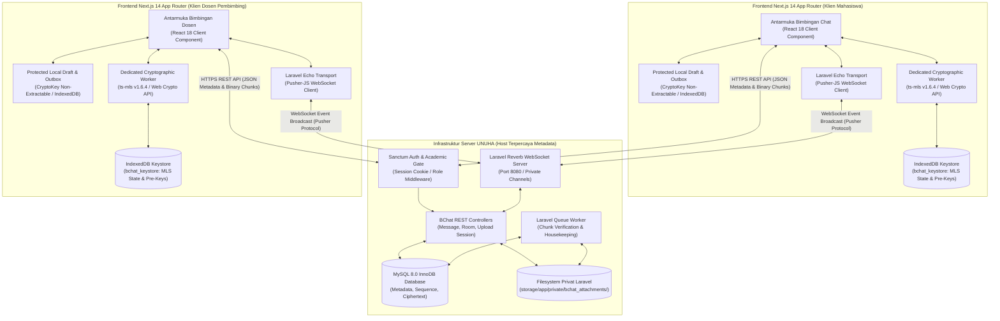
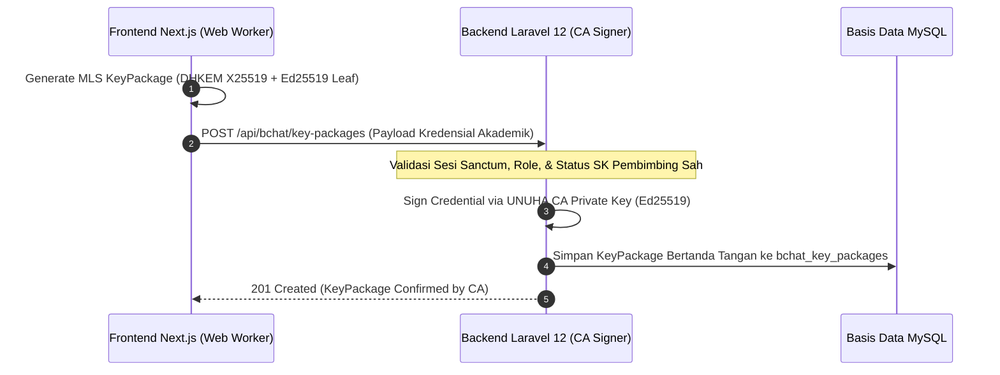
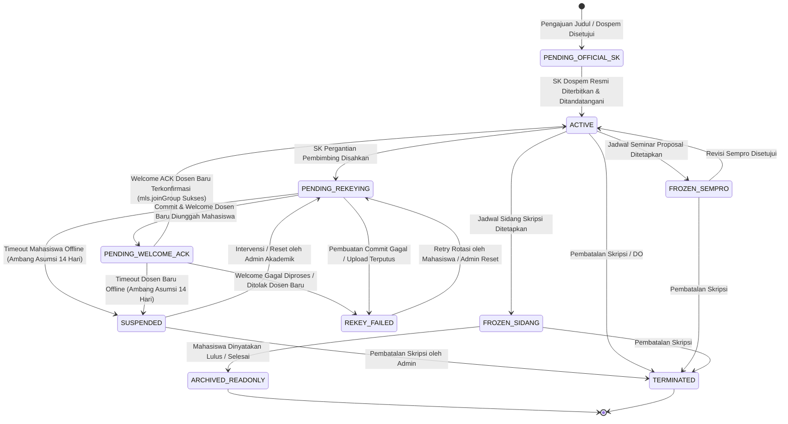
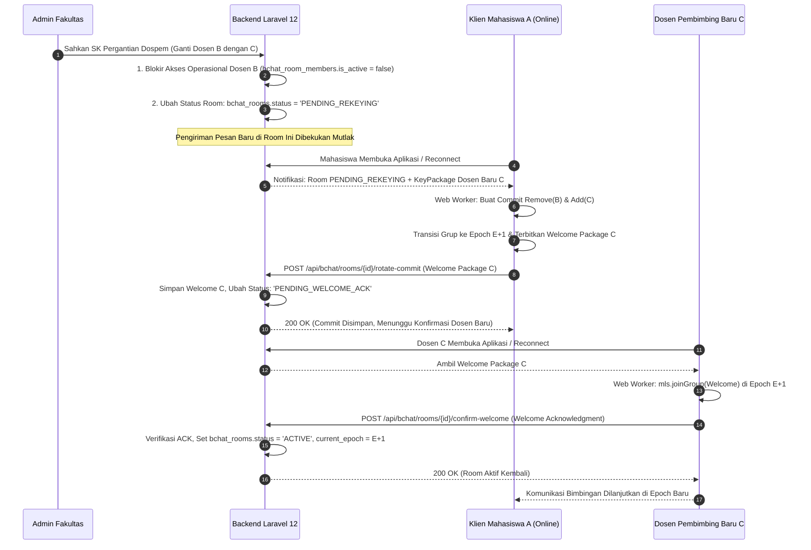
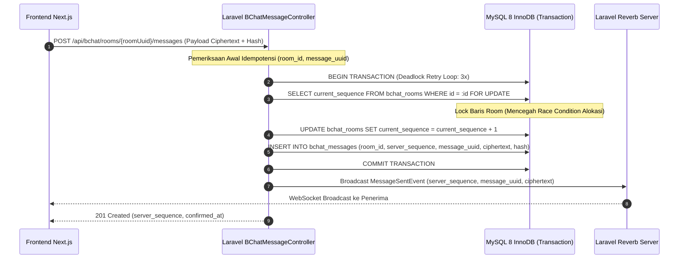
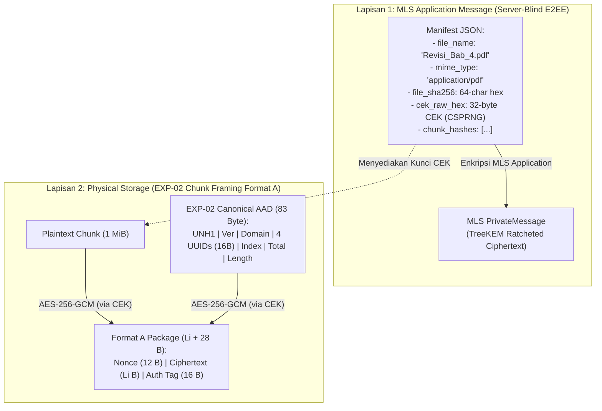
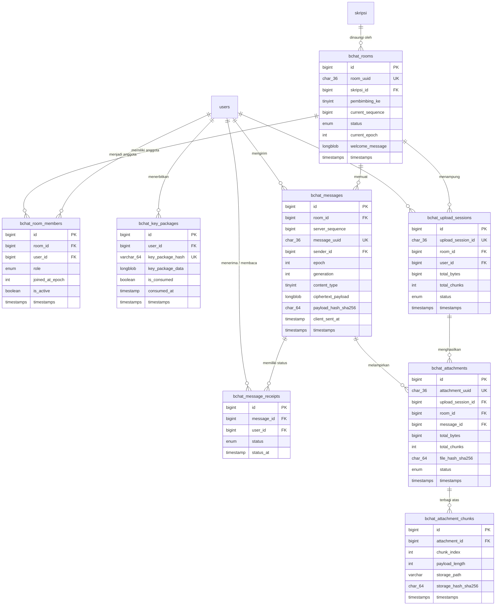
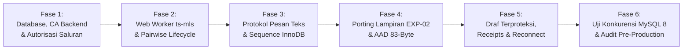

# B-CHAT-11 — SPESIFIKASI TEKNIS INTEGRASI BIMBINGAN ONLINE CHAT REAL-TIME E2EE
## SPESIFIKASI ARSITEKTUR DAN INTEGRASI SISTEM KOMUNIKASI AMAN END-TO-END ENCRYPTION (E2EE)
### SISTEM INFORMASI MANAJEMEN SKRIPSI UNIVERSITAS NAHDLATUL ULAMA CIBITUNG (UNUHA)

**Status Dokumen:** DOKUMEN SPESIFIKASI TEKNIS INTEGRASI ACUAN FINAL (REVISI B-CHAT-11E)  
**Mode Operasi:** `DOCUMENT REVISION ONLY — STRICTLY READ-ONLY — ZERO IMPLEMENTATION MUTATION`  
**Kandidat MLS Acuan:** `ts-mls` v1.6.4 (`KANDIDAT EVALUASI`)  
**Dokumen Pendahulu Acuan:**
1. [B-CHAT-01_Spesifikasi_Kebutuhan_Fitur_Bimbingan_Online.md](file:///d:/Aplikasi/laragon/www/sistem_manajamen_skripsi/B-CHAT-01_Spesifikasi_Kebutuhan_Fitur_Bimbingan_Online.md)
2. [B-CHAT-04_Rancangan_Teknis.md](file:///d:/Aplikasi/laragon/www/sistem_manajamen_skripsi/B-CHAT-04_Rancangan_Teknis.md)
3. [B-CHAT-05_Spesifikasi_Final_E2EE.md](file:///d:/Aplikasi/laragon/www/sistem_manajamen_skripsi/B-CHAT-05_Spesifikasi_Final_E2EE.md)
4. [B-CHAT-08A.5_Final_Editorial_Precision_Closure_EXP-02.md](file:///d:/Aplikasi/laragon/www/sistem_manajamen_skripsi/B-CHAT-08A.5_Final_Editorial_Precision_Closure_EXP-02.md)
5. [B-CHAT-08D.2_Final_Technical_Precision_Correction_EXP-02.md](file:///d:/Aplikasi/laragon/www/sistem_manajamen_skripsi/B-CHAT-08D.2_Final_Technical_Precision_Correction_EXP-02.md)
6. [B-CHAT-09_Rancangan_Arsitektur_Integrasi_E2EE.md](file:///d:/Aplikasi/laragon/www/sistem_manajamen_skripsi/B-CHAT-09_Rancangan_Arsitektur_Integrasi_E2EE.md)
7. [B-CHAT-10_Tahap_1G_Audit_Konsistensi_Kriptografi_MLS.md](file:///d:/Aplikasi/laragon/www/sistem_manajamen_skripsi/scratch/bchat_prototype/exp05_browser_worker_identity/B-CHAT-10_Tahap_1G_Audit_Konsistensi_Kriptografi_MLS.md)
8. [B-CHAT-11A_Audit_Koreksi_Spesifikasi.md](file:///d:/Aplikasi/laragon/www/sistem_manajamen_skripsi/B-CHAT-11A_Audit_Koreksi_Spesifikasi.md)
9. [B-CHAT-11B_Laporan_Revisi_Spesifikasi.md](file:///d:/Aplikasi/laragon/www/sistem_manajamen_skripsi/B-CHAT-11B_Laporan_Revisi_Spesifikasi.md)
10. [B-CHAT-11C_Audit_Final_Konsistensi.md](file:///d:/Aplikasi/laragon/www/sistem_manajamen_skripsi/B-CHAT-11C_Audit_Final_Konsistensi.md)
11. [B-CHAT-11D_Laporan_Finalisasi_Spesifikasi.md](file:///d:/Aplikasi/laragon/www/sistem_manajamen_skripsi/B-CHAT-11D_Laporan_Finalisasi_Spesifikasi.md)  
**Tanggal Pembaruan:** 6 November 2026  

---

> [!IMPORTANT]
> **PANDUAN STATUS KEPUTUSAN ARSITEKTURAL DAN KLASIFIKASI KLAUSUL (B-CHAT-11E):**  
> Seluruh klausul teknis dalam dokumen spesifikasi ini diberi penandaan status yang baku, eksplisit, dan dapat dipertanggungjawabkan:
> - **`DISETUJUI`**: Keputusan kebijakan produk atau arsitektural proyek yang telah disepakati secara definitif oleh Pemilik Proyek.
> - **`KANDIDAT DESAIN / EVALUASI`**: Pilihan media, algoritma, atau arsitektur teknologi yang dipilih untuk evaluasi implementasi (belum menjadi solusi final permanen).
> - **`OPEN`**: Area teknis, regulasi, atau parameter yang belum diputuskan, belum terbukti, atau menunggu validasi empiris lanjutan.
> - **`ASUMSI DESAIN`**: Asumsi kerja sementara yang digunakan perancang untuk memodelkan interaksi sistem dan wajib dibuktikan saat implementasi.
> - **`PERLU EKSPERIMEN`**: Kebutuhan pengujian performa, toleransi jaringan seluler, atau tolok ukur khusus sebelum kode produksi ditulis.
> - **`BELUM DIIMPLEMENTASIKAN`**: Rancangan spesifikasi teknis, skema database, atau REST endpoint yang belum diterapkan pada kode sumber aplikasi utama (Laravel maupun Next.js).
>
> **Batasan Penting:** Dokumen ini merupakan **spesifikasi acuan perencanaan integrasi**, bukan bukti kesiapan produksi. Keberhasilan pengujian pada harness/prototipe eksperimen scratch terisolasi dibedakan secara tegas dari kesiapan kode integrasi pada aplikasi utama.

---

## 1. RINGKASAN EKSEKUTIF DAN LANDASAN ARSITEKTUR

### 1.1. Latar Belakang dan Tujuan `[DISETUJUI]`
Dokumen B-CHAT-11 (Revisi Final B-CHAT-11E) menetapkan spesifikasi arsitektur teknis terperinci untuk mengintegrasikan fitur obrolan real-time terenkripsi *End-to-End* (E2EE) ke dalam platform akademik Sistem Informasi Manajemen Skripsi UNUHA. Integrasi ini menghubungkan frontend Next.js 14.2.10 (App Router), transport real-time Laravel Reverb WebSocket, backend transaksional Laravel 12, dan kandidat engine Messaging Layer Security (MLS) IETF RFC 9420.

### 1.2. Status Kandidat Engine MLS `[KANDIDAT EVALUASI]`
1. **`ts-mls` v1.6.4** ditetapkan sebagai **`KANDIDAT EVALUASI` utama** untuk penyusunan spesifikasi teknis integrasi, didasarkan pada pembuktian eksekusi browser nyata (Google Chrome Headless), footprint First Load JS yang sangat ringkas (**89.2 kB**), dan stabilitas Dedicated Web Worker (73 FPS, 0 jank). Status ini **BUKAN** merupakan penetapan library produksi final permanen.
2. **OpenMLS-WASM** tetap dipertahankan sebagai **`KANDIDAT EVALUASI` pembanding cadangan**, dengan catatan keterbatasan interoperabilitas langsung, ketergantungan linker host, dan ukuran bundel yang besar ($3{,}8\text{ MB} - 5{,}2\text{ MB}$).

### 1.3. Prinsip Arsitektur: *Server-Blind Plaintext and Content-Key Access* `[DISETUJUI]`
Sistem ini secara tegas menerapkan batasan operasional ilmiah sesuai B-CHAT-09 Bagian 1.1:
$$\mathbf{Server\text{-}Blind\ Plaintext\ and\ Content\text{-}Key\ Access}$$

Prinsip ini memisahkan secara mutlak:
1. **Objek yang Tidak Pernah Diketahui Server (*Zero Plaintext/Key Knowledge*):**
   - Isi teks pesan bimbingan obrolan (hanya disimpan sebagai `ciphertext_payload` terenkripsi MLS).
   - Kunci privat identitas pengguna (*Identity Private Key* Ed25519).
   - Kunci simetris enkripsi konten lampiran (*Content Encryption Key* / CEK AES-256-GCM).
   - Kunci rahasia grup MLS (*TreeKEM Group Secrets*, *Epoch Secrets*, dan *Ratchet Tree Private Nodes*).
   - Nama asli berkas lampiran dan tipe MIME asli berkas (dibungkus di dalam manifest terenkripsi MLS).
2. **Metadata Operasional yang Tetap Dikelola Server:**
   - Pengenal pengguna (`users.id`, peran akademik mahasiswa/dosen, NIM/NIDN).
   - Pengenal ruang obrolan (`room_uuid`) dan pengenal skripsi (`skripsi_id`).
   - Penomoran urutan pesan monotonik server (`server_sequence`).
   - Waktu pengiriman dan penerimaan server (*server timestamps*).
   - Ukuran paket ciphertext pesan dan potongan chunk berkas ($L_i + 28\text{ B}$).
   - Status sesi unggah lampiran dan indeks potongan chunk.
   - Status pengiriman (*sent*, *delivered*, *read* receipts).

---

## 2. ARSITEKTUR SISTEM TERINTEGRASI

### 2.1. Diagram Komponen Sistem End-to-End `[ASUMSI DESAIN]`



### 2.2. Batas Kepercayaan Komponen (*Trust Boundaries*) `[ASUMSI DESAIN]`

| Komponen Sistem | Tingkat Kepercayaan | Data yang Boleh Diakses | Tanggung Jawab Keamanan |
| :--- | :--- | :--- | :--- |
| **Main UI Thread (Next.js)** | Terpercaya (Sisi Klien) | Plaintext draf, decrypted chat view, UI state | Sanitasi rendering (XSS Prevention via DOMPurify), penegakan single-tab view, orkestrasi Worker |
| **Dedicated Web Worker** | Terpercaya Penuh (Kripto Klien) | Plaintext pesan, kunci privat identitas, CEK, MLS state | Komputasi kriptografis TreeKEM, enkripsi/dekripsi AES-256-GCM, validasi signature Ed25519 |
| **IndexedDB Keystore Klien** | Terisolasi di Klien | State MLS terserialisasi, Pre-Key private pairs | Isolasi origin domain peramban, penyimpanan CryptoKey `extractable: false` |
| **Laravel Reverb (WebSocket)** | Tidak Terpercaya untuk Plaintext | Ciphertext pesan, ID event, channel name, socket ID | Transport real-time berlatensi rendah, otentikasi koneksi private channel via Sanctum |
| **Laravel REST API & Controllers** | Terpercaya untuk Metadata Akademik | Ciphertext, hash SHA-256, sequence, relasi SK, AAD biner | Alokasi `server_sequence` transaksional, verifikasi kuota berkas, validasi SK pembimbing |
| **MySQL 8 Database** | Terpercaya untuk Integritas Metadata | Rekaman ciphertext, sequence monotonik, receipts, log audit | Konsistensi ACID, isolasi transaksi `FOR UPDATE`, integritas relasional |
| **Filesystem Privat Server** | Terpercaya untuk Penyimpanan Biner | Ciphertext chunk lampiran ($L_i + 28\text{ B}$) | Isolasi direktori privat di luar web root, verifikasi SHA-256 read-back |

### 2.3. Pemisahan Kanal REST API vs Real-Time WebSocket Reverb `[DISETUJUI]`
1. **Kanal Transaksional REST API (HTTPS):**  
   REST API bertindak sebagai **sumber kebenaran tunggal (*Single Source of Truth*)** yang persisten. Semua operasi pembentukan ruang, pengambilan riwayat, pembuatan sesi unggah, transmisi chunk lampiran, dan pengiriman pesan **wajib** melalui REST endpoint dengan verifikasi otentikasi Sanctum dan pencatatan basis data MySQL secara transaksional.
2. **Kanal Transport Real-Time Laravel Reverb (WebSocket):**  
   Kanal WebSocket bertindak sebagai **lapisan notifikasi dan akselerasi transport (*Transient Transport Layer*)**. Reverb membroadcast event ke klien yang sedang online secara real-time. Jika koneksi WebSocket terputus, klien tidak kehilangan data karena riwayat pesan disinkronkan ulang secara deterministik melalui REST API berbasis kursor `server_sequence`.

---

## 3. SPESIFIKASI IDENTITAS, KEANGGOTAAN, DAN OTORISASI AKADEMIK

### 3.1. Pemisahan Entitas Identitas `[DISETUJUI]`
Dokumen ini membedakan secara eksplisit 6 entitas yang beroperasi pada lapisan berbeda:
1. **Identitas Akun Sanctum:** Entitas akun pengguna berbasis sesi pada tabel `users` (`users.id`).
2. **Identitas Akademik UNUHA:** Data atribut akademik mahasiswa/dosen (`mahasiswa.NIM`, `dosen.NIDN`, peran akademik, dan relasi `skripsi.id_skripsi`).
3. **MLS Credential:** Struktur data kredensial kriptografis RFC 9420 yang merepresentasikan identitas di dalam pohon kunci TreeKEM.
4. **Signature Key:** Pasangan kunci digital privat/publik (Ed25519) milik anggota yang digunakan untuk menandatangani pesan MLS dan proposal grup.
5. **KeyPackage:** Paket pre-key publik (HPKE public key, credential, signature key, dan capabilities) bertanda tangan digital yang diunggah ke server untuk inisialisasi grup.
6. **Otorisasi Keanggotaan Room:** Kebijakan otorisasi server (Laravel Gate / Middleware / Reverb channel policy) yang memverifikasi apakah akun berhak mengakses ruang bimbingan tertentu.

### 3.2. Prasyarat Mutlak SK Dosen Pembimbing yang Sah `[DISETUJUI]`
1. Ruang obrolan bimbingan **DILARANG KERAS** dibentuk atau diaktifkan tanpa adanya penetapan Surat Keputusan (SK) Dosen Pembimbing resmi yang ditandatangani oleh Ketua Program Studi (Kaprodi) dan Dekan Fakultas.
2. Keberadaan baris pada tabel `pengajuan_dospem` dengan status `ditetapkan` **tidak boleh dianggap sebagai bukti otomatis bahwa SK sudah sah ditandatangani**, sebelum struktur data pengesahan SK dan alur verifikasi tanda tangan diverifikasi secara administratif.
3. Selama SK belum disahkan oleh pihak fakultas, ruang bimbingan berada pada status terkunci: `PENDING_OFFICIAL_SK`.

### 3.3. Model Kardinalitas Ruang Obrolan (*Pairwise Room Model*) `[DISETUJUI]`
Sistem bimbingan E2EE UNUHA menggunakan arsitektur **kardinalitas ruang berpasangan (*Pairwise 1-on-1 Rooms*)**:
- **Tahap Proposal Skripsi:**  
  Tepat **1 Room Obrolan Pairwise** menghubungkan Mahasiswa dengan Dosen Pembimbing Proposal tunggal.
- **Tahap Skripsi Penuh:**  
  Tepat **2 Room Obrolan Pairwise Terpisah**:
  - **Room 1:** Menghubungkan Mahasiswa dengan Dosen Pembimbing Utama (Pembimbing 1).
  - **Room 2:** Menghubungkan Mahasiswa dengan Dosen Pembimbing Pendamping (Pembimbing 2).
- **Independensi Kriptografis Antar-Room:**  
  Setiap room memiliki pengenal `room_uuid` unik, grup MLS TreeKEM mandiri, riwayat pesan terpisah, dan siklus epoch independen. Dosen Pembimbing 1 **sama sekali tidak memiliki akses** ke kunci grup maupun riwayat pesan pada Room Pembimbing 2, dan sebaliknya.

### 3.4. Otoritas Sertifikat (CA) Akademik UNUHA Ed25519 `[OPEN — MENUNGGU VALIDASI IMPLEMENTASI]`
Untuk mencegah serangan penyamaran identitas (*impersonation*) dan injeksi kunci publik palsu pada pertukaran KeyPackage MLS, backend Laravel bertindak secara konseptual sebagai Otoritas Sertifikat Akademik (*Academic Certificate Authority*):



#### A. Format Kredensial RFC 9420 (`BasicCredential`) `[KANDIDAT EVALUASI]`
Sesuai RFC 9420 Bagian 5.2, format kredensial yang digunakan pada kandidat `ts-mls` v1.6.4 adalah **`BasicCredential`** (CredentialType ID 1):
- Field `identity` berisi buffer biner `Uint8Array` kanonikal yang memuat serialisasi data akademik:
  ```json
  {
    "user_id": 1001,
    "uuid": "550e8400-e29b-41d4-a716-446655440000",
    "role": "mahasiswa",
    "nomor_induk": "2021001001",
    "skripsi_id": 101,
    "room_uuid": "b7c3e590-1111-4f1b-8001-unuha0000001",
    "valid_until": 1785000000,
    "ca_signature_hex": "e4f8a1...64_bytes_hex_signature"
  }
  ```
- *Catatan Kritis:* Penggunaan payload JSON terstruktur di dalam `identity` merupakan konvensi lapisan aplikasi (*application-layer profiling*). Integrasi penuh modul `authService` dengan Laravel CA berstatus **`OPEN`** sampai alur verifikasi end-to-end terbukti pada basis kode riil.

#### B. Pengelolaan Kunci Privat Otoritas CA di Host Server `[ASUMSI DESAIN]`
- Kunci privat CA disimpan secara terisolasi di luar web root pada: `storage/app/secure/ca/unuha_bchat_ca_ed25519.key`.
- **Izin Berkas:** Ditetapkan izin kaku `chmod 0600` pada lingkungan Unix/Linux (hanya dapat dibaca oleh user proses PHP-FPM / CLI server) atau *Access Control List* (ACL) setara pada Windows Server/Cloud Deployment.
- **Larangan Keras:** Kunci privat CA **DILARANG KERAS** ditaruh pada berkas `.env`, kode sumber controller, atau di-commit ke Git.
- **Prosedur Pemulihan Kebocoran Kunci CA (*CA Compromise Protocol*):**  
  Jika kunci CA terkompromi:
  1. Administrator menerbitkan pasangan kunci CA baru dengan nomor versi inkremental (`ca_version: 2`).
  2. Kunci publik baru didistribusikan ke klien frontend Next.js melalui saluran konfigurasi terotentikasi.
  3. Kunci publik lama dimasukkan ke daftar revocations darurat.
  4. Seluruh ruang obrolan diwajibkan melakukan *re-keying / credential refresh* pada siklus berikutnya.

### 3.5. Protokol Pencabutan Kredensial (CRL) & Toleransi Offline `[OPEN — BELUM DISETUJUI]`
1. **Penerbitan Pencabutan di Server:** Jika hak bimbingan dosen dibatalkan atau mahasiswa mengundurkan diri, backend Laravel menerbitkan entri pencabutan pada tabel `bchat_crl_revocations`.
2. **Sinkronisasi Klien:** Klien menyinkronkan daftar CRL setiap kali koneksi online terbentuk (`GET /api/bchat/crl?since={timestamp}`).
3. **Batas Toleransi Perangkat Offline:** Ambang batas toleransi offline selama **72 jam** berstatus **`OPEN — BELUM DISETUJUI`** (merupakan `ASUMSI DESAIN` teknis perancangan awal yang belum disahkan oleh Pemilik Proyek). Secara kriptografis, ambang waktu ini adalah *revocation exposure delay window* (kompromi ketersediaan vs latensi pencabutan), bukan jaminan keamanan mutlak. Jika peramban tidak dapat menghubungi server untuk memperbarui CRL melebihi ambang batas yang nantinya disahkan universitas, Web Worker akan menghentikan operasi enkripsi pesan baru hingga sinkronisasi berhasil (*fail-secure offline policy*).

### 3.6. Siklus Hidup Ruang Obrolan (*Room Lifecycle State Machine*) `[ASUMSI DESAIN]`



### 3.7. Alur Pergantian Dosen Pembimbing (Rotasi TreeKEM MLS) `[KANDIDAT EVALUASI]`
Ketika terjadi pergantian dosen pembimbing berdasarkan SK resmi baru yang ditandatangani Kaprodi dan Dekan:



#### Ketentuan Transisi Rotasi Pembimbing & Persyaratan Welcome Acknowledgment:

1. **Pembedaan Tegas Empat Operasi Independen:**  
   Sistem membedakan secara mutlak 4 tahapan operasi yang tidak boleh disamakan atau dianggap selesai bersamaan:
   - *Operasi 1: Pemblokiran Akses Operasional Server.* Dilakukan seketika oleh backend pada basis data (`bchat_room_members.is_active = false`), memblokir dosen lama dari seluruh endpoint REST API dan Reverb. Pemblokiran server ini **BUKAN** merupakan selesainya pencabutan akses kriptografis.
   - *Operasi 2: Pemrosesan Remove Proposal & Commit MLS.* Dijalankan oleh klien mahasiswa melalui pembentukan proposal *Remove* dan *Commit TreeKEM*, menghasilkan path secret dan epoch secret baru ($E+1$) yang tidak dapat diakses oleh dosen lama (Forward Secrecy / Post-Compromise Security).
   - *Operasi 3: Penerbitan dan Pengunggahan Welcome Package.* Mahasiswa mengenkripsi parameter grup baru menggunakan KeyPackage Dosen Baru dan mengunggahnya ke server via `POST /api/bchat/rooms/{id}/rotate-commit`. Status room berpindah ke `PENDING_WELCOME_ACK`.
   - *Operasi 4: Konfirmasi Keberhasilan Bergabung (Welcome Acknowledgment).* Dosen baru memproses paket Welcome, merekonstruksi state ratchet tree di Epoch E+1, dan mengirimkan *Welcome Acknowledgment* ke server via endpoint rancangan `POST /api/bchat/rooms/{id}/confirm-welcome` (`RANCANGAN ENDPOINT — BELUM DIIMPLEMENTASIKAN`). Ruang obrolan **DILARANG KERAS** kembali berstatus `ACTIVE` sebelum tahap keempat ini terkonfirmasi penuh.

2. **Persyaratan Ketat Welcome Acknowledgment Sebelum Room ACTIVE:**  
   Sebelum status ruang obrolan diubah kembali menjadi `ACTIVE`, backend Laravel wajib memverifikasi secara deterministik bahwa:
   - Dosen pembimbing baru telah menerima paket Welcome untuk `room_uuid` yang tepat.
   - Paket Welcome telah berhasil diproses oleh MLS client milik dosen tersebut (`mls.joinGroup(...)` sukses tanpa exception).
   - Konfirmasi terikat secara mutlak pada tuple: identitas pengguna (`user_id` yang diautentikasi sesi Sanctum), `room_uuid`, dan `epoch` yang relevan ($E+1$).
   - Konfirmasi tidak dapat disalahgunakan untuk mengaktifkan room lain atau mengonfirmasi epoch yang berbeda (*Cross-Room and Cross-Epoch Replay Prevention*).
   - Pengiriman ulang konfirmasi dengan tuple yang sama ditangani secara idempoten (`200 OK` tanpa duplikasi mutasi state).
   - Backend memverifikasi bahwa room saat itu benar-benar berada dalam status `PENDING_WELCOME_ACK` dan pemanggil adalah dosen baru yang terdaftar pada room tersebut.
   - Room **hanya dan hanya jika** seluruh kondisi di atas terpenuhi baru dapat dialihkan ke status `ACTIVE`.

3. **Status Validasi Kriptografis Konfirmasi (`OPEN`):**  
   Bentuk muatan (*payload*) pembuktian kriptografis dari konfirmasi Welcome (apakah berupa *confirmation tag* HMAC yang diturunkan dari epoch secret baru, atau tanda tangan digital Ed25519 dari group context baru) **DITANDAI SEBAGAI `OPEN`** untuk divalidasi langsung terhadap API `ts-mls` pada tahap implementasi (Fase 2 / Fase 6). Spesifikasi ini secara tegas tidak mengarang mekanisme pembuktian sebelum diuji secara fisik.

4. **Ketergantungan Kehadiran Pengguna (Online Dependency):**  
   Karena server bersifat *server-blind*, server tidak dapat merotasi grup secara mandiri:
   - Jika mahasiswa sedang offline saat SK terbit, room berada pada status transisi `PENDING_REKEYING`.
   - Jika mahasiswa telah mengunggah Welcome tetapi dosen baru belum online/join, room berada pada status transisi `PENDING_WELCOME_ACK`.
   - Selama status `PENDING_REKEYING` maupun `PENDING_WELCOME_ACK`, pengiriman pesan baru di room tersebut dibekukan sepenuhnya.

5. **Penanganan Timeout dan Ambang Batas Waktu:**  
   - Ambang batas toleransi mahasiswa/dosen offline selama **14 hari** berstatus **`ASUMSI DESAIN / OPEN`** (belum menjadi kebijakan final resmi universitas).
   - Jika mahasiswa atau dosen baru tidak menyelesaikan proses rekeying melampaui ambang batas waktu yang nantinya disahkan, room berpindah ke status `SUSPENDED` untuk penanganan manual atau pembatalan oleh Administrator Akademik.

6. **Penanganan Kegagalan & Idempotensi Retry:**  
   - Jika proses Commit oleh mahasiswa gagal atau Welcome package ditolak oleh Dosen Baru (tidak valid/rusak): Room berpindah ke status `REKEY_FAILED`.
   - Kegagalan atau proses rekeying yang terputus di tengah jalan **tidak boleh membuat room kembali `ACTIVE` secara prematur**.
   - Dari status `REKEY_FAILED`, mahasiswa dapat melakukan retry pembuatan Commit baru dengan mengambil KeyPackage Dosen Baru yang masih valid atau yang diperbarui.

7. **Isolasi Pairwise Mutlak:**  
   Pergantian Dosen Pembimbing pada Room 1 (Pembimbing Utama) **SAMA SEKALI TIDAK BERDAMPAK** pada keanggotaan, state kunci, atau riwayat pesan pada Room 2 (Pembimbing Pendamping).

### 3.8. Otorisasi Saluran Reverb WebSocket `[DISETUJUI]`
Otorisasi saluran WebSocket pada `routes/channels.php` mengamankan channel privat `private-bchat.room.{roomUuid}`:
```php
Broadcast::channel('bchat.room.{roomUuid}', function ($user, $roomUuid) {
    // 1. Cari room aktif
    $room = BChatRoom::where('room_uuid', $roomUuid)->first();
    if (!$room || in_array($room->status, ['TERMINATED', 'PENDING_OFFICIAL_SK'])) {
        return false;
    }

    // 2. Verifikasi keanggotaan aktif pengguna dalam room
    return $room->members()
        ->where('user_id', $user->id)
        ->where('is_active', true)
        ->exists();
});
```

---

## 4. SPESIFIKASI PROTOKOL MLS (RFC 9420 via `ts-mls` v1.6.4)

### 4.1. Pemilihan Ciphersuite Kanonikal `[DISETUJUI]`
Sistem mengunci satu ciphersuite kanonikal RFC 9420:
- **Nama Ciphersuite:** `MLS_128_DHKEMX25519_AES128GCM_SHA256_Ed25519`
- **ID Ciphersuite:** `0x0001`
- **Pertimbangan Teknis:** Memberikan keseimbangan optimal antara efisiensi kurva Curve25519 dan akselerasi native Web Cryptography API di browser untuk AES-GCM dan SHA-256 tanpa pembengkakan bundel WebAssembly.

### 4.2. Inisialisasi Pre-Key Pool (KeyPackage) Pengguna `[ASUMSI DESAIN]`
1. Setiap klien membangkitkan pool minimal 5 KeyPackage cadangan via Web Worker.
2. KeyPackage publik dikirim ke REST endpoint `POST /api/bchat/key-packages` dan disimpan di tabel `bchat_key_packages` dengan status `is_consumed = false`.
3. Kunci privat pasangan KeyPackage disimpan di IndexedDB klien (`bchat_keystore`).
4. Ketika room dibentuk, server memberikan 1 KeyPackage publik milik calon anggota, lalu menandainya sebagai `is_consumed = true` secara atomik (*consume-once semantics*).

### 4.3. Format Pesan Aplikasi (*MLS Application Message*) `[KANDIDAT EVALUASI]`
Pesan teks dan metadata manifest lampiran dienkripsi ke dalam format biner *MLS PrivateMessage* (TreeKEM ratcheted ciphertext). Muatan internal aplikasi sebelum dienkripsi distandarisasi sebagai JSON terstruktur:
```json
{
  "version": 1,
  "message_uuid": "550e8400-e29b-41d4-a716-446655440001",
  "content_type": "TEXT",
  "client_sent_at": "2026-11-06T09:30:00.000Z",
  "payload": {
    "text": "Selamat pagi Bapak, draft bab 4 skripsi telah saya perbaiki."
  }
}
```

### 4.4. Persistensi State IndexedDB & Hook Rehidrasi `[OPEN — MENUNGGU VALIDASI FASE 2]`
1. **Serialisasi State di Memori:**  
   Klien menserialisasi state grup menggunakan API:
   $$\text{stateBytes} = \text{mls.encodeGroupState}(\text{groupState})$$
   Buffer biner disimpan di IndexedDB object store `mls_group_states`. Untuk mencegah benturan data pada perangkat bersama, store ini menggunakan *compound index* `[user_id, room_uuid]`.
2. **Rehidrasi Pasca-Reload / Crash:**  
   Sesuai temuan audit Tahap 1G Bagian 2.1, fungsi rehidrasi **wajib** menyertakan argumen *offset* numerik `0`:
   ```javascript
   // Web Worker Rehydration Hook
   const [restoredGroupState] = mls.decodeGroupState(stateBytes, 0);
   restoredGroupState.clientConfig = clientConfig; // Re-attach local configuration
   ```
3. **Batasan Bukti dan Status Terbuka (OPEN):**  
   Audit B-CHAT-11C menegaskan bahwa keberhasilan pemanggilan `decodeGroupState(rawBytes, 0)` pada Tahap 1F **HANYA MEMBUKTIKAN KEMAMPUAN DESERIALISASI STATE DI MEMORI**, dan **BELUM MEMBUKTIKAN PERSISTENSI INDEXEDDB SECARA LENGKAP**.  
   Seluruh aspek persistensi fisik berikut berstatus **`OPEN`** dan wajib divalidasi pada **Fase 2**:
   - Persistensi atomik multi-store IndexedDB (`device_keystore`, `mls_group_states`, `drafts`).
   - Pemulihan setelah browser crash atau perangkat restart (*crash recovery and partial write mitigation*).
   - Penanganan kegagalan parsial dan deteksi korupsi buffer biner.
   - Konsistensi antara state MLS dan data riwayat pesan lokal di IndexedDB.
   - Isolasi akun dan pemulihan lintas sesi pada perangkat bersama.

### 4.5. Pengelolaan Epoch dan Retensi Kunci `[OPEN — MENUNGGU VALIDASI]`
Sesuai hasil audit B-CHAT-11A dan temuan kode fisik audit B-CHAT-11C:
- **Konfigurasi Bawaan Library (`ts-mls@1.6.4`):**
  Nilai bawaan (*default implementation constants*) yang ditemukan pada kode fisik pustaka adalah:
  * `retainKeysForGenerations: 10`
  * `maximumForwardRatchetSteps: 200`
  * `retainKeysForEpochs: 4`
- **Penegasan Status Kebijakan:**  
  Nilai-nilai bawaan library di atas **BUKAN MERUPAKAN KEPUTUSAN KEBIJAKAN KEAMANAN PRODUKSI UNUHA**, melainkan semata-mata parameter teknis implementasi internal pustaka `ts-mls` v1.6.4 pada versi yang diuji.
- **Status Retensi Kunci:** Ditetapkan sebagai **`OPEN — MENUNGGU VALIDASI`**. Angka final retensi generasi maupun retensi epoch **TIDAK DITETAPKAN SECARA PREMATUR** sebagai standar produksi tanpa pengujian empiris.
- **Pembedaan Konsep Kriptografis Wajib:**
  * *Retensi Kunci Epoch:* Menyimpan secret epoch historis secara terbatas untuk mendekripsi pesan yang tertunda di jaringan seluler saat grup telah berpindah epoch (RFC 9420 §7.7).
  * *Generation Ratchet & Anti-Replay:* Penolakan pesan yang sudah pernah didekripsi di dalam epoch yang sama ditegakkan oleh pembaruan generation ratchet (`Desired gen in the past`), bukan oleh pemotongan retensi epoch.
  * *Kebutuhan Pengujian Lanjutan:* Diperlukan pengujian pesan terlambat (*out-of-order delivery*), simulasi jitter jaringan seluler, perpindahan epoch konkuren, dan ketahanan replay pada versi `ts-mls@1.6.4` sebelum angka kebijakan diadopsi (`PERLU EKSPERIMEN`).

### 4.6. Pemulihan Perangkat dan Akun (*Device & Account Recovery*) `[ASUMSI DESAIN & KANDIDAT EVALUASI]`
Dokumen ini membedakan secara mutlak dua domain pemulihan yang berbeda:

#### A. Pemulihan Akses Akun (*Account Recovery*)
- Ditangani sepenuhnya oleh otentikasi aplikasi Laravel Sanctum (login, lupa password, reset password oleh admin).
- Berhasil login kembali memulihkan hak akses pengguna ke sistem informasi akademik.

#### B. Pemulihan Riwayat Pesan Terenkripsi (*Historical Plaintext Recovery*)
- Karena prinsip *Server-Blind Plaintext Access*, server tidak memiliki salinan kunci privat TreeKEM klien.
- **Konsekuensi Kriptografis:** Jika perangkat fisik hilang, rusak, atau penyimpanan IndexedDB peramban dibersihkan, **kunci privat lama HILANG PERMANEN**. Login kembali **TIDAK OTOMATIS** memulihkan kemampuan membaca pesan terenkripsi masa lalu.
- **Perilaku Perangkat Baru:**
  1. Perangkat baru membangkitkan pasangan kunci privat baru dan mengunggah KeyPackage baru bertanda tangan CA.
  2. Sesi perangkat lama dicabut di server.
  3. Klien perangkat baru membentuk keanggotaan/ruang baru untuk komunikasi masa depan.
  4. **Perilaku Antarmuka (UI):** Pesan masa lalu yang kuncinya telah hilang ditampilkan dengan keterangan yang jujur dan tidak menyesatkan:  
     `"Pesan terenkripsi dengan kunci perangkat sebelumnya (Kunci tidak tersedia pada perangkat ini)"`.
- **Status Kebijakan Single Active Device:** Ditetapkan sebagai **`KANDIDAT EVALUASI`**, bukan keputusan final permanen.

---

## 5. SPESIFIKASI PROTOKOL PESAN OBROLAN

> [!NOTE]
> **Catatan Status Implementasi:** Kebijakan penomoran monotonik dan format payload biner berstatus `DISETUJUI`, namun modul controller (`BChatMessageController`), REST endpoint (`POST /messages`), broadcast event Reverb, dan tabel pesan yang digambarkan pada Bagian 5 ini merupakan rancangan spesifikasi integrasi yang **`BELUM DIIMPLEMENTASIKAN`** pada aplikasi utama Laravel 12 maupun Next.js 14.

### 5.1. Identitas Pesan Unik `[DISETUJUI]`
Setiap pesan memiliki pengenal kanonikal `message_uuid` bertipe RFC 4122 UUID v4 yang dibangkitkan oleh klien pengirim menggunakan `crypto.randomUUID()`.

### 5.2. Alokasi Urutan Monotonik Server (`server_sequence`) Transaksional `[DISETUJUI]`
Untuk mencegah ambiguitas urutan antar-klien, server mengalokasikan nomor urut monotonik per room di dalam mesin MySQL 8 InnoDB.



#### Ketentuan Transaksional dan Sequence Monotonik:
1. **Jaminan Urutan:** **Strictly Monotonically Increasing dan Unik per Room ($S_{i+1} > S_i$)**.  
   *Koreksi B-CHAT-11A:* Seluruh klaim "gapless sequence" **DIHAPUS**. Jika sebuah transaksi mengalami *rollback* (akibat kegagalan jaringan, timeout, atau constraint error), celah sequence dapat terjadi. Klien **DILARANG** mengasumsikan urutan gapless ($S_{i+1} == S_i + 1$) agar tidak terjebak dalam *infinite sync loop*.
2. **Penanganan Deadlock Transaksi:**  
   Operasi pengiriman dibungkus dalam transaksi `DB::transaction(..., 3)` yang secara otomatis melakukan *retry* hingga 3 kali jika terjadi `MySQL Error 1213: Deadlock found when trying to get lock`.
3. **Pencegahan Race Condition Idempotensi:**  
   Pemeriksaan idempotensi awal dilakukan sebelum lock baris. Namun, integritas akhir ditegakkan oleh `UNIQUE KEY uk_message_uuid` dan `UNIQUE KEY uk_room_sequence` di skema basis data.
4. **Penanganan Konflik Identitas Pesan:**  
   - Jika `message_uuid` sama dan `payload_hash_sha256` identik: Server merespons `200 OK` dengan rekaman tersimpan (*Idempotent Replay*).
   - Jika `message_uuid` sama tetapi `payload_hash_sha256` berbeda: Server **MENOLAK KERAS** permintaan dengan kode `409 Conflict` (`BCAT_ERR_PAYLOAD_MUTATION_CONFLICT`). Penimpaan pesan lama dilarang mutlak.

### 5.3. Siklus Hidup Status Tanda Terima (*Receipts Lifecycle*) `[DISETUJUI]`
Status pesan bergerak melalui empat tahapan deterministik:
1. `PENDING`: Pesan sedang diproses di Web Worker atau sedang dikirim via jaringan.
2. `SENT`: Pesan berhasil disimpan di MySQL server dan memperoleh nomor `server_sequence`.
3. `DELIVERED`: Klien penerima berhasil menerima ciphertext melalui Reverb atau REST sync.
4. `READ`: Pengguna penerima membuka ruang obrolan dan merender pesan terdekripsi di layar.
- **Sinyal Read Receipt Terenkripsi:** Sinyal baca dikirimkan kembali sebagai pesan kontrol terenkripsi di dalam room MLS agar server tidak dapat memetakan kebiasaan membaca detail pengguna.

### 5.4. Sinkronisasi Riwayat Berbasis Kursor (*Cursor-Based Pagination*) `[DISETUJUI]`
Klien memuat riwayat obrolan menggunakan kursor `server_sequence`:
- Endpoint: `GET /api/bchat/rooms/{roomUuid}/messages?cursor_before={sequence}&limit=50`
- Respon mengembalikan 50 pesan sebelumnya secara terurut menurun (`ORDER BY server_sequence DESC`), menjamin riwayat yang stabil tanpa pergeseran halaman (*offset drift*).

---

## 6. SPESIFIKASI PROTOKOL LAMPIRAN BERKAS (EXP-02 & OD-17)

> [!NOTE]
> **Catatan Status Implementasi:** Format AAD 83-byte dan algoritma chunking Format A ($L_i + 28\text{ B}$) berstatus `DISETUJUI` berbasis pembuktian eksperimen prototipe terisolasi EXP-02. Namun REST endpoints sesi unggah, penulisan chunk ke storage privat, dan integrasi upload worker merupakan rancangan yang **`BELUM DIIMPLEMENTASIKAN`** pada aplikasi utama.

### 6.1. Parameter Batas Kuota Berkas Sah `[DISETUJUI]`
Sesuai mandat EXP-02, batas kuota dihitung dalam satuan byte desimal persis:
- Ukuran maksimal berkas per file: **10.000.000 byte** (Bukan 10 MiB binary).
- Jumlah maksimal berkas per pesan: **5 file**.
- Total batas kuota lampiran per pesan: **25.000.000 byte** gabungan.
- Ukuran potongan chunk kanonikal: **1 MiB ($1.048.576\text{ byte}$)**.

### 6.2. Arsitektur Dua Lapisan Binding Kriptografis Lampiran `[DISETUJUI]`



#### Lapisan 1 — E2EE Manifest melalui MLS Application Message `[DISETUJUI]`
- Memuat metadata rahasia yang server tidak boleh ketahui: nama berkas asli, tipe MIME asli, hash SHA-256 berkas utuh, dan kunci simetris CEK 256-bit.
- CEK dikirim secara terotentikasi dan terenkripsi di dalam *MLS Application Message*.
- Server **DILARANG KERAS** menerima atau menyimpan CEK atau manifest rahasia dalam bentuk plaintext.
- Manifest terikat secara kriptografis dengan identitas `room_uuid`, `message_uuid`, `attachment_uuid`, `upload_session_id`, dan epoch MLS terkait.

#### Lapisan 2 — Chunk Framing EXP-02 di Filesystem Privat `[DISETUJUI]`
- Algoritma: **AES-256-GCM**.
- Kunci: CEK 256-bit acak unik per berkas lampiran.
- Nonce 96-bit: Terdiri dari `UploadSessionSalt (8 byte)` + `ChunkIndex (4 byte uint32be)`.
- Potongan chunk: 1 MiB ($1.048.576\text{ byte}$).
- **AAD Kanonis Tepat 83 Byte:** Mengikuti format baku EXP-02 secara ketat, dilarang diganti string pipe-delimited.
- **Pembungkusan Format A:** Panjang paket adalah $L_i + 28\text{ B}$ ($\text{Nonce 12 B} \parallel \text{Ciphertext } L_i\text{ B} \parallel \text{Auth Tag 16 B}$).
- Pengenal UUID: Seluruh UUID dinormalisasi menjadi **16 byte biner mentah** (`uuidToBytes`).
- **Verifikasi Read-Back SHA-256 Server:** Server memverifikasi integritas penulisan fisik ke disk (`storage_hash_sha256`), yang murni merupakan pemeriksaan integritas penyimpanan server, bukan autentikasi manifest end-to-end.

### 6.3. Struktur AAD Kanonis 83-Byte EXP-02 `[DISETUJUI]`

| Offset | Panjang | Tipe Data | Nilai / Deskripsi Kanonikal |
| :---: | :---: | :---: | :--- |
| `0..3` | 4 byte | ASCII String | Magic Header: `'UNH1'` (`0x55, 0x4E, 0x48, 0x31`) |
| `4..5` | 2 byte | Uint16 Big-Endian | Protocol Version: `0x0001` |
| `6` | 1 byte | Uint8 | Domain Separator: `0x02` (Attachment Chunk Domain) |
| `7..22` | 16 byte | Raw Binary | Room UUID (`room_uuid` dalam format 16-byte mentah) |
| `23..38` | 16 byte | Raw Binary | Message UUID (`message_uuid` dalam format 16-byte mentah) |
| `39..54` | 16 byte | Raw Binary | Attachment UUID (`attachment_uuid` dalam format 16-byte mentah) |
| `55..70` | 16 byte | Raw Binary | Upload Session ID (`upload_session_id` dalam format 16-byte mentah) |
| `71..74` | 4 byte | Uint32 Big-Endian | Chunk Index $i$ (0-based: $0 \le i < N$) |
| `75..78` | 4 byte | Uint32 Big-Endian | Total Chunks $N$ ($1 \le N \le 10$) |
| `79..82` | 4 byte | Uint32 Big-Endian | Plaintext Length $L_i$ ($1 \le L_i \le 1.048.576$) |
| **Total** | **83 byte** | **Buffer Biner** | **Format Kanonis Baku EXP-02** |

### 6.4. Status Keputusan Distribusi Kunci Lampiran OD-17 `[KANDIDAT EVALUASI]`
- **Pendekatan B (`KANDIDAT UTAMA EVALUASI DISETUJUI`):**  
  CEK 256-bit dibangkitkan via CSPRNG per berkas lampiran, dibungkus di dalam manifest terenkripsi MLS.
- **Pendekatan A (Pembanding Resmi):**  
  CEK diturunkan via `MLS-Exporter(label="bchat-attachment-cek", context, length=32)`.
- **Status Resmi:**  
  **`KANDIDAT UTAMA EVALUASI DISETUJUI — PEMENANG FINAL BELUM DIPUTUSKAN`**. Keputusan akhir dipegang oleh Pemilik Proyek setelah evaluasi end-to-end selesai.

### 6.5. Siklus Hidup Sesi Unggah dan Pembersihan Berkas `[ASUMSI DESAIN]`
1. `POST /api/bchat/rooms/{roomUuid}/upload-sessions` membuka sesi unggah (`message_id = NULL`).
2. Klien mengunggah potongan chunk secara bertahap via `POST /api/bchat/upload-sessions/{id}/chunks/{index}`.
3. Batas percobaan retry I/O: $K_{\text{io\_retry}} = 1$ dari buffer RAM klien. Dilarang menggunakan kombinasi (CEK, Nonce) yang sama.
4. Setelah seluruh chunk tervalidasi, klien mengirim pesan MLS yang menautkan `message_id`.
5. **Housekeeping:** Sesi unggah yang tidak tuntas dalam **2 jam** ditandai `FAILED_ABANDONED` dan seluruh potongan filenya dihapus permanen dari filesystem privat.

---

## 7. PERSISTENSI BASIS DATA & RANCANGAN SKEMA (ERD) `[ASUMSI DESAIN — BELUM DIIMPLEMENTASIKAN]`

> [!WARNING]
> **PEMBERITAHUAN SKEMA BASIS DATA KONSEPTUAL:**  
> Seluruh tabel dengan awalan `bchat_` di bawah ini merupakan **rancangan skema konseptual integrasi** (`ASUMSI DESAIN — BELUM DIIMPLEMENTASIKAN`). Tabel-tabel ini **BELUM DIIMPLEMENTASIKAN** pada database proyek dan **DILARANG DICIPTAKAN** pada tahap spesifikasi ini.

### 7.1. Entity-Relationship Diagram (ERD) `[ASUMSI DESAIN]`



### 7.2. Definisi Struktur Kolom dan Tabel Konseptual `[ASUMSI DESAIN]`

```sql
-- 1. Tabel Ruang Obrolan Bimbingan Pairwise
CREATE TABLE bchat_rooms (
    id BIGINT UNSIGNED AUTO_INCREMENT PRIMARY KEY,
    room_uuid CHAR(36) NOT NULL UNIQUE,
    skripsi_id BIGINT UNSIGNED NOT NULL,
    pembimbing_ke TINYINT UNSIGNED NOT NULL DEFAULT 1 COMMENT '1: Pembimbing Utama, 2: Pembimbing Pendamping',
    current_sequence BIGINT UNSIGNED NOT NULL DEFAULT 0 COMMENT 'Counter urutan monotonik transaksional',
    status ENUM('PENDING_OFFICIAL_SK', 'ACTIVE', 'PENDING_REKEYING', 'PENDING_WELCOME_ACK', 'REKEY_FAILED', 'SUSPENDED', 'FROZEN_SEMPRO', 'FROZEN_SIDANG', 'ARCHIVED_READONLY', 'TERMINATED') NOT NULL DEFAULT 'PENDING_OFFICIAL_SK',
    current_epoch INT UNSIGNED NOT NULL DEFAULT 0,
    welcome_message LONGBLOB NULL COMMENT 'Paket Welcome untuk anggota yang baru bergabung',
    created_at TIMESTAMP NULL,
    updated_at TIMESTAMP NULL,
    FOREIGN KEY (skripsi_id) REFERENCES skripsi(id_skripsi) ON DELETE CASCADE,
    UNIQUE KEY uk_skripsi_pembimbing (skripsi_id, pembimbing_ke),
    INDEX idx_room_status (status)
) ENGINE=InnoDB DEFAULT CHARSET=utf8mb4 COLLATE=utf8mb4_unicode_ci;

-- 2. Tabel Keanggotaan Ruang Obrolan
CREATE TABLE bchat_room_members (
    id BIGINT UNSIGNED AUTO_INCREMENT PRIMARY KEY,
    room_id BIGINT UNSIGNED NOT NULL,
    user_id BIGINT UNSIGNED NOT NULL,
    role ENUM('mahasiswa', 'dosen_pembimbing') NOT NULL,
    joined_at_epoch INT UNSIGNED NOT NULL DEFAULT 0,
    is_active BOOLEAN NOT NULL DEFAULT TRUE,
    created_at TIMESTAMP NULL,
    updated_at TIMESTAMP NULL,
    FOREIGN KEY (room_id) REFERENCES bchat_rooms(id) ON DELETE CASCADE,
    FOREIGN KEY (user_id) REFERENCES users(id) ON DELETE CASCADE,
    UNIQUE KEY uk_room_user (room_id, user_id),
    INDEX idx_user_active_rooms (user_id, is_active)
) ENGINE=InnoDB DEFAULT CHARSET=utf8mb4 COLLATE=utf8mb4_unicode_ci;

-- 3. Tabel Pool Pre-Key / KeyPackage MLS
CREATE TABLE bchat_key_packages (
    id BIGINT UNSIGNED AUTO_INCREMENT PRIMARY KEY,
    user_id BIGINT UNSIGNED NOT NULL,
    key_package_hash CHAR(64) NOT NULL UNIQUE COMMENT 'Hash SHA-256 dari data KeyPackage',
    key_package_data LONGBLOB NOT NULL COMMENT 'Data biner KeyPackage bertanda tangan CA',
    is_consumed BOOLEAN NOT NULL DEFAULT FALSE,
    consumed_at TIMESTAMP NULL,
    created_at TIMESTAMP NULL,
    updated_at TIMESTAMP NULL,
    FOREIGN KEY (user_id) REFERENCES users(id) ON DELETE CASCADE,
    INDEX idx_user_available_keys (user_id, is_consumed)
) ENGINE=InnoDB DEFAULT CHARSET=utf8mb4 COLLATE=utf8mb4_unicode_ci;

-- 4. Tabel Pesan Obrolan Terenkripsi E2EE
CREATE TABLE bchat_messages (
    id BIGINT UNSIGNED AUTO_INCREMENT PRIMARY KEY,
    room_id BIGINT UNSIGNED NOT NULL,
    server_sequence BIGINT UNSIGNED NOT NULL COMMENT 'Monotonik terurut per room',
    message_uuid CHAR(36) NOT NULL UNIQUE,
    sender_id BIGINT UNSIGNED NOT NULL,
    epoch INT UNSIGNED NOT NULL,
    generation INT UNSIGNED NOT NULL,
    content_type TINYINT UNSIGNED NOT NULL DEFAULT 1 COMMENT '1: TEXT, 2: ATTACHMENT_MANIFEST, 3: CONTROL_RECEIPT',
    ciphertext_payload LONGBLOB NOT NULL COMMENT 'Paket MLS PrivateMessage biner',
    payload_hash_sha256 CHAR(64) NOT NULL COMMENT 'Hash verifikasi idempotensi',
    client_sent_at TIMESTAMP NOT NULL,
    created_at TIMESTAMP NULL,
    updated_at TIMESTAMP NULL,
    FOREIGN KEY (room_id) REFERENCES bchat_rooms(id) ON DELETE CASCADE,
    FOREIGN KEY (sender_id) REFERENCES users(id) ON DELETE CASCADE,
    UNIQUE KEY uk_room_sequence (room_id, server_sequence),
    INDEX idx_room_pagination (room_id, server_sequence DESC),
    INDEX idx_message_idempotency (room_id, payload_hash_sha256)
) ENGINE=InnoDB DEFAULT CHARSET=utf8mb4 COLLATE=utf8mb4_unicode_ci;

-- 5. Tabel Status Penerimaan dan Pembacaan Pesan
CREATE TABLE bchat_message_receipts (
    id BIGINT UNSIGNED AUTO_INCREMENT PRIMARY KEY,
    message_id BIGINT UNSIGNED NOT NULL,
    user_id BIGINT UNSIGNED NOT NULL,
    status ENUM('DELIVERED', 'READ') NOT NULL,
    status_at TIMESTAMP NOT NULL DEFAULT CURRENT_TIMESTAMP,
    FOREIGN KEY (message_id) REFERENCES bchat_messages(id) ON DELETE CASCADE,
    FOREIGN KEY (user_id) REFERENCES users(id) ON DELETE CASCADE,
    UNIQUE KEY uk_message_user_status (message_id, user_id, status)
) ENGINE=InnoDB DEFAULT CHARSET=utf8mb4 COLLATE=utf8mb4_unicode_ci;

-- 6. Tabel Sesi Unggah Lampiran
CREATE TABLE bchat_upload_sessions (
    id BIGINT UNSIGNED AUTO_INCREMENT PRIMARY KEY,
    upload_session_id CHAR(36) NOT NULL UNIQUE,
    room_id BIGINT UNSIGNED NOT NULL,
    user_id BIGINT UNSIGNED NOT NULL,
    total_bytes BIGINT UNSIGNED NOT NULL,
    total_chunks INT UNSIGNED NOT NULL,
    status ENUM('UPLOADING', 'COMPLETED', 'FAILED_ABANDONED') NOT NULL DEFAULT 'UPLOADING',
    created_at TIMESTAMP NULL,
    updated_at TIMESTAMP NULL,
    FOREIGN KEY (room_id) REFERENCES bchat_rooms(id) ON DELETE CASCADE,
    FOREIGN KEY (user_id) REFERENCES users(id) ON DELETE CASCADE,
    INDEX idx_session_status (status, created_at)
) ENGINE=InnoDB DEFAULT CHARSET=utf8mb4 COLLATE=utf8mb4_unicode_ci;

-- 7. Tabel Berkas Lampiran Terenkripsi
CREATE TABLE bchat_attachments (
    id BIGINT UNSIGNED AUTO_INCREMENT PRIMARY KEY,
    attachment_uuid CHAR(36) NOT NULL UNIQUE,
    upload_session_id BIGINT UNSIGNED NOT NULL,
    room_id BIGINT UNSIGNED NOT NULL,
    message_id BIGINT UNSIGNED NULL COMMENT 'Nullable saat upload, diisi saat pesan terbit',
    total_bytes BIGINT UNSIGNED NOT NULL,
    total_chunks INT UNSIGNED NOT NULL,
    file_hash_sha256 CHAR(64) NOT NULL COMMENT 'Hash SHA-256 dari seluruh ciphertext tergabung',
    status ENUM('PENDING_MESSAGE', 'ATTACHED', 'ORPHANED') NOT NULL DEFAULT 'PENDING_MESSAGE',
    created_at TIMESTAMP NULL,
    updated_at TIMESTAMP NULL,
    FOREIGN KEY (upload_session_id) REFERENCES bchat_upload_sessions(id) ON DELETE CASCADE,
    FOREIGN KEY (room_id) REFERENCES bchat_rooms(id) ON DELETE CASCADE,
    FOREIGN KEY (message_id) REFERENCES bchat_messages(id) ON DELETE CASCADE,
    INDEX idx_attachment_room (room_id, status)
) ENGINE=InnoDB DEFAULT CHARSET=utf8mb4 COLLATE=utf8mb4_unicode_ci;

-- 8. Tabel Potongan Chunk Berkas Terenkripsi
CREATE TABLE bchat_attachment_chunks (
    id BIGINT UNSIGNED AUTO_INCREMENT PRIMARY KEY,
    attachment_id BIGINT UNSIGNED NOT NULL,
    chunk_index INT UNSIGNED NOT NULL,
    payload_length INT UNSIGNED NOT NULL COMMENT 'Panjang Li + 28 Byte',
    storage_path VARCHAR(255) NOT NULL,
    storage_hash_sha256 CHAR(64) NOT NULL,
    created_at TIMESTAMP NULL,
    updated_at TIMESTAMP NULL,
    FOREIGN KEY (attachment_id) REFERENCES bchat_attachments(id) ON DELETE CASCADE,
    UNIQUE KEY uk_attachment_chunk_index (attachment_id, chunk_index)
) ENGINE=InnoDB DEFAULT CHARSET=utf8mb4 COLLATE=utf8mb4_unicode_ci;

-- 9. Tabel Daftar Pencabutan Kredensial Akademik (CRL)
CREATE TABLE bchat_crl_revocations (
    id BIGINT UNSIGNED AUTO_INCREMENT PRIMARY KEY,
    user_id BIGINT UNSIGNED NOT NULL,
    revoked_credential_uuid CHAR(36) NOT NULL UNIQUE,
    reason VARCHAR(255) NOT NULL,
    revoked_at TIMESTAMP NOT NULL DEFAULT CURRENT_TIMESTAMP,
    FOREIGN KEY (user_id) REFERENCES users(id) ON DELETE CASCADE,
    INDEX idx_crl_revoked_at (revoked_at)
) ENGINE=InnoDB DEFAULT CHARSET=utf8mb4 COLLATE=utf8mb4_unicode_ci;
```

---

## 8. SPESIFIKASI DRAF PESAN LOKAL & OUTBOX

### 8.1. Kebijakan Produk Draf Pesan Lokal & Outbox Transmisi `[DISETUJUI]`
Sesuai kesepakatan tata kelola produk, sistem memberlakukan lima pilar kebijakan produk yang bersifat baku:
1. **Penyimpanan Lokal:** Draf pesan disimpan secara lokal pada perangkat pengguna, bukan pada server.
2. **Pemisahan Akun & Room:** Draf dipisahkan secara mutlak berdasarkan identitas akun pengguna dan ruang obrolan (*room*).
3. **Enkripsi Penyimpanan Lokal:** Draf dilindungi dengan enkripsi penyimpanan lokal at-rest untuk mencegah pembacaan langsung dari storage perangkat.
4. **Zero Server Transmission:** Draf pesan **TIDAK DIKIRIMKAN KE SERVER** dalam bentuk apapun sebelum pengguna secara sadar dan aktif menekan tombol "Kirim".
5. **Daya Tahan Sesi Offline:** Draf pesan harus dapat bertahan ketika peramban ditutup (*browser restart*) atau koneksi jaringan terputus, sejauh mekanisme penyimpanan fisik perangkat memungkinkan.
6. **Pemisahan Konseptual Mutlak:**
   - *Draf Lokal (Local Draft):* Teks/lampiran yang sedang diketik dan belum pernah diminta untuk dikirim.
   - *Outbox Pesan (In-Flight / Offline Queue):* Pesan yang telah ditekan tombol "Kirim", telah dienkripsi MLS oleh Web Worker, namun tertunda pengirimannya akibat kegagalan jaringan.

### 8.2. Media & Mekanisme Teknis Penyimpanan Draf `[KANDIDAT DESAIN — BELUM DIIMPLEMENTASIKAN]`
Sebagai rancangan implementasi teknis untuk memenuhi kebijakan produk di atas:
- **Media Penyimpanan:** Menggunakan IndexedDB peramban sebagai kandidat media persistensi lokal.
- **Algoritma Enkripsi Draf:** Menggunakan AES-256-GCM lokal untuk mengenkripsi payload draf.
- **Kandidat Pengelolaan Kunci Lokal:**  
  Klien membangkitkan `CryptoKey` simetris AES-GCM 256-bit lokal dengan parameter `extractable: false`:
  ```javascript
  const localDraftKey = await crypto.subtle.generateKey(
    { name: 'AES-GCM', length: 256 },
    false, // Non-extractable
    ['encrypt', 'decrypt']
  );
  ```
- **Penyimpanan Kunci & Draf:**  
  `CryptoKey` disimpan di IndexedDB object store `device_keystore`. Payload teks draf dienkripsi menggunakan AES-256-GCM lokal dan disimpan pada object store `drafts`.
- **Kandidat Pemisahan Data:**  
  Kunci entri draf menggunakan *compound key*: `[user_id, room_uuid]`.
- **Autosave Terenkripsi:**  
  Autosave melakukan persistensi terenkripsi ke IndexedDB secara lokal (debounced 1.000 ms setelah pengetikan berhenti), tanpa panggilan jaringan ke server.
- **Pembersihan Draf:**  
  Draf dihapus dari IndexedDB saat tombol kirim ditekan atau saat pengguna memilih membatalkan/menghapus draf.
- **Penegasan Status:** Seluruh media dan mekanisme teknis pada Bagian 8.2 ini berstatus **`KANDIDAT DESAIN — BELUM DIIMPLEMENTASIKAN`**, bukan solusi produksi yang sudah tervalidasi.

### 8.3. Aspek Terbuka (OPEN Items) Persistensi & Keamanan Draf Lokal `[OPEN]`
Berikut adalah enam aspek teknis kritis penyimpanan draf lokal yang **belum tervalidasi** dan berstatus **`OPEN`**:
1. **Pembuatan dan Provisioning Kunci:** Mekanisme inisialisasi awal, penyimpanan, dan pengikatan kunci draf saat pengguna pertama kali membuka ruang obrolan.
2. **Pemulihan Kunci Pasca-Kehilangan Data:** Perilaku pemulihan kunci draf setelah pengguna *logout*, berganti perangkat, atau jika data penyimpanan peramban dibersihkan (*browser storage clearance*).
3. **Isolasi Antarakun Saat Pergantian Sesi:** Perlindungan kunci draf di IndexedDB agar tidak dapat diakses saat akun berganti pada komputer laboratorium bersama.
4. **Persistensi Atomik & Mitigasi Browser Crash:** Penanganan kegagalan penulisan parsial (*partial write*) jika peramban crash mendadak di tengah eksekusi debounced autosave.
5. **Penanganan XSS & Batasan `CryptoKey` Non-Extractable:** Pengakuan realistis bahwa `extractable: false` tidak melindungi dari serangan XSS aktif pada origin yang sama (skrip jahat tetap dapat memanggil `crypto.subtle.decrypt()`).
6. **Penghapusan Draf Saat Hak Akses Dicabut:** Kebijakan dan mekanisme pembersihan residu draf lokal ketika akun pengguna dinonaktifkan atau mahasiswa/dosen tidak lagi menjadi anggota room bimbingan.

### 8.4. Keterbatasan Keamanan Penyimpanan Klien & Mitigasi XSS `[ASUMSI DESAIN]`
1. **Batas Perlindungan `extractable: false`:**  
   Meskipun `extractable: false` mencegah skrip jahat mengekspor byte mentah kunci simetris, atribut ini **TIDAK MEMBERIKAN PERLINDUNGAN MUTLAK TERHADAP XSS**. Jika penyerang berhasil mengeksekusi kode XSS di origin yang sama, penyerang tetap dapat memanggil method `crypto.subtle.decrypt()` selama kunci berada di IndexedDB.
2. **Mitigasi XSS Utama:**  
   Pertahanan XSS ditegakkan melalui Content Security Policy (CSP) kaku tanpa `unsafe-eval` dan sanitasi DOMPurify pada seluruh output rendering.
3. **Risiko Penghapusan Storage Peramban:**  
   Jika pengguna menghapus cache/storage peramban, `CryptoKey` lokal akan terhapus dan draf lokal hilang secara permanen.

### 8.5. Sinkronisasi Multi-Tab via Web Locks API `[KANDIDAT DESAIN — BELUM DIIMPLEMENTASIKAN]`
Untuk mencegah tabrakan penulisan draf saat pengguna membuka tab ganda di peramban yang sama:
```javascript
// Kandidat Rancangan Penanganan Konkurensi Tab (BELUM DIIMPLEMENTASIKAN)
await navigator.locks.request(`lock_draft_${userId}_${roomUuid}`, async (lock) => {
  // Baca draf terbaru dari IndexedDB, sinkronkan input, tulis draf terenkripsi
});
```

---

## 9. ANALISIS KEAMANAN & THREAT MODEL (STRIDE)

| Kategori STRIDE | Potensi Ancaman | Vektor Serangan | Mekanisme Pertahanan & Kontrol Mitigasi |
| :--- | :--- | :--- | :--- |
| **Spoofing (Penyamaran)** | Pengguna luar menyamar sebagai dosen pembimbing | Injeksi KeyPackage palsu saat pembentukan room | KeyPackage wajib bertanda tangan Otoritas CA Ed25519 UNUHA; `authService` memvalidasi signature & SK resmi |
| **Tampering (Manipulasi)** | Man-in-the-Middle memodifikasi isi pesan atau lampiran | Mengubah muatan ciphertext di proxy/storage | TreeKEM authenticated encryption pada pesan; AAD 83-byte kanonis & tag AES-GCM 128-bit pada chunk lampiran |
| **Repudiation (Penyangkalan)** | Pengirim menyangkal telah mengirim revisi skripsi | Mengklaim pesan diinjeksikan pihak ketiga | Tanda tangan digital identitas MLS leaf key pada setiap pesan; urutan monotonik server `server_sequence` |
| **Information Disclosure** | Administrator server membaca isi draf atau percakapan | Akses langsung ke database MySQL & filesystem | *Server-Blind Architecture*: Server hanya memegang ciphertext; kunci privat dan CEK berada di memori aman klien |
| **Denial of Service (DoS)** | Pengguna membanjiri server dengan chunk palsu | Membuka upload session masif tanpa pesan | Validasi kuota (10.000.000 B/file, 25.000.000 B/pesan); auto-cleanup sesi terlantar via queue worker dalam 2 jam |
| **Elevation of Privilege** | Dosen yang telah dicopot mencoba membaca bimbingan baru | Menggunakan kunci sesi lama setelah SK diganti | TreeKEM *Removal Forward Secrecy*: Kunci pohon dirotasi pada Epoch baru; anggota lama ditolak dengan error AEAD |

### 9.1. Batasan Keamanan Kriptografis dan Perangkat Terkompromi `[ASUMSI DESAIN]`
1. **Batas Forward Secrecy:**  
   Pencopotan anggota menjamin bahwa dosen lama tidak dapat membaca percakapan baru. Namun, jika perangkat fisik klien jatuh ke tangan pihak ketiga tanpa kunci layar (*unlocked device*), rekaman historis yang tersimpan di IndexedDB klien dapat dibaca kecuali pengguna melakukan *logout* yang membersihkan keystore lokal.
2. **Batas Post-Compromise Security (PCS):**  
   PCS sejati (*Self-Healing / Key Refresh*) mensyaratkan pembaruan kunci periodik oleh anggota aktif. Spesifikasi ini menjadwalkan rotasi kunci mandiri (*self-update commit*) setiap **100 pesan** atau setiap **30 hari**.

---

## 10. RENCANA IMPLEMENTASI BERTAHAP & KRITERIA PENERIMAAN `[RENCANA KERJA — BELUM DIIMPLEMENTASIKAN]`

> [!NOTE]
> **Catatan Status Implementasi:** Rencana kerja bertahap Fase 1 sampai Fase 6 di bawah ini berstatus **`RENCANA KERJA — BELUM DIIMPLEMENTASIKAN`**. Seluruh rincian lingkup kerja dan kriteria penerimaan (*acceptance criteria*) merupakan tolok ukur pengujian fase mendatang, bukan kemampuan yang sudah tersedia pada aplikasi utama saat ini.

Implementasi sistem bimbingan online E2EE UNUHA dirancang dalam **6 fase bertahap yang terukur** dengan kriteria penerimaan objektif:



### Rincian Fase Implementasi dan Acceptance Criteria:

#### Fase 1: Fondasi Skema Database, CA Ed25519 Backend & Autorisasi Saluran
- **Lingkup Kerja:**
  - Migrasi skema tabel konseptual `bchat_rooms`, `bchat_room_members`, `bchat_key_packages`, dan `bchat_crl_revocations`.
  - Implementasi modul penandatangan kredensial Ed25519 pada backend Laravel 12 (`storage/app/secure/ca/` dengan izin `0600`).
  - Implementasi otorisasi saluran Reverb pada `routes/channels.php`.
- **Kriteria Penerimaan (Acceptance Criteria):**
  - Room hanya dapat dibuat jika status `pengajuan_dospem` bernilai `ditetapkan` dan SK resmi telah diverifikasi.
  - Endpoint `POST /api/bchat/key-packages` berhasil memverifikasi dan menandatangani kredensial dengan kunci privat CA.
  - Pengguna tanpa hak akses ditolak saat melakukan *subscribe* ke channel WebSocket Reverb (`403 Forbidden`).

#### Fase 2: Web Worker Kriptografi `ts-mls`, Pool KeyPackage & Pairwise Room Lifecycle
- **Lingkup Kerja:**
  - Integrasi pustaka `ts-mls` v1.6.4 ke dalam Dedicated Web Worker Next.js 14 App Router.
  - Pembuatan *pool* KeyPackage mahasiswa dan dosen di IndexedDB (`bchat_keystore`).
  - Implementasi alur `createGroup`, `Welcome`, dan `Commit` pairwise room 1-on-1.
  - Pengujian parameter retensi kunci epoch (`retainKeysForEpochs`) pada kondisi simulasi network jitter (`PERLU EKSPERIMEN`).
- **Kriteria Penerimaan (Acceptance Criteria):**
  - First Load JS bundel Next.js tetap berada di bawah **100 kB** dengan `swcMinify: false`.
  - Dedicated Web Worker berjalan pada latar belakang tanpa menurunkan performa UI thread (stabilitas $\ge 60\text{ FPS}$).
  - Pertukaran Welcome package menghasilkan state grup yang identik pada Mahasiswa dan Dosen di Epoch 1.

#### Fase 3: Protokol Pertukaran Pesan Teks & Kontrol Transaksional Sequence Monotonik
- **Lingkup Kerja:**
  - REST endpoint `POST /api/bchat/rooms/{roomUuid}/messages`.
  - Transaksi isolasi baris MySQL 8 InnoDB `SELECT ... FOR UPDATE` pada penomoran `server_sequence` dengan deadlock retry loop 3x.
  - Integrasi broadcast event real-time Laravel Reverb via Pusher protocol.
  - Implementasi deteksi idempotensi dan penolakan konflik substitusi payload (`409 Conflict`).
- **Kriteria Penerimaan (Acceptance Criteria):**
  - Pesan teks berhasil dienkripsi di Worker pengirim dan didekripsi sempurna di Worker penerima.
  - Nomor `server_sequence` terbukti strictly monotonically increasing per room pada pengiriman konkuren.
  - Pengiriman ulang pesan yang sama menghasilkan `200 OK` tanpa duplikasi baris database; pengiriman payload berbeda dengan UUID sama ditolak `409 Conflict`.

#### Fase 4: Porting Modul Lampiran EXP-02 (AAD 83-Byte, Upload Session & Manifest MLS)
- **Lingkup Kerja:**
  - Porting modul kanonikal EXP-02 ([`chunker.js`](file:///d:/Aplikasi/laragon/www/sistem_manajamen_skripsi/scratch/bchat_prototype/exp02_chunking_aad/chunker.js), [`aad.js`](file:///d:/Aplikasi/laragon/www/sistem_manajamen_skripsi/scratch/bchat_prototype/exp02_chunking_aad/aad.js)) ke Web Worker.
  - Implementasi pembangkitan CEK 256-bit acak via CSPRNG (OD-17 Pendekatan B).
  - Integrasi AAD kanonis 83-byte persis pada framing chunk Format A ($L_i + 28\text{ B}$).
  - REST endpoints sesi unggah, penulisan chunk ke `storage/app/private/bchat_attachments/`, dan verifikasi SHA-256 read-back.
- **Kriteria Penerimaan (Acceptance Criteria):**
  - Berkas hingga 10.000.000 byte terpotong menjadi chunk @1 MiB, seluruhnya tervalidasi dengan AAD 83-byte EXP-02.
  - CEK terbukti terenkripsi aman di dalam manifest pesan aplikasi MLS (server tidak pernah menerima plaintext CEK).
  - Server read-back SHA-256 cocok 100% dengan hash yang dikirimkan klien.

#### Fase 5: Draf Lokal Terproteksi, Receipts Terenkripsi & Sinkronisasi Reconnect
- **Lingkup Kerja:**
  - Modul penyimpanan draf terenkripsi CryptoKey non-extractable di IndexedDB dengan Web Locks API.
  - Pemisahan data draf lokal yang belum dikirim dari antrean outbox in-flight.
  - Pengiriman sinyal baca (*Read Receipt*) terenkripsi via pesan kontrol MLS.
  - Protokol rekonsiliasi pesan tertinggal saat koneksi terputus (*reconnect sync*).
- **Kriteria Penerimaan (Acceptance Criteria):**
  - Draf pesan tidak pernah bocor ke server dan terisolasi per `[user_id, room_uuid]`.
  - Klien yang reconnect berhasil mengambil seluruh pesan tertinggal berbasis `cursor_before`.

#### Fase 6: Uji Konkurensi MySQL 8, Audit Keamanan Pre-Production & Penutupan
- **Lingkup Kerja:**
  - Uji beban konkurensi alokasi sequence MySQL 8 (50 transaksi konkuren per detik per room).
  - Pengujian rotasi dosen pembimbing (Remove & Add Commit via transisi `PENDING_REKEYING`) dan pengujian ketahanan replay.
  - Pengujian batas kuota, circuit breaker I/O, dan audit kebocoran memori.
- **Kriteria Penerimaan (Acceptance Criteria):**
  - Zero unhandled deadlocks pada penomoran `server_sequence` MySQL 8.
  - Dosen yang dicabut terbukti 100% gagal mendekripsi pesan baru setelah rotasi TreeKEM tuntas.
  - Laporan verifikasi keamanan pre-production disetujui oleh Tim Pengembang dan Pemilik Proyek.

---

## 11. REKONSILIASI OPEN ITEMS & MATRIKS KEPUTUSAN PEMILIK PROYEK

Seluruh item terbuka (**OPEN Items**) dipertahankan secara transparan dan diklasifikasikan dengan benar:

### 11.1. Daftar OPEN Items Wajib:

| Kode Item | Area Spesifikasi | Deskripsi Masalah Terbuka | Status Klasifikasi | Rencana Tindak Lanjut pada Implementasi |
| :---: | :--- | :--- | :---: | :--- |
| **OPEN-01** | **Integrasi AAD 83-Byte** | Penyatuan buffer biner 83-byte EXP-02 dengan pipeline Web Worker `ts-mls`. | **`OPEN`** | Wajib divalidasi pada **Fase 4** melalui porting modul [`aad.js`](file:///d:/Aplikasi/laragon/www/sistem_manajamen_skripsi/scratch/bchat_prototype/exp02_chunking_aad/aad.js) ke Web Worker. |
| **OPEN-02** | **Backend Laravel CA Signer** | Implementasi penerbitan kredensial bertanda tangan Ed25519 oleh backend Laravel. | **`OPEN`** | Wajib dirancang dengan izin filesystem `chmod 0600` pada **Fase 1** via service `AcademicCertificateAuthority`. |
| **OPEN-03** | **Konfigurasi Retensi Kunci** | Penyetelan parameter `retainKeysForEpochs` pada `clientConfig` `ts-mls`. | **`OPEN`** | Status dipertahankan terbuka; nilai final ditetapkan pasca-uji jitter jaringan pada **Fase 2**. |
| **OPEN-04** | **Sinkronisasi CRL & Offline** | Protokol pembaruan CRL dan batas toleransi offline (72 jam adalah asumsi perancangan awal, belum disetujui). | **`OPEN — BELUM DISETUJUI`** | Diuji mekanisme fail-secure saat offline melampaui ambang batas resmi pada **Fase 1 & 5**. |
| **OPEN-05** | **Keputusan Final OD-17** | Penetapan pemenang akhir distribusi CEK (Pendekatan B vs Pendekatan A). | **`OPEN`** | Status tetap: `KANDIDAT UTAMA EVALUASI DISETUJUI — PEMENANG FINAL BELUM DIPUTUSKAN`. |
| **OPEN-06** | **Interoperabilitas OpenMLS** | Keterbatasan translasi wireformat antara `ts-mls` dan OpenMLS-WASM v0.9.2. | **`OPEN`** | `ts-mls` v1.6.4 dijadikan kandidat utama homogen; OpenMLS dicatat sebagai evaluasi sekunder. |
| **OPEN-07** | **Persistensi State Lengkap** | Penanganan persistensi atomik IndexedDB, mitigasi crash, dan isolasi akun. | **`OPEN`** | Deserialisasi memori terbukti via `decodeGroupState(raw, 0)`. Persistensi atomik multi-store dan crash recovery wajib diuji pada **Fase 2**. |
| **OPEN-08** | **Pemulihan Perangkat & Akun** | Protokol pendaftaran perangkat baru & penanganan riwayat unreadable. | **`OPEN`** | Dirancang via protokol re-keying dan pelabelan unreadable history pada **Fase 2**. |
| **OPEN-09** | **Kebijakan Retensi Arsip** | Kebijakan resmi universitas mengenai batas penyimpanan ciphertext di server. | **`OPEN`** | Menunggu penetapan Surat Edaran Rektorat UNUHA terkait retensi dokumen digital skripsi. |
| **OPEN-10** | **Bukti Kriptografis Welcome ACK** | Format muatan kriptografis dan verifikasi ACK join Welcome pada MLS. | **`OPEN`** | Wajib divalidasi terhadap API `ts-mls` pada **Fase 2 / Fase 6**. |
| **OPEN-11** | **Siklus Hidup Kunci Draf Lokal** | Provisioning, pemulihan pasca-logout, dan isolasi multi-akun kunci draf IndexedDB. | **`OPEN`** | Wajib divalidasi pada **Fase 5** sebelum fitur draf lokal diaktifkan. |

### 11.2. Daftar Keputusan yang Masih Membutuhkan Persetujuan Pengguna (Pemilik Proyek):
1. **Pengesahan Pemenang Final OD-17:** Apakah Pendekatan B (Ephemeral CEK via MLS Message) disahkan sebagai standar final definitif setelah evaluasi Fase 4 berhasil?
2. **Kebijakan Retensi Data Historis (OPEN-09):** Apakah ciphertext pesan mahasiswa yang telah lulus disimpan permanen di basis data server atau diarsipkan/dihapus setelah masa retensi tertentu (misal 5 tahun)?
3. **Penyediaan Server WebSocket Reverb:** Penetapan spesifikasi hosting dan sertifikat SSL/TLS domain resmi (`wss://...:8080`) untuk melayani lalu lintas real-time Reverb secara production-ready.
4. **Persetujuan Transisi ke Fase 1 Implementasi:** Pengesahan formal dokumen acuan final B-CHAT-11E sebagai gerbang izin untuk memulai penulisan migrasi skema basis data konseptual (Fase 1).

---

## 12. KRITERIA PENUTUPAN MANDAT B-CHAT-11E

Mandat penegasan status keputusan dan persyaratan integrasi B-CHAT-11E telah diselesaikan secara tuntas dengan bukti:
- Dokumen utama `B-CHAT-11_Spesifikasi_Integrasi_E2EE.md` telah diselaraskan penuh sesuai mandat B-CHAT-11E:
  * Klasifikasi draf lokal dipisahkan secara tegas antara Kebijakan Produk (`DISETUJUI`), Pilihan Teknis Media/Mekanisme (`KANDIDAT DESAIN — BELUM DIIMPLEMENTASIKAN`), dan Aspek Belum Tervalidasi (`OPEN`).
  * Persyaratan Welcome Acknowledgment (`POST /confirm-welcome`) dirinci secara deterministik mengikat tuple `(user_id, room_uuid, confirmed_epoch)` dan ditandai sebagai rancangan endpoint yang belum diterapkan di aplikasi utama (`BELUM DIIMPLEMENTASIKAN`).
  * Format bukti kriptografis Welcome ACK ditandai secara jujur sebagai **`OPEN`** (OPEN-10) untuk divalidasi pada Fase 2/6 tanpa mengarang mekanisme fiktif.
  * Status implementasi ditegaskan di seluruh dokumen: membedakan bukti harness eksperimen dari integrasi kode aplikasi utama. Dokumen ini ditegaskan sebagai **spesifikasi acuan perencanaan integrasi**, bukan bukti kesiapan produksi.
- Dokumen historis `B-CHAT-11A`, `B-CHAT-11B`, `B-CHAT-11C`, dan `B-CHAT-11D` dipertahankan 100% utuh tanpa modifikasi apa pun (`zero mutation on historical documents`).
- Tidak ada modifikasi kode sumber pada aplikasi Laravel 12 (`manajemen_skripsi/`) maupun Next.js 14 (`frontend_manajemen_skripsi/`).
- Tidak ada migrasi basis data, perubahan konfigurasi, atau penambahan dependensi.
- Sesuai instruksi penutup mandat, seluruh pekerjaan dihentikan dalam mode **`DOCUMENT-ONLY — STRICTLY LIMITED`** dan diserahkan secara resmi untuk ditinjau oleh Pemilik Proyek.

```
================================================================================
STATUS DOKUMEN : SPESIFIKASI INTEGRASI E2EE B-CHAT-11 ACUAN FINAL (B-CHAT-11E)
MODE OPERASI   : DOCUMENT REVISION ONLY — ZERO IMPLEMENTATION MUTATION
KANDIDAT MLS   : ts-mls v1.6.4 (Kandidat Evaluasi Utama)
STATUS OD-17   : KANDIDAT UTAMA EVALUASI DISETUJUI — PEMENANG FINAL BELUM DIPUTUSKAN
STATUS IZIN    : DOKUMEN ACUAN PERENCANAAN. BELUM ADA IZIN IMPLEMENTASI APLIKASI.
================================================================================
```
