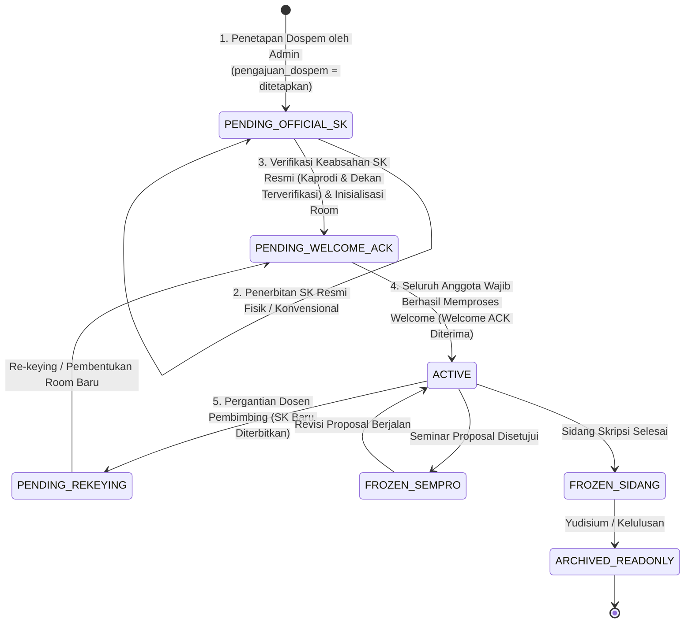
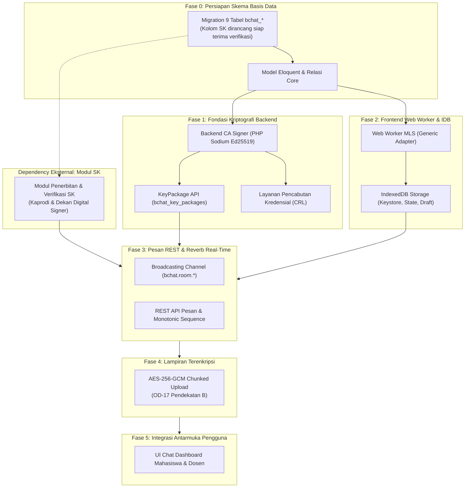

# B-CHAT-12A — REKONSILIASI GAP AUDIT DAN KESIAPAN IMPLEMENTASI E2EE
## SISTEM INFORMASI MANAJEMEN SKRIPSI UNUHA

| Parameter | Keterangan |
| :--- | :--- |
| **Proyek** | Sistem Informasi Manajemen Skripsi UNUHA |
| **Fitur** | Bimbingan Online Chat Real-Time E2EE (B-CHAT) |
| **Tahap** | B-CHAT-12A — Rekonsiliasi GAP Audit dan Kesiapan Implementasi |
| **Mode Audit** | STRICTLY READ-ONLY — ZERO IMPLEMENTATION MUTATION |
| **Acuan Arsitektur** | [`B-CHAT-11_Spesifikasi_Integrasi_E2EE.md`](file:///d:/Aplikasi/laragon/www/sistem_manajamen_skripsi/B-CHAT-11_Spesifikasi_Integrasi_E2EE.md) (Revisi B-CHAT-11E) |
| **Laporan Terkait** | [`B-CHAT-12_Tahap_0_Audit_Kesiapan_Implementasi.md`](file:///d:/Aplikasi/laragon/www/sistem_manajamen_skripsi/B-CHAT-12_Tahap_0_Audit_Kesiapan_Implementasi.md) |
| **Waktu Pelaksanaan** | 2026-11-06 |
| **Auditor** | Tim Arsitektur & Kriptografi E2EE Antigravity |

---

## 1. Ringkasan Eksekutif

Laporan Rekonsiliasi B-CHAT-12A disusun sebagai tindak lanjut langsung atas audit kesiapan implementasi Tahap 0. Rekonsiliasi ini bertujuan mengoreksi ambiguitas temuan awal, menegaskan kepatuhan terhadap tata kelola akademik universitas, menyelaraskan 9 tabel skema konseptual basis data, serta menetapkan batas kesiapan implementasi secara terukur dan presisi.

### Pokok-Pokok Rekonsiliasi:
1. **Penegasan Mutlak Prasyarat SK Resmi Kaprodi & Dekan:**
   Status administratif `pengajuan_dospem = 'ditetapkan'` oleh Admin **DILARANG DIJADIKAN PENGGANTI SK RESMI**. Usulan kompromi sementara pada laporan Tahap 0 yang menyarankan pengalihan trigger aktivasi ke status Admin secara tegas **DIBATALKAN**. Dokumen Surat Keputusan (SK) resmi yang ditandatangani oleh Ketua Program Studi (Kaprodi) dan Dekan Fakultas tetap menjadi **prasyarat mutlak (hard prerequisite)** untuk mengaktifkan ruang bimbingan E2EE (*room activation*).
2. **Ketiadaan Modul SK sebagai Dependency Terbuka:**
   Pemeriksaan menyeluruh pada basis data dan backend Laravel membuktikan bahwa modul penerbitan SK resmi, penyimpanan berkas SK, pencatatan nomor/tanggal SK, dan tanda tangan digital pejabat fakultas/prodi **BELUM TERSEDIA** di sistem. Kondisi ini diklasifikasikan sebagai **EXTERNAL DEPENDENCY BLOCKER** bagi aktivasi percakapan E2EE.
3. **Rekonsiliasi 9 Tabel Konseptual `bchat_*`:**
   Ditetapkan bahwa skema database konseptual E2EE secara baku terdiri atas **9 tabel berawalan `bchat_`** sesuai Bab 7 B-CHAT-11. Komponen sertifikat CA, kredensial MLS pengguna, dan MLS epoch state telah direkonsiliasi: ketiganya **TIDAK MEMERLUKAN TABEL SERVER TERPISAH** karena fungsinya telah dipenuhi oleh secured filesystem storage (`storage/app/secure/ca/`), kolom-kolom pada tabel `bchat_rooms` dan `bchat_messages`, serta penyimpanan lokal klien di IndexedDB (`mls_group_states`).
4. **Lifecycle Aktivasi Room Tanpa Jalan Pintas (*Zero-Bypass Lifecycle*):**
   Disusun mesin status 7 tahap yang menjamin bahwa room chat pairwise dibuat dalam status tertahan (`PENDING_OFFICIAL_SK`) dan **TIDAK AKAN PERNAH BERUBAH MENJADI `ACTIVE`** sebelum dokumen SK terverifikasi sah dan konfirmasi deterministik Welcome (Welcome ACK) diterima dari seluruh anggota yang sah.
5. **Kesiapan Perencanaan Migration Pertama:**
   Pekerjaan migrasi 9 tabel `bchat_*` dinyatakan **READY WITH CONDITIONS**. Skema tabel dapat disiapkan dan dijalankan tanpa merusak tabel aplikasi yang ada, dengan syarat representasi data SK pada tabel `bchat_rooms` menampung atribut verifikasi SK secara terstruktur sembari menunggu kehadiran modul SK resmi.

---

## 2. Bukti Kondisi Modul SK Resmi

Penelusuran mendalam terhadap seluruh berkas model, controller, migrasi basis data, dan rute pada aplikasi Laravel ([`manajemen_skripsi`](file:///d:/Aplikasi/laragon/www/sistem_manajamen_skripsi/manajemen_skripsi)) menghasilkan bukti-bukti faktual sebagai berikut:

### 2.1. Alur Penetapan Dosen Pembimbing Saat Ini
Penetapan dosen pembimbing diatur di dalam [`PengajuanDospemAdminController.php`](file:///d:/Aplikasi/laragon/www/sistem_manajamen_skripsi/manajemen_skripsi/app/Http/Controllers/Admin/PengajuanDospemAdminController.php#L150-L228):
* Metode `tetapkan(Request $request, $id)` hanya memeriksa:
  1. Status pengajuan berada pada status `menunggu_penetapan`.
  2. Tahap bimbingan adalah `proposal`.
  3. Relasi skripsi terverifikasi milik mahasiswa pengaju dan judul skripsi telah berstatus `disetujui` oleh Kaprodi (`PengajuanJudul`).
  4. Belum ada dosen pembimbing yang terdaftar pada tabel `dosen_pembimbing`.
* Eksekusi penetapan (Baris 195–206) melakukan dua operasi:
  ```php
  $lockedPengajuan->update([
      'status'        => 'ditetapkan',
      'dosen_id'      => $dosen->id_dosen,
      'catatan_admin' => $catatanAdmin,
  ]);

  DosenPembimbing::create([
      'id_skripsi' => $lockedSkripsi->id_skripsi,
      'id_dosen'   => $dosen->id_dosen,
  ]);
  ```
* Metode ini kemudian menulis entri log di `pengajuan_dospem_logs` dan memancarkan notifikasi akademik via `AcademicNotificationDispatcher`.

### 2.2. Ketiadaan Modul dan Entitas SK Resmi
1. **Tidak Ada Tabel SK:** Tidak ditemukan migrasi basis data untuk entitas surat keputusan (misalnya `surat_keputusan`, `sk_dospem`, atau sejenisnya).
2. **Tidak Ada Atribut SK:** Tabel `pengajuan_dospem`, `dosen_pembimbing`, maupun `skripsi` sama sekali tidak memiliki kolom:
   - `nomor_sk` (nomor surat keputusan resmi fakultas/universitas).
   - `file_sk` / `dokumen_sk` (path berkas digital PDF SK).
   - `tanggal_sk` / `berlaku_mulai` / `berlaku_sampai`.
   - `penandatangan_kaprodi_id` / `penandatangan_dekan_id`.
3. **Ketiadaan Tanda Tangan Digital:** Tidak ada algoritma kriptografi (kunci privat, hash dokumen, stempel digital, atau verifier tanda tangan) untuk mengesahkan keaslian SK.
4. **Peran Kaprodi dan Dekan:**
   - Kaprodi hanya memiliki kewenangan persetujuan judul skripsi via [`KaprodiPengajuanJudulController.php`](file:///d:/Aplikasi/laragon/www/sistem_manajamen_skripsi/manajemen_skripsi/app/Http/Controllers/KaprodiPengajuanJudulController.php#L135).
   - Peran Dekan **belum ada** di dalam sistem (tabel `users` hanya memiliki enum peran: `admin`, `dosen`, `mahasiswa`).

### 2.3. Matriks Kondisi Faktual Elemen SK

| Elemen | Tersedia | Bukti Kode Sumber | Keterangan GAP |
| :--- | :---: | :--- | :--- |
| **Penetapan dosen oleh Admin** | **YA** | [`PengajuanDospemAdminController.php#L195-L206`](file:///d:/Aplikasi/laragon/www/sistem_manajamen_skripsi/manajemen_skripsi/app/Http/Controllers/Admin/PengajuanDospemAdminController.php#L195-L206) | Berjalan lancar, namun murni bersifat penugasan administratif internal sistem. |
| **Nomor SK** | **TIDAK** | Skema tabel `pengajuan_dospem` & `dosen_pembimbing` | Tidak ada kolom penyimpanan nomor SK resmi. |
| **Dokumen SK** | **TIDAK** | [`config/filesystems.php`](file:///d:/Aplikasi/laragon/www/sistem_manajamen_skripsi/manajemen_skripsi/config/filesystems.php) & Model `PengajuanDospem` | Tidak ada modul penyimpanan/pengunggahan file PDF SK. |
| **Tanggal SK** | **TIDAK** | Skema tabel `pengajuan_dospem` | Tidak ada pencatatan tanggal penerbitan atau masa berlaku SK. |
| **Penandatangan Kaprodi** | **TIDAK** | [`KaprodiPengajuanJudulController.php`](file:///d:/Aplikasi/laragon/www/sistem_manajamen_skripsi/manajemen_skripsi/app/Http/Controllers/KaprodiPengajuanJudulController.php) | Kaprodi hanya menyetujui judul; tidak ada alur penandatanganan SK pembimbing oleh Kaprodi. |
| **Penandatangan Dekan** | **TIDAK** | Enum `role` pada model [`User.php`](file:///d:/Aplikasi/laragon/www/sistem_manajamen_skripsi/manajemen_skripsi/app/Models/User.php#L25) | Peran Dekan belum terdaftar; tidak ada alur penandatanganan SK oleh Dekan. |
| **Verifikasi Keaslian SK** | **TIDAK** | Seluruh controller & service | Tidak ada infrastruktur verifikasi keaslian dokumen atau stempel digital. |
| **Relasi SK dengan Pembimbing & Mahasiswa** | **TIDAK** | Relasi Eloquent `Skripsi`, `DosenPembimbing` | Relasi yang ada hanya mencatat `id_skripsi` dan `id_dosen` tanpa mengacu pada dasar hukum SK resmi. |

---

## 3. Matriks Rekonsiliasi Sembilan Tabel Konseptual dan Entitas Tambahan

Menindaklanjuti perbandingan antara Bab 7 B-CHAT-11 dan laporan kesiapan Tahap 0, seluruh tabel konseptual diselaraskan dengan nomenklatur baku berawalan `bchat_`. Selain itu, dievaluasi status 3 entitas pendukung (CA, Kredensial MLS, dan State Epoch) guna menghindari redundansi basis data:

### 3.1. Matriks Rekonsiliasi Entitas Basis Data

| No | Entitas Konseptual | Nama Tabel Baku | Fungsi Utama dalam Sistem E2EE | Relasi Kunci Utama | Status Keputusan |
| :-: | :--- | :--- | :--- | :--- | :--- |
| **1** | **Room** | `bchat_rooms` | Menyimpan metadata ruang obrolan pairwise, status siklus hidup room, sequence monotonic, epoch aktif, dan blob pesan Welcome inisialisasi. | FK ke `skripsi(id_skripsi)`. Unique: `(skripsi_id, pembimbing_ke)`. | **Tabel Tersendiri (Wajib)** |
| **2** | **Room Member** | `bchat_room_members` | Mencatat keanggotaan mahasiswa dan dosen pembimbing pada suatu room, peran akademik, epoch saat bergabung, dan status keaktifan. | FK ke `bchat_rooms(id)` dan `users(id)`. Unique: `(room_id, user_id)`. | **Tabel Tersendiri (Wajib)** |
| **3** | **Key Package** | `bchat_key_packages` | Menyimpan *pre-key pool* / KeyPackage MLS bertanda tangan CA milik pengguna yang siap dikonsumsi satu kali saat pembentukan room. | FK ke `users(id)`. Unique: `key_package_hash`. Index: `(user_id, is_consumed)`. | **Tabel Tersendiri (Wajib)** |
| **4** | **Message** | `bchat_messages` | Menyimpan rekaman ciphertext pesan (MLS PrivateMessage), urutan server monotonik (`server_sequence`), epoch, generasi, tipe konten, dan hash verifikasi. | FK ke `bchat_rooms(id)` dan `users(id)`. Unique: `(room_id, server_sequence)`. | **Tabel Tersendiri (Wajib)** |
| **5** | **Receipt** | `bchat_message_receipts` | Mencatat status tanda terima pengiriman (`DELIVERED`) dan pembacaan (`READ`) per pengguna tanpa memutasi baris ciphertext pesan. | FK ke `bchat_messages(id)` dan `users(id)`. Unique: `(message_id, user_id, status)`. | **Tabel Tersendiri (Wajib)** |
| **6** | **Upload Session** | `bchat_upload_sessions` | Mengelola sesi unggah berkas biner terenkripsi (chunked upload) sebelum pesan manifest diterbitkan. | FK ke `bchat_rooms(id)` dan `users(id)`. Unique: `upload_session_id`. | **Tabel Tersendiri (Wajib)** |
| **7** | **Attachment** | `bchat_attachments` | Mencatat metadata berkas lampiran terenkripsi AES-256-GCM, total chunk, ukuran byte, dan hash integritas ciphertext SHA-256. | FK ke `bchat_upload_sessions(id)`, `bchat_rooms(id)`, dan `bchat_messages(id)`. | **Tabel Tersendiri (Wajib)** |
| **8** | **Attachment Chunk** | `bchat_attachment_chunks` | Mencatat lokasi penyimpanan fisik potongan berkas terenkripsi pada storage privat Laravel (`storage/app/private/bchat_attachments/`). | FK ke `bchat_attachments(id)`. Unique: `(attachment_id, chunk_index)`. | **Tabel Tersendiri (Wajib)** |
| **9** | **CRL Revocation** | `bchat_crl_revocations` | Menyimpan daftar pencabutan kredensial identitas pengguna yang diterbitkan oleh CA backend guna verifikasi integritas saat pembentukan grup. | FK ke `users(id)`. Unique: `revoked_credential_uuid`. | **Tabel Tersendiri (Wajib)** |
| **10** | **CA Certificate / Key** | *(Bukan Tabel)* | Menyimpan pasangan kunci root CA Ed25519 UNUHA yang digunakan untuk menandatangani kredensial identitas pengguna. | Disimpan aman di filesystem privat di luar web root: `storage/app/secure/ca/unuha_bchat_ca_ed25519.key`. | **Tercakup di Filesystem Storage** (Tidak perlu tabel DB) |
| **11** | **MLS Identity Credential** | *(Bukan Tabel Terpisah)* | Memuat klaim identitas pengguna (nama, peran, institusi) bertanda tangan digital CA. | Terkandung di dalam blob `key_package_data` pada tabel `bchat_key_packages` dan diverifikasi via `bchat_crl_revocations`. | **Tercakup pada Tabel Key Package & CRL** |
| **12** | **MLS Epoch / State Recovery** | *(Bukan Tabel Terpisah)* | Menyimpan riwayat transisi epoch dan pemulihan state TreeKEM grup. | Counter epoch tersimpan di `bchat_rooms.current_epoch`; epoch per pesan di `bchat_messages.epoch`; State pohon utuh tersimpan di IndexedDB klien (`mls_group_states`). | **Tercakup pada Tabel Room, Message, & IDB Klien** |

### 3.2. Penegasan Karakteristik Pairwise
Skema di atas dirancang secara ketat untuk menjamin prinsip isolasi pairwise:
* **Tahap Proposal:** Dibuat tepat satu room antara Mahasiswa dan Pembimbing Proposal (`pembimbing_ke = 1`).
* **Tahap Skripsi:** Dibuat maksimal dua room terpisah secara independen:
  1. Room Pasangan 1: Mahasiswa $\leftrightarrow$ Dosen Pembimbing 1 (`pembimbing_ke = 1`).
  2. Room Pasangan 2: Mahasiswa $\leftrightarrow$ Dosen Pembimbing 2 (`pembimbing_ke = 2`).
* **Isolasi Pergantian Pembimbing:** Jika Dosen Pembimbing 1 diganti melalui penerbitan SK revisi, hanya Room Pasangan 1 yang dibekukan/dibuat ulang. Room Pasangan 2 **sama sekali tidak terpengaruh** dan state kriptografi MLS-nya tetap beroperasi normal.

---

## 4. Lifecycle Aktivasi Room yang Direkomendasikan

Lifecycle ruang bimbingan E2EE wajib mengikuti mesin status deterministik tanpa jalan pintas (*zero-bypass state machine*). Status penetapan oleh Admin **tidak pernah** langsung mengaktifkan room.



### Rincian 7 Tahap Lifecycle Room:

1. **Tahap 1: Penetapan Dosen Pembimbing Administratif oleh Admin**
   - Admin menetapkan dosen pembimbing pada sistem akademik (`pengajuan_dospem.status = 'ditetapkan'`, membuat entri `dosen_pembimbing`).
   - Sistem mendaftarkan entitas `bchat_rooms` dengan status awal: **`PENDING_OFFICIAL_SK`**.
   - **Aturan Keamanan:** Pada status ini, pertukaran pesan, pengunggahan lampiran, maupun pembentukan tree MLS **DILARANG KERAS**.
2. **Tahap 2: Penerbitan SK Resmi**
   - Bagian tata usaha/fakultas menerbitkan Surat Keputusan resmi penetapan dosen pembimbing yang memuat nomor SK, tanggal penetapan, serta ditandatangani oleh Ketua Program Studi dan Dekan Fakultas.
   - Status room: **Tetap `PENDING_OFFICIAL_SK`** (menunggu verifikasi sistem).
3. **Tahap 3: Verifikasi SK dan Pihak Penandatangan**
   - Sistem memverifikasi keabsahan dokumen SK:
     - Nomor SK terdaftar resmi dan tanggal SK masih dalam rentang berlaku.
     - Tanda tangan digital Kaprodi dan Dekan terbukti sah melalui verifikasi kriptografis.
     - Data mahasiswa, dosen pembimbing, dan judul skripsi cocok 100% dengan penetapan akademik.
   - **Kondisi Khusus (GAP Saat Ini):** Karena modul SK belum ada di aplikasi, seluruh room yang terbentuk akan **TERTAHAN SECARA AMAN pada status `PENDING_OFFICIAL_SK`**. Tidak ada pihak yang dapat melewati gerbang ini tanpa verifikasi SK.
4. **Tahap 4: Pembuatan Room & Inisialisasi MLS Group**
   - Setelah SK terverifikasi sah, backend memperbarui status room menjadi **`PENDING_WELCOME_ACK`**.
   - Klien Mahasiswa (inisiator) mengambil KeyPackage publik Dosen Pembimbing dari `bchat_key_packages`.
   - Web Worker Mahasiswa membangkitkan grup MLS (TreeKEM), menambahkan Dosen, dan menghasilkan pesan biner `Welcome`.
   - Pesan `Welcome` disimpan pada `bchat_rooms.welcome_message`.
5. **Tahap 5: Pendaftaran Anggota & Notifikasi Distribusi Welcome**
   - Backend mendaftarkan keanggotaan pada `bchat_room_members`.
   - Backend mengirimkan sinyal siaran Reverb via channel privat dosen (`users.{dosenUserId}.notifications`) bahwa paket Welcome siap diunduh.
6. **Tahap 6: Konfirmasi Welcome (Welcome ACK Deterministik)**
   - Web Worker Dosen mengunduh `welcome_message`, memvalidasi root CA UNUHA, memvalidasi ratchet tree, dan mengonfirmasi keberhasilan inisialisasi state lokal ke backend via endpoint `POST /api/bchat/rooms/{id}/welcome-ack`.
7. **Tahap 7: Aktivasi Room (`ACTIVE`)**
   - Backend memverifikasi bahwa:
     1. Status SK telah terverifikasi (`status_sk = VERIFIED`).
     2. Konfirmasi Welcome ACK dari kedua anggota telah tercatat lengkap.
   - Backend mengubah status menjadi **`ACTIVE`**.
   - Percakapan terenkripsi E2EE resmi dibuka.

---

## 5. Rekonsiliasi Urutan Implementasi

Penyusunan urutan fase implementasi harus mencerminkan ketergantungan nyata antara skema data, layanan kriptografi backend, runtime frontend, dan gerbang verifikasi SK:



### Analisis Ketergantungan dan Prasyarat:
1. **Pekerjaan yang Dapat Berjalan Paralel:**
   - **Fase 0 (Migration 9 Tabel `bchat_*`)** dan **Fase 1 (Backend CA Signer via PHP Sodium)** dapat dikembangkan tanpa menunggu modul SK selesai, karena skema tabel dan penerbitan KeyPackage adalah fondasi infrastruktur pasif.
   - **Fase 2 (Frontend Web Worker & IndexedDB)** dapat dikembangkan secara independen menggunakan generic adapter di browser.
2. **Blocker Wajib bagi Komunikasi Aktif (Fase 3 ke atas):**
   - Pertukaran pesan (`bchat_messages`), siaran Reverb, dan aktivasi room **DIBLOKIR SECARA MUTLAK** sampai modul/data verifikasi SK resmi tersedia.
   - Tanpa verifikasi SK, status room tertahan di `PENDING_OFFICIAL_SK`, sehingga endpoint pengiriman pesan akan menolak akses (`403 Forbidden: Room pending official SK verification`).
3. **Keputusan OPEN yang Terisolasi:**
   - **OPEN-10 (Library MLS Produksi):** Terisolasi di dalam Web Worker melalui pola generic adapter; tidak menghalangi pembuatan skema basis data backend.
   - **OPEN-11 (Distribusi CEK OD-17):** Hanya mempengaruhi Fase 4 (Lampiran); skema tabel `bchat_attachments` dan `bchat_attachment_chunks` sudah sepenuhnya kompatibel dengan Pendekatan B.

---

## 6. Daftar Blocker dan Keputusan yang Dibutuhkan

Berikut adalah daftar hambatan (*blockers*) dan keputusan kebijakan yang harus ditetapkan oleh Pemilik Proyek / Pimpinan Teknis:

| ID Blocker | Deskripsi Hambatan | Dampak Terhadap Proyek | Keputusan yang Dibutuhkan dari Pemilik Proyek |
| :---: | :--- | :--- | :--- |
| **BLK-01** | **Ketiadaan Modul SK Resmi di Aplikasi** | Room tidak dapat berpindah dari `PENDING_OFFICIAL_SK` ke `ACTIVE`. Fitur chat tidak dapat digunakan secara operasional. | Menentukan apakah modul penerbitan SK digital (Kaprodi & Dekan) akan dibangun bersamaan dalam proyek ini atau disediakan data mock/bridging sementara untuk pengujian internal rintisan. |
| **BLK-02** | **Representasi Data SK pada Tabel `bchat_rooms`** | Rancangan kolom migrasi pertama memerlukan kepastian struktur pencatatan SK. | Menyetujui apakah tabel `bchat_rooms` menampung atribut kolom langsung: `sk_nomor VARCHAR(100)`, `sk_tanggal DATE`, `sk_file_path VARCHAR(255)`, `sk_verified_at TIMESTAMP NULL`, atau foreign key ke tabel modul SK terpisah. |
| **BLK-03** | **Ketiadaan Akun / Peran Dekan di Sistem** | Sistem tidak memiliki entitas pengguna Dekan untuk menandatangani SK. | Menyetujui penambahan peran `dekan` pada tabel `users` atau penetapan pejabat penandatangan melalui penugasan struktural. |

---

## 7. Rekomendasi Langkah Implementasi Pertama

Berdasarkan hasil rekonsiliasi ketergantungan di atas, direkomendasikan langkah implementasi pertama yang aman, modular, dan tidak menimbulkan risiko regresi terhadap sistem yang sedang berjalan:

### Rekomendasi Paket Pekerjaan: **B-CHAT-12 Tahap 1 — Fondasi Skema Database & Layanan CA Backend**
1. **Langkah 1: Penyusunan 9 Migration Laravel Baku (`bchat_*`)**
   - Menulis file migration untuk 9 tabel konseptual:
     1. `create_bchat_rooms_table.php` (dilengkapi kolom metadata SK: `sk_nomor`, `sk_tanggal`, `sk_file_path`, `sk_verified_at`).
     2. `create_bchat_room_members_table.php`
     3. `create_bchat_key_packages_table.php`
     4. `create_bchat_messages_table.php`
     5. `create_bchat_message_receipts_table.php`
     6. `create_bchat_upload_sessions_table.php`
     7. `create_bchat_attachments_table.php`
     8. `create_bchat_attachment_chunks_table.php`
     9. `create_bchat_crl_revocations_table.php`
   - *Alasan Kelayakan:* Seluruh foreign key tabel `bchat_*` mengarah ke tabel induk yang telah stabil (`skripsi` dan `users`). Tidak ada ketergantungan eksternal yang hilang pada level DDL basis data.
2. **Langkah 2: Model Eloquent & Relasi E2EE**
   - Membuat model Eloquent di `app/Models/` untuk masing-masing tabel `bchat_*`.
   - Menghubungkan relasi dari model `Skripsi` dan `User` ke model `BchatRoom` dan `BchatKeyPackage`.
3. **Langkah 3: Layanan Backend CA Signer (`MlsCaService`)**
   - Membangun service class di `app/Services/E2EE/MlsCaService.php` menggunakan ekstensi bawaan PHP 8.2 libsodium (`sodium_crypto_sign_*`).
   - Menyimpan private key CA di luar web root pada `storage/app/secure/ca/`.
   - Mengimplementasikan endpoint pendaftaran dan pengambilan Key Package publik (`POST & GET /api/bchat/key-packages`).

---

## 8. Keputusan Kesiapan Implementasi (Audit E)

Berikut adalah ketetapan status kesiapan formal untuk 6 parameter kunci:

| No | Parameter Evaluasi Kesiapan | Status Formal | Dasar Pertimbangan & Bukti |
| :-: | :--- | :---: | :--- |
| **1** | **Dukungan Persyaratan SK Resmi Saat Ini** | **BLOCKED** | Modul SK resmi, nomor SK, berkas SK, dan tanda tangan digital Kaprodi/Dekan terbukti **belum tersedia sama sekali** di aplikasi utama. |
| **2** | **Konsistensi Rancangan Tabel Konseptual** | **READY WITH CONDITIONS** | 9 tabel baku `bchat_*` telah selaras penuh dengan B-CHAT-11 Bab 7. Entitas CA, kredensial, dan state MLS telah terbukti tidak memerlukan tabel tambahan. Kondisi: Nama tabel wajib seragam berawalan `bchat_*`. |
| **3** | **Kepastian Lifecycle Aktivasi Room** | **READY** | Lifecycle 7 tahap (dari status `PENDING_OFFICIAL_SK` hingga `ACTIVE`) telah didefinisikan secara deterministik tanpa toleransi jalan pintas bypass. |
| **4** | **Kelayakan Perencanaan Migrasi Pertama** | **READY WITH CONDITIONS** | Skema 9 tabel siap dimigrasikan ke database Laravel karena tabel induk (`skripsi`, `users`) sudah ada. Kondisi: Kolom metadata SK disematkan langsung pada `bchat_rooms` untuk menampung verifikasi SK. |
| **5** | **Kelayakan Memulai Fase Backend** | **READY WITH CONDITIONS** | Pengembangan skema tabel, model Eloquent, dan layanan CA Ed25519 siap dimulai. Kondisi: Ruang obrolan tidak boleh diaktifkan sebelum verifikasi SK dapat diuji secara nyata. |
| **6** | **Status Blocker Keputusan Pemilik Proyek** | **OPEN** | Pemilik proyek perlu memutuskan arah pembangunan modul SK (apakah dibuat penuh, diintegrasikan, atau menggunakan mekanisme verifikasi rintisan). |

---

## 9. Bukti Path dan Nama Komponen yang Diperiksa

Seluruh temuan dalam laporan rekonsiliasi ini merujuk secara akurat pada berkas-berkas berikut:

1. **Dokumen Acuan & Spesifikasi:**
   - [`B-CHAT-11_Spesifikasi_Integrasi_E2EE.md`](file:///d:/Aplikasi/laragon/www/sistem_manajamen_skripsi/B-CHAT-11_Spesifikasi_Integrasi_E2EE.md) (Bab 3, 5, 7, dan 8).
   - [`B-CHAT-12_Tahap_0_Audit_Kesiapan_Implementasi.md`](file:///d:/Aplikasi/laragon/www/sistem_manajamen_skripsi/B-CHAT-12_Tahap_0_Audit_Kesiapan_Implementasi.md).
2. **Backend Controllers & Services:**
   - [`PengajuanDospemAdminController.php`](file:///d:/Aplikasi/laragon/www/sistem_manajamen_skripsi/manajemen_skripsi/app/Http/Controllers/Admin/PengajuanDospemAdminController.php#L150-L228) (Alur penetapan administratif dosen pembimbing oleh Admin).
   - [`KaprodiPengajuanJudulController.php`](file:///d:/Aplikasi/laragon/www/sistem_manajamen_skripsi/manajemen_skripsi/app/Http/Controllers/KaprodiPengajuanJudulController.php#L21-L60) (Penetapan kewenangan program studi Kaprodi).
   - [`BimbinganController.php`](file:///d:/Aplikasi/laragon/www/sistem_manajamen_skripsi/manajemen_skripsi/app/Http/Controllers/BimbinganController.php) (Pencatatan log bimbingan manual konvensional).
   - [`AcademicNotificationDispatcher.php`](file:///d:/Aplikasi/laragon/www/sistem_manajamen_skripsi/manajemen_skripsi/app/Services/AcademicNotificationDispatcher.php) (Pemicu siaran event notifikasi akademik).
3. **Backend Models & Konfigurasi:**
   - [`User.php`](file:///d:/Aplikasi/laragon/www/sistem_manajamen_skripsi/manajemen_skripsi/app/Models/User.php) (Enum role: `admin`, `dosen`, `mahasiswa`).
   - [`PengajuanDospem.php`](file:///d:/Aplikasi/laragon/www/sistem_manajamen_skripsi/manajemen_skripsi/app/Models/PengajuanDospem.php) (Status: `menunggu_penetapan`, `ditetapkan`, `ditolak`).
   - [`DosenPembimbing.php`](file:///d:/Aplikasi/laragon/www/sistem_manajamen_skripsi/manajemen_skripsi/app/Models/DosenPembimbing.php) (Relasi operasional pembimbing).
   - [`Skripsi.php`](file:///d:/Aplikasi/laragon/www/sistem_manajamen_skripsi/manajemen_skripsi/app/Models/Skripsi.php) (Entitas skripsi induk).
   - [`config/filesystems.php`](file:///d:/Aplikasi/laragon/www/sistem_manajamen_skripsi/manajemen_skripsi/config/filesystems.php) (Disk privat `'local'`).
4. **Frontend Components:**
   - [`src/lib/echo.ts`](file:///d:/Aplikasi/laragon/www/sistem_manajamen_skripsi/frontend_manajemen_skripsi/src/lib/echo.ts) (Koneksi Reverb singleton).
   - [`dashboardmahasiswa/bimbingan/page.tsx`](file:///d:/Aplikasi/laragon/www/sistem_manajamen_skripsi/frontend_manajemen_skripsi/src/app/(app)/(dashboard)/dashboardmahasiswa/bimbingan/page.tsx) (Mockup UI bimbingan mahasiswa).
   - [`dashboarddosen/pembimbing_skripsi/page.tsx`](file:///d:/Aplikasi/laragon/www/sistem_manajamen_skripsi/frontend_manajemen_skripsi/src/app/(app)/(dashboard)/dashboarddosen/pembimbing_skripsi/page.tsx) (Mockup UI bimbingan dosen).

---

## 10. Konfirmasi Integritas Workspace

Auditor mengonfirmasi dengan penuh kepatuhan bahwa selama pelaksanaan mandat **B-CHAT-12A**:
* **NOL Perubahan Kode:** Tidak ada kode Laravel, Next.js, model, controller, route, view, maupun worker yang diubah atau ditambah.
* **NOL Perubahan Basis Data:** Tidak ada migrasi yang dijalankan, diubah, atau dibuat; tidak ada data yang dimanipulasi pada database SQLite/MySQL.
* **NOL Perubahan Dependensi:** Tidak ada paket Composer atau NPM yang dipasang, diperbarui, atau dihapus.
* **NOL Perubahan Konfigurasi:** Seluruh berkas `.env`, `.env.example`, dan konfigurasi sistem tetap utuh tanpa modifikasi.
* **NOL Perubahan Git:** Tidak ada operasi *commit*, *stage*, *stash*, *branching*, atau *push* yang dieksekusi.

---
*Laporan ini disusun secara resmi sebagai dokumen rekonsiliasi definitif untuk mengarahkan pembukaan mandat implementasi bertahap pada Sistem Informasi Manajemen Skripsi UNUHA.*

