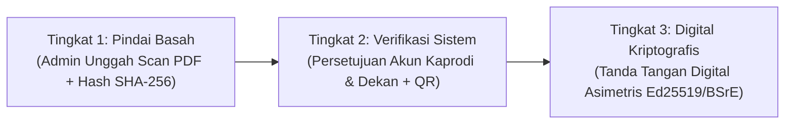
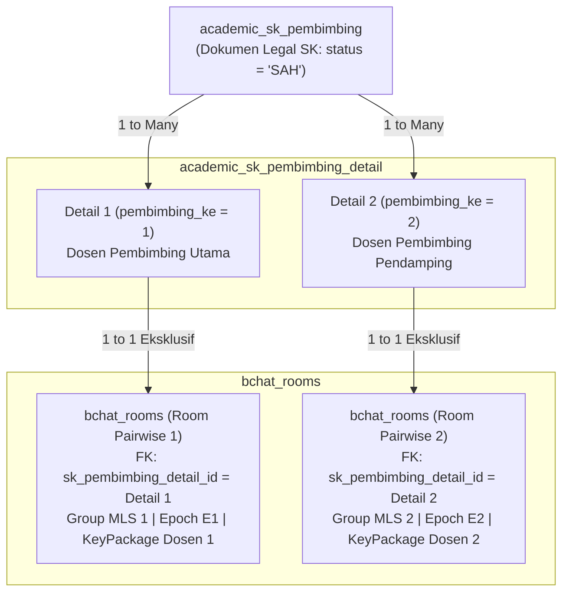
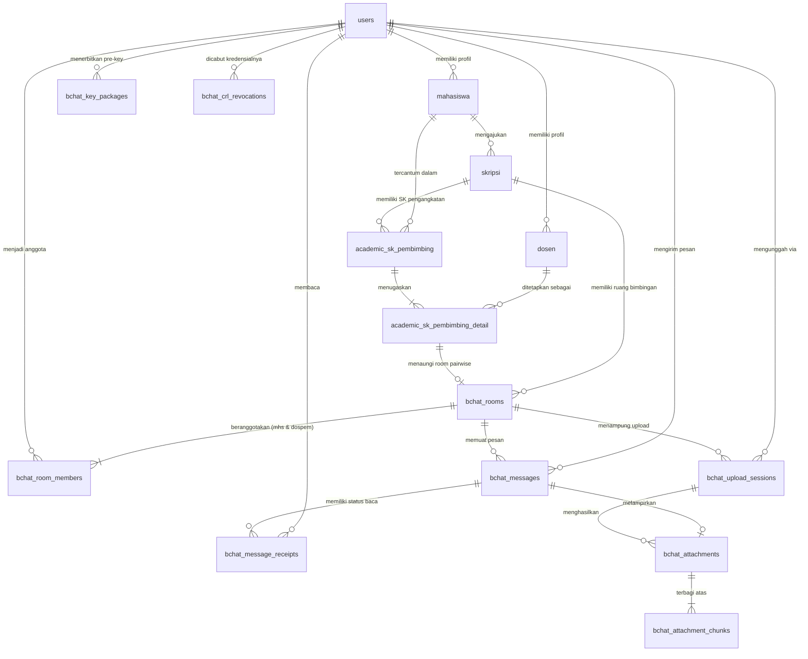

# B-CHAT-12B — FINALISASI MODEL SK AKADEMIK DAN RELASI DENGAN PAIRWISE ROOM
## SISTEM INFORMASI MANAJEMEN SKRIPSI UNUHA

| Parameter | Keterangan |
| :--- | :--- |
| **Proyek** | Sistem Informasi Manajemen Skripsi UNUHA |
| **Fitur** | Bimbingan Online Chat Real-Time E2EE (B-CHAT) |
| **Tahap** | B-CHAT-12B — Finalisasi Model SK Akademik dan Relasi Pairwise Room |
| **Mode Audit** | STRICTLY READ-ONLY — DESIGN ONLY — ZERO CODE/DATABASE MUTATION |
| **Acuan Arsitektur** | [`B-CHAT-11_Spesifikasi_Integrasi_E2EE.md`](file:///d:/Aplikasi/laragon/www/sistem_manajamen_skripsi/B-CHAT-11_Spesifikasi_Integrasi_E2EE.md), [`B-CHAT-12A`](file:///d:/Aplikasi/laragon/www/sistem_manajamen_skripsi/B-CHAT-12A_Rekonsiliasi_GAP_Kesiapan_Implementasi.md) |
| **Waktu Pelaksanaan** | 2026-11-06 |
| **Auditor** | Tim Arsitektur & Kriptografi E2EE Antigravity |

---

## 1. Ringkasan Eksekutif

Mandat B-CHAT-12B dilaksanakan untuk menyelesaikan perancangan model data Surat Keputusan (SK) resmi pengangkatan dosen pembimbing dan merumuskan relasi strukturalnya dengan ruang obrolan (*room*) E2EE pairwise.

### Pokok-Pokok Desain Final:
1. **Dekomposisi Entitas SK Resmi Menjadi Induk-Detail:**
   Untuk mengakomodasi fleksibilitas jumlah pembimbing (1 dosen pada tahap proposal, dan 1 atau 2 dosen pada tahap skripsi) serta memastikan integritas riwayat pergantian dosen, entitas SK resmi dimodelkan menjadi dua tabel konseptual:
   - `academic_sk_pembimbing` (Entitas Induk Dokumen SK resmi).
   - `academic_sk_pembimbing_detail` (Entitas Detail Penugasan per Dosen Pembimbing).
2. **Kopling Deterministik Rantai Otorisasi Pairwise Room:**
   Hubungan struktural ditetapkan dengan rantai tegas:
   $$\text{SK Resmi} \longrightarrow \text{Detail Penugasan Pembimbing} \longrightarrow \text{Pairwise Room}$$
   Setiap entitas `bchat_rooms` wajib mereferensikan secara langsung satu entitas penugasan spesifik pada `academic_sk_pembimbing_detail.id`. Desain ini menjamin bahwa satu room pairwise hanya mengikat tepat satu pasangan (Mahasiswa $\leftrightarrow$ Dosen Pembimbing Tertentu) di bawah payung hukum penugasan yang sah.
3. **Isolasi Mutlak Pairwise pada Tahap Skripsi:**
   Pada tahap skripsi dengan dua dosen pembimbing, sistem membentuk dua ruang obrolan yang sepenuhnya independen (Room 1 untuk Pembimbing 1, Room 2 untuk Pembimbing 2). Masing-masing room memiliki kunci grup MLS, epoch, ratchet tree, sekuens pesan, dan channel siaran Reverb tersendiri. Penggantian salah satu pembimbing **sama sekali tidak mempengaruhi** room pembimbing lainnya.
4. **Prinsip Gerbang Keamanan Ganda (Dual Barrier):**
   Pencabutan atau pembatalan SK diberlakukan melalui dua lapisan:
   - *Lapisan Otorisasi Server:* Status room dibekukan menjadi `ARCHIVED_READONLY` atau `TERMINATED`, channel WebSocket ditutup, dan akses API ditolak seketika.
   - *Lapisan Kriptografi MLS:* Room lama tidak pernah digunakan kembali untuk dosen baru; dibuat room baru dengan grup TreeKEM baru sehingga dosen lama secara matematis tidak dapat mendekripsi pesan masa depan (*Forward Secrecy* & *Post-Compromise Security*).
5. **Kesiapan Perencanaan Migrasi Pertama:**
   Migrasi database pertama dinilai **READY FOR DRAFTING WITH CONDITIONS**. Skema migration pertama direkomendasikan mencakup 2 tabel modul SK (`academic_sk_pembimbing` dan `academic_sk_pembimbing_detail`) bersama 9 tabel `bchat_*`, sehingga integritas referensial Foreign Key terkunci sejak awal.

---

## 2. Kondisi Aktual Tabel dan Relasi Akademik Saat Ini

Berdasarkan penelusuran kode sumber Laravel pada repositori [`manajemen_skripsi`](file:///d:/Aplikasi/laragon/www/sistem_manajamen_skripsi/manajemen_skripsi), kondisi riil relasi akademik yang ada dirangkum dalam tabel inventarisasi berikut:

### 2.1. Inventarisasi Model dan Skema Akademik Eksisting

| Model / Tabel | Primary Key | Foreign Key Penting | Kolom Status & Atribut Kunci | Kondisi Riil & Batasan |
| :--- | :--- | :--- | :--- | :--- |
| [`Skripsi`](file:///d:/Aplikasi/laragon/www/sistem_manajamen_skripsi/manajemen_skripsi/app/Models/Skripsi.php) / `skripsi` | `id_skripsi` | `id_mahasiswa` $\rightarrow$ `mahasiswa.id_mahasiswa` | `judul`, `status_judul` (`'diajukan'`, `'disetujui'`) | Tidak memiliki timestamps. Satu mahasiswa dapat memiliki riwayat skripsi melalui relasi 1-to-N. |
| [`Mahasiswa`](file:///d:/Aplikasi/laragon/www/sistem_manajamen_skripsi/manajemen_skripsi/app/Models/Mahasiswa.php) / `mahasiswa` | `id_mahasiswa` | `user_id` $\rightarrow$ `users.id` | `NIM`, `nama_mahasiswa`, `prodi` | Terhubung 1-to-1 dengan akun `User`. |
| [`Dosen`](file:///d:/Aplikasi/laragon/www/sistem_manajamen_skripsi/manajemen_skripsi/app/Models/Dosen.php) / `dosen` | `id_dosen` | `user_id` $\rightarrow$ `users.id` | `NIDN`, `nama_dosen`, `prodi` | Terhubung 1-to-1 dengan akun `User`. |
| [`PengajuanDospem`](file:///d:/Aplikasi/laragon/www/sistem_manajamen_skripsi/manajemen_skripsi/app/Models/PengajuanDospem.php) / `pengajuan_dospem` | `id` | `skripsi_id` $\rightarrow$ `skripsi.id_skripsi` `mahasiswa_id` $\rightarrow$ `mahasiswa.id_mahasiswa` `dosen_id` $\rightarrow$ `dosen.id_dosen` | `tahap` (`'proposal'`, `'skripsi'`) `status` (`'menunggu_penetapan'`, `'ditetapkan'`, `'ditolak'`) | Hanya menampung 1 dosen terpilih (`dosen_id` skalar). Virtual column `active_tahap` membatasi 1 pengajuan aktif per tahap. |
| [`PengajuanDospemLog`](file:///d:/Aplikasi/laragon/www/sistem_manajamen_skripsi/manajemen_skripsi/app/Models/PengajuanDospemLog.php) / `pengajuan_dospem_logs` | `id` | `pengajuan_dospem_id` `user_id` $\rightarrow$ `users.id` | `tindakan`, `status_sebelum`, `status_sesudah`, `snapshot_dosen_id` | Audit log append-only atas aksi formulir antrean pengajuan dospem oleh Admin. |
| [`DosenPembimbing`](file:///d:/Aplikasi/laragon/www/sistem_manajamen_skripsi/manajemen_skripsi/app/Models/DosenPembimbing.php) / `dosen_pembimbing` | `id_pembimbing` | `id_skripsi` $\rightarrow$ `skripsi.id_skripsi` `id_dosen` $\rightarrow$ `dosen.id_dosen` | *(Hanya ID relasi, tanpa atribut status atau urutan)* | **Sangat sederhana.** Tidak ada kolom `pembimbing_ke` (1 vs 2), tidak ada status aktif/nonaktif, tidak ada tanggal penugasan, dan tidak ada timestamps. |
| [`PenugasanKaprodi`](file:///d:/Aplikasi/laragon/www/sistem_manajamen_skripsi/manajemen_skripsi/app/Models/PenugasanKaprodi.php) / `penugasan_kaprodi` | `id` | `dosen_id` $\rightarrow$ `dosen.id_dosen` | `prodi`, `tanggal_mulai`, `tanggal_selesai`, `is_aktif` | Menentukan dosen yang menjabat Kaprodi aktif per prodi; digunakan untuk memverifikasi hak persetujuan judul skripsi. |

### 2.2. Temuan Kritis Relasi Saat Ini:
1. **Ketiadaan Riwayat Penugasan:** Tabel `dosen_pembimbing` bersifat destruktif; jika dosen diganti dan record diperbarui/dihapus, sejarah penugasan dosen sebelumnya hilang tanpa jejak.
2. **Ketiadaan Pembeda Ordinal Pembimbing:** Tabel `dosen_pembimbing` tidak memiliki kolom `pembimbing_ke` atau penanda peran (Utama vs Pendamping).
3. **Pembatasan Logika Controller Tahap Skripsi:** Kode [`PengajuanDospemAdminController.php#L153-L155`](file:///d:/Aplikasi/laragon/www/sistem_manajamen_skripsi/manajemen_skripsi/app/Http/Controllers/Admin/PengajuanDospemAdminController.php#L153-L155) secara eksplisit melempar eksepsi:  
   `"Fitur penetapan ini hanya berlaku untuk tahap proposal pada rilis ini."`  
   Artinya, alur penetapan dua pembimbing untuk tahap skripsi belum diaktifkan di level controller.
4. **Zero Legal SK Artifact:** Tidak ada tabel, kolom, berkas biner, nomor SK, tanggal SK, maupun tanda tangan digital Kaprodi dan Dekan yang merepresentasikan SK resmi.

---

## 3. Model Entitas SK Resmi yang Direkomendasikan

Untuk mewadahi dokumen legal SK resmi secara utuh dan independen tanpa merusak struktur akademik yang ada, dirancang entitas induk: `academic_sk_pembimbing`.

### 3.1. Struktur Atribut Entitas `academic_sk_pembimbing`

| Nama Atribut | Tipe Data Konseptual | Sifat | Deskripsi & Fungsi Tata Kelola Akademik |
| :--- | :--- | :---: | :--- |
| `id` | BigInt Unsigned | PK, Auto | Identifikator unik internal sistem. |
| `nomor_sk` | Varchar(100) | Unique, Not Null | Nomor resmi Surat Keputusan (contoh: `042/SK/FTIK-UNUHA/X/2026`). |
| `skripsi_id` | BigInt Unsigned | FK, Not Null | Merujuk ke `skripsi(id_skripsi)` yang dinaungi. |
| `mahasiswa_id` | BigInt Unsigned | FK, Not Null | Merujuk ke `mahasiswa(id_mahasiswa)` yang ditetapkan. |
| `tahap` | Enum(`'proposal'`, `'skripsi'`) | Not Null | Tahap bimbingan akademik yang diatur oleh SK. |
| `tanggal_sk` | Date | Not Null | Tanggal resmi penerbitan dokumen SK oleh fakultas. |
| `berlaku_mulai` | Date | Not Null | Tanggal awal masa berlakunya SK bimbingan. |
| `berlaku_sampai` | Date | Nullable | Tanggal berakhir masa berlaku SK (misal 6 bulan sejak penetapan). |
| `dokumen_path` | Varchar(255) | Not Null | Lokasi berkas PDF SK pada storage privat (`storage/app/private/academic_sk/`). |
| `dokumen_hash_sha256` | Char(64) | Not Null | Hash SHA-256 berkas PDF untuk mendeteksi perubahan fisik dokumen (*tamper-proof*). |
| `status` | Enum | Not Null | Status siklus SK: `'DRAFT'`, `'MENUNGGU_PENGESAHAN'`, `'SAH'`, `'DITOLAK'`, `'DIBATALKAN'`, `'KEDALUWARSA'`. Default: `'DRAFT'`. |
| `kaprodi_user_id` | BigInt Unsigned | FK, Nullable | Akun dosen yang bertindak sebagai Kaprodi saat pengesahan. |
| `kaprodi_disahkan_at` | Timestamp | Nullable | Waktu pengesahan/persetujuan oleh Kaprodi. |
| `kaprodi_catatan` | Text | Nullable | Catatan verifikasi akademik dari Kaprodi. |
| `dekan_user_id` | BigInt Unsigned | FK, Nullable | Akun pejabat Dekan yang mengesahkan SK. |
| `dekan_disahkan_at` | Timestamp | Nullable | Waktu penetapan/pengesahan oleh Dekan. |
| `dekan_catatan` | Text | Nullable | Catatan pengesahan dari Dekan. |
| `metode_verifikasi` | Enum | Not Null | `'PINDAI_BASAH'`, `'VERIFIKASI_SISTEM'`, `'DIGITAL_KRIPTOGRAFIS_ED25519'`. |
| `tanda_tangan_dekan_sig` | Text | Nullable | Signature digital kriptografis (jika menggunakan metode digital). |
| `created_at` / `updated_at` | Timestamp | Nullable | Standar pencatatan audit Eloquent. |

### 3.2. Tiga Tingkat Mekanisme Pengesahan Dokumen SK

1. **Tingkat 1 — Dokumen SK Konvensional yang Dipindai (Fase Transisi Jangka Pendek):**
   Fakultas menerbitkan SK fisik bertanda tangan basah dan cap stempel. Berkas dipindai menjadi PDF dan diunggah ke storage privat Laravel. Sistem mencatat hash SHA-256 untuk mendeteksi pemalsuan berkas fisik.
2. **Tingkat 2 — Pengesahan Akun Struktural Sistem (Fase Rilis Integrasi):**
   Setelah berkas diunggah, Kaprodi login untuk memverifikasi aspek akademik (`kaprodi_disahkan_at`), kemudian Dekan login untuk menandatangani penerbitan resmi (`dekan_disahkan_at`). Status SK berubah menjadi `'SAH'`.
3. **Tingkat 3 — Tanda Tangan Digital Kriptografis Penuh (Fase Lanjutan):**
   Pejabat menandatangani ringkasan dokumen menggunakan asymmetric keypair (Ed25519 atau sertifikat X.509 resmi). Nilai signature disimpan di `tanda_tangan_dekan_sig` dan dapat diverifikasi oleh publik/mahasiswa.

---

## 4. Relasi Detail SK dan Pembimbing

Untuk menghubungkan SK dengan dosen pembimbing secara fleksibel, entitas induk SK didekomposisi dengan tabel detail: `academic_sk_pembimbing_detail`.

### 4.1. Struktur Atribut Entitas `academic_sk_pembimbing_detail`

| Nama Atribut | Tipe Data Konseptual | Sifat | Deskripsi & Fungsi Relasional |
| :--- | :--- | :---: | :--- |
| `id` | BigInt Unsigned | PK, Auto | Identifikator unik record penugasan pembimbing. |
| `sk_pembimbing_id` | BigInt Unsigned | FK, Not Null | Merujuk ke `academic_sk_pembimbing(id)` on delete cascade. |
| `dosen_id` | BigInt Unsigned | FK, Not Null | Merujuk ke `dosen(id_dosen)` yang ditugaskan. |
| `pembimbing_ke` | TinyInt Unsigned | Not Null | Ordinal peran: `1` (Pembimbing 1 / Proposal), `2` (Pembimbing 2 / Pendamping). |
| `peran_pembimbing` | Enum | Not Null | `'pembimbing_proposal'`, `'pembimbing_utama'`, `'pembimbing_pendamping'`. |
| `status_penugasan` | Enum | Not Null | `'AKTIF'`, `'DIGANTI'`, `'DIBATALKAN'`. Default: `'AKTIF'`. |
| `tanggal_mulai` | Date | Not Null | Tanggal penugasan dosen mulai aktif. |
| `tanggal_selesai` | Date | Nullable | Tanggal penugasan dosen berakhir (jika diganti/dibatalkan). |
| `digantikan_oleh_detail_id` | BigInt Unsigned | FK, Nullable | Merujuk ke `academic_sk_pembimbing_detail(id)` pengganti (audit silsilah pergantian). |
| `keterangan_perubahan` | Text | Nullable | Alasan administratif penggantian dosen pembimbing. |
| `created_at` / `updated_at` | Timestamp | Nullable | Timestamps Eloquent. |

### 4.2. Batasan Integritas Relasional (Database Constraints)
* **Kaidah Ordinal Unik per SK:**
  `UNIQUE KEY uk_sk_pembimbing_ke (sk_pembimbing_id, pembimbing_ke)`  
  *Menjamin satu SK tidak dapat memiliki dua dosen dengan nomor urut yang sama.*
* **Kaidah Dosen Unik per SK:**
  `UNIQUE KEY uk_sk_dosen (sk_pembimbing_id, dosen_id)`  
  *Menjamin satu dosen tidak ditugaskan ganda sebagai pembimbing 1 dan 2 pada SK yang sama.*
* **Kaidah Immutability Histori:**  
  Jika pembimbing diganti, baris penugasan lama **tidak ditimpa**, melainkan status diubah menjadi `'DIGANTI'`, `tanggal_selesai` diisi, dan kolom `digantikan_oleh_detail_id` ditautkan ke record penugasan baru pada SK pembaharuan.

---

## 5. Relasi SK dan Penugasan dengan Pairwise Room

Hubungan struktural antara modul hukum akademik dan subsistem kriptografi E2EE dirumuskan dengan prinsip **Kopling Deterministik Tertutup**:

### 5.1. Penyesuaian Kolom pada Tabel `bchat_rooms`
Untuk mengunci relasi dengan penugasan yang sah, tabel `bchat_rooms` (sebagaimana dirancang pada Bab 7 B-CHAT-11) dipertegas dengan penambahan atribut referensial:
* `sk_pembimbing_detail_id`: `BIGINT UNSIGNED NOT NULL FOREIGN KEY REFERENCES academic_sk_pembimbing_detail(id)`
* `UNIQUE KEY uk_room_sk_detail (sk_pembimbing_detail_id)`  
  *Menjamin satu penugasan pembimbing hanya memiliki tepat satu ruang obrolan pairwise aktif.*

### 5.2. Penegakan Kebijakan Keamanan Ruang Obrolan
1. **Otorisasi Ketat Sebelum Aktivasi:**
   Sebuah room pairwise **hanya diizinkan berpindah ke status `ACTIVE`** apabila:
   $$\text{bchat\_rooms.status} = \text{'ACTIVE'} \iff (\text{sk.status} = \text{'SAH'}) \land (\text{detail.status\_penugasan} = \text{'AKTIF'}) \land (\text{welcome\_ack} = \text{TRUE})$$
   Jika SK berstatus selain `'SAH'`, backend secara mutlak memblokir transmisi pesan (`403 Forbidden: SK Pembimbing Belum Disahkan`).
2. **Pencegahan Reaktivasi Ilegal Room Lama:**
   Ketika seorang dosen diganti, `detail.status_penugasan` diubah menjadi `'DIGANTI'`, dan room pairwise terkait diubah menjadi `'ARCHIVED_READONLY'`. Room ini **dikunci secara permanen** dari mutasi data pesan baru. Penggantian data administratif di masa depan tidak dapat mengaktifkan kembali room yang sudah diarsipkan.
3. **Pemisahan Kriptografi Pairwise:**
   Room 1 dan Room 2 memiliki Group ID MLS yang berlainan secara global. Pesan ciphertext Room 1 tidak dapat dibaca oleh Room 2, bahkan jika kedua dosen bimbingan berada dalam satu program studi yang sama.

---

## 6. Diagram Entity-Relationship (ERD) Konseptual

Berikut adalah diagram relasi entitas terintegrasi yang menghubungkan sistem akademik manajemen skripsi, entitas SK resmi, dan sembilan tabel subsistem E2EE:

---

## 7. Lifecycle dan Lima Skenario Perubahan

### Skenario 1 — Penetapan Normal (Proposal / Skripsi)
1. **Penetapan Administratif:** Admin menetapkan dosen pembimbing di sistem. Record `academic_sk_pembimbing` terbuat dengan status `'DRAFT'`, detail penugasan terisi.
2. **Pengesahan Dua Pihak:** Kaprodi memeriksa dan memberikan persetujuan (`kaprodi_disahkan_at`), Dekan mengesahkan SK resmi (`dekan_disahkan_at`). Status SK berubah menjadi **`'SAH'`**.
3. **Persiapan Room:** Backend mendeteksi SK sah dan menginisialisasi `bchat_rooms` (status: `PENDING_WELCOME_ACK`) terhubung ke `academic_sk_pembimbing_detail`.
4. **Prosedur MLS Welcome:** Mahasiswa mengambil KeyPackage Dosen dari `bchat_key_packages`, membentuk TreeKEM grup MLS, dan mengunggah paket Welcome ke `bchat_rooms.welcome_message`.
5. **Konfirmasi Deterministik & Aktivasi:** Dosen login, memvalidasi Welcome, dan mengirimkan Welcome ACK. Backend mengubah status room menjadi **`ACTIVE`**. Bimbingan online E2EE aktif.

### Skenario 2 — SK Ditolak atau Belum Lengkap
1. **Pengajuan & Penolakan:** Draft SK diajukan, namun Kaprodi atau Dekan menolak (misalnya kuota bimbingan dosen terlampaui atau topik tidak sesuai).
2. **Pencatatan Penolakan:** Status SK diubah menjadi **`'DITOLAK'`** disertai catatan verifikasi.
3. **Status Room:** Entitas room **TIDAK PERNAH DIBUAT** atau jika sudah terdaftar secara pre-alokasi, statusnya tetap **`PENDING_OFFICIAL_SK`** lalu ditutup menjadi `TERMINATED`.
4. **Pencegahan Bypass:** Tidak ada jalan pintas melalui status `pengajuan_dospem = 'ditetapkan'`. Seluruh API chat menolak akses pengiriman pesan.

### Skenario 3 — Penggantian Satu Pembimbing (Tahap Skripsi)
*Kasus:* Mahasiswa memiliki Pembimbing 1 (Dosen A) dan Pembimbing 2 (Dosen B). Dosen A cuti studi lanjut dan digantikan oleh Dosen C.
1. **Penerbitan SK Pembaharuan:** Diterbitkan SK revisi baru (`academic_sk_pembimbing`). Detail penugasan Dosen A pada SK lama diubah statusnya menjadi `'DIGANTI'` dengan pointer `digantikan_oleh_detail_id` menunjuk ke penugasan Dosen C pada SK baru.
2. **Dampak pada Room 2 (Dosen B):**
   - **NOL DAMPAK (ISOLASI MUTLAK).** Room 2 tetap berjalan normal dengan status `ACTIVE`. Kunci grup MLS Room 2 tidak berubah.
3. **Dampak pada Room 1 (Dosen A):**
   - Room 1 lama (Mahasiswa $\leftrightarrow$ Dosen A) seketika diubah statusnya menjadi **`ARCHIVED_READONLY`**. Dosen A tidak dapat lagi mengirim pesan atau menerima siaran Reverb.
   - Backend membuat entitas **Room 1 Baru** yang terhubung ke detail penugasan Dosen C.
   - Mahasiswa melakukan *fresh MLS group establishment* dengan Dosen C, mendistribusikan Welcome baru.
   - Setelah Welcome ACK dari Dosen C, Room 1 Baru menjadi `ACTIVE`. Dosen A tidak memiliki kunci untuk mendekripsi Room 1 Baru.

### Skenario 4 — SK Dibatalkan (Mahasiswa Mengundurkan Diri / Sanksi)
1. **Pencabutan SK:** Fakultas menerbitkan surat pembatalan. Status `academic_sk_pembimbing` diubah menjadi **`'DIBATALKAN'`**. Seluruh detail penugasan diubah menjadi `'DIBATALKAN'`.
2. **Tindakan Server Seketika:**
   - Seluruh room pairwise yang terhubung diubah statusnya menjadi **`TERMINATED`**.
   - Channel privat Reverb dibongkar (*unsubscribed*).
   - Akses API pengiriman dan pengunduhan lampiran ditutup secara permanen.
3. **Tindakan Kriptografis Institusi:**
   - Kredensial MLS pengguna dicatatkan ke dalam tabel `bchat_crl_revocations`.
   - Riwayat ciphertext di database server tetap dipertahankan (*append-only storage*) untuk kepentingan audit hukum akademik masa depan.

### Skenario 5 — Dua Pembimbing Skripsi Berjalan Simultan
1. **Struktur Multi-Room:** Satu SK skripsi yang berstatus `'SAH'` memuat dua record detail:
   - Detail ID 101: Dosen X (Pembimbing 1).
   - Detail ID 102: Dosen Y (Pembimbing 2).
2. **Operasi Independen:**
   - Sistem membentuk dua room: Room A (terikat Detail 101) dan Room B (terikat Detail 102).
   - Mahasiswa berkomunikasi dengan Dosen X melalui Room A pada channel Reverb `bchat.room.{roomA_id}`.
   - Mahasiswa berkomunikasi dengan Dosen Y melalui Room B pada channel Reverb `bchat.room.{roomB_id}`.
   - Transmisi pesan, sequence number, dan rotasi epoch kedua room tidak pernah saling mempengaruhi (*zero cross-talk*).

---

## 8. Keputusan Skema yang Sudah Pasti (Locked Decisions)

Berikut adalah ketetapan arsitektur yang telah final dan menjadi konsensus teknis:

1. **Format Pairwise Rigid:** Fitur bimbingan online chat UNUHA strictly menggunakan arsitektur pairwise (1-to-1). Tidak ada grup tripartite (mahasiswa + 2 pembimbing dalam satu room) untuk menghindari kompleksitas MLS TreeKEM skala ganjil dan kebocoran catatan privat.
2. **Dekomposisi Tabel SK:** SK resmi wajib dimodelkan terpisah menjadi tabel induk (`academic_sk_pembimbing`) dan tabel penugasan detail (`academic_sk_pembimbing_detail`).
3. **Kopling Room ke Detail Penugasan:** Tabel `bchat_rooms` wajib memiliki foreign key eksplisit ke `academic_sk_pembimbing_detail.id`.
4. **Nomenklatur 9 Tabel Konseptual:** Tabel E2EE secara baku menggunakan prefix `bchat_` (Rooms, Members, KeyPackages, Messages, Receipts, UploadSessions, Attachments, AttachmentChunks, CrlRevocations).
5. **Zero-Knowledge Delivery Service:** Kunci CA disimpan di secure filesystem (`storage/app/secure/ca/`), state pohon TreeKEM disimpan di IndexedDB klien (`mls_group_states`). Backend tidak menyimpan state ratcheting plaintext.
6. **Gerbang Welcome ACK Deterministik:** Tidak ada room yang dapat aktif tanpa konfirmasi Welcome ACK yang sah dari seluruh anggota yang ditugaskan.

---

## 9. Daftar Keputusan Terbuka (OPEN Items) dan Pertanyaan untuk Pemilik Proyek

Terdapat tiga pertanyaan kebijakan strategis yang membutuhkan keputusan formal dari Pemilik Proyek / Pimpinan UNUHA sebelum kode implementasi dieksekusi:

### 1. OPEN-12: Paket Penempatan Migrasi Tabel SK Resmi
* *Pilihan A (Disarankan):* Migrasi `academic_sk_pembimbing` dan `academic_sk_pembimbing_detail` disertakan langsung ke dalam paket migrasi B-CHAT Tahap 1.  
  *Keuntungan:* Tidak menunggu perombakan modul core akademik; relasi foreign key dari `bchat_rooms` dapat langsung diuji dan dikunci secara ketat.
* *Pilihan B:* Tabel SK dibangun terpisah oleh tim modul akademik inti.  
  *Konsekuensi:* Implementasi B-CHAT terblokir sampai modul SK selesai dan dimigrasikan.

### 2. OPEN-13: Penerimaan Alur Verifikasi SK Bertingkat
* *Pertanyaan:* Apakah Pemilik Proyek menyetujui implementasi **Tingkat 1 (Pindai Basah & Hash SHA-256)** dan **Tingkat 2 (Verifikasi Akun Kaprodi & Dekan)** untuk operasional tahap rintisan, sembari menyiapkan infrastruktur tanda tangan digital kriptografis penuh (Tingkat 3) di masa depan?
* *Rekomendasi Tim:* **Setuju**. Pendekatan berjenjang ini membuka blokir operasional tanpa mengorbankan integritas dokumen akademik.

### 3. OPEN-14: Penyeragaman Tata Kelola Pembimbing per Program Studi
* *Pertanyaan:* Apakah seluruh program studi di lingkungan UNUHA menerapkan aturan baku 1 pembimbing untuk proposal dan 2 pembimbing untuk skripsi, atau terdapat prodi tertentu yang hanya menugaskan 1 pembimbing pada skripsi?
* *Catatan Desain:* Model `academic_sk_pembimbing_detail` sudah mendukung kedua variasi tersebut secara dinamis melalui kolom `pembimbing_ke` (1..N).

---

## 10. Penilaian Kesiapan Migrasi Pertama

| Parameter Kesiapan | Status | Evaluasi Teknis & Mitigasi |
| :--- | :---: | :--- |
| **Kesiapan Desain Skema Relasional** | **READY** | Skema 11 tabel (2 tabel modul SK + 9 tabel `bchat_*`) telah dirancang konsisten, memenuhi normalisasi 3NF, dan memiliki indeks performa yang tepat. |
| **Kesiapan Dependensi Tabel Induk** | **READY** | Seluruh tabel yang dirujuk oleh Foreign Key (`users`, `skripsi`, `mahasiswa`, `dosen`) sudah ada dan stabil pada database aplikasi. |
| **Kesiapan Integritas Referensial** | **READY** | Relasi dari `bchat_rooms` ke `academic_sk_pembimbing_detail` telah terkunci dengan constraint yang mencegah orphan record. |
| **Kesiapan Logika Verifikasi Bisnis** | **READY WITH CONDITIONS** | DDL Migration dapat dibuat. Namun, penegakan keabsahan SK dan pencegahan bypass aktivasi room wajib diimplementasikan pada level Form Request, Service, dan Policy Laravel. |

### Kesimpulan Kesiapan Migrasi:
Migrasi pertama dinyatakan **LAYAK DAN SIAP DIRANCANG (READY FOR DRAFTING)** sebagai satu kesatuan paket migrasi terisolasi.

---

## 11. Bukti Berkas dan Path yang Diperiksa

Seluruh analisis dan perancangan konseptual pada laporan ini didasarkan pada penelusuran berkas-berkas riil berikut:

1. **Migrasi Basis Data Terkait:**
   - [`2026_10_28_000001_create_pengajuan_dospem_table.php`](file:///d:/Aplikasi/laragon/www/sistem_manajamen_skripsi/manajemen_skripsi/database/migrations/2026_10_28_000001_create_pengajuan_dospem_table.php)
   - [`2026_10_28_000002_create_pengajuan_dospem_logs_table.php`](file:///d:/Aplikasi/laragon/www/sistem_manajamen_skripsi/manajemen_skripsi/database/migrations/2026_10_28_000002_create_pengajuan_dospem_logs_table.php)
   - [`2026_09_26_041409_create_dosen_pembimbing_table.php`](file:///d:/Aplikasi/laragon/www/sistem_manajamen_skripsi/manajemen_skripsi/database/migrations/2026_09_26_041409_create_dosen_pembimbing_table.php)
   - [`2026_09_26_040728_create_skripsi_table.php`](file:///d:/Aplikasi/laragon/www/sistem_manajamen_skripsi/manajemen_skripsi/database/migrations/2026_09_26_040728_create_skripsi_table.php)
   - [`2026_10_22_100003_create_penugasan_kaprodi_table.php`](file:///d:/Aplikasi/laragon/www/sistem_manajamen_skripsi/manajemen_skripsi/database/migrations/2026_10_22_100003_create_penugasan_kaprodi_table.php)
2. **Model Eloquent Terkait:**
   - [`PengajuanDospem.php`](file:///d:/Aplikasi/laragon/www/sistem_manajamen_skripsi/manajemen_skripsi/app/Models/PengajuanDospem.php)
   - [`DosenPembimbing.php`](file:///d:/Aplikasi/laragon/www/sistem_manajamen_skripsi/manajemen_skripsi/app/Models/DosenPembimbing.php)
   - [`Skripsi.php`](file:///d:/Aplikasi/laragon/www/sistem_manajamen_skripsi/manajemen_skripsi/app/Models/Skripsi.php)
   - [`User.php`](file:///d:/Aplikasi/laragon/www/sistem_manajamen_skripsi/manajemen_skripsi/app/Models/User.php)
   - [`PenugasanKaprodi.php`](file:///d:/Aplikasi/laragon/www/sistem_manajamen_skripsi/manajemen_skripsi/app/Models/PenugasanKaprodi.php)
3. **Controller dan Service Alur Penetapan:**
   - [`PengajuanDospemAdminController.php`](file:///d:/Aplikasi/laragon/www/sistem_manajamen_skripsi/manajemen_skripsi/app/Http/Controllers/Admin/PengajuanDospemAdminController.php)
   - [`KaprodiPengajuanJudulController.php`](file:///d:/Aplikasi/laragon/www/sistem_manajamen_skripsi/manajemen_skripsi/app/Http/Controllers/KaprodiPengajuanJudulController.php)
   - [`AcademicNotificationDispatcher.php`](file:///d:/Aplikasi/laragon/www/sistem_manajamen_skripsi/manajemen_skripsi/app/Services/AcademicNotificationDispatcher.php)
4. **Dokumen Spesifikasi Acuan:**
   - [`B-CHAT-11_Spesifikasi_Integrasi_E2EE.md`](file:///d:/Aplikasi/laragon/www/sistem_manajamen_skripsi/B-CHAT-11_Spesifikasi_Integrasi_E2EE.md)
   - [`B-CHAT-12A_Rekonsiliasi_GAP_Kesiapan_Implementasi.md`](file:///d:/Aplikasi/laragon/www/sistem_manajamen_skripsi/B-CHAT-12A_Rekonsiliasi_GAP_Kesiapan_Implementasi.md)

---

## 12. Konfirmasi Integritas Repositori (Zero Mutation)

Auditor menegaskan dengan penuh kepatuhan etika rekayasa perangkat lunak bahwa selama pelaksanaan mandat **B-CHAT-12B**:
* **Tidak Ada Perubahan Kode:** Tidak ada berkas di `manajemen_skripsi/` atau `frontend_manajemen_skripsi/` yang dibuat, diedit, atau dihapus.
* **Tidak Ada Perubahan Database:** Tidak ada file migration yang dijalankan, diubah, atau dibuat; tidak ada data basis data yang dimutasi.
* **Tidak Ada Perubahan Dependensi:** Berkas `composer.json`, `composer.lock`, `package.json`, dan `pnpm-lock.yaml` tetap dalam kondisi aslinya.
* **Tidak Ada Perubahan Konfigurasi:** Seluruh konfigurasi sistem dan environment variables tetap utuh.
* **Tidak Ada Operasi Git:** Tidak ada perintah `git commit`, `git add`, `git branch`, atau manipulasi VCS yang dijalankan. Repositori tetap dalam kondisi bersih.

---
*Laporan ini disusun secara resmi untuk menjadi dasar arsitektural final sebelum perancangan migration dan pembukaan mandat implementasi Sistem Informasi Manajemen Skripsi UNUHA.*

