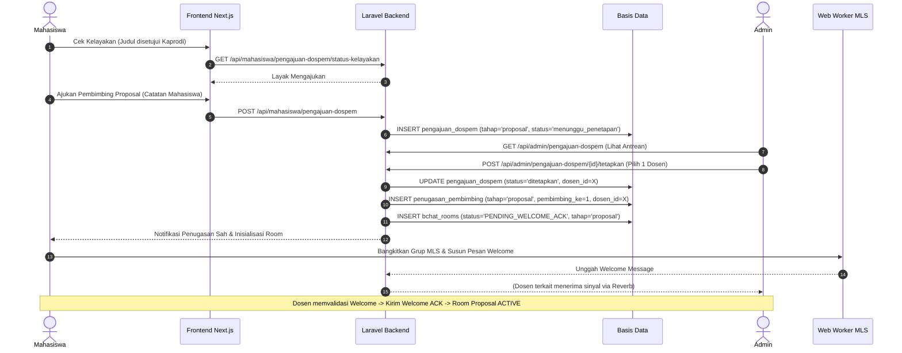
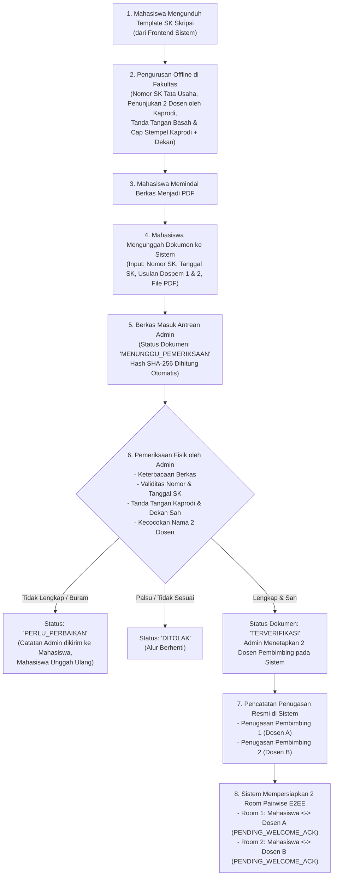
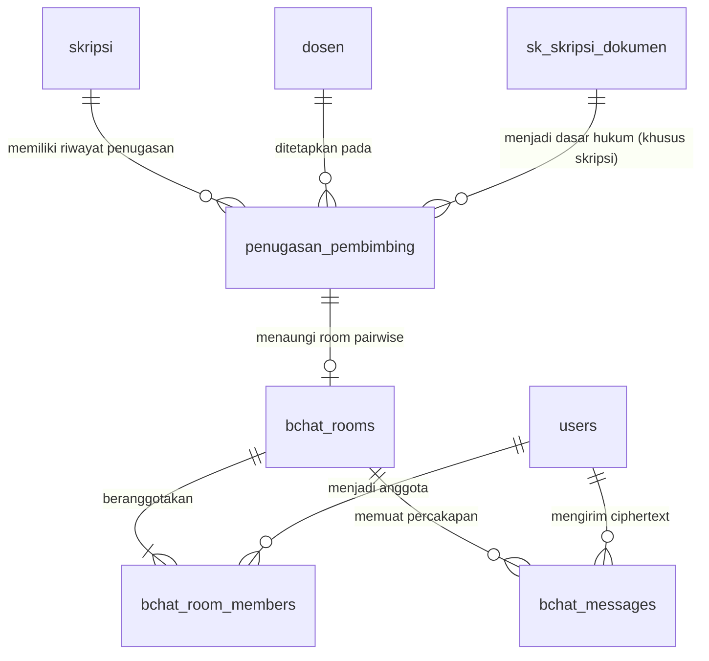
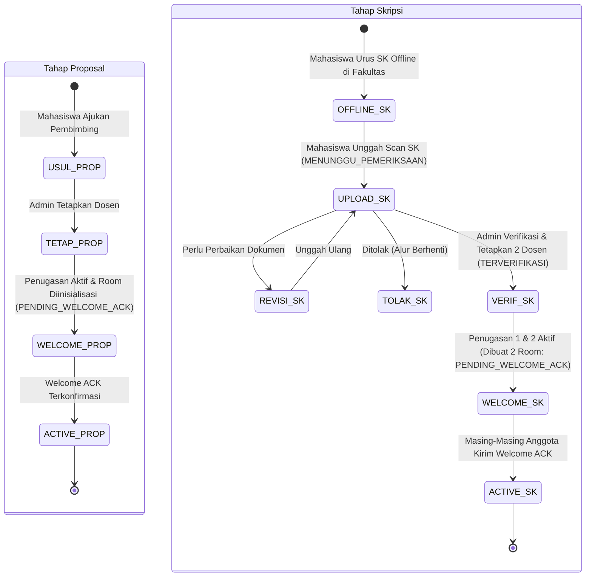

# B-CHAT-12C — REKONSILIASI ALUR SK PEMBIMBING SKRIPSI DAN PAIRWISE ROOM
## SISTEM INFORMASI MANAJEMEN SKRIPSI UNUHA

| Parameter | Keterangan |
| :--- | :--- |
| **Proyek** | Sistem Informasi Manajemen Skripsi UNUHA |
| **Fitur** | Bimbingan Online Chat Real-Time E2EE (B-CHAT) |
| **Tahap** | B-CHAT-12C — Rekonsiliasi Alur SK Pembimbing Skripsi dan Pairwise Room |
| **Mode Audit** | STRICTLY READ-ONLY — DESIGN ONLY — ZERO CODE/DATABASE MUTATION |
| **Dasar Klarifikasi** | Klarifikasi Pemilik Proyek (6 November 2026) |
| **Acuan Arsitektur** | [`B-CHAT-11`](file:///d:/Aplikasi/laragon/www/sistem_manajamen_skripsi/B-CHAT-11_Spesifikasi_Integrasi_E2EE.md), [`B-CHAT-11E`](file:///d:/Aplikasi/laragon/www/sistem_manajamen_skripsi/B-CHAT-11E_Laporan_Penegasan_Status.md), [`B-CHAT-12A`](file:///d:/Aplikasi/laragon/www/sistem_manajamen_skripsi/B-CHAT-12A_Rekonsiliasi_GAP_Kesiapan_Implementasi.md), [`B-CHAT-12B`](file:///d:/Aplikasi/laragon/www/sistem_manajamen_skripsi/B-CHAT-12B_Model_SK_Akademik_dan_Relasi_Pairwise_Room.md) |
| **Waktu Pelaksanaan** | 2026-11-06 |
| **Auditor** | Tim Arsitektur & Kriptografi E2EE Antigravity |

---

## 1. Ringkasan Eksekutif

Laporan Rekonsiliasi B-CHAT-12C disusun untuk menyelaraskan arsitektur teknis Bimbingan Online Chat Real-Time E2EE dengan tata kelola akademik aktual Universitas Nurul Huda (UNUHA) berdasarkan klarifikasi resmi Pemilik Proyek tertanggal 6 November 2026.

### Pokok-Pokok Klarifikasi dan Keputusan Definitif:
1. **Diferensiasi Mutlak Dua Jalur Bimbingan:**
   - **Tahap Proposal (Seminar Proposal):**
     **SAMA SEKALI TIDAK MEMERLUKAN SURAT KEPUTUSAN (SK).** Penugasan pembimbing proposal murni merupakan penetapan administratif internal oleh Admin melalui sistem berdasarkan pengajuan mahasiswa. Room pairwise proposal dipersiapkan langsung setelah penetapan sah dan anggota mengonfirmasi Welcome MLS.
   - **Tahap Skripsi (Sidang Akhir):**
     **WAJIB MEMILIKI SK PEMBIMBING SKRIPSI RESMI.** Pengurusan SK dilakukan secara **offline** oleh mahasiswa di lingkungan fakultas (memperoleh nomor SK, penunjukan dosen oleh Kaprodi, serta tanda tangan basah Kaprodi dan Dekan). Berkas fisik yang telah lengkap dipindai (scan) dan diunggah oleh mahasiswa ke sistem untuk diverifikasi oleh Admin.
2. **Batasan Batas Lingkup Sistem (System Boundary):**
   Sistem Manajemen Skripsi UNUHA **BUKAN penerbit SK, BUKAN pengelola penomoran SK, dan BUKAN penyedia tanda tangan digital** pada fase ini. Sistem bertindak sebagai:
   - Penyedia template dokumen SK untuk diunduh mahasiswa.
   - Media penerima unggahan berkas scan SK dari mahasiswa.
   - Antarmuka verifikasi administratif bagi Admin untuk memeriksa kelengkapan fisik dokumen dan mencocokkan dosen yang ditunjuk dengan data master dosen.
   - Perekam penugasan resmi pembimbing skripsi yang sah sebagai syarat pembentukan room chat E2EE.
3. **Penyederhanaan Hash SHA-256 Dokumen:**
   Nilai hash SHA-256 yang dihitung saat pengunggahan berkas SK murni berfungsi sebagai **pemeriksaan integritas berkas (file integrity check at-rest)** guna mendeteksi kerusakan atau penggantian berkas di storage privat, **BUKAN sebagai bukti keaslian tanda tangan digital kriptografis**.
4. **Relasi Terpadu Penugasan dan Pairwise Room:**
   Dirancang entitas penugasan terpadu (`penugasan_pembimbing`) yang menaungi penugasan Proposal (tanpa SK) maupun penugasan Skripsi (berdasarkan SK terverifikasi). Ruang obrolan E2EE (`bchat_rooms`) mereferensikan record penugasan yang sah ini secara 1-to-1, menjamin isolasi pairwise yang ketat tanpa ambiguitas relasional.

---

## 2. Alur Pembimbing Proposal Tanpa SK

Tahap bimbingan proposal beroperasi menggunakan alur administratif internal yang sudah tersedia pada sistem tanpa melibatkan dokumen SK resmi:

### Karakteristik Alur Proposal:
1. **Verifikasi Prasyarat:** Judul skripsi mahasiswa wajib berstatus `disetujui` oleh Kaprodi via [`KaprodiPengajuanJudulController.php`](file:///d:/Aplikasi/laragon/www/sistem_manajamen_skripsi/manajemen_skripsi/app/Http/Controllers/KaprodiPengajuanJudulController.php).
2. **Kardinalitas:** Tepat satu mahasiswa dengan satu dosen pembimbing proposal (`pembimbing_ke = 1`).
3. **Pencatatan Penugasan:** Dicatat langsung ke tabel operasional penugasan dengan kolom referensi SK bernilai `NULL`.
4. **Kesiapan Room:** Room pairwise proposal dibuat seketika saat penetapan Admin disahkan. Tidak ada gerbang blokir dokumen SK. Room aktif (`ACTIVE`) setelah proses pertukaran kunci MLS Welcome ACK selesai.

---

## 3. Alur Pengajuan SK Pembimbing Skripsi Offline dan Verifikasi Sistem

Tahap bimbingan skripsi mewajibkan keberadaan SK resmi fisik yang diurus secara offline sebelum room pairwise skripsi dapat dipersiapkan:

### Rincian Pemeriksaan Administratif oleh Admin:
Admin bertindak sebagai gerbang verifikasi keabsahan dokumen:
1. Membuka dan meninjau berkas PDF melalui viewer terproteksi di dashboard admin.
2. Memeriksa nomor SK, tanggal penetapan, dan stempel basah fakultas.
3. Memastikan tanda tangan Ketua Program Studi dan Dekan Fakultas tertera jelas.
4. Mencocokkan nama dan NIDN dosen yang tertera pada berkas dengan master data dosen di sistem.
5. Memilih akun Dosen Pembimbing 1 dan Dosen Pembimbing 2 pada dropdown form penetapan, kemudian menekan tombol **"Verifikasi & Tetapkan Pembimbing"**.

---

## 4. Model Data Dokumen SK dan Penugasan Pembimbing

Untuk mewadahi perbedaan mendasar antara Proposal (tanpa SK) dan Skripsi (dengan SK offline), dirancang dua entitas konseptual yang saling melengkapi:

### 4.1. Entitas Dokumen SK Skripsi: `sk_skripsi_dokumen`
Tabel ini khusus mencatat dokumen fisik yang diunggah oleh mahasiswa untuk tahap skripsi:

| Nama Kolom | Tipe Data | Deskripsi & Aturan Integritas |
| :--- | :--- | :--- |
| `id` | BigInt Unsigned PK | Identifikator unik dokumen unggahan. |
| `skripsi_id` | BigInt Unsigned FK | Merujuk ke `skripsi(id_skripsi)` on delete cascade. |
| `mahasiswa_id` | BigInt Unsigned FK | Merujuk ke `mahasiswa(id_mahasiswa)` pengunggah. |
| `nomor_sk` | Varchar(100) | Nomor resmi SK fisik yang diinputkan mahasiswa/diverifikasi admin. |
| `tanggal_sk` | Date | Tanggal penetapan yang tertera pada dokumen SK fisik. |
| `file_path` | Varchar(255) | Lokasi penyimpanan berkas PDF pada storage privat (`storage/app/private/sk_skripsi/`). |
| `file_hash_sha256` | Char(64) | Hash SHA-256 berkas PDF saat diunggah (pemeriksaan integritas fisik berkas). |
| `file_size_bytes` | BigInt Unsigned | Ukuran berkas PDF dalam byte (maksimum 10 MB). |
| `status_dokumen` | Enum | `'MENUNGGU_PEMERIKSAAN'`, `'PERLU_PERBAIKAN'`, `'DITOLAK'`, `'TERVERIFIKASI'`, `'DIBATALKAN'`. Default: `'MENUNGGU_PEMERIKSAAN'`. |
| `admin_id` | BigInt Unsigned FK Nullable | Akun admin yang melakukan verifikasi dokumen (`users.id`). |
| `diperiksa_at` | Timestamp Nullable | Waktu pemeriksaan oleh admin. |
| `catatan_admin` | Text Nullable | Catatan instruksi perbaikan atau alasan penolakan dokumen. |
| `dosen_1_usulan_id` | BigInt Unsigned FK Nullable | Usulan Dosen Pembimbing 1 yang dipilih mahasiswa saat upload. |
| `dosen_2_usulan_id` | BigInt Unsigned FK Nullable | Usulan Dosen Pembimbing 2 yang dipilih mahasiswa saat upload. |
| `created_at` / `updated_at` | Timestamps | Standar timestamps Eloquent. |

### 4.2. Entitas Penugasan Terpadu: `penugasan_pembimbing`
Tabel operasional yang mencatat hak bimbingan resmi yang telah disahkan, menjadi jembatan bagi Proposal maupun Skripsi:

| Nama Kolom | Tipe Data | Deskripsi & Aturan Integritas |
| :--- | :--- | :--- |
| `id` | BigInt Unsigned PK | Identifikator unik penugasan bimbingan. |
| `skripsi_id` | BigInt Unsigned FK | Merujuk ke `skripsi(id_skripsi)`. |
| `tahap` | Enum(`'proposal'`, `'skripsi'`) | Tahap bimbingan akademik. |
| `pembimbing_ke` | TinyInt Unsigned | `1` (Pembimbing Proposal / Pembimbing Utama), `2` (Pembimbing Pendamping). |
| `dosen_id` | BigInt Unsigned FK | Dosen pembimbing yang sah (`dosen.id_dosen`). |
| `sk_dokumen_id` | BigInt Unsigned FK Nullable | **NULL jika tahap = 'proposal'**; Merujuk ke `sk_skripsi_dokumen(id)` terverifikasi jika tahap = `'skripsi'`. |
| `pengajuan_dospem_id` | BigInt Unsigned FK Nullable | Merujuk ke `pengajuan_dospem(id)` (khusus tahap proposal). |
| `status_penugasan` | Enum | `'AKTIF'`, `'DIGANTI'`, `'DIBATALKAN'`. Default: `'AKTIF'`. |
| `tanggal_mulai` | Date | Tanggal penugasan mulai berlaku. |
| `tanggal_selesai` | Date Nullable | Tanggal penugasan berakhir jika diganti/selesai. |
| `digantikan_oleh_id` | BigInt Unsigned FK Nullable | Merujuk ke `penugasan_pembimbing(id)` baru jika terjadi pergantian. |
| `created_at` / `updated_at` | Timestamps | Standar timestamps Eloquent. |

#### Indeks dan Aturan Integritas (Constraints):
* `UNIQUE KEY uk_skripsi_tahap_ordinal (skripsi_id, tahap, pembimbing_ke, status_penugasan)`  
  *Menjamin tidak ada dua penugasan aktif pada nomor urut pembimbing yang sama di satu tahap skripsi.*
* `INDEX idx_dosen_penugasan_aktif (dosen_id, status_penugasan)`  
  *Mempercepat penelusuran beban bimbingan aktif per dosen.*

---

## 5. Relasi Penugasan dengan Pairwise Room E2EE

Struktur relasi antara penugasan akademik yang sah dan ruang obrolan E2EE dirumuskan secara langsung (*direct 1-to-1 link*):

### 5.1. Penyesuaian Kolom pada Tabel `bchat_rooms`
Tabel `bchat_rooms` (Bab 7 B-CHAT-11) disempurnakan dengan foreign key tunggal yang bersih:
* `penugasan_pembimbing_id`: `BIGINT UNSIGNED NOT NULL FOREIGN KEY REFERENCES penugasan_pembimbing(id)`
* `UNIQUE KEY uk_room_penugasan (penugasan_pembimbing_id)`  
  *Menjamin satu penugasan aktif hanya memiliki tepat satu ruang obrolan pairwise.*

### 5.2. Konsistensi Akses Pairwise:
1. **Untuk Proposal:**  
   Satu record `penugasan_pembimbing` (`tahap = 'proposal'`, `pembimbing_ke = 1`) terhubung ke satu `bchat_rooms` (Room Proposal). Tidak ada foreign key dokumen SK yang dicek.
2. **Untuk Skripsi:**  
   Dokumen SK yang terverifikasi menghasilkan dua record `penugasan_pembimbing`:
   - Penugasan 1 (`pembimbing_ke = 1`) $\longrightarrow$ terhubung ke Room Pairwise 1 (`bchat_rooms`).
   - Penugasan 2 (`pembimbing_ke = 2`) $\longrightarrow$ terhubung ke Room Pairwise 2 (`bchat_rooms`).
3. **Pemisahan Kriptografi Total:**  
   Room 1 dan Room 2 memiliki Group ID MLS yang berlainan, Ratchet Tree terpisah, channel Reverb terpisah (`bchat.room.{room1_id}` dan `bchat.room.{room2_id}`). Dosen Pembimbing 1 tidak dapat mengintip percakapan Dosen Pembimbing 2, begitu pula sebaliknya.

---

## 6. Skenario Pergantian Pembimbing dan Pembatalan

### 6.1. Skenario Pergantian Satu Pembimbing Skripsi
*Kasus Riil:* Mahasiswa memiliki Pembimbing 1 (Dosen A) dan Pembimbing 2 (Dosen B). Dosen A berhalangan tetap, sehingga digantikan oleh Dosen C.
1. **Pengurusan Dokumen Perubahan Offline:** Mahasiswa mengurus SK Perubahan / Surat Tugas Penggantian Pembimbing 1 secara offline di fakultas (ditandatangani Kaprodi & Dekan).
2. **Unggah Dokumen Perubahan:** Mahasiswa mengunggah dokumen perubahan ke sistem (`sk_skripsi_dokumen` baru).
3. **Verifikasi Admin:** Admin memeriksa dokumen perubahan, memverifikasi tanda tangan Kaprodi/Dekan, dan menyetujuinya.
4. **Pembaruan Data Penugasan:**
   - Record `penugasan_pembimbing` Dosen A diubah: `status_penugasan = 'DIGANTI'`, `tanggal_selesai = now()`.
   - Dibuat record `penugasan_pembimbing` baru untuk Dosen C (`pembimbing_ke = 1`, `status_penugasan = 'AKTIF'`).
   - Kolom `digantikan_oleh_id` pada penugasan lama ditautkan ke penugasan baru (jejak audit silsilah).
5. **Dampak pada Room 2 (Dosen B — Pembimbing 2):**
   - **TIDAK ADA PERUBAHAN APAPUN (ISOLASI MUTLAK).** Room 2 tetap `ACTIVE`, kunci MLS tetap utuh, percakapan berjalan seperti biasa.
6. **Dampak pada Room 1 (Dosen A — Pembimbing 1 Lama):**
   - Room 1 lama dibekukan seketika menjadi **`ARCHIVED_READONLY`**.
   - Channel WebSocket Reverb untuk Room 1 lama diputus dari Dosen A.
   - Dibuatkan entitas **Room 1 Baru** yang terikat pada record penugasan Dosen C.
   - Mahasiswa menginisialisasi grup MLS baru bersama Dosen C (Fresh Group, Epoch 0), mendistribusikan Welcome baru.
   - Setelah Dosen C mengirimkan Welcome ACK, Room 1 Baru menjadi `ACTIVE`. Dosen A tidak memiliki kunci matematis untuk membaca pesan di Room 1 Baru.

### 6.2. Skenario Pembatalan Hak Bimbingan (Mahasiswa Mengundurkan Diri / Sanksi)
1. **Aksi Administratif:** Admin menandai penugasan pembimbing menjadi `'DIBATALKAN'`.
2. **Pemblokiran Akses Server:**
   - Seluruh room terkait diubah statusnya menjadi **`TERMINATED`**.
   - Channel Reverb dibongkar (*unsubscribed*).
   - Seluruh endpoint API pengiriman pesan dan pengunduhan lampiran memblokir akses (`403 Forbidden`).
3. **Pencatatan CRL:** Jika pembatalan disebabkan oleh kompromi akun atau pelanggaran keamanan, kredensial pengguna dimasukkan ke tabel `bchat_crl_revocations`.
4. **Preservasi Data:** Seluruh rekaman ciphertext di `bchat_messages` dan potongan berkas di `bchat_attachment_chunks` **TIDAK DIHAPUS**, melainkan disimpan sebagai arsip hukum statis untuk keperluan investigasi universitas.

---

## 7. Lifecycle Aktivasi Room Pairwise Deterministik

Gerbang aktivasi room membedakan alur Proposal dan Skripsi, namun menerapkan standar penerimaan kriptografi MLS Welcome ACK yang seragam:

### Penegakan Persyaratan Welcome ACK Deterministik (OPEN-10 & B-CHAT-11E):
Aktivasi room (`status = 'ACTIVE'`) **tidak boleh** hanya mengandalkan pemanggilan HTTP GET biasa. Klien penerima (Dosen) wajib mengirimkan payload konfirmasi deterministik (`POST /api/bchat/rooms/{id}/welcome-ack`) yang membuktikan secara kriptografis bahwa:
1. Paket `welcome_message` berhasil didekripsi menggunakan private key yang cocok dengan KeyPackage publik yang tersimpan.
2. Group ID dan epoch inisialisasi cocok dengan data room server.
3. Kredensial identitas mahasiswa terverifikasi sah ditandatangani oleh root CA UNUHA.
4. Ratchet tree berhasil disimpan ke IndexedDB klien (`mls_group_states`).

Selama Welcome ACK belum diterima secara lengkap, backend memblokir pengiriman pesan ciphertext baru dan membatasi akses broadcasting Reverb.

---

## 8. Daftar Keputusan Pasti dan Status OPEN

### 8.1. Keputusan yang Telah Pasti (Locked Decisions)
1. **Penetapan Proposal Tanpa SK:** Tidak ada entitas atau dokumen SK yang disyaratkan untuk tahap proposal.
2. **SK Skripsi Diurus Offline:** Sistem tidak menerbitkan SK dan tidak mengelola tanda tangan digital pejabat; sistem hanya memvalidasi dokumen pindai fisik yang diunggah.
3. **Penyederhanaan Hash SHA-256:** Hash SHA-256 murni untuk pemeriksaan integritas berkas upload, bukan keaslian tanda tangan basah.
4. **Entitas Penugasan Terpadu:** Menggunakan `penugasan_pembimbing` sebagai tabel operasional bersama yang menghubungkan `skripsi`, `tahap`, `pembimbing_ke`, dan `bchat_rooms`.
5. **Isolasi Pairwise Mutlak:** Skripsi selalu menggunakan dua room terpisah dengan siklus hidup dan kunci kriptografi yang terisolasi.
6. **Dual Barrier Keamanan:** Pembatalan bimbingan mencakup blokade otorisasi server seketika dan isolasi kunci MLS TreeKEM pada room baru.

### 8.2. Daftar Status Terbuka (OPEN Items) yang Perlu Konfirmasi Akademik

| ID | Parameter Terbuka | Keterangan & Asumsi Sementara | Keputusan yang Dibutuhkan |
| :---: | :--- | :--- | :--- |
| **OPEN-15** | **Format Template SK Skripsi** | Format template SK yang dapat diunduh mahasiswa apakah seragam se-universitas atau berbeda per fakultas/prodi? | Format template dokumen fisik baku UNUHA. |
| **OPEN-16** | **Tenggat Masa Berlaku SK Skripsi** | Apakah SK pembimbing skripsi memiliki masa kedaluwarsa baku (misal 6 bulan) yang otomatis memicu perpanjangan SK jika belum sidang? | Aturan masa kedaluwarsa SK skripsi pada buku pedoman akademik UNUHA. |
| **OPEN-17** | **Mekanisme SK Penggantian Pembimbing** | Ketika 1 dosen diganti, apakah fakultas menerbitkan SK Penggantian Parsial (hanya menyebut pergantian dosen bersangkutan) atau menerbitkan SK Baru utuh yang mencantumkan kembali kedua dosen? | Praktik administrasi baku di Tata Usaha FTIK / Fakultas UNUHA. |

---

## 9. Penilaian Kesiapan Perancangan Migrasi

Pekerjaan perancangan DDL migrasi pertama dinilai **READY FOR DRAFTING** dengan pembagian paket skema yang sangat terstruktur:

```mermaid
flowchart LR
    subgraph PAKET_A["Paket Modul Akademik & Dokumen (3 Tabel)"]
        T1["sk_skripsi_dokumen\n(Penyimpanan Scan SK & Status Pemeriksaan)"]
        T2["penugasan_pembimbing\n(Penugasan Terpadu: Proposal & Skripsi)"]
        T3["penugasan_pembimbing_logs\n(Audit Trail Append-Only)"]
    end

    subgraph PAKET_B["Paket Modul Kriptografi & B-CHAT (9 Tabel)"]
        T4["bchat_rooms (FK: penugasan_pembimbing_id)"]
        T5["bchat_room_members"]
        T6["bchat_key_packages"]
        T7["bchat_messages"]
        T8["bchat_message_receipts"]
        T9["bchat_upload_sessions"]
        T10["bchat_attachments"]
        T11["bchat_attachment_chunks"]
        T12["bchat_crl_revocations"]
    end

    PAKET_A --> PAKET_B
```

### Evaluasi Kesiapan per Elemen:
* **Model Penugasan Proposal:** `READY` (Menggunakan kolom `sk_dokumen_id = NULL` pada `penugasan_pembimbing`).
* **Model Dokumen SK Skripsi:** `READY` (Tabel `sk_skripsi_dokumen` menampung berkas PDF, hash SHA-256, dan verifikasi admin).
* **Model Detail Penugasan Pembimbing:** `READY` (Kolom `pembimbing_ke` 1 dan 2 memisahkan peran utama dan pendamping).
* **Relasi Penugasan dengan Room E2EE:** `READY` (Tabel `bchat_rooms` memiliki foreign key langsung ke `penugasan_pembimbing(id)`).
* **Sembilan Tabel Konseptual `bchat_*`:** `READY` (Struktur kolom telah konsisten dengan RFC 9420 dan Bab 7 B-CHAT-11).

---

## 10. Bukti Berkas dan Path yang Diperiksa

Seluruh analisis didasarkan pada penelusuran berkas riil berikut:
1. **Controller Mahasiswa:** [`PengajuanDospemMahasiswaController.php`](file:///d:/Aplikasi/laragon/www/sistem_manajamen_skripsi/manajemen_skripsi/app/Http/Controllers/Mahasiswa/PengajuanDospemMahasiswaController.php) (Alur verifikasi kelayakan judul dan pengajuan dospem proposal).
2. **Controller Admin:** [`PengajuanDospemAdminController.php`](file:///d:/Aplikasi/laragon/www/sistem_manajamen_skripsi/manajemen_skripsi/app/Http/Controllers/Admin/PengajuanDospemAdminController.php) (Alur penetapan administratif oleh Admin).
3. **Controller Kaprodi:** [`KaprodiPengajuanJudulController.php`](file:///d:/Aplikasi/laragon/www/sistem_manajamen_skripsi/manajemen_skripsi/app/Http/Controllers/KaprodiPengajuanJudulController.php) (Persetujuan judul resmi).
4. **Migrasi Eksisting:**
   - [`2026_10_28_000001_create_pengajuan_dospem_table.php`](file:///d:/Aplikasi/laragon/www/sistem_manajamen_skripsi/manajemen_skripsi/database/migrations/2026_10_28_000001_create_pengajuan_dospem_table.php)
   - [`2026_10_28_000002_create_pengajuan_dospem_logs_table.php`](file:///d:/Aplikasi/laragon/www/sistem_manajamen_skripsi/manajemen_skripsi/database/migrations/2026_10_28_000002_create_pengajuan_dospem_logs_table.php)
   - [`2026_09_26_041409_create_dosen_pembimbing_table.php`](file:///d:/Aplikasi/laragon/www/sistem_manajamen_skripsi/manajemen_skripsi/database/migrations/2026_09_26_041409_create_dosen_pembimbing_table.php)
5. **Dokumen Spesifikasi:** [`B-CHAT-11`](file:///d:/Aplikasi/laragon/www/sistem_manajamen_skripsi/B-CHAT-11_Spesifikasi_Integrasi_E2EE.md), [`B-CHAT-12A`](file:///d:/Aplikasi/laragon/www/sistem_manajamen_skripsi/B-CHAT-12A_Rekonsiliasi_GAP_Kesiapan_Implementasi.md), [`B-CHAT-12B`](file:///d:/Aplikasi/laragon/www/sistem_manajamen_skripsi/B-CHAT-12B_Model_SK_Akademik_dan_Relasi_Pairwise_Room.md).

---

## 11. Konfirmasi Integritas Repositori (Zero Mutation)

Auditor mengonfirmasi dengan penuh integritas bahwa selama pelaksanaan mandat **B-CHAT-12C**:
* **Tidak Ada Perubahan Kode:** Tidak ada berkas di `manajemen_skripsi/` atau `frontend_manajemen_skripsi/` yang dibuat, dimodifikasi, atau dihapus.
* **Tidak Ada Perubahan Basis Data:** Tidak ada file migration yang dijalankan, diubah, atau dibuat; data database tidak dimanipulasi.
* **Tidak Ada Perubahan Dependensi:** Berkas Composer dan NPM/PNPM tetap dalam kondisi aslinya.
* **Tidak Ada Perubahan Konfigurasi:** Berkas `.env` dan konfigurasi aplikasi tetap utuh.
* **Tidak Ada Operasi Git:** Tidak ada operasi `git commit`, `git add`, `git branch`, atau push ke repositori jarak jauh.

---
*Laporan ini disusun secara resmi sebagai rekonsiliasi definitif alur akademik dan kriptografi sebelum pembukaan mandat penyusunan migrasi basis data Sistem Informasi Manajemen Skripsi UNUHA.*

