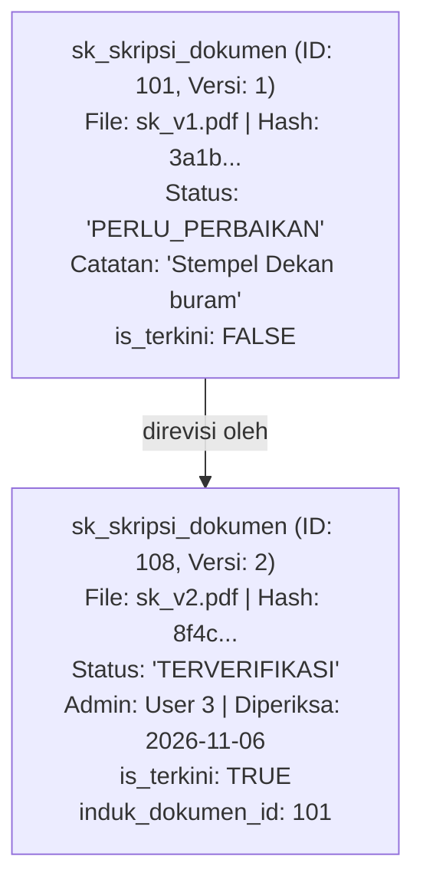
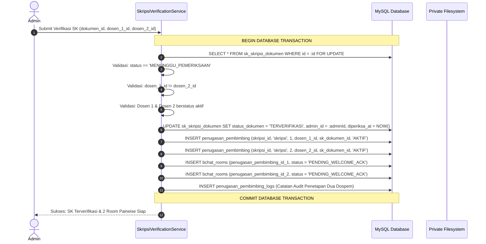
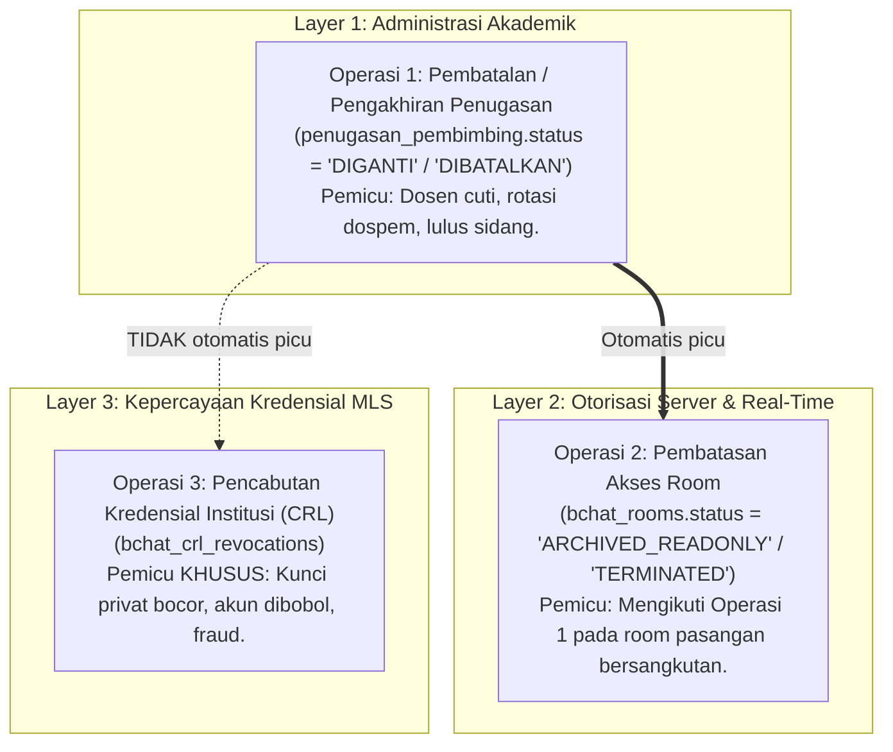
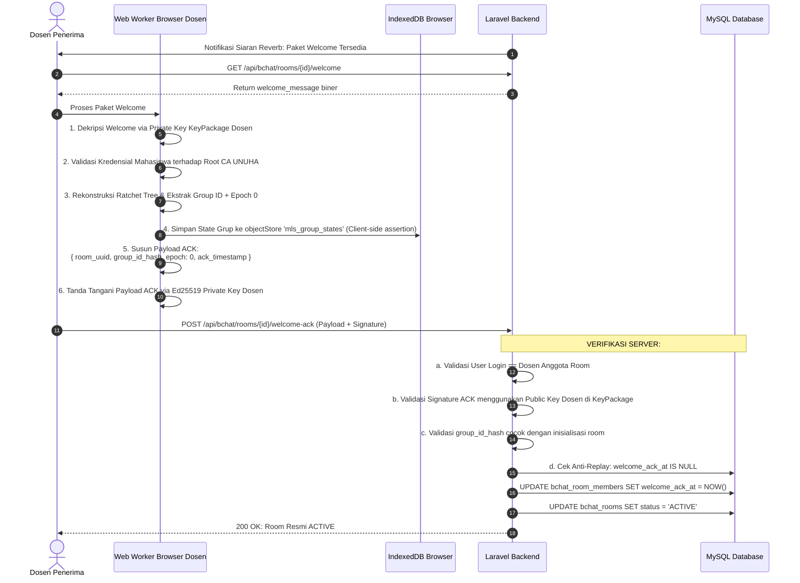

# B-CHAT-12D — KOREKSI INTEGRITAS MODEL PENUGASAN, DOKUMEN SK, DAN LIFECYCLE PAIRWISE ROOM
## SISTEM INFORMASI MANAJEMEN SKRIPSI UNUHA

| Parameter | Keterangan |
| :--- | :--- |
| **Proyek** | Sistem Informasi Manajemen Skripsi UNUHA |
| **Fitur** | Bimbingan Online Chat Real-Time E2EE (B-CHAT) |
| **Tahap** | B-CHAT-12D — Koreksi Integritas Model Penugasan, Dokumen SK, dan Lifecycle |
| **Mode Audit** | STRICTLY READ-ONLY — DESIGN ONLY — ZERO CODE/DATABASE MUTATION |
| **Dokumen Acuan** | [`B-CHAT-11`](file:///d:/Aplikasi/laragon/www/sistem_manajamen_skripsi/B-CHAT-11_Spesifikasi_Integrasi_E2EE.md), [`B-CHAT-11E`](file:///d:/Aplikasi/laragon/www/sistem_manajamen_skripsi/B-CHAT-11E_Laporan_Penegasan_Status.md), [`B-CHAT-12A`](file:///d:/Aplikasi/laragon/www/sistem_manajamen_skripsi/B-CHAT-12A_Rekonsiliasi_GAP_Kesiapan_Implementasi.md), [`B-CHAT-12B`](file:///d:/Aplikasi/laragon/www/sistem_manajamen_skripsi/B-CHAT-12B_Model_SK_Akademik_dan_Relasi_Pairwise_Room.md), [`B-CHAT-12C`](file:///d:/Aplikasi/laragon/www/sistem_manajamen_skripsi/B-CHAT-12C_Rekonsiliasi_Alur_SK_dan_Pairwise_Room.md) |
| **Waktu Pelaksanaan** | 2026-11-06 |
| **Auditor** | Tim Arsitektur & Kriptografi E2EE Antigravity |

---

## 1. Ringkasan Temuan B-CHAT-12C

Evaluasi kritis terhadap dokumen B-CHAT-12C mengidentifikasi lima area desain yang memerlukan koreksi integritas terarah sebelum penyusunan DDL migrasi database pertama dapat dilaksanakan:

1. **Cacat Struktural pada UNIQUE Constraint Penugasan:**  
   Constraint usulan B-CHAT-12C (`UNIQUE KEY (skripsi_id, tahap, pembimbing_ke, status_penugasan)`) cacat fatal: jika seorang dosen diganti lebih dari satu kali, update status menjadi `'DIGANTI'` akan memicu pelanggaran duplikasi kunci (*duplicate entry error*) pada database. Diperlukan mekanisme *Active Slot Virtual Column* yang mengabaikan record non-aktif.
2. **Kebutuhan Batas Penegakan Integritas Proposal vs Skripsi:**  
   Aturan bahwa Proposal tanpa SK (`pembimbing_ke = 1`, `sk_dokumen_id IS NULL`) sedangkan Skripsi wajib merujuk SK terverifikasi (`pembimbing_ke IN (1, 2)`, dua dosen berbeda) belum dipetakan secara tegas antara apa yang dijamin oleh database constraint, transaksi atomik, dan validasi aplikasi.
3. **Ketiadaan Versioning pada Pengunggahan Dokumen SK:**  
   Unggah ulang berkas SK saat perbaikan berisiko menimpa atau mengaburkan audit trail berkas lama jika tidak dikelola dengan multi-record berantai.
4. **Perancuan Tiga Tindakan Pembatalan:**  
   Pencabutan penugasan akademik, pemblokiran ruang chat server, dan pencabutan kredensial MLS institusi (CRL) sempat tercampur seolah selalu dieksekusi bersamaan, padahal memiliki pemicu, lingkup, dan konsekuensi keamanan yang sangat berbeda.
5. **Klaim Berlebih pada Welcome ACK:**  
   Pernyataan bahwa backend dapat membuktikan penyimpanan fisik *ratchet tree* di IndexedDB klien adalah kekeliruan arsitektural. Backend web berada di luar batas peramban klien dan hanya dapat memverifikasi konfirmasi kriptografis yang dikirimkan klien, bukan membuktikan persistensi fisik penyimpanan lokal browser.

---

## 2. Rekomendasi UNIQUE Constraint dan Riwayat Penugasan

### 2.1. Analisis Kegagalan Constraint B-CHAT-12C
Pada B-CHAT-12C Subbab 4.2 dirumuskan constraint:
```sql
-- DESAIN CACAT (B-CHAT-12C)
UNIQUE KEY uk_skripsi_tahap_ordinal (skripsi_id, tahap, pembimbing_ke, status_penugasan)
```
**Simulasi Kegagalan:**
1. Skripsi ID 1 menetapkan Dosen A sebagai Pembimbing 1 (`status_penugasan = 'AKTIF'`).  
   Tuple: `(1, 'skripsi', 1, 'AKTIF')` $\rightarrow$ **VALID**.
2. Dosen A diganti dengan Dosen B. Record Dosen A diubah menjadi `'DIGANTI'`, Record Dosen B dibuat `'AKTIF'`.  
   Tuple A: `(1, 'skripsi', 1, 'DIGANTI')` $\rightarrow$ **VALID**.  
   Tuple B: `(1, 'skripsi', 1, 'AKTIF')` $\rightarrow$ **VALID**.
3. Enam bulan kemudian, Dosen B berhalangan dan diganti dengan Dosen C. Record Dosen B diubah menjadi `'DIGANTI'`.  
   Tuple B baru: `(1, 'skripsi', 1, 'DIGANTI')` $\rightarrow$ **CRASH! DUPLICATE ENTRY!**  
   Database menolak penyimpanan karena tuple `(1, 'skripsi', 1, 'DIGANTI')` sudah dimiliki oleh Dosen A. Alur pergantian dosen kedua gagal total.

### 2.2. Solusi Terpilih: Generated Virtual Column "Active Slot"
Dalam standar SQL dan mesin MySQL 8 / MariaDB, **nilai `NULL` tidak pernah dianggap duplikat dalam UNIQUE index**. Karakteristik ini dimanfaatkan untuk mengimplementasikan pola *Active Slot*:

```sql
-- DESAIN KOREKSI FINAL (B-CHAT-12D)
ALTER TABLE penugasan_pembimbing
ADD COLUMN active_slot VARCHAR(50) GENERATED ALWAYS AS (
    CASE 
        WHEN status_penugasan = 'AKTIF' 
        THEN CONCAT(tahap, '_', pembimbing_ke) 
        ELSE NULL 
    END
) VIRTUAL;

ALTER TABLE penugasan_pembimbing
ADD CONSTRAINT uk_skripsi_active_slot UNIQUE (skripsi_id, active_slot);
```

### 2.3. Bukti Perilaku dan Keunggulan Desain
* **Saat Dosen A Aktif:** `active_slot` bernilai `'skripsi_1'`. Tuple unik: `(1, 'skripsi_1')`.
* **Pencegahan Slot Ganda:** Jika ada transaksi lain mencoba membuat Dosen X aktif pada `(skripsi_id = 1, tahap = 'skripsi', pembimbing_ke = 1)`, database secara fisik menolak dengan error duplikasi kunci. Integritas slot aktif 100% dijamin database.
* **Saat Pergantian Dosen:** Record lama diubah menjadi `status_penugasan = 'DIGANTI'`. Secara otomatis nilai `active_slot` pada record lama berubah menjadi `NULL`. Record baru dimasukkan dengan `status_penugasan = 'AKTIF'`, sehingga mengambil alih nilai `'skripsi_1'`.
* **Riwayat Tak Terbatas:** Berapa pun jumlah mantan pembimbing yang berstatus `'DIGANTI'` atau `'DIBATALKAN'`, seluruhnya memiliki `active_slot = NULL`, sehingga tidak pernah terjadi benturan unik.
* **Silsilah Penggantian:** Kolom `digantikan_oleh_id` (self-referencing FK nullable) menghubungkan record lama ke record baru, membentuk rantai sejarah penugasan yang utuh.

---

## 3. Matriks Integritas Proposal versus Skripsi

Penegakan aturan bisnis dipetakan secara ketat berdasarkan kapabilitas teknis layer: Database Constraint, Database Transaction, dan Validasi Aplikasi Laravel:

| No | Aturan Bisnis Integritas | Penegakan Layer Database | Penegakan Layer Transaksi | Penegakan Layer Aplikasi (Laravel) |
| :-: | :--- | :--- | :--- | :--- |
| **1** | **Proposal: Tanpa SK, `sk_dokumen_id` Wajib NULL, `pembimbing_ke` Wajib 1.** | `CHECK ( (tahap = 'proposal' AND sk_dokumen_id IS NULL AND pembimbing_ke = 1) OR (tahap = 'skripsi') )` | Menjamin rollback jika operasi menghasilkan inkonsistensi. | Form Request menolak payload proposal yang menyertakan `sk_dokumen_id` atau `pembimbing_ke != 1`. |
| **2** | **Skripsi: Wajib Merujuk Dokumen SK Terverifikasi.** | `FOREIGN KEY (sk_dokumen_id) REFERENCES sk_skripsi_dokumen(id) RESTRICT` | `DB::transaction` mengunci baris dokumen SK (`lockForUpdate`) saat penetapan. | Service memverifikasi `sk_skripsi_dokumen.status_dokumen === 'TERVERIFIKASI'`. Jika status bukan terverifikasi, melempar `DomainException` (422). |
| **3** | **Skripsi: Wajib 2 Pembimbing (Ke-1 dan Ke-2).** | Virtual column `active_slot` menjamin maksimal 1 slot `skripsi_1` dan 1 slot `skripsi_2` per skripsi. | Transaksi penetapan membuat 2 baris penugasan secara atomik (all-or-nothing). | Validasi Form Request memeriksa input `dosen_1_id` dan `dosen_2_id` keduanya terisi sah. |
| **4** | **Anti-Rangkap Dosen pada SK yang Sama.** | Tidak dapat dicegah antar-baris oleh DDL tabel tanpa trigger kompleks. | Transaksi memeriksa duplikasi dosen sebelum insert baris kedua. | `Rule::different('dosen_1_id', 'dosen_2_id')` memastikan dosen 1 dan dosen 2 bukan orang yang sama. |
| **5** | **SK Dibatalkan Otomatis Nonaktifkan Penugasan.** | `FOREIGN KEY ... ON DELETE RESTRICT` mencegah dokumen SK dihapus fisik jika masih dirujuk penugasan. | Transaksi pembatalan SK memperbarui status penugasan dan status room secara atomik. | Service pembatalan mengubah seluruh penugasan aktif terkait menjadi `'DIBATALKAN'`. |

---

## 4. Rancangan Versi dan Riwayat Dokumen SK

Untuk mencegah hilangnya bukti fisik saat mahasiswa mengunggah revisi dokumen (misalnya akibat perbaikan kualitas scan atau koreksi nomor), diterapkan **Pola Multi-Record Terpaut (Linked Multi-Record)** pada tabel `sk_skripsi_dokumen`:



### 4.1. Struktur Kolom Audit Dokumen pada `sk_skripsi_dokumen`
* `versi_ke`: `INT UNSIGNED NOT NULL DEFAULT 1` (Penomoran versi berkas yang diunggah).
* `is_terkini`: `BOOLEAN NOT NULL DEFAULT TRUE` (Penanda dokumen unggahan aktif).
* `induk_dokumen_id`: `BIGINT UNSIGNED NULL FOREIGN KEY REFERENCES sk_skripsi_dokumen(id)` (Menunjuk ke dokumen versi sebelumnya yang diperbaiki).
* `file_path`: `VARCHAR(255) NOT NULL` (Path absolut privat unik per versi, contoh: `sk_skripsi/sk_1_v1_3a1b.pdf`).
* `file_hash_sha256`: `CHAR(64) NOT NULL` (Hash integritas berkas upload at-rest).
* `status_dokumen`: `ENUM('MENUNGGU_PEMERIKSAAN', 'PERLU_PERBAIKAN', 'DITOLAK', 'TERVERIFIKASI', 'DIBATALKAN')`.

### 4.2. Aturan Immutability dan Kunci Integritas:
1. **Zero File Overwrite:** Setiap upload revisi selalu menyimpan berkas baru pada storage privat dengan nama unik. Berkas lama tidak pernah ditimpa atau dihapus.
2. **Kunci Dokumen Terverifikasi:** Jika sebuah record dokumen telah mencapai status `'TERVERIFIKASI'`, sistem **menolak mutlak** pengunggahan dokumen baru oleh mahasiswa, kecuali jika Admin secara resmi menerbitkan sesi revisi/penggantian pembimbing.

---

## 5. Alur Transaksi Verifikasi SK dan Penetapan Dua Pembimbing

Seluruh proses verifikasi berkas SK dan pembentukan dua ruang bimbingan pairwise wajib dieksekusi di dalam **satu transaksi basis data atomik (`DB::transaction`)**:



Jika terjadi kegagalan sistem pada salah satu langkah (misalnya benturan active slot atau kegagalan insert room), seluruh operasi di-rollback secara otomatis, mencegah kondisi *partial state* (misal SK terverifikasi tapi room hanya terbuat satu).

---

## 6. Pemisahan Pembatalan Akademik, Pembatasan Room, dan Pencabutan Kredensial

Ketiga operasi penanganan pembatalan dipisahkan secara tegas berdasarkan layer, pemicu, dan dampaknya:



### Rincian Matriks Dampak:
* **Pergantian Normal Dosen 1:**  
  Operasi 1 dijalankan pada Penugasan 1 $\rightarrow$ Operasi 2 dijalankan pada Room 1.  
  **Dosen 1 TIDAK dimasukkan ke CRL (Operasi 3 TIDAK dijalankan)** karena Dosen 1 masih dosen sah UNUHA.  
  **Room 2 (Pembimbing 2) TETAP AKTIF 100% (Zero Impact).**
* **Mahasiswa Dikeluarkan (Drop Out / Pelanggaran Etik Berat):**  
  Operasi 1 dijalankan pada seluruh penugasan mahasiswa $\rightarrow$ Operasi 2 membekukan seluruh room mahasiswa $\rightarrow$ Operasi 3 mencabut kredensial mahasiswa di CRL agar tidak dapat menerbitkan KeyPackage baru.

---

## 7. Definisi Welcome ACK yang Dikoreksi dan Batas Pembuktiannya

### 7.1. Koreksi Batas Bukti: Server vs Klien
Sesuai prinsip kehati-hatian kriptografi dan arsitektur peramban, ditegaskan:
> **BATASAN PEMBUKTIAN BACKEND:**  
> Backend server adalah aplikasi web berbasis PHP/Laravel yang beroperasi di server. Backend **TIDAK DAPAT MEMBUKTIKAN SECARA FISIK** bahwa *ratchet tree* atau *MLS state* telah tertulis secara persisten di media IndexedDB perangkat klien. IndexedDB sepenuhnya berada dalam domain internal peramban klien.

### 7.2. Mekanisme Welcome ACK yang Dapat Diverifikasi Server
Server hanya memverifikasi bukti kriptografis dan konsistensi status transmisi:



### 7.3. Status Keputusan OPEN-10
Status **OPEN-10 (Library MLS Produksi & Verifikasi Welcome ACK)** **TETAP OPEN**. Spesifikasi di atas mendefinisikan batas kemampuan verifikasi server secara jujur tanpa mengklaim bukti fisik IndexedDB yang mustahil diverifikasi server.

---

## 8. Status Seluruh OPEN Items

| ID | Topik Keputusan Terbuka | Kategori | Status Saat Ini | Dampak Desain & Batasan Sikap Sistem |
| :---: | :--- | :---: | :---: | :--- |
| **OPEN-10** | **Library MLS Produksi & Definisi Bukti ACK** | Kriptografi | **OPEN** | `ts-mls` tetap sebagai kandidat evaluasi utama. Backend memverifikasi tanda tangan digital ACK dan idempotensi; persistensi IndexedDB diperlakukan sebagai jaminan lokal klien. |
| **OPEN-11** | **Distribusi CEK Lampiran (OD-17 B vs A)** | Kriptografi | **OPEN (Kandidat: B)** | Skema tabel `bchat_attachments` dan `bchat_attachment_chunks` netral dan siap mendukung Pendekatan B (Payload-distributed CEK). |
| **OPEN-15** | **Format Template Dokumen SK Skripsi** | Kebijakan Akademik | **OPEN** | Sistem menyediakan pengunduhan berkas template statis generik. Tidak ada asumsi template seragam atau berbeda per prodi yang dikunci di level skema. |
| **OPEN-16** | **Masa Berlaku Kedaluwarsa SK Skripsi** | Kebijakan Akademik | **OPEN** | Kolom `tanggal_selesai` pada penugasan dibiarkan nullable. Jika di masa depan diberlakukan batas 6 bulan, penegakan dilakukan via scheduled job tanpa mengubah skema. |
| **OPEN-17** | **Bentuk SK Penggantian Dosen (Parsial vs Utuh)** | Tata Kelola Akademik | **OPEN** | Model multi-record `sk_skripsi_dokumen` dan `penugasan_pembimbing` fleksibel mendukung SK penggantian parsial (1 dosen) maupun SK penggantian utuh (2 dosen). |

---

## 9. Rekomendasi Kesiapan Menuju Penyusunan DDL Migrasi

### 9.1. Evaluasi Kesiapan Akhir
* **Model Penugasan Terpadu:** **READY**. Cacat UNIQUE constraint telah diselesaikan melalui virtual column `active_slot`.
* **Model Dokumen SK Skripsi:** **READY**. Pola multi-record berantai menjamin audit trail berkas fisik tidak pernah hilang.
* **Integritas Proposal vs Skripsi:** **READY**. Batasan database (`CHECK`), transaksi atomik, dan validasi aplikasi telah dipetakan secara tuntas.
* **Isolasi Pairwise & Dual Barrier:** **READY**. Hubungan 1-to-1 antara penugasan dan room telah terkunci rapat.
* **Protokol Welcome ACK:** **READY IN SPECIFICATION**. Batasan verifikasi server telah dirumuskan secara presisi.

### 9.2. Rekomendasi Status Lanjut: **READY FOR DDL DRAFTING**
Desain konseptual telah mencapai konsistensi penuh dan dinyatakan **LAYAK UNTUK MASUK KE TAHAP PENYUSUNAN DRAFT DDL MIGRASI BASIS DATA** (Paket 3 tabel akademik & dokumen + Paket 9 tabel `bchat_*`).

> [!IMPORTANT]
> **PENEGASAN STATUS OTORISASI:**  
> Status **READY FOR DDL DRAFTING** adalah penilaian kesiapan teknis desain dokumen. Status ini **BUKAN IZIN UNTUK MENJALANKAN MIGRASI** atau mengimplementasikan fitur ke dalam aplikasi. Eksekusi kode atau migrasi basis data tetap memerlukan persetujuan dan mandat terpisah dari Pemilik Proyek.

---

## 10. Bukti Pemeriksaan dan Konfirmasi Zero Mutation

### 10.1. Bukti Pemeriksaan Komponen
Perancangan dan audit integritas ini merujuk secara akurat pada berkas-berkas berikut:
1. [`PengajuanDospemMahasiswaController.php#L20-L102`](file:///d:/Aplikasi/laragon/www/sistem_manajamen_skripsi/manajemen_skripsi/app/Http/Controllers/Mahasiswa/PengajuanDospemMahasiswaController.php#L20-L102) (Pemeriksaan kelayakan judul proposal).
2. [`PengajuanDospemAdminController.php#L150-L228`](file:///d:/Aplikasi/laragon/www/sistem_manajamen_skripsi/manajemen_skripsi/app/Http/Controllers/Admin/PengajuanDospemAdminController.php#L150-L228) (Pola transaksi penetapan dospem proposal).
3. [`2026_10_28_000001_create_pengajuan_dospem_table.php#L51-L62`](file:///d:/Aplikasi/laragon/www/sistem_manajamen_skripsi/manajemen_skripsi/database/migrations/2026_10_28_000001_create_pengajuan_dospem_table.php#L51-L62) (Pola virtual column `active_tahap` eksisting).
4. [`B-CHAT-11_Spesifikasi_Integrasi_E2EE.md`](file:///d:/Aplikasi/laragon/www/sistem_manajamen_skripsi/B-CHAT-11_Spesifikasi_Integrasi_E2EE.md) (Bab 7 & 8: Skema 9 tabel konseptual dan kebijakan outbox).
5. [`B-CHAT-12C_Rekonsiliasi_Alur_SK_dan_Pairwise_Room.md`](file:///d:/Aplikasi/laragon/www/sistem_manajamen_skripsi/B-CHAT-12C_Rekonsiliasi_Alur_SK_dan_Pairwise_Room.md) (Diferensiasi proposal vs skripsi).

### 10.2. Konfirmasi Integritas Repositori (Zero Mutation)
Auditor menegaskan dengan penuh kepatuhan profesional bahwa selama pengerjaan mandat **B-CHAT-12D**:
* **Nol Perubahan Kode:** Tidak ada berkas di `manajemen_skripsi/` atau `frontend_manajemen_skripsi/` yang dibuat, dimodifikasi, atau dihapus.
* **Nol Perubahan Database:** Tidak ada migrasi basis data yang dijalankan, diubah, atau dibuat; data pada database tidak dimanipulasi.
* **Nol Perubahan Dependensi:** Berkas lockfile Composer dan NPM/PNPM tidak tersentuh.
* **Nol Perubahan Konfigurasi:** Berkas `.env` dan konfigurasi environment tetap utuh.
* **Nol Operasi Git:** Tidak ada perintah `git commit`, `git add`, `git branch`, atau push ke remote repository.

---
*Laporan ini disusun secara resmi sebagai dokumen finalisasi koreksi integritas arsitektur sebelum penyusunan draf DDL migrasi Sistem Informasi Manajemen Skripsi UNUHA.*

