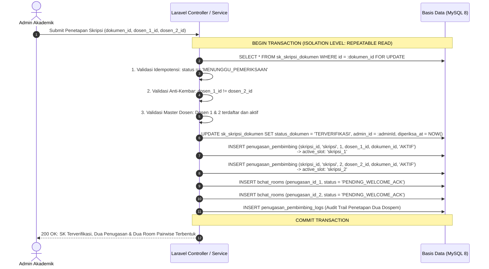
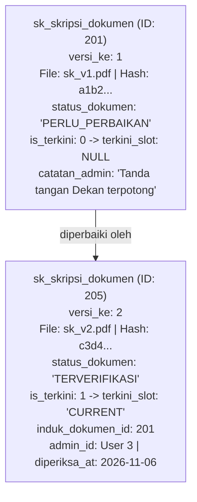
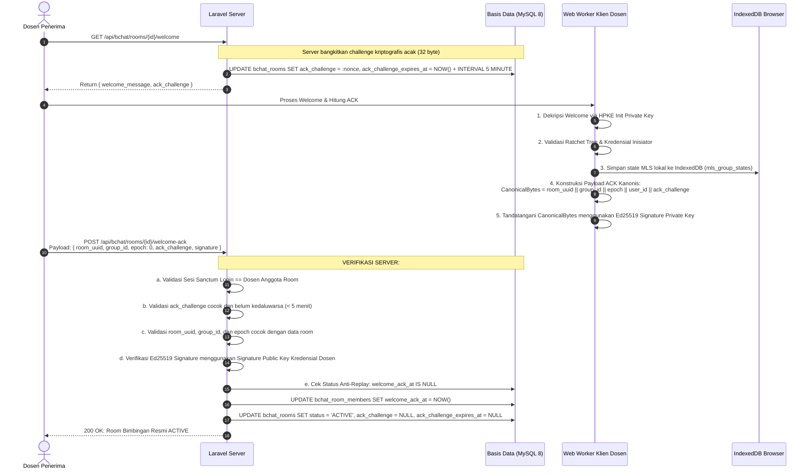

# B-CHAT-12E — FINALISASI ATURAN INTEGRITAS RELASIONAL DAN WELCOME ACK
## SISTEM INFORMASI MANAJEMEN SKRIPSI UNUHA

| Parameter | Keterangan |
| :--- | :--- |
| **Proyek** | Sistem Informasi Manajemen Skripsi UNUHA |
| **Fitur** | Bimbingan Online Chat Real-Time E2EE (B-CHAT) |
| **Tahap** | B-CHAT-12E — Finalisasi Aturan Integritas Relasional dan Welcome ACK |
| **Mode Audit** | STRICTLY READ-ONLY — DESIGN ONLY — ZERO CODE/DATABASE MUTATION |
| **Dokumen Acuan** | [`B-CHAT-11`](file:///d:/Aplikasi/laragon/www/sistem_manajamen_skripsi/B-CHAT-11_Spesifikasi_Integrasi_E2EE.md), [`B-CHAT-11E`](file:///d:/Aplikasi/laragon/www/sistem_manajamen_skripsi/B-CHAT-11E_Laporan_Penegasan_Status.md), [`B-CHAT-12C`](file:///d:/Aplikasi/laragon/www/sistem_manajamen_skripsi/B-CHAT-12C_Rekonsiliasi_Alur_SK_dan_Pairwise_Room.md), [`B-CHAT-12D`](file:///d:/Aplikasi/laragon/www/sistem_manajamen_skripsi/B-CHAT-12D_Koreksi_Integritas_Model_dan_Lifecycle.md) |
| **Waktu Pelaksanaan** | 2026-11-06 |
| **Auditor** | Tim Arsitektur & Kriptografi E2EE Antigravity |

---

## 1. Ringkasan Temuan B-CHAT-12D dan Sasaran Finalisasi

Evaluasi lanjutan terhadap laporan B-CHAT-12D mengonfirmasi bahwa arah arsitektur telah berada pada jalur yang benar, namun memerlukan penyempurnaan pada empat aspek teknis kritis sebelum naskah DDL migrasi pertama dapat disusun:

1. **Batas Kemampuan CHECK Constraint:**  
   CHECK constraint SQL pada mesin MySQL 8 beroperasi secara ketat pada baris lokal (*intra-row*) dan **tidak mendukung subquery** ke tabel lain. Batasan bahwa "Dokumen SK yang dirujuk penugasan skripsi harus berstatus `TERVERIFIKASI`" tidak dapat ditegakkan murni oleh CHECK constraint, melainkan harus dikawal oleh transaksi atomik dan validasi aplikasi. Diperlukan matriks pemisah yang transparan.
2. **Jaminan Cross-Table Consistency FK SK:**  
   Foreign key tunggal `sk_dokumen_id` hanya menjamin keberadaan ID dokumen, tetapi tidak mencegah potensi inkonsistensi jika dokumen yang dipilih ternyata milik skripsi lain. Diperlukan *Composite Foreign Key* `(sk_dokumen_id, skripsi_id)` untuk mengunci relasi silang secara fisik di basis data.
3. **Pengendalian Konkurensi Versi Dokumen SK:**  
   Pola multi-record dokumen SK memerlukan *unique active-version constraint* menggunakan generated column guna mencegah benturan konkurensi (dua permintaan upload bersamaan yang sama-sama mengklaim versi terkini).
4. **Koreksi Ilmiah Spesifikasi Kriptografi Welcome ACK:**  
   Spesifikasi konfirmasi penerimaan Welcome harus membedakan secara tegas antara *HPKE Encryption Key* (untuk membungkus rahasia grup) dengan *Signature Key* identitas anggota (Ed25519 untuk menandatangani ACK). Selain itu, perlindungan anti-replay harus menggunakan mekanisme *Challenge-Response Nonce* jangka pendek, dengan pengakuan jujur bahwa backend tidak memiliki bukti fisik atas persistensi IndexedDB di peramban klien.

---

## 2. Matriks Aturan CHECK, FK, UNIQUE, Transaksi, dan Validasi Aplikasi

Berikut adalah matriks penegakan integritas data yang membedakan domain penegakan basis data (DDL Constraints) dari domain logika bisnis (Database Transactions & Laravel Application Layer):

| No | Aturan Integritas | Penegakan DDL Database (MySQL 8) | Penegakan Database Transaction | Penegakan Aplikasi (Laravel FormRequest / Service) |
| :-: | :--- | :--- | :--- | :--- |
| **1** | **Proposal: Tanpa Dokumen SK & Pembimbing Tunggal.** | `CONSTRAINT chk_penugasan_proposal CHECK ((tahap = 'proposal' AND sk_dokumen_id IS NULL AND pembimbing_ke = 1) OR (tahap = 'skripsi'))` | Transaksi penugasan proposal memverifikasi status `pengajuan_dospem` sebelum eksekusi. | Form Request menolak parameter `sk_dokumen_id` jika endpoint yang dipanggil adalah penetapan proposal. |
| **2** | **Skripsi: Wajib Ada SK & Ordinal Pembimbing 1 atau 2.** | `CONSTRAINT chk_penugasan_skripsi CHECK ((tahap = 'skripsi' AND sk_dokumen_id IS NOT NULL AND pembimbing_ke IN (1, 2)) OR (tahap = 'proposal'))` | Transaksi penetapan mengunci baris dokumen SK (`lockForUpdate`). | Service memvalidasi bahwa `sk_dokumen_id` disertakan dan ordinal bernilai 1 atau 2. |
| **3** | **Kesesuaian Skripsi Dokumen dengan Penugasan (Anti-Tukar Skripsi).** | Composite FK:<br>`FOREIGN KEY (sk_dokumen_id, skripsi_id) REFERENCES sk_skripsi_dokumen(id, skripsi_id) ON DELETE RESTRICT` | Transaksi memverifikasi keselarasan kepemilikan skripsi dan mahasiswa. | Service melempar `DomainException` jika dokumen yang diunggah tidak dinaungi oleh skripsi yang sama. |
| **4** | **Dokumen SK Harus Berstatus TERVERIFIKASI.** | *Tidak dapat diuji via CHECK (larangan subquery MySQL).* Ditegakkan via status lifecycle. | Transaksi verifikasi SK dan penetapan dospem dieksekusi bersamaan dalam satu blok atomik. | Service memeriksa `if ($dokumen->status_dokumen !== 'TERVERIFIKASI') throw ...` sebelum penugasan dibuat. |
| **5** | **Tepat Satu Penugasan Aktif per Slot.** | Generated Virtual Column:<br>`active_slot = (status='AKTIF' ? CONCAT(tahap,'_',pembimbing_ke) : NULL)`<br>`UNIQUE KEY (skripsi_id, active_slot)` | Menjamin rollback otomatis jika dua proses bersamaan mencoba mengisi slot yang sama. | Service memeriksa ketersediaan slot sebelum membuat entitas baru. |
| **6** | **Dua Pembimbing Skripsi Tidak Boleh Orang yang Sama.** | *Tidak dapat diuji via DDL antar-baris (cross-row).* | Transaksi mengeksekusi insert kedua penugasan secara atomik; rollback jika duplikat dosen. | Validasi Form Request: `Rule::different('dosen_1_id', 'dosen_2_id')`. |
| **7** | **Hanya Satu Dokumen SK Berstatus Terkini per Skripsi.** | Generated Virtual Column:<br>`terkini_slot = (is_terkini=1 ? 'CURRENT' : NULL)`<br>`UNIQUE KEY (skripsi_id, terkini_slot)` | `DB::transaction` mengunci baris dokumen lama sebelum membuat versi baru. | Service mengatur `is_terkini = false` pada versi lama saat versi baru diunggah. |

---

## 3. Rancangan Integritas Pasangan Dua Pembimbing Skripsi

Penetapan Pembimbing 1 dan Pembimbing 2 pada tahap skripsi merupakan satu kesatuan keputusan hukum akademik yang wajib berlangsung secara **atomik (all-or-nothing)**:



### Jaminan Keamanan Transaksi:
1. **Pencegahan Double-Submit:** Row-locking (`FOR UPDATE`) pada baris dokumen SK mencegah pemrosesan ganda jika Admin menekan tombol simpan dua kali secara simultan.
2. **Rollback Mutlak:** Jika salah satu penugasan gagal (misalnya benturan pada constraint `active_slot` karena skripsi telah memiliki pembimbing aktif), seluruh mutasi dibatalkan, status dokumen SK kembali ke posisi semula, dan room tidak pernah terbentuk.
3. **Penyatuan Asal Dokumen:** Kedua baris penugasan mengikat nilai `sk_dokumen_id` yang persis sama, menjamin bahwa pasangan pembimbing secara sah berasal dari lembar SK fisik yang sama.

---

## 4. Rancangan Versioning Dokumen SK dan Pengendalian Konkurensi

Untuk mencegah hilangnya dokumen riwayat akibat perbaikan atau unggah ulang, serta menghindari kondisi balapan (*race condition*) yang dapat melahirkan dua versi aktif sekaligus, diterapkan arsitektur **Linked Multi-Record dengan Virtual Slot Locking**:



### 4.1. Definisi Kolom dan Indeks Integritas Versi
Pada tabel `sk_skripsi_dokumen`:
* `versi_ke`: `INT UNSIGNED NOT NULL DEFAULT 1`.
* `is_terkini`: `BOOLEAN NOT NULL DEFAULT TRUE`.
* `induk_dokumen_id`: `BIGINT UNSIGNED NULL FOREIGN KEY REFERENCES sk_skripsi_dokumen(id)`.
* Virtual Slot Column:
  ```sql
  terkini_slot VARCHAR(20) GENERATED ALWAYS AS (
      CASE WHEN is_terkini = 1 THEN 'CURRENT' ELSE NULL END
  ) VIRTUAL,
  CONSTRAINT uk_skripsi_dokumen_terkini UNIQUE (skripsi_id, terkini_slot)
  ```

### 4.2. Pengendalian Konkurensi Unggah (Concurrency Control):
* Saat mahasiswa mengunggah revisi dokumen SK, backend membuka transaksi:
  1. Melakukan lock pada baris skripsi induk (`SELECT id_skripsi FROM skripsi WHERE id_skripsi = :id FOR UPDATE`).
  2. Mengambil versi tertinggi yang ada: `SELECT MAX(versi_ke) FROM sk_skripsi_dokumen WHERE skripsi_id = :id`.
  3. Mengubah record aktif lama: `UPDATE sk_skripsi_dokumen SET is_terkini = 0 WHERE skripsi_id = :id AND is_terkini = 1`. (Hal ini secara otomatis mengosongkan slot unik `terkini_slot` menjadi `NULL`).
  4. Menyisipkan record baru: `versi_ke = $maxVersion + 1`, `is_terkini = 1`, `induk_dokumen_id = $oldId`.
* **Kekuatan Jaminan:** Constraint `uk_skripsi_dokumen_terkini` menjamin database akan melempar *unique key violation* jika terjadi dua proses bersamaan yang mencoba menandai dua dokumen berbeda dengan `is_terkini = 1` pada skripsi yang sama.

---

## 5. Rancangan Welcome ACK (OPEN-10) Beserta Batas Pembuktiannya

### 5.1. Pemisahan Peran dan Kunci Kriptografi (RFC 9420)
Mengoreksi kekeliruan umum pada spesifikasi awal:
* **Peran Inisiator (Mahasiswa):**
  Mengambil KeyPackage publik dosen, membentuk MLS Group (Epoch 0), mengeksekusi TreeKEM Add proposal dan Commit, lalu menghasilkan paket `Welcome` terenkripsi.
* **Peran Penerima (Dosen):**
  Menerima `welcome_message`, mendekripsi rahasia grup menggunakan **HPKE Private Key / Init Private Key** yang berpasangan dengan KeyPackage yang tersimpan di server.
* **Pemisahan Kunci Tanda Tangan ACK:**
  Tanda tangan konfirmasi ACK **TIDAK MENGGUNAKAN HPKE KEY**, melainkan menggunakan **Identity Signature Private Key (Ed25519)** yang melekat pada Kredensial Identitas MLS Dosen. Server memverifikasi signature ACK menggunakan *Signature Public Key* yang telah disertifikasi oleh CA UNUHA.

### 5.2. Protokol Challenge-Response Anti-Replay Terikat Konteks
Untuk mencegah serangan replay, pemalsuan, dan konfirmasi basi, Welcome ACK diikat secara deterministik:



### 5.3. Penegasan Batas Pembuktian Ilmiah (Server vs Klien)
Auditor menegaskan batasan pembuktian secara transparan:
1. **Hal yang DAPAT Dibuktikan secara Kriptografis oleh Server:**
   - Server membuktikan bahwa entitas pemegang kunci privat identitas dosen yang sah telah memproses konteks Welcome dan menyetujui parameter room yang ditandai oleh challenge server berumur pendek.
   - Server membuktikan transmisi ACK bebas dari serangan replay dan manipulasi pihak ketiga (*tamper-proof*).
2. **Hal yang TIDAK DAPAT Dibuktikan secara Fisik oleh Server:**
   - Server **TIDAK MEMILIKI AKSES FISIK** untuk memverifikasi apakah byte ratchet tree benar-benar telah tertulis dan bertahan di dalam sektor storage IndexedDB perangkat klien.
   - Pernyataan penyimpanan IndexedDB adalah **laporan sepihak klien (client-reported status)** yang berada di luar batas audit server (*unverifiable client storage boundary*).
3. **Status OPEN-10:**
   Status **OPEN-10 tetap dipertahankan OPEN** hingga fase pengujian integrasi runtime library MLS di browser nyata dapat mengevaluasi ketahanan kegagalan penyimpanan lokal klien.

---

## 6. Status Seluruh Keputusan Terbuka (OPEN Items)

Berikut adalah konsolidasi status seluruh *open decisions* proyek yang tetap dipertahankan tanpa intervensi sepihak:

| Kode OPEN | Domain Keputusan | Status Saat Ini | Sikap Teknis & Batasan Model Data |
| :---: | :--- | :---: | :--- |
| **OPEN-10** | **Library MLS Produksi & Batas Bukti ACK** | **OPEN** | Pustaka `ts-mls` tetap sebagai kandidat utama spesifikasi di balik generic adapter. Server memverifikasi signature ACK berbasis challenge; penyimpanan fisik IndexedDB diperlakukan sebagai jaminan lokal klien. |
| **OPEN-11** | **Mekanisme Distribusi CEK Lampiran (OD-17)** | **OPEN** | Pendekatan B (Payload-Distributed CEK) sebagai kandidat utama, Pendekatan A sebagai pembanding. Skema basis data lampiran dirancang netral dan kompatibel dengan kedua pendekatan. |
| **OPEN-15** | **Format Template Dokumen SK Skripsi** | **OPEN** | Sistem hanya bertindak sebagai penyedia unduhan template statis generik. Tidak ada asumsi keseragaman format antar-fakultas/prodi yang dikunci pada DDL. |
| **OPEN-16** | **Masa Berlaku Kedaluwarsa SK Skripsi** | **OPEN** | Kolom `tanggal_selesai` pada penugasan dibiarkan nullable (`DATE NULL`). Jika kebijakan universitas kelak menetapkan masa berlaku 6 bulan, penegakan dilakukan melalui *scheduled background command* tanpa merombak DDL. |
| **OPEN-17** | **Bentuk SK Penggantian Pembimbing (Parsial vs Utuh)** | **OPEN** | Model data multi-record `sk_skripsi_dokumen` dan dekomposisi `penugasan_pembimbing` (per `pembimbing_ke`) secara fleksibel mendukung SK penggantian parsial (1 dosen) maupun SK baru utuh (2 dosen). |

---

## 7. Evaluasi Kesiapan Menuju DDL Drafting

### 7.1. Matriks Kesiapan 12 Tabel Rancangan
Model data konseptual kini telah mencapai konsistensi struktural penuh tanpa pertentangan aturan:

* **Paket Modul Akademik & Dokumen (3 Tabel):**
  1. `sk_skripsi_dokumen`: Menampung riwayat scan SK offline, versioning berantai (`versi_ke`, `is_terkini`), hash integritas SHA-256, dan unique slot `uk_skripsi_dokumen_terkini`. $\rightarrow$ **READY FOR DDL**
  2. `penugasan_pembimbing`: Menampung penugasan Proposal & Skripsi, composite FK `(sk_dokumen_id, skripsi_id)`, CHECK constraints pemisah alur, dan unique slot `uk_skripsi_active_slot`. $\rightarrow$ **READY FOR DDL**
  3. `penugasan_pembimbing_logs`: Audit trail mutasi penugasan append-only. $\rightarrow$ **READY FOR DDL**

* **Paket Modul Kriptografi & B-CHAT (9 Tabel Konseptual Baku):**
  4. `bchat_rooms`: FK tunggal ke `penugasan_pembimbing_id`, kolom `ack_challenge`, `ack_challenge_expires_at`, status lifecycle. $\rightarrow$ **READY FOR DDL**
  5. `bchat_room_members`: Keanggotaan room, peran, dan timestamp `welcome_ack_at`. $\rightarrow$ **READY FOR DDL**
  6. `bchat_key_packages`: Pool pre-key MLS bertanda tangan CA. $\rightarrow$ **READY FOR DDL**
  7. `bchat_messages`: Monotonic sequence, epoch, generation, ciphertext payload, SHA-256 idempotency hash. $\rightarrow$ **READY FOR DDL**
  8. `bchat_message_receipts`: Status delivery dan read receipts terpisah. $\rightarrow$ **READY FOR DDL**
  9. `bchat_upload_sessions`: Pengelolaan sesi chunked upload berkas terenkripsi. $\rightarrow$ **READY FOR DDL**
  10. `bchat_attachments`: Metadata berkas terenkripsi AES-256-GCM. $\rightarrow$ **READY FOR DDL**
  11. `bchat_attachment_chunks`: Lokasi fisik potongan ciphertext di storage privat. $\rightarrow$ **READY FOR DDL**
  12. `bchat_crl_revocations`: Daftar pencabutan kredensial darurat institusi. $\rightarrow$ **READY FOR DDL**

### 7.2. Kesimpulan Kesiapan: **READY FOR DDL DRAFTING**
Model data relasional, integritas constraint, dan pemisahan lifecycle room telah tervalidasi secara konsisten. Rancangan dinyatakan **SIAP DAN LAYAK UNTUK MEMASUKI TAHAP PENYUSUNAN DRAFT NASKAH DDL MIGRASI BASIS DATA**.

> [!CAUTION]
> **BATASAN OTORISASI:**  
> Penilaian **READY FOR DDL DRAFTING** adalah persetujuan teknis atas kelayakan dokumen spesifikasi. Status ini **BUKAN IZIN MENJALANKAN MIGRASI KE DATABASE**, bukan izin membuat file migration fisik di kode Laravel, dan bukan izin implementasi. Seluruh eksekusi kode tetap memerlukan izin dan mandat tersendiri dari Pemilik Proyek.

---

## 8. Bukti Pemeriksaan dan Konfirmasi Zero Mutation

### 8.1. Komponen yang Diperiksa
1. Dokumen Historis Proyek:
   - [`B-CHAT-11_Spesifikasi_Integrasi_E2EE.md`](file:///d:/Aplikasi/laragon/www/sistem_manajamen_skripsi/B-CHAT-11_Spesifikasi_Integrasi_E2EE.md) (Bab 7: Skema konseptual 9 tabel `bchat_*`).
   - [`B-CHAT-11E_Laporan_Penegasan_Status.md`](file:///d:/Aplikasi/laragon/www/sistem_manajamen_skripsi/B-CHAT-11E_Laporan_Penegasan_Status.md) (Penegasan deterministik 7 poin Welcome ACK).
   - [`B-CHAT-12C_Rekonsiliasi_Alur_SK_dan_Pairwise_Room.md`](file:///d:/Aplikasi/laragon/www/sistem_manajamen_skripsi/B-CHAT-12C_Rekonsiliasi_Alur_SK_dan_Pairwise_Room.md) (Diferensiasi proposal vs skripsi offline).
   - [`B-CHAT-12D_Koreksi_Integritas_Model_dan_Lifecycle.md`](file:///d:/Aplikasi/laragon/www/sistem_manajamen_skripsi/B-CHAT-12D_Koreksi_Integritas_Model_dan_Lifecycle.md) (Pola virtual column Active Slot).
2. Sumber Daya Teknis Aplikasi:
   - [`2026_10_28_000001_create_pengajuan_dospem_table.php`](file:///d:/Aplikasi/laragon/www/sistem_manajamen_skripsi/manajemen_skripsi/database/migrations/2026_10_28_000001_create_pengajuan_dospem_table.php) (Pola generated column MySQL 8).
   - [`PengajuanDospemAdminController.php`](file:///d:/Aplikasi/laragon/www/sistem_manajamen_skripsi/manajemen_skripsi/app/Http/Controllers/Admin/PengajuanDospemAdminController.php) (Transaksi penetapan operasional).

### 8.2. Pernyataan Kepatuhan Zero Mutation
Auditor menyatakan dengan penuh tanggung jawab profesional bahwa selama pelaksanaan mandat **B-CHAT-12E**:
* **Nol Perubahan Kode:** Tidak ada berkas di repositori `manajemen_skripsi/` atau `frontend_manajemen_skripsi/` yang ditambah, dimodifikasi, atau dihapus.
* **Nol Perubahan Database:** Tidak ada perintah DDL/DML, migrasi, atau manipulasi data yang dijalankan pada server basis data.
* **Nol Perubahan Dependensi & Konfigurasi:** Berkas Composer, NPM, dan konfigurasi `.env` tetap murni tanpa modifikasi.
* **Nol Operasi Git:** Tidak ada aksi commit, staging, stash, branching, atau push yang dijalankan.

---
*Laporan ini disusun secara resmi sebagai dokumen final penutup tahap perancangan arsitektur sebelum penyusunan naskah DDL migrasi Sistem Informasi Manajemen Skripsi UNUHA.*

