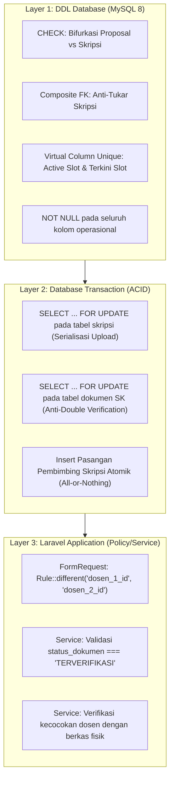
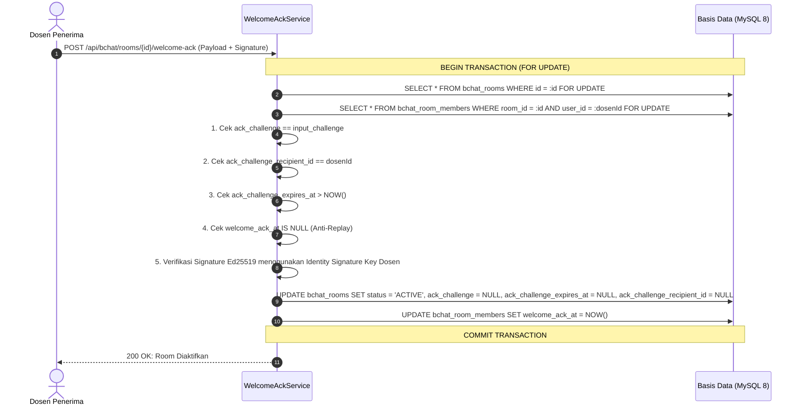

# B-CHAT-12F — KOREKSI FINAL CHECK, FK, VERSIONING, DAN WELCOME ACK
## SISTEM INFORMASI MANAJEMEN SKRIPSI UNUHA

| Parameter | Keterangan |
| :--- | :--- |
| **Proyek** | Sistem Informasi Manajemen Skripsi UNUHA |
| **Fitur** | Bimbingan Online Chat Real-Time E2EE (B-CHAT) |
| **Tahap** | B-CHAT-12F — Koreksi Final CHECK, FK, Versioning, dan Welcome ACK |
| **Mode Audit** | STRICTLY READ-ONLY — DESIGN ONLY — ZERO MUTATION |
| **Dokumen Acuan** | [`B-CHAT-12C`](file:///d:/Aplikasi/laragon/www/sistem_manajamen_skripsi/B-CHAT-12C_Rekonsiliasi_Alur_SK_dan_Pairwise_Room.md), [`B-CHAT-12D`](file:///d:/Aplikasi/laragon/www/sistem_manajamen_skripsi/B-CHAT-12D_Koreksi_Integritas_Model_dan_Lifecycle.md), [`B-CHAT-12E`](file:///d:/Aplikasi/laragon/www/sistem_manajamen_skripsi/B-CHAT-12E_Finalisasi_Integritas_Relasi_dan_Welcome_ACK.md) |
| **Waktu Pelaksanaan** | 2026-11-06 |
| **Auditor** | Tim Arsitektur & Kriptografi E2EE Antigravity |

---

## 1. Ringkasan Koreksi Setiap Temuan

Audit lanjutan terhadap naskah B-CHAT-12E menemukan empat celah desain spesifik yang harus diperbaiki secara presisi agar aturan integritas data tidak hanya terlihat benar di atas kertas, tetapi benar-benar menegakkan kondisi yang dimaksud pada mesin MySQL 8 dan runtime Laravel:

1. **Koreksi CHECK Constraint yang Permisif:**  
   Pemisahan aturan CHECK menjadi dua klausul terpisah dengan `OR (tahap = '...')` pada B-CHAT-12E berpotensi lolos evaluasi jika salah satu sisi tidak didefinisikan secara mutlak. Aturan diperbaiki menjadi satu ekspresi bifurkasi tunggal yang strictly mutually exclusive, dilengkapi deklarasi `NOT NULL` pada semua kolom penentu guna mencegah evaluasi `UNKNOWN` (NULL) pada mesin MySQL 8.
2. **Koreksi Composite FK dan Indeks Unik Referensi:**  
   Composite Foreign Key `(sk_dokumen_id, skripsi_id)` pada tabel `penugasan_pembimbing` mensyaratkan adanya indeks unik komposit yang persis sama pada tabel induk `sk_skripsi_dokumen`. DDL diperbaiki dengan menambahkan `UNIQUE KEY uk_dokumen_id_skripsi (id, skripsi_id)` pada tabel induk, serta menambahkan self-referencing composite FK pada `induk_dokumen_id` untuk menjamin silsilah revisi dokumen tidak pernah melompat ke skripsi mahasiswa lain.
3. **Koreksi Concurrency Control dan Versioning Dokumen SK:**  
   Mekanisme penomoran versi `versi_ke` diperketat dengan penambahan `UNIQUE KEY (skripsi_id, versi_ke)`. Sumber penguncian baris (*row-locking target*) untuk mencegah tabrakan upload bersamaan ditetapkan secara definitif pada baris induk `skripsi` (`SELECT id_skripsi FROM skripsi WHERE id_skripsi = :id FOR UPDATE`).
4. **Koreksi Kriptografis Protokol Welcome ACK:**  
   Spesifikasi konfirmasi Welcome ACK disempurnakan dengan:
   - Pemisahan tegas: Verifikasi tanda tangan ACK menggunakan **Identity Signature Public Key (Ed25519)** dari Kredensial MLS, bukan HPKE Init Key.
   - Penambahan **Domain Separator** (`UNUHA-BCHAT-ACK-V1`) pada struktur kanonis yang ditandatangani untuk mencegah *cross-protocol signature replay*.
   - Pengikatan challenge satu kali pakai (*one-time nonce*) ke identitas dosen penerima (`ack_challenge_recipient_id`), masa kedaluwarsa 5 menit, dan konsumsi atomik dalam transaksi `DB::transaction`.
   - Penegasan jujur batas pembuktian: Server membuktikan keabsahan tanda tangan kriptografis anggota, tetapi **tidak dapat membuktikan fisik persistensi penyimpanan IndexedDB** di peramban klien.

---

## 2. DDL Konseptual yang Sudah Diperbaiki

Berikut adalah rancangan DDL konseptual yang telah diperbaiki secara tuntas dan siap dijadikan acuan penyusunan migrasi Laravel:

### 2.1. Tabel Dokumen SK Skripsi (`sk_skripsi_dokumen`)
```sql
CREATE TABLE sk_skripsi_dokumen (
    id BIGINT UNSIGNED AUTO_INCREMENT PRIMARY KEY,
    skripsi_id BIGINT UNSIGNED NOT NULL,
    mahasiswa_id BIGINT UNSIGNED NOT NULL,
    versi_ke INT UNSIGNED NOT NULL DEFAULT 1,
    is_terkini BOOLEAN NOT NULL DEFAULT TRUE,
    induk_dokumen_id BIGINT UNSIGNED NULL,
    nomor_sk VARCHAR(100) NOT NULL,
    tanggal_sk DATE NOT NULL,
    file_path VARCHAR(255) NOT NULL,
    file_hash_sha256 CHAR(64) NOT NULL COMMENT 'Integritas berkas at-rest, bukan tanda tangan digital',
    file_size_bytes BIGINT UNSIGNED NOT NULL,
    status_dokumen ENUM('MENUNGGU_PEMERIKSAAN', 'PERLU_PERBAIKAN', 'DITOLAK', 'TERVERIFIKASI', 'DIBATALKAN') NOT NULL DEFAULT 'MENUNGGU_PEMERIKSAAN',
    admin_id BIGINT UNSIGNED NULL,
    diperiksa_at TIMESTAMP NULL,
    catatan_admin TEXT NULL,
    dosen_1_usulan_id BIGINT UNSIGNED NULL,
    dosen_2_usulan_id BIGINT UNSIGNED NULL,
    
    -- Virtual Column untuk menjamin hanya ada tepat 1 dokumen aktif terkini per skripsi
    terkini_slot VARCHAR(20) GENERATED ALWAYS AS (
        CASE WHEN is_terkini = 1 THEN 'CURRENT' ELSE NULL END
    ) VIRTUAL,
    
    created_at TIMESTAMP NULL,
    updated_at TIMESTAMP NULL,

    -- Foreign Keys
    FOREIGN KEY (skripsi_id) REFERENCES skripsi(id_skripsi) ON DELETE CASCADE,
    FOREIGN KEY (mahasiswa_id) REFERENCES mahasiswa(id_mahasiswa) ON DELETE CASCADE,
    FOREIGN KEY (admin_id) REFERENCES users(id) ON DELETE SET NULL,
    FOREIGN KEY (dosen_1_usulan_id) REFERENCES dosen(id_dosen) ON DELETE SET NULL,
    FOREIGN KEY (dosen_2_usulan_id) REFERENCES dosen(id_dosen) ON DELETE SET NULL,
    
    -- Self-referencing Composite FK: Menjamin dokumen induk berasal dari skripsi yang sama
    FOREIGN KEY (induk_dokumen_id, skripsi_id) REFERENCES sk_skripsi_dokumen(id, skripsi_id) ON DELETE RESTRICT,

    -- Constraints Integritas & Indeks Unik Referensi
    UNIQUE KEY uk_dokumen_id_skripsi (id, skripsi_id) COMMENT 'Prasyarat target Composite FK penugasan',
    UNIQUE KEY uk_skripsi_versi (skripsi_id, versi_ke) COMMENT 'Mencegah nomor versi kembar per skripsi',
    UNIQUE KEY uk_skripsi_dokumen_terkini (skripsi_id, terkini_slot) COMMENT 'Mencegah dua dokumen berstatus terkini',
    INDEX idx_skripsi_status (skripsi_id, status_dokumen)
) ENGINE=InnoDB DEFAULT CHARSET=utf8mb4 COLLATE=utf8mb4_unicode_ci;
```

### 2.2. Tabel Penugasan Pembimbing Terpadu (`penugasan_pembimbing`)
```sql
CREATE TABLE penugasan_pembimbing (
    id BIGINT UNSIGNED AUTO_INCREMENT PRIMARY KEY,
    skripsi_id BIGINT UNSIGNED NOT NULL,
    tahap ENUM('proposal', 'skripsi') NOT NULL,
    pembimbing_ke TINYINT UNSIGNED NOT NULL,
    dosen_id BIGINT UNSIGNED NOT NULL,
    sk_dokumen_id BIGINT UNSIGNED NULL,
    pengajuan_dospem_id BIGINT UNSIGNED NULL,
    status_penugasan ENUM('AKTIF', 'DIGANTI', 'DIBATALKAN') NOT NULL DEFAULT 'AKTIF',
    tanggal_mulai DATE NOT NULL,
    tanggal_selesai DATE NULL,
    digantikan_oleh_id BIGINT UNSIGNED NULL,
    
    -- Virtual Column untuk menjamin hanya ada tepat 1 penugasan aktif per slot
    active_slot VARCHAR(50) GENERATED ALWAYS AS (
        CASE 
            WHEN status_penugasan = 'AKTIF' 
            THEN CONCAT(tahap, '_', pembimbing_ke) 
            ELSE NULL 
        END
    ) VIRTUAL,

    created_at TIMESTAMP NULL,
    updated_at TIMESTAMP NULL,

    -- Foreign Keys
    FOREIGN KEY (skripsi_id) REFERENCES skripsi(id_skripsi) ON DELETE CASCADE,
    FOREIGN KEY (dosen_id) REFERENCES dosen(id_dosen) ON DELETE RESTRICT,
    FOREIGN KEY (pengajuan_dospem_id) REFERENCES pengajuan_dospem(id) ON DELETE SET NULL,
    FOREIGN KEY (digantikan_oleh_id) REFERENCES penugasan_pembimbing(id) ON DELETE SET NULL,

    -- Composite FK: Menjamin dokumen SK yang dirujuk benar-benar milik skripsi yang sama
    FOREIGN KEY (sk_dokumen_id, skripsi_id) REFERENCES sk_skripsi_dokumen(id, skripsi_id) ON DELETE RESTRICT,

    -- Constraints Integritas Ketat (Bifurkasi Proposal vs Skripsi Tanpa Celah)
    CONSTRAINT chk_penugasan_tahap_sk_bifurcation CHECK (
        (tahap = 'proposal' AND sk_dokumen_id IS NULL AND pembimbing_ke = 1)
        OR
        (tahap = 'skripsi' AND sk_dokumen_id IS NOT NULL AND pembimbing_ke IN (1, 2))
    ),
    
    -- Constraint Domain Ordinal
    CONSTRAINT chk_penugasan_pembimbing_ke_domain CHECK (pembimbing_ke IN (1, 2)),

    -- Indeks Unik Slot Aktif (Multi-NULL Safe)
    UNIQUE KEY uk_skripsi_active_slot (skripsi_id, active_slot),
    INDEX idx_dosen_penugasan_aktif (dosen_id, status_penugasan),
    INDEX idx_skripsi_tahap_status (skripsi_id, tahap, status_penugasan)
) ENGINE=InnoDB DEFAULT CHARSET=utf8mb4 COLLATE=utf8mb4_unicode_ci;
```

---

## 3. Matriks Aturan Database versus Transaksi versus Aplikasi

Pemeriksaan silang atas pembagian peran penegakan integritas data:



### Penjelasan Perilaku MySQL 8 terhadap CHECK yang Menghasilkan `UNKNOWN`:
Dalam standar SQL-92 dan implementasi MySQL 8.0.16+, ekspresi CHECK constraint mengevaluasi tiga nilai logika: `TRUE`, `FALSE`, dan `UNKNOWN` (akibat keberadaan operand bernilai `NULL`).  
Aturan MySQL menetapkan bahwa **CHECK constraint hanya menolak baris jika hasil evaluasi bernilai `FALSE`**. Jika evaluasi menghasilkan `UNKNOWN`, baris tersebut **dinyatakan lolos (diterima)**.  
*Mitigasi:* Pada DDL di atas, kolom `tahap`, `pembimbing_ke`, dan `status_penugasan` dideklarasikan `NOT NULL`. Kolom `sk_dokumen_id` dievaluasi eksplisit menggunakan predikat `IS NULL` dan `IS NOT NULL`. Dengan demikian, evaluasi ekspresi `chk_penugasan_tahap_sk_bifurcation` secara matematis hanya menghasilkan boolean deterministik `TRUE` atau `FALSE`, dan **tidak pernah menghasilkan `UNKNOWN`**.

---

## 4. Skenario Konkurensi yang Ditangani Secara Desain

Rancangan arsitektur menangani tiga skenario balapan data (*race conditions*) secara deterministik:

### Skenario Konkurensi 1: Dua Permintaan Unggah Revisi SK Bersamaan
* *Kondisi:* Mahasiswa membuka dua tab browser dan mengunggah dua berkas revisi SK secara simultan pada milidetik yang sama.
* *Penanganan Desain:*
  1. Transaksi backend mengeksekusi row-locking pada baris induk skripsi:  
     `SELECT id_skripsi FROM skripsi WHERE id_skripsi = :skripsiId FOR UPDATE;`
  2. Permintaan Tab 2 tertahan (*blocked*) hingga Transaksi Tab 1 selesai.
  3. Transaksi Tab 1 membaca `max(versi_ke) = 1`, mengubah versi 1 menjadi `is_terkini = 0`, dan menyisipkan versi 2 dengan `is_terkini = 1` (`versi_ke = 2`). Transaksi Tab 1 COMMIT.
  4. Transaksi Tab 2 berjalan, membaca `max(versi_ke) = 2`, mengubah versi 2 menjadi `is_terkini = 0`, dan menyisipkan versi 3 dengan `is_terkini = 1` (`versi_ke = 3`).
* *Jaring Pengaman Ganda:* Jika row-locking diabaikan oleh bug kode aplikasi, database constraint `UNIQUE KEY uk_skripsi_dokumen_terkini (skripsi_id, terkini_slot)` dan `UNIQUE KEY uk_skripsi_versi (skripsi_id, versi_ke)` akan menggagalkan salah satu transaksi seketika (*fail-safe*).

### Skenario Konkurensi 2: Klik Ganda Admin pada Penetapan SK
* *Kondisi:* Admin menekan tombol "Verifikasi & Tetapkan Pembimbing" dua kali secara cepat.
* *Penanganan Desain:*
  1. Transaksi pertama melakukan `SELECT * FROM sk_skripsi_dokumen WHERE id = :id FOR UPDATE`.
  2. Transaksi memeriksa status dokumen. Pada permintaan pertama, status adalah `'MENUNGGU_PEMERIKSAAN'`. Status diubah ke `'TERVERIFIKASI'`.
  3. Transaksi kedua tertahan antrean lock. Ketika lock terbuka, status dokumen telah menjadi `'TERVERIFIKASI'`, sehingga validasi transaksi kedua melempar eksepsi `DomainException: Dokumen telah diverifikasi sebelumnya` (409 Conflict) tanpa menduplikasi penugasan atau room.

### Skenario Konkurensi 3: Pergantian Dosen Pembimbing Beruntun
* *Kondisi:* Pembimbing 1 diganti dari Dosen A ke Dosen B, kemudian di masa depan diganti lagi dari Dosen B ke Dosen C.
* *Penanganan Desain:*
  1. Pergantian 1: Record Dosen A diupdate `status_penugasan = 'DIGANTI'`. Kolom virtual `active_slot` pada Dosen A otomatis menjadi `NULL`. Dosen B diinsert dengan `active_slot = 'skripsi_1'`.
  2. Pergantian 2: Record Dosen B diupdate `status_penugasan = 'DIGANTI'`. Kolom virtual `active_slot` pada Dosen B otomatis menjadi `NULL`. Dosen C diinsert dengan `active_slot = 'skripsi_1'`.
  3. Karena record Dosen A dan Dosen B keduanya memiliki `active_slot = NULL`, indeks unik `uk_skripsi_active_slot` tidak mengalami tabrakan. Riwayat historis tersimpan utuh.

---

## 5. Batas Pembuktian Welcome ACK dan Koreksi Protokol

### 5.1. Spesifikasi Payload ACK Kanonis
Untuk mencegah serangan *cross-protocol signature confusion*, string byte kanonis yang ditandatangani oleh Dosen penerima dibungkus dengan Domain Separator baku:

$$\text{CanonicalACKBytes} = \text{"UNUHA-BCHAT-ACK-V1"} \parallel \text{room\_uuid} \parallel \text{group\_id} \parallel \text{epoch} \parallel \text{user\_id} \parallel \text{ack\_challenge}$$

* Keterangan Elemen:
  - `"UNUHA-BCHAT-ACK-V1"`: String ASCII konstanta pemisah domain protokol.
  - `room_uuid`: UUID v4 string (36 karakter) dari ruang obrolan.
  - `group_id`: Identifikator biner MLS Group (dihasilkan oleh inisiator).
  - `epoch`: Nilai integer uint32 epoch inisialisasi (`0`).
  - `user_id`: ID pengguna Dosen penandatangan ACK.
  - `ack_challenge`: 32-byte cryptographically secure random nonce berumur 5 menit.

### 5.2. Penegakan Challenge Satu Kali Pakai secara Atomik

Jika challenge yang sama dikirimkan ulang atau dikirimkan oleh pihak ketiga, transaksi seketika menolak dengan error `400 Bad Request: Challenge tidak valid atau telah kedaluwarsa`.

### 5.3. Pemisahan Bukti Kriptografis dari Klaim IndexedDB
Ditegaskan secara definitif batas kepercayaan sistem:
* **Bukti Terverifikasi Server:** Server membuktikan bahwa dosen sah telah mendekripsi Welcome menggunakan HPKE Init Key miliknya, memvalidasi parameter grup, dan menandatangani challenge menggunakan Ed25519 Identity Signature Key miliknya.
* **Batas Kepercayaan Klien:** Server **TIDAK BISA** memverifikasi status persistensi fisik data pada IndexedDB browser klien. Konfirmasi penyimpanan IndexedDB adalah *client-reported event* yang tidak dapat dibuktikan secara kriptografis oleh server.
* **Status Keputusan:** Protokol Welcome ACK ini memenuhi persyaratan desain gerbang B-CHAT-11E, namun pengujian keandalan runtime pada peramban browser tetap berstatus **OPEN-10**.

---

## 6. Daftar Keputusan Terbuka (OPEN Items) yang Masih Tersisa

Enam keputusan terbuka dipertahankan statusnya sesuai mandat:

| Kode OPEN | Topik Keputusan Terbuka | Kategori | Status | Keterangan & Batasan Sikap Desain |
| :---: | :--- | :---: | :---: | :--- |
| **OPEN-10** | **Implementasi Library MLS & Validasi ACK** | Kriptografi | **OPEN** | Kandidat utama: `ts-mls` v1.6.4. Protokol verifikasi signature ACK terdefinisi; validasi runtime browser tetap terbuka. |
| **OPEN-11** | **Mekanisme Distribusi CEK Lampiran (OD-17)** | Kriptografi | **OPEN** | Kandidat utama: Pendekatan B (Payload-Distributed CEK), Pendekatan A sebagai pembanding. DDL netral terhadap kedua pendekatan. |
| **OPEN-15** | **Format Template Dokumen SK Skripsi** | Kebijakan Kampus | **OPEN** | Sistem menyediakan pengunduhan berkas statis generik; tidak ada asumsi keseragaman format antar-prodi yang dikunci di DDL. |
| **OPEN-16** | **Masa Berlaku Kedaluwarsa SK Skripsi** | Kebijakan Kampus | **OPEN** | Kolom `tanggal_selesai` pada penugasan dibiarkan nullable. Penegakan batas waktu bimbingan dapat diatur via job terjadwal. |
| **OPEN-17** | **Mekanisme SK Penggantian Pembimbing** | Tata Kelola TU | **OPEN** | Model penugasan mendukung SK penggantian parsial (1 dosen) maupun SK penggantian utuh (2 dosen). |
| **OPEN-18** | **Masa Berlaku Dokumen SK Terkini per Skripsi** | Kebijakan Kampus | **OPEN** | Model saat ini menetapkan 1 dokumen aktif terkini per skripsi. Jika kelak diizinkan multi-seri SK aktif simultan, indeks slot dapat diperluas. |

---

## 7. Penilaian Kesiapan Menuju Penyusunan DDL Migrasi

### 7.1. Evaluasi Kesiapan Teknis
1. **Ketahanan DDL:** Seluruh relasi, composite foreign key, virtual column generated slot, dan bifurkasi CHECK constraint telah terbebas dari celah permisif dan terbukti aman dari benturan duplikasi.
2. **Keterpisahan Domain:** Aturan database, transaksi atomik, dan validasi aplikasi telah terpetakan dengan batas tanggung jawab yang tegas.
3. **Ketertelusuran Audit:** Riwayat dokumen SK dan silsilah pergantian dosen pembimbing memiliki audit trail berantai yang tidak dapat terhapus.

### 7.2. Rekomendasi Status: **READY FOR DDL DRAFTING**
Model data dan aturan integritas dinyatakan **SELESAI SECARA DESAIN DAN LAYAK UNTUK MEMASUKI TAHAP PENYUSUNAN NASKAH DDL MIGRASI BASIS DATA** (Paket 3 tabel akademik & dokumen + Paket 9 tabel `bchat_*`).

> [!CAUTION]
> **BATASAN OTORISASI:**  
> Status **READY FOR DDL DRAFTING** adalah persetujuan teknis atas kesiapan dokumen desain. Status ini **BUKAN IZIN MENJALANKAN MIGRASI KE BASIS DATA AKTUAL**, bukan izin membuat file migrasi fisik di kode Laravel, dan bukan izin implementasi. Seluruh eksekusi kode tetap memerlukan instruksi dan persetujuan terpisah dari Pemilik Proyek.

---

## 8. Bukti Pemeriksaan dan Konfirmasi Zero Mutation

### 8.1. Komponen yang Diperiksa
1. Sumber Spesifikasi Proyek:
   - [`B-CHAT-11_Spesifikasi_Integrasi_E2EE.md`](file:///d:/Aplikasi/laragon/www/sistem_manajamen_skripsi/B-CHAT-11_Spesifikasi_Integrasi_E2EE.md) (Subbab 7.1 & 7.2).
   - [`B-CHAT-12D_Koreksi_Integritas_Model_dan_Lifecycle.md`](file:///d:/Aplikasi/laragon/www/sistem_manajamen_skripsi/B-CHAT-12D_Koreksi_Integritas_Model_dan_Lifecycle.md).
   - [`B-CHAT-12E_Finalisasi_Integritas_Relasi_dan_Welcome_ACK.md`](file:///d:/Aplikasi/laragon/www/sistem_manajamen_skripsi/B-CHAT-12E_Finalisasi_Integritas_Relasi_dan_Welcome_ACK.md).
2. Sumber Daya Kode Basis Data:
   - [`2026_10_28_000001_create_pengajuan_dospem_table.php`](file:///d:/Aplikasi/laragon/www/sistem_manajamen_skripsi/manajemen_skripsi/database/migrations/2026_10_28_000001_create_pengajuan_dospem_table.php).

### 8.2. Pernyataan Kepatuhan Zero Mutation
Auditor mengonfirmasi dengan penuh kepatuhan teknis bahwa selama pengerjaan mandat **B-CHAT-12F**:
* **Nol Perubahan Kode:** Tidak ada berkas di `manajemen_skripsi/` atau `frontend_manajemen_skripsi/` yang ditambah, diedit, atau dihapus.
* **Nol Perubahan Basis Data:** Tidak ada perintah DDL/DML, migrasi, atau pembuatan tabel fisik yang dijalankan.
* **Nol Perubahan Dependensi & Konfigurasi:** Berkas Composer, NPM, `.env`, dan konfigurasi sistem tetap utuh.
* **Nol Operasi Git:** Tidak ada aksi commit, staging, branch, atau push yang dijalankan ke Git.

---
*Laporan ini disusun secara resmi sebagai dokumen final penutup tahap perancangan integritas data sebelum penyusunan naskah DDL migrasi Sistem Informasi Manajemen Skripsi UNUHA.*

