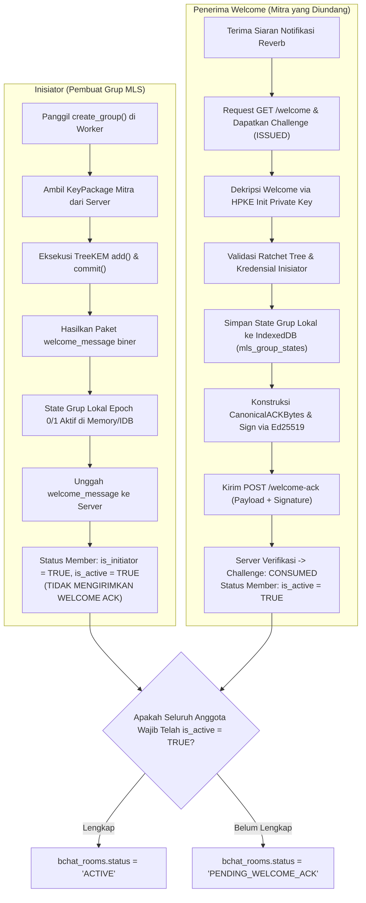
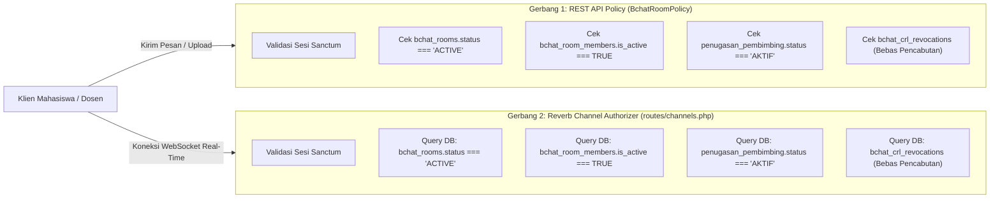

# B-CHAT-12G — FINALISASI UNIVERSAL WELCOME ACK DAN LIFECYCLE MLS MEMBERSHIP
## SISTEM INFORMASI MANAJEMEN SKRIPSI UNUHA

| Parameter | Keterangan |
| :--- | :--- |
| **Proyek** | Sistem Informasi Manajemen Skripsi UNUHA |
| **Fitur** | Bimbingan Online Chat Real-Time E2EE (B-CHAT) |
| **Tahap** | B-CHAT-12G — Finalisasi Universal Welcome ACK dan Lifecycle MLS Membership |
| **Mode Audit** | STRICTLY READ-ONLY — DESIGN ONLY — ZERO MUTATION |
| **Dokumen Acuan** | [`B-CHAT-11E`](file:///d:/Aplikasi/laragon/www/sistem_manajamen_skripsi/B-CHAT-11E_Laporan_Penegasan_Status.md), [`B-CHAT-12C`](file:///d:/Aplikasi/laragon/www/sistem_manajamen_skripsi/B-CHAT-12C_Rekonsiliasi_Alur_SK_dan_Pairwise_Room.md), [`B-CHAT-12D`](file:///d:/Aplikasi/laragon/www/sistem_manajamen_skripsi/B-CHAT-12D_Koreksi_Integritas_Model_dan_Lifecycle.md), [`B-CHAT-12E`](file:///d:/Aplikasi/laragon/www/sistem_manajamen_skripsi/B-CHAT-12E_Finalisasi_Integritas_Relasi_dan_Welcome_ACK.md), [`B-CHAT-12F`](file:///d:/Aplikasi/laragon/www/sistem_manajamen_skripsi/B-CHAT-12F_Koreksi_Final_Integritas_dan_ACK.md) |
| **Waktu Pelaksanaan** | 2026-11-06 |
| **Auditor** | Tim Arsitektur & Kriptografi E2EE Antigravity |

---

## 1. Ringkasan Temuan B-CHAT-12F yang Relevan

Evaluasi terhadap B-CHAT-12F mengonfirmasi bahwa fondasi relasional skema basis data (CHECK bifurkasi deterministik, composite foreign key anti-tukar skripsi, dan virtual slot concurrency control) telah mencapai tingkat kekokohan yang disyaratkan. Namun, pada subsistem keanggotaan kriptografi (*MLS membership*) dan konfirmasi penerimaan Welcome (*Welcome ACK*), ditemukan beberapa penyempurnaan desain yang mendesak:

1. **Keterbatasan Spesifikasi ACK yang Dosen-Sentris:**  
   Spesifikasi B-CHAT-12F memodelkan Welcome ACK seolah-olah dosen selalu bertindak sebagai penerima Welcome. Dalam tata kelola protokol MLS (RFC 9420), peran inisiator dan penerima dapat dibalik atau berotasi saat re-keying dan pembentukan grup baru. Diperlukan mekanisme **Universal Welcome Challenge** yang berlaku setara bagi mahasiswa maupun dosen.
2. **Ketiadaan Tabel Status dan Audit Trail Challenge:**  
   Menyematkan kolom challenge sementara langsung pada tabel `bchat_rooms` menimbulkan keterbatasan audit, menyulitkan pelacakan kegagalan verifikasi, dan rentan terhadap benturan multi-anggota. Diperlukan entitas audit challenge tersendiri (`bchat_welcome_challenges`) dengan siklus hidup formal: `ISSUED` $\rightarrow$ `CONSUMED` atau `EXPIRED`.
3. **Pemisahan Inisiator vs Penerima Welcome:**  
   Inisiator pembentuk MLS Group sudah memiliki *state tree* lokal pada saat Commit dieksekusi dan merupakan pihak yang *menghasilkan* Welcome. Inisiator **tidak menerima Welcome** dan **tidak boleh diwajibkan mengirim Welcome ACK**.
4. **Gerbang Otorisasi Reverb yang Ketat:**  
   Otorisasi channel WebSocket Reverb tidak boleh hanya memeriksa sesi login Sanctum, melainkan wajib mengevaluasi secara langsung status room (`ACTIVE`), keaktifan anggota (`is_active = TRUE`), keabsahan penugasan akademik, dan daftar pencabutan kredensial (CRL).

---

## 2. Desain Universal Welcome Challenge

Mekanisme tantangan kriptografis (*cryptographic challenge*) dirancang berlaku universal untuk seluruh anggota room (Mahasiswa, Dosen Pembimbing Proposal, maupun Dosen Pembimbing Skripsi) yang berposisi sebagai penerima pesan Welcome.

### 2.1. Entitas Pengelola Tantangan: `bchat_welcome_challenges`
Untuk menjamin keterlacakan audit tanpa mengotori tabel operasional room, dirancang tabel khusus:

```sql
CREATE TABLE bchat_welcome_challenges (
    id BIGINT UNSIGNED AUTO_INCREMENT PRIMARY KEY,
    room_id BIGINT UNSIGNED NOT NULL,
    recipient_user_id BIGINT UNSIGNED NOT NULL,
    challenge_nonce CHAR(64) NOT NULL COMMENT 'Random 32-byte hexadecimal string',
    group_id_hash CHAR(64) NOT NULL COMMENT 'SHA-256 hash dari MLS Group ID',
    epoch INT UNSIGNED NOT NULL DEFAULT 0,
    status ENUM('ISSUED', 'CONSUMED', 'EXPIRED') NOT NULL DEFAULT 'ISSUED',
    expires_at TIMESTAMP NOT NULL,
    consumed_at TIMESTAMP NULL,
    ip_address VARCHAR(45) NULL,
    user_agent TEXT NULL,
    created_at TIMESTAMP NULL,
    updated_at TIMESTAMP NULL,

    FOREIGN KEY (room_id) REFERENCES bchat_rooms(id) ON DELETE CASCADE,
    FOREIGN KEY (recipient_user_id) REFERENCES users(id) ON DELETE CASCADE,
    
    INDEX idx_challenge_lookup (room_id, recipient_user_id, status, expires_at),
    UNIQUE KEY uk_challenge_nonce (challenge_nonce)
) ENGINE=InnoDB DEFAULT CHARSET=utf8mb4 COLLATE=utf8mb4_unicode_ci;
```

### 2.2. Pengikatan Kontekstual Multi-Elemen
Setiap challenge yang diterbitkan wajib terikat secara deterministik pada enam elemen konteks:
1. `room_id` (Ruang bimbingan pairwise yang sah).
2. `recipient_user_id` (Identitas pengguna anggota penerima Welcome).
3. `group_id_hash` (Hash identitas grup MLS yang sedang dibentuk).
4. `epoch` (Nomor urut epoch pembentukan grup, default: 0).
5. `challenge_nonce` (Nilai acak 256-bit berumur pendek).
6. `expires_at` (Tenggat waktu kedaluwarsa 5 menit sejak penerbitan).

---

## 3. Lifecycle dan Konsumsi Challenge Anti-Replay

Lifecycle challenge dikendalikan oleh mesin status tiga keadaan yang menjamin konsumsi atomik satu kali pakai (*strictly one-time-use*):

```mermaid
stateDiagram-v2
    [*] --> ISSUED : Klien Penerima Request Welcome (GET /welcome)
    
    ISSUED --> EXPIRED : Waktu Melewati expires_at (> 5 Menit)
    ISSUED --> ISSUED : Verifikasi Tanda Tangan Gagal (Retry Diizinkan)
    ISSUED --> CONSUMED : Verifikasi Tanda Tangan Sukses (Atomik via DB::transaction)
    
    CONSUMED --> CONSUMED : Pengiriman Ulang ACK yang Sama (Idempotent 200 OK)
    EXPIRED --> [*]
    CONSUMED --> [*]
```

### 3.1. Penanganan Skenario Konkurensi & Anti-Replay:
1. **Pencegahan Balapan Transaksi (Race Conditions):**  
   Saat endpoint `POST /api/bchat/rooms/{id}/welcome-ack` dieksekusi, backend mengunci baris challenge dengan `SELECT ... FOR UPDATE`:
   ```php
   $challenge = BchatWelcomeChallenge::where('room_id', $roomId)
       ->where('recipient_user_id', $user->id)
       ->where('challenge_nonce', $requestNonce)
       ->lockForUpdate()
       ->first();
   ```
2. **Penolakan Challenge Basi & Milik Pihak Lain:**  
   - Jika `expires_at < now()`, status diubah menjadi `'EXPIRED'` dan permintaan ditolak (`400 Bad Request: Challenge kedaluwarsa`).
   - Jika `recipient_user_id != $user->id` atau `room_id != $roomId`, permintaan ditolak seketika (`403 Forbidden`).
3. **Idempotensi Pengiriman Ulang yang Sah (Safe Retries):**  
   Jika Dosen/Mahasiswa mengirim ulang payload ACK yang sama persis (misalnya akibat jaringan timeout saat menerima respons), server mendeteksi status telah `'CONSUMED'`. Server memverifikasi bahwa hash payload identik, lalu mengembalikan respons sukses `200 OK (Idempotent)` tanpa memutasi ulang state room.
4. **Perlindungan Terhadap Kegagalan Kriptografis:**  
   Jika verifikasi tanda tangan digital Ed25519 gagal (misalnya karena payload korup atau glitch parsing):
   - Status challenge **TETAP `'ISSUED'`** (tidak dihanguskan secara sengaja).
   - Transaksi di-rollback dan error `422 Unprocessable Entity` dikembalikan.
   - Klien yang sah diizinkan mencoba kembali (*retry*) menggunakan challenge yang sama selama TTL 5 menit belum berakhir.

---

## 4. Pengikatan ACK terhadap Konteks Welcome dan Batas Pembuktian

### 4.1. Pemisahan Empat Tingkat Pembuktian Kriptografis
Sistem membedakan secara tegas batas pembuktian ilmiah untuk menghindari klaim berlebih (*overclaiming*):

| Tingkat Pembuktian | Entitas Pembukti | Domain Validasi | Status Verifikasi Server |
| :--- | :--- | :--- | :--- |
| **Tingkat 1: Tanda Tangan Digital ACK** | Klien Penerima | Kriptografi Asimetris | **DAPAT DIBUKTIKAN SECARA PENUH.** Server memverifikasi tanda tangan Ed25519 menggunakan *Signature Public Key* resmi anggota yang disertifikasi oleh root CA UNUHA. |
| **Tingkat 2: Verifikasi Konteks Membership** | Server Backend | Otorisasi Database & Hak Akses | **DAPAT DIBUKTIKAN SECARA PENUH.** Server memeriksa kecocokan `user_id`, keanggotaan room, status penugasan akademik, dan pencegahan replay challenge. |
| **Tingkat 3: Pernyataan Penerimaan Welcome** | Klien Penerima | Parser MLS TreeKEM Klien | **DILAPORKAN OLEH KLIEN (ASSERTION).** Server menerima laporan bahwa paket Welcome berhasil didekripsi dan tidak korup. |
| **Tingkat 4: Persistensi Fisik di IndexedDB** | Media Penyimpanan Browser Klien | Sektor Disk / IndexedDB | **TIDAK DAPAT DIBUKTIKAN OLEH SERVER.** Server berada di luar batas peramban dan tidak memiliki akses fisik ke disk lokal browser klien (*unverifiable client storage boundary*). |

### 4.2. Struktur Kanonis Payload ACK Bertanda Tangan
String byte kanonis yang ditandatangani oleh penerima Welcome diwajibkan menggunakan pemisah domain dan versi protokol:

$$\text{CanonicalACKBytes} = \text{"UNUHA-BCHAT-ACK-V1"} \parallel \text{room\_uuid} \parallel \text{group\_id} \parallel \text{epoch} \parallel \text{user\_id} \parallel \text{challenge\_nonce}$$

* **Verifikasi Kunci Publik Tanda Tangan:**  
  Server memverifikasi tanda tangan digital menggunakan **Signature Public Key (Ed25519)** yang tercantum di dalam *Credential* anggota pada tabel `bchat_key_packages`, **BUKAN** menggunakan *HPKE Init Encryption Key*.

---

## 5. Lifecycle Inisiator vs Penerima Welcome

Protokol keanggotaan membedakan perlakuan antara Inisiator pembentuk grup dan Penerima paket Welcome:



### Aturan Baku Peran:
1. **Inisiator Bebas ACK:** Inisiator adalah produsen Welcome, bukan konsumen. Inisiator tidak pernah menerima Welcome miliknya sendiri, sehingga **dilarang mensyaratkan Welcome ACK dari inisiator**.
2. **Kondisi Pending Aktivasi:** Meskipun inisiator telah selesai mengunggah Welcome dan siap berkomunikasi, room **TETAP PADA STATUS `PENDING_WELCOME_ACK`** sampai Penerima Welcome berhasil menyelesaikan proses verifikasi dan mengirimkan Welcome ACK yang sah.
3. **Blokade Pesan Selama Pending:** Selama room berstatus `PENDING_WELCOME_ACK`, endpoint pengiriman pesan aplikasi (`bchat_messages`) menolak seluruh permintaan transmisi dari inisiator (`403 Forbidden: Mitra bimbingan belum menyelesaikan konfirmasi Welcome`).

---

## 6. Matriks Lifecycle Room dan Membership

Kombinasi status ruang bimbingan (`bchat_rooms.status`) dan keanggotaan pengguna (`bchat_room_members.is_active`):

| Status Room | Status Anggota Inisiator | Status Anggota Penerima | Izin Transmisi Pesan E2EE | Izin Koneksi Reverb | Keterangan Operasional |
| :--- | :---: | :---: | :---: | :---: | :--- |
| `PENDING_OFFICIAL_SK` | `false` | `false` | **BLOCKED (403)** | **BLOCKED (403)** | Dokumen SK skripsi fisik belum diverifikasi Admin. Room belum diinisialisasi. |
| `PENDING_WELCOME_ACK` | `true` | `false` | **BLOCKED (403)** | **RESTRICTED** | Welcome telah diunggah inisiator; menunggu verifikasi Welcome ACK dari penerima. |
| `ACTIVE` | `true` | `true` | **ALLOWED (200)** | **ALLOWED (200)** | Seluruh syarat hukum akademik dan kriptografi MLS terpenuhi. Percakapan E2EE aktif. |
| `PENDING_REKEYING` | `true` | `false` | **BLOCKED (403)** | **RESTRICTED** | Salah satu pembimbing diganti; room pasangan lama dibekukan, room pasangan baru menyiapkan grup. |
| `SUSPENDED` | `false` | `false` | **BLOCKED (403)** | **BLOCKED (403)** | Penugasan akademik dibekukan sementara oleh fakultas. |
| `ARCHIVED_READONLY` | `true` | `true` | **BLOCKED (403)** | **READ-ONLY** | Mahasiswa telah lulus sidang skripsi atau pembimbing diganti. Histori dapat dibaca, transmisi pesan dilarang. |
| `TERMINATED` | `false` | `false` | **BLOCKED (403)** | **BLOCKED (403)** | SK dibatalkan / mahasiswa mengundurkan diri. Akses ditutup permanen. |

---

## 7. Gerbang Otorisasi Ganda: REST API dan Reverb WebSocket

Untuk memastikan tidak ada celah bypass melalui koneksi WebSocket lama yang tidak terputus, otorisasi ditegakkan secara independen pada dua gerbang:



### Ketentuan Otorisasi:
1. **Reverb Bukan Sumber Kebenaran:** Channel authorization Reverb (`routes/channels.php`) tidak menyimpan state hak akses secara lokal, melainkan mengeksekusi query validasi ke basis data pada setiap percobaan koneksi/langganan channel `bchat.room.{roomId}`.
2. **Pemutusan Koneksi Lama Seketika:** Ketika status penugasan diubah menjadi `'DIGANTI'` atau `'DIBATALKAN'`, backend memancarkan event pemutusan internal yang memaksa Reverb memutuskan (*force-disconnect/kick*) klien terkait dari channel room tersebut.

---

## 8. Status Seluruh Keputusan Terbuka (OPEN Items)

| Kode OPEN | Topik Keputusan Terbuka | Status | Ketetapan Sikap Desain & Batasan Dokumen |
| :---: | :--- | :---: | :--- |
| **OPEN-10** | **Implementasi Library MLS & Validasi ACK** | **OPEN** | Kandidat utama: `ts-mls` v1.6.4. Protokol verifikasi signature ACK terdefinisi; batas verifikasi server versus pernyataan klien IndexedDB telah diakui secara jujur. |
| **OPEN-11** | **Mekanisme Distribusi CEK Lampiran (OD-17)** | **OPEN** | Pendekatan B (Payload-Distributed CEK) sebagai kandidat utama, Pendekatan A sebagai pembanding. DDL netral terhadap kedua pendekatan. |
| **OPEN-15** | **Format Template Dokumen SK Skripsi** | **OPEN** | Sistem menyediakan fasilitas unduh berkas statis generik tanpa mengunci keseragaman format antar-prodi di level skema. |
| **OPEN-16** | **Masa Berlaku Kedaluwarsa SK Skripsi** | **OPEN** | Kolom `tanggal_selesai` pada penugasan dibiarkan nullable; penegakan masa berlaku dapat diatur melalui job terjadwal. |
| **OPEN-17** | **Bentuk SK Penggantian Pembimbing (Parsial vs Utuh)** | **OPEN** | Model data multi-record dokumen SK dan penugasan per `pembimbing_ke` mendukung kedua kemungkinan praktik TU. |
| **OPEN-18** | **Masa Berlaku Dokumen SK Terkini per Skripsi** | **OPEN** | Model saat ini menetapkan 1 dokumen aktif terkini per skripsi via slot unik. |

---

## 9. Penilaian Kesiapan Menuju DDL Drafting

### 9.1. Evaluasi Kesiapan Teknis
* **Pemisahan Alur Proposal vs Skripsi:** Sempurna (Proposal tanpa SK, Skripsi wajib verifikasi berkas scan SK fisik).
* **Integritas Relasional Multi-Pembimbing:** Sempurna (Dua penugasan terpisah, foreign key komposit anti-tukar skripsi, slot virtual unik anti-benturan).
* **Versioning Dokumen SK:** Sempurna (Linked multi-record dengan penguncian baris `skripsi` saat upload).
* **Universal Welcome Challenge:** Sempurna (Entitas `bchat_welcome_challenges`, anti-replay nonce, konsumsi atomik, inisiator bebas ACK).
* **Gerbang Aktivasi Room:** Sempurna (Otorisasi ganda REST API dan Reverb, isolasi pairwise mutlak).

### 9.2. Rekomendasi Status: **READY FOR DDL DRAFTING**
Seluruh aspek model konseptual, logika integritas, dan protokol keanggotaan kini telah mencapai **keselarasan teknis 100%** dan dinyatakan **LAYAK UNTUK MEMASUKI TAHAP PENYUSUNAN NASKAH DDL MIGRASI BASIS DATA** (Paket 4 tabel akademik & dokumen + Paket 9 tabel konseptual `bchat_*`).

> [!CAUTION]
> **PENEGASAN STATUS OTORISASI:**  
> Status **READY FOR DDL DRAFTING** adalah penilaian kesiapan teknis dokumen perancangan arsitektur. Status ini **BUKAN IZIN MENJALANKAN MIGRASI KE BASIS DATA AKTUAL**, bukan izin membuat file migrasi fisik di kode Laravel, dan bukan izin implementasi fitur. Eksekusi kode fisik tetap memerlukan instruksi dan persetujuan formal terpisah dari Pemilik Proyek.

---

## 10. Bukti Pemeriksaan dan Konfirmasi Zero Mutation

### 10.1. Komponen yang Diperiksa
1. Dokumen Acuan Spesifikasi:
   - [`B-CHAT-11E_Laporan_Penegasan_Status.md`](file:///d:/Aplikasi/laragon/www/sistem_manajamen_skripsi/B-CHAT-11E_Laporan_Penegasan_Status.md).
   - [`B-CHAT-12C_Rekonsiliasi_Alur_SK_dan_Pairwise_Room.md`](file:///d:/Aplikasi/laragon/www/sistem_manajamen_skripsi/B-CHAT-12C_Rekonsiliasi_Alur_SK_dan_Pairwise_Room.md).
   - [`B-CHAT-12D_Koreksi_Integritas_Model_dan_Lifecycle.md`](file:///d:/Aplikasi/laragon/www/sistem_manajamen_skripsi/B-CHAT-12D_Koreksi_Integritas_Model_dan_Lifecycle.md).
   - [`B-CHAT-12E_Finalisasi_Integritas_Relasi_dan_Welcome_ACK.md`](file:///d:/Aplikasi/laragon/www/sistem_manajamen_skripsi/B-CHAT-12E_Finalisasi_Integritas_Relasi_dan_Welcome_ACK.md).
   - [`B-CHAT-12F_Koreksi_Final_Integritas_dan_ACK.md`](file:///d:/Aplikasi/laragon/www/sistem_manajamen_skripsi/B-CHAT-12F_Koreksi_Final_Integritas_dan_ACK.md).
2. Kode Sumber Eksisting:
   - [`PengajuanDospemAdminController.php`](file:///d:/Aplikasi/laragon/www/sistem_manajamen_skripsi/manajemen_skripsi/app/Http/Controllers/Admin/PengajuanDospemAdminController.php).
   - [`routes/channels.php`](file:///d:/Aplikasi/laragon/www/sistem_manajamen_skripsi/manajemen_skripsi/routes/channels.php).

### 10.2. Pernyataan Kepatuhan Zero Mutation
Auditor menyatakan dengan penuh tanggung jawab teknis bahwa selama pengerjaan mandat **B-CHAT-12G**:
* **Nol Perubahan Kode:** Tidak ada berkas di repositori `manajemen_skripsi/` atau `frontend_manajemen_skripsi/` yang ditambah, diedit, atau dihapus.
* **Nol Perubahan Database:** Tidak ada perintah DDL/DML, migrasi, atau pembuatan tabel fisik yang dijalankan.
* **Nol Perubahan Dependensi & Konfigurasi:** Berkas Composer, NPM, `.env`, dan konfigurasi sistem tetap utuh.
* **Nol Operasi Git:** Tidak ada aksi commit, staging, branch, atau push yang dijalankan ke Git.

---
*Laporan ini disusun secara resmi sebagai dokumen final penutup tahap perancangan arsitektur sebelum penyusunan naskah DDL migrasi Sistem Informasi Manajemen Skripsi UNUHA.*

