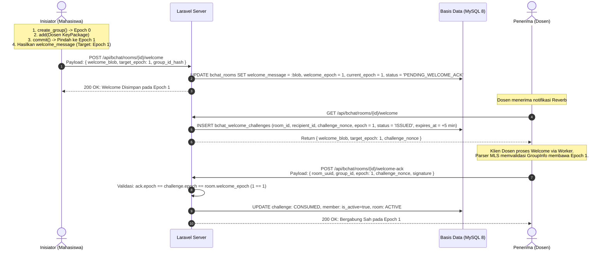
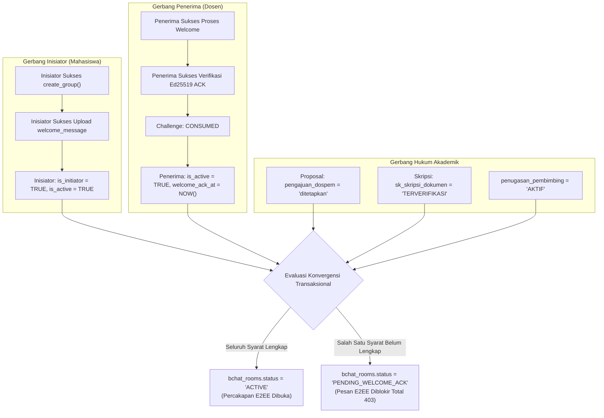

# B-CHAT-12H — FINALISASI EPOCH, IDEMPOTENSI ACK, AKTIVASI ROOM, DAN REVERB AUTHORIZATION
## SISTEM INFORMASI MANAJEMEN SKRIPSI UNUHA

| Parameter | Keterangan |
| :--- | :--- |
| **Proyek** | Sistem Informasi Manajemen Skripsi UNUHA |
| **Fitur** | Bimbingan Online Chat Real-Time E2EE (B-CHAT) |
| **Tahap** | B-CHAT-12H — Finalisasi Epoch, Idempotensi ACK, Aktivasi Room, dan Reverb |
| **Mode Audit** | STRICTLY READ-ONLY — DESIGN ONLY — ZERO MUTATION |
| **Dokumen Acuan** | [`B-CHAT-11E`](file:///d:/Aplikasi/laragon/www/sistem_manajamen_skripsi/B-CHAT-11E_Laporan_Penegasan_Status.md), [`B-CHAT-12C`](file:///d:/Aplikasi/laragon/www/sistem_manajamen_skripsi/B-CHAT-12C_Rekonsiliasi_Alur_SK_dan_Pairwise_Room.md), [`B-CHAT-12D`](file:///d:/Aplikasi/laragon/www/sistem_manajamen_skripsi/B-CHAT-12D_Koreksi_Integritas_Model_dan_Lifecycle.md), [`B-CHAT-12E`](file:///d:/Aplikasi/laragon/www/sistem_manajamen_skripsi/B-CHAT-12E_Finalisasi_Integritas_Relasi_dan_Welcome_ACK.md), [`B-CHAT-12F`](file:///d:/Aplikasi/laragon/www/sistem_manajamen_skripsi/B-CHAT-12F_Koreksi_Final_Integritas_dan_ACK.md), [`B-CHAT-12G`](file:///d:/Aplikasi/laragon/www/sistem_manajamen_skripsi/B-CHAT-12G_Finalisasi_Universal_Welcome_ACK_dan_Membership.md) |
| **Waktu Pelaksanaan** | 2026-11-06 |
| **Auditor** | Tim Arsitektur & Kriptografi E2EE Antigravity |

---

## 1. Koreksi Asumsi Epoch pada MLS Welcome

### 1.1. Koreksi Ilmiah Terhadap Asumsi `epoch = 0`
Pada dokumen sebelumnya ([`B-CHAT-12F`](file:///d:/Aplikasi/laragon/www/sistem_manajamen_skripsi/B-CHAT-12F_Koreksi_Final_Integritas_dan_ACK.md) dan [`B-CHAT-12G`](file:///d:/Aplikasi/laragon/www/sistem_manajamen_skripsi/B-CHAT-12G_Finalisasi_Universal_Welcome_ACK_dan_Membership.md)), kolom epoch pada tabel challenge dan penerimaan Welcome sempat diasumsikan bernilai `0` secara *default*. Berdasarkan spesifikasi resmi **RFC 9420 (Messaging Layer Security) Section 12.4**, asumsi ini terbukti **tidak tepat**:

1. **Epoch Saat Pembuatan Grup:**  
   Ketika inisiator memanggil `create_group()`, grup dibentuk dengan satu anggota (inisiator) pada **Epoch 0**.
2. **Epoch Pasca-Commit:**  
   Inisiator menambahkan anggota baru melalui KeyPackage (`add()`) dan mengeksekusi `commit()`. Dalam RFC 9420, **setiap operasi Commit selalu menaikkan nomor epoch secara monotonik ($E \rightarrow E+1$)**.  
   Dengan demikian, setelah Commit penambahan anggota awal dieksekusi, grup inisiator telah berpindah ke **Epoch 1**.
3. **Epoch yang Dibawa oleh Pesan Welcome:**  
   Paket biner `welcome_message` yang dihasilkan dari Commit tersebut memuat rahasia grup (*group secrets*) untuk **Epoch 1**, bukan Epoch 0! Penerima Welcome yang berhasil mendekripsi paket akan langsung bergabung ke dalam grup pada **Epoch 1**.
4. **Epoch Saat Re-keying / Penggantian Anggota:**  
   Jika di masa depan terjadi penggantian dosen pembimbing pada grup yang telah berjalan selama $E$ epoch, Commit penambahan dosen pengganti akan menghasilkan paket Welcome pada **Epoch $E+1$**.

### 1.2. Dampak Koreksi Desain
* Nilai epoch pada `bchat_welcome_challenges` **DILARANG DI-HARDCODE KE NILAI 0**. Kolom `epoch` wajib mencerminkan epoch target yang dibawa oleh paket Welcome (`target_epoch`).
* Backend tidak boleh menebak nomor epoch berdasarkan urutan operasi aplikasi. Sumber kebenaran epoch dikelola secara transaksional dari metadata Commit yang diunggah inisiator.

---

## 2. Lifecycle Welcome dan Sumber Kebenaran Epoch



### 2.1. Sumber Kebenaran Epoch (Single Source of Truth)
* **Sumber Primer Inisialisasi:** Kolom `welcome_epoch` pada tabel `bchat_rooms` yang ditetapkan saat inisiator mengunggah paket Welcome.
* **Sumber Otorisasi Challenge:** Kolom `epoch` pada tabel `bchat_welcome_challenges` yang disalin langsung dari `bchat_rooms.welcome_epoch` saat challenge diterbitkan.
* **Penolakan Mismatch Epoch:** Jika klien penerima mengirimkan payload ACK dengan nilai epoch yang tidak cocok dengan `bchat_welcome_challenges.epoch`, backend seketika menolak dengan respon `422 Unprocessable Entity: Epoch mismatch antara Welcome dan Challenge`.

---

## 3. Idempotensi ACK yang Aman dan Pencegahan Replay

Untuk mencegah serangan replay, pemalsuan, dan kondisi balapan (*race condition*), evaluasi penyerahan Welcome ACK dikawal oleh matriks status transaksional berikut:

### 3.1. Matriks Penanganan Kasus Penyerahan ACK

| Kasus Permintaan | Kondisi Transaksional pada Database | Respon HTTP & Tindakan Backend | Dampak State Room |
| :--- | :--- | :--- | :--- |
| **Kasus 1: ACK Pertama Sah** | `status = 'ISSUED'`, `expires_at > NOW()`, `recipient_id == auth_user`, signature valid. | **`200 OK`**. Challenge diubah ke `'CONSUMED'`, simpan `ack_payload_hash` dan `ack_signature`, aktifkan membership. | Room berpindah ke **`ACTIVE`** (jika seluruh anggota sah). |
| **Kasus 2: Retry ACK Identik Sukses** | `status = 'CONSUMED'`, hash payload kanonis saat ini == `ack_payload_hash` tersimpan. | **`200 OK (Idempotent Success)`**. Mengembalikan konfirmasi sukses tanpa mutasi data ulang. | Room **TETAP `ACTIVE`** (Zero mutation). |
| **Kasus 3: ACK Berbeda untuk Challenge Terpakai** | `status = 'CONSUMED'`, hash payload kanonis != `ack_payload_hash` tersimpan. | **`409 Conflict`**. Ditolak mutlak karena mencoba menggunakan challenge yang telah dikonsumsi transaksi lain. | Tidak ada perubahan state. |
| **Kasus 4: ACK dari Akun Bukan Penerima** | `recipient_user_id != auth_user_id`. | **`403 Forbidden`**. Ditolak karena challenge terikat eksklusif ke user lain. | Tidak ada perubahan state. |
| **Kasus 5: ACK Mismatch Konteks / Epoch** | `room_uuid != room.uuid` ATAU `epoch != challenge.epoch`. | **`422 Unprocessable Entity`**. Ditolak karena inkonsistensi parameter grup. | Tidak ada perubahan state. |
| **Kasus 6: ACK Challenge Kedaluwarsa** | `expires_at <= NOW()` (status otomatis diupdate `'EXPIRED'`). | **`400 Bad Request`**. Ditolak karena batas waktu 5 menit terlampaui. Klien diwajibkan meminta challenge baru. | Tidak ada perubahan state. |
| **Kasus 7: ACK Saat Membership Dicabut** | `member.is_active = FALSE` ATAU akun terdaftar di `bchat_crl_revocations`. | **`403 Forbidden`**. Ditolak permanen karena hak akademik/kriptografis dicabut. | Room dibekukan / tetap non-aktif. |

### 3.2. Penegakan Concurrency Control Anti-Double Activation
Pencegahan dua permintaan ACK bersamaan (*concurrent ACK submissions*) dijamin secara fisik di database melalui row-level lock:
```php
DB::transaction(function () use ($roomId, $userId, $nonce, $payload, $signature) {
    // 1. Kunci baris challenge secara eksklusif
    $challenge = BchatWelcomeChallenge::where('room_id', $roomId)
        ->where('recipient_user_id', $userId)
        ->where('challenge_nonce', $nonce)
        ->lockForUpdate()
        ->first();

    // 2. Kunci baris membership penerima
    $member = BchatRoomMember::where('room_id', $roomId)
        ->where('user_id', $userId)
        ->lockForUpdate()
        ->first();

    // 3. Evaluasi Kasus Idempotensi & Validitas
    if ($challenge->status === 'CONSUMED') {
        $currentHash = hash('sha256', $payload);
        if ($challenge->ack_payload_hash === $currentHash) {
            return response()->json(['status' => 'success', 'message' => 'Idempotent ACK'], 200);
        }
        throw new ConflictHttpException('Challenge telah digunakan untuk muatan berbeda.');
    }

    // 4. Verifikasi Tanda Tangan Ed25519
    // Jika gagal, throw exception (status challenge TETAP 'ISSUED' untuk retry yang sah)
    
    // 5. Konsumsi Sukses
    $challenge->update([
        'status'           => 'CONSUMED',
        'consumed_at'      => now(),
        'ack_payload_hash' => hash('sha256', $payload),
        'ack_signature'    => $signature,
    ]);

    $member->update(['is_active' => true, 'welcome_ack_at' => now()]);
});
```

---

## 4. Transisi Atomik Membership dan Aktivasi Room

Aktivasi ruang obrolan E2EE tunduk pada aturan **Atomic Convergence Gateway**:



### 4.1. Definisi Kondisi Kesiapan:
1. **Kondisi Inisiator Siap:**  
   Inisiator telah berhasil mengunggah `welcome_message`, `welcome_epoch`, dan `group_id_hash`. Record keanggotaan inisiator tercatat `is_active = TRUE`, `is_initiator = TRUE`.
2. **Kondisi Penerima Welcome Siap:**  
   Penerima Welcome telah menyerahkan payload ACK yang valid secara kriptografis, challenge tercatat `'CONSUMED'`, dan keanggotaan penerima diubah menjadi `is_active = TRUE`.
3. **Momen Aktivasi Room:**  
   Room **HANYA BERPINDAH KE STATUS `ACTIVE`** di dalam transaksi yang sama saat record keanggotaan penerima berhasil diperbarui menjadi `is_active = TRUE`.  
   *Penegasan Keras:* Room **MUSTAHIL AKTIF** hanya karena inisiator berhasil membuat MLS Group. Jika penerima belum mengirimkan Welcome ACK yang sah, room tertahan pada `PENDING_WELCOME_ACK`.

---

## 5. Matriks Otorisasi REST API dan Reverb WebSocket

Untuk menerapkan pertahanan berlapis (*defense-in-depth*), hak akses dievaluasi secara independen pada dua gerbang:

| Dimensi Evaluasi | Gerbang 1: REST API Policy (`BchatRoomPolicy`) | Gerbang 2: Reverb WebSocket (`routes/channels.php`) |
| :--- | :--- | :--- |
| **Frekuensi Evaluasi** | Dievaluasi pada **setiap permintaan HTTP** (`POST /messages`, `GET /messages`, `POST /attachments`). | Dievaluasi saat **klien melakukan koneksi dan subscription channel** `bchat.room.{id}`. |
| **Evaluasi Status Room** | Wajib `bchat_rooms.status === 'ACTIVE'`. Menolak `PENDING_*`, `ARCHIVED_*`, `TERMINATED`. | Wajib `bchat_rooms.status === 'ACTIVE'`. Menolak subscription jika room belum aktif. |
| **Evaluasi Membership** | Wajib `bchat_room_members.is_active === TRUE` dan `user_id === auth_user_id`. | Wajib `bchat_room_members.is_active === TRUE` dan `user_id === auth_user_id`. |
| **Evaluasi Legal Akademik** | Wajib `penugasan_pembimbing.status_penugasan === 'AKTIF'`. | Wajib `penugasan_pembimbing.status_penugasan === 'AKTIF'`. |
| **Evaluasi Kredensial (CRL)**| Wajib tidak terdaftar di `bchat_crl_revocations`. | Wajib tidak terdaftar di `bchat_crl_revocations`. |

### 5.1. Batas Kemampuan Reverb dan Pertahanan Berlapis (Defense-in-Depth)
* **Batas Kemampuan Reverb:**  
  Setelah sebuah koneksi WebSocket berhasil terjalin, soket TCP Reverb tetap terbuka di memori server. Pemutusan koneksi (*force disconnect/kick*) melalui event broadcast adalah mekanisme *best-effort performance optimization* yang dapat mengalami keterlambatan (*network lag/reconnection attempt*).
* **Mekanisme Defensif Sejati (True Defense):**  
  Meskipun soket WebSocket Reverb seorang mantan anggota belum terputus:
  1. Mantan anggota **tidak dapat mengirim pesan**, karena endpoint transmisi `POST /api/bchat/rooms/{id}/messages` secara instan menolak dengan `403 Forbidden` berdasarkan evaluasi database terkini.
  2. Mantan anggota **tidak dapat mendekripsi siaran pesan baru**, karena pesan baru dienkripsi dengan ratchet tree epoch baru yang mengecualikan anggota tersebut (*MLS Forward Secrecy*). Kunci lama mantan anggota secara matematis mustahil mendekripsi pesan epoch baru.
  3. Mantan anggota **tidak dapat mengunduh lampiran**, karena pengunduhan potongan berkas wajib melalui REST endpoint privat yang memvalidasi otorisasi database.

---

## 6. Skenario Kegagalan dan Pemulihan (Failure & Recovery)

### 6.1. Skenario 1: Penerima Gagal Memproses Welcome (Client Error)
* *Kejadian:* Peramban penerima crash saat memproses Welcome atau kunci lokal korup.
* *Status Sistem:* Challenge `bchat_welcome_challenges` tetap `'ISSUED'` hingga waktu 5 menit terlewati. Keanggotaan penerima tetap `is_active = FALSE`. Status room tetap `PENDING_WELCOME_ACK`.
* *Pemulihan:* Klien penerima yang dimuat ulang memanggil kembali `GET /api/bchat/rooms/{id}/welcome`. Jika challenge lama telah lewat 5 menit, status lama menjadi `'EXPIRED'` dan diterbitkan challenge baru. Penerima memproses ulang Welcome.

### 6.2. Skenario 2: Challenge Kedaluwarsa Saat Jaringan Terputus
* *Kejadian:* Klien Dosen menerima challenge, namun koneksi internet terputus selama 10 menit sebelum sempat mengirim ACK.
* *Status Sistem:* Saat koneksi kembali dan ACK dikirim, backend mendeteksi `expires_at < NOW()`. Transaksi mengubah challenge menjadi `'EXPIRED'` dan menolak permintaan (`400 Bad Request`).
* *Pemulihan:* Klien secara otomatis meminta paket Welcome dan challenge baru (`GET /welcome`), menandatangani challenge baru, dan mengirimkan ACK baru.

### 6.3. Skenario 3: Pergantian Pembimbing Skripsi Beruntun
* *Kejadian:* Mahasiswa mengganti Pembimbing 1 dari Dosen A ke Dosen B, kemudian ke Dosen C.
* *Perilaku Sistem:*
  - Room 2 (Pembimbing 2) **sama sekali tidak terpengaruh** dan tetap `ACTIVE`.
  - Room 1 lama (Dosen A) dibekukan ke `ARCHIVED_READONLY`.
  - Room 1 pengganti (Dosen B) dibuat. Ketika Dosen B diganti Dosen C, Room 1 (Dosen B) dibekukan ke `ARCHIVED_READONLY`.
  - Dibuatkan Room 1 baru (Dosen C) dengan penugasan sah. Inisiator membuat MLS Group baru pada Epoch 0, Commit ke Epoch 1, dan Dosen C mengonfirmasi Welcome pada Epoch 1.

---

## 7. Daftar Keputusan Terbuka (OPEN Items) yang Tersisa

| Kode OPEN | Domain Keputusan | Status | Keterangan & Batasan Desain |
| :---: | :--- | :---: | :--- |
| **OPEN-10** | **Library MLS Produksi & Batas Bukti ACK** | **OPEN** | Kandidat: `ts-mls` v1.6.4. Batas bukti tanda tangan server vs laporan lokal IndexedDB telah didefinisikan secara jujur. |
| **OPEN-11** | **Distribusi CEK Lampiran (OD-17 B vs A)** | **OPEN** | Kandidat utama: Pendekatan B (Payload-Distributed CEK). Skema DDL netral terhadap kedua pendekatan. |
| **OPEN-15** | **Format Template Dokumen SK Skripsi** | **OPEN** | Sistem menyediakan unduhan template statis fleksibel tanpa memaksakan struktur isi di level DDL. |
| **OPEN-16** | **Masa Berlaku Kedaluwarsa SK Skripsi** | **OPEN** | Kolom tanggal selesai dibiarkan nullable. Penegakan masa kedaluwarsa diatur via job aplikasi. |
| **OPEN-17** | **Mekanisme SK Penggantian Pembimbing** | **OPEN** | Model data multi-record mendukung SK penggantian parsial (1 dosen) maupun utuh (2 dosen). |
| **OPEN-18** | **Masa Berlaku Dokumen SK Terkini per Skripsi** | **OPEN** | Ditetapkan 1 dokumen aktif terkini per skripsi via slot virtual unik. |
| **OPEN-19** | **Representasi Integer Epoch Internal Library MLS** | **OPEN** | Format representasi serialisasi epoch (uint32 vs uint64) pada kandidat library `ts-mls` wajib divalidasi saat pengujian implementasi runtime. |

---

## 8. Rekomendasi Kesiapan Menuju DDL Drafting

### 8.1. Kesimpulan Kesiapan Teknis
Seluruh temuan arsitektural terkait nomor epoch RFC 9420, penanganan idempotensi multi-skenario, atomisitas konvergensi room, dan pertahanan berlapis Reverb telah tuntas dirumuskan secara matematis dan transaksional. Model data 13 tabel konseptual telah bebas dari seluruh cacat logika.

### 8.2. Rekomendasi Status: **READY FOR DDL DRAFTING**
Model data relasional dan arsitektur siklus hidup keanggotaan E2EE dinyatakan **LENGKAP, KONSISTEN, DAN LAYAK UNTUK MEMASUKI TAHAP PENYUSUNAN NASKAH DDL MIGRASI BASIS DATA**.

> [!CAUTION]
> **PENEGASAN STATUS OTORISASI:**  
> Status **READY FOR DDL DRAFTING** adalah penilaian kesiapan teknis dokumen perancangan arsitektur. Status ini **BUKAN IZIN MENJALANKAN MIGRASI KE BASIS DATA AKTUAL**, bukan izin membuat file migrasi fisik di kode Laravel, dan bukan izin implementasi. Eksekusi kode fisik tetap memerlukan instruksi dan persetujuan formal terpisah dari Pemilik Proyek.

---

## 9. Bukti Pemeriksaan dan Konfirmasi Zero Mutation

### 9.1. Komponen yang Diperiksa
1. Dokumen Historis Proyek:
   - [`B-CHAT-11_Spesifikasi_Integrasi_E2EE.md`](file:///d:/Aplikasi/laragon/www/sistem_manajamen_skripsi/B-CHAT-11_Spesifikasi_Integrasi_E2EE.md) (Bab 7 & 8).
   - [`B-CHAT-12F_Koreksi_Final_Integritas_dan_ACK.md`](file:///d:/Aplikasi/laragon/www/sistem_manajamen_skripsi/B-CHAT-12F_Koreksi_Final_Integritas_dan_ACK.md).
   - [`B-CHAT-12G_Finalisasi_Universal_Welcome_ACK_dan_Membership.md`](file:///d:/Aplikasi/laragon/www/sistem_manajamen_skripsi/B-CHAT-12G_Finalisasi_Universal_Welcome_ACK_dan_Membership.md).
2. Kode Sumber Aplikasi Eksisting:
   - [`routes/channels.php`](file:///d:/Aplikasi/laragon/www/sistem_manajamen_skripsi/manajemen_skripsi/routes/channels.php).
   - [`PengajuanDospemAdminController.php`](file:///d:/Aplikasi/laragon/www/sistem_manajamen_skripsi/manajemen_skripsi/app/Http/Controllers/Admin/PengajuanDospemAdminController.php).

### 9.2. Pernyataan Kepatuhan Zero Mutation
Auditor menyatakan dengan penuh tanggung jawab teknis bahwa selama pengerjaan mandat **B-CHAT-12H**:
* **Nol Perubahan Kode:** Tidak ada berkas di repositori `manajemen_skripsi/` atau `frontend_manajemen_skripsi/` yang ditambah, diedit, atau dihapus.
* **Nol Perubahan Database:** Tidak ada perintah DDL/DML, migrasi, atau pembuatan tabel fisik yang dijalankan.
* **Nol Perubahan Dependensi & Konfigurasi:** Berkas Composer, NPM, `.env`, dan konfigurasi sistem tetap utuh.
* **Nol Operasi Git:** Tidak ada aksi commit, staging, branch, atau push yang dijalankan ke Git.

---
*Laporan ini disusun secara resmi sebagai dokumen final penutup tahap perancangan integritas epoch, ACK, dan otorisasi sebelum penyusunan naskah DDL migrasi Sistem Informasi Manajemen Skripsi UNUHA.*

