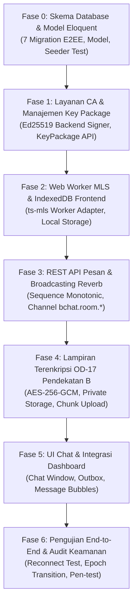

# B-CHAT-12 — TAHAP 0
# LAPORAN AUDIT KESIAPAN IMPLEMENTASI FITUR BIMBINGAN ONLINE CHAT REAL-TIME E2EE

| Parameter | Keterangan |
| :--- | :--- |
| **Proyek** | Sistem Informasi Manajemen Skripsi UNUHA |
| **Fitur** | Bimbingan Online Chat Real-Time E2EE (B-CHAT) |
| **Tahap** | B-CHAT-12 Tahap 0 — Audit Kesiapan Implementasi |
| **Mode Audit** | STRICTLY READ-ONLY — ZERO CODE/DATABASE MUTATION |
| **Acuan Arsitektur** | [`B-CHAT-11_Spesifikasi_Integrasi_E2EE.md`](file:///d:/Aplikasi/laragon/www/sistem_manajamen_skripsi/B-CHAT-11_Spesifikasi_Integrasi_E2EE.md) (Revisi Final B-CHAT-11E) |
| **Dokumen Terkait** | [`B-CHAT-09`](file:///d:/Aplikasi/laragon/www/sistem_manajamen_skripsi/B-CHAT-09_Keputusan_Arsitektur_E2EE.md), [`B-CHAT-10`](file:///d:/Aplikasi/laragon/www/sistem_manajamen_skripsi/scratch/bchat_prototype/exp04_mls_comparison/Laporan_Evaluasi_ts-mls_vs_OpenMLS.md), [`B-CHAT-11E`](file:///d:/Aplikasi/laragon/www/sistem_manajamen_skripsi/B-CHAT-11E_Laporan_Penegasan_Status.md) |
| **Waktu Pelaksanaan** | 2026-11-06 |
| **Auditor** | Tim Arsitektur & Kriptografi E2EE Antigravity |

---

## 1. Ringkasan Eksekutif Kesiapan

Audit Kesiapan Implementasi (B-CHAT-12 Tahap 0) dilakukan untuk mengevaluasi secara faktual dan komprehensif tingkat kesiapan kode sumber, skema basis data, pustaka pendukung, serta arsitektur runtime pada aplikasi backend ([`manajemen_skripsi`](file:///d:/Aplikasi/laragon/www/sistem_manajamen_skripsi/manajemen_skripsi)) dan frontend ([`frontend_manajemen_skripsi`](file:///d:/Aplikasi/laragon/www/sistem_manajamen_skripsi/frontend_manajemen_skripsi)) sebelum pekerjaan implementasi fitur **Bimbingan Online Chat Real-Time E2EE** dimulai.

### Kesimpulan Ringkas Kesiapan:
1. **Fondasi Infrastruktur Umum (SIAP PAKAI / REUSABLE):**
   Aplikasi utama telah memiliki infrastruktur dasar yang sangat kokoh: Laravel 12.46.0 dengan PHP 8.2.12, Laravel Sanctum v4.2.2 (autentikasi SPA cookie stateful), Laravel Reverb v1.12.0 (WebSocket server), Next.js 14.2.10 App Router dengan Laravel Echo v2.6.3 dan Pusher-js v8.6.0 yang telah terintegrasi di [`src/lib/echo.ts`](file:///d:/Aplikasi/laragon/www/sistem_manajamen_skripsi/frontend_manajemen_skripsi/src/lib/echo.ts). Relasi akademik dasar (`User`, `Mahasiswa`, `Dosen`, `Skripsi`, `PengajuanDospem`, `DosenPembimbing`) telah berjalan baik.
2. **Komponen Khusus E2EE & MLS (BELUM TERSEDIA / MISSING):**
   Seluruh tabel basis data chat E2EE (`chat_rooms`, `chat_room_members`, `chat_messages`, `chat_attachments`, `chat_mls_epochs`, `mls_key_packages`, `mls_ca_certificates`), controller MLS/Chat, pustaka `ts-mls` di frontend, Web Worker kriptografi, IndexedDB persistence, serta antarmuka UI chat di dashboard mahasiswa maupun dosen **belum diimplementasikan sama sekali** di aplikasi utama. Kode prototipe yang berhasil diuji pada Tahap 1E–1G masih terisolasi di direktori scratch [`scratch/bchat_prototype/`](file:///d:/Aplikasi/laragon/www/sistem_manajamen_skripsi/scratch/bchat_prototype/).
3. **GAP Substansial Terhadap Asumsi B-CHAT-11 (SK Resmi):**
   Spesifikasi B-CHAT-11 mengasumsikan pemicu pembuatan room chat berakar pada dokumen SK resmi bertanda tangan digital Kaprodi dan Dekan. Audit menemukan bahwa pada sistem saat ini, penetapan dosen pembimbing dilakukan secara administratif oleh Admin via sistem tanpa rekaman nomor SK fisik maupun tanda tangan digital pejabat fakultas/prodi di basis data. GAP ini memerlukan penyesuaian pemicu room pada fase awal agar implementasi chat tidak terblokir.
4. **Kesiapan Eksekusi Bertahap:**
   Secara arsitektural, implementasi **layak untuk dimulai**, namun wajib dilaksanakan secara modular melalui pendekatan bertahap (*phased rollout*), dimulai dari penyusunan skema database dan backend CA/KeyPackage (Fase 1), diikuti oleh Web Worker kriptografi di frontend (Fase 2), sebelum menghubungkan Reverb dan antarmuka pengguna (Fase 3–5).

---

## 2. Inventarisasi Komponen yang Dapat Digunakan Kembali (Reusable)

Berdasarkan pemeriksaan read-only terhadap kode sumber Laravel dan Next.js, komponen-komponen berikut berstatus **AVAILABLE** dan siap digunakan kembali (*reusable*) untuk mendukung fitur B-CHAT tanpa perlu merombak ulang pondasi yang sudah ada:

| Komponen / Modul | Lokasi File / Simbol | Status Kesiapan | Catatan Pemanfaatan E2EE |
| :--- | :--- | :--- | :--- |
| **Framework Backend** | [`composer.json`](file:///d:/Aplikasi/laragon/www/sistem_manajamen_skripsi/manajemen_skripsi/composer.json) | Laravel `v12.46.0`, PHP `8.2.12` | Mendukung penuh fitur PHP 8.2 (termasuk native libsodium untuk Ed25519) dan fitur Eloquent mutakhir. |
| **Autentikasi SPA Stateful** | [`bootstrap/app.php`](file:///d:/Aplikasi/laragon/www/sistem_manajamen_skripsi/manajemen_skripsi/bootstrap/app.php#L20-L24) | Laravel Sanctum `v4.2.2` | `EnsureFrontendRequestsAreStateful`, cookie HttpOnly, CSRF protection, dan konfigurasi CORS `supports_credentials: true` pada origin `http://localhost:3000`. |
| **Konektivitas WebSocket** | [`composer.lock`](file:///d:/Aplikasi/laragon/www/sistem_manajamen_skripsi/manajemen_skripsi/composer.lock) & [`bootstrap/app.php`](file:///d:/Aplikasi/laragon/www/sistem_manajamen_skripsi/manajemen_skripsi/bootstrap/app.php#L13-L17) | Laravel Reverb `v1.12.0` | Broadcasting channel terdaftar dengan middleware `['api', 'auth:sanctum']`. Siap menerima pendaftaran channel chat terotorisasi. |
| **Pola Siaran Event Backend** | [`AcademicNotificationBroadcasted.php`](file:///d:/Aplikasi/laragon/www/sistem_manajamen_skripsi/manajemen_skripsi/app/Events/AcademicNotificationBroadcasted.php#L12-L93) | Event Broadcasting Pattern | Pola `ShouldBroadcast`, `public bool $afterCommit = true`, `PrivateChannel`, dan `broadcastWith()` dapat langsung diadaptasi menjadi `ChatMessageBroadcasted`. |
| **Model Relasi Pengguna & Akademik** | [`User.php`](file:///d:/Aplikasi/laragon/www/sistem_manajamen_skripsi/manajemen_skripsi/app/Models/User.php#L52-L60), [`Mahasiswa.php`](file:///d:/Aplikasi/laragon/www/sistem_manajamen_skripsi/manajemen_skripsi/app/Models/Mahasiswa.php#L28-L45), [`Dosen.php`](file:///d:/Aplikasi/laragon/www/sistem_manajamen_skripsi/manajemen_skripsi/app/Models/Dosen.php), [`Skripsi.php`](file:///d:/Aplikasi/laragon/www/sistem_manajamen_skripsi/manajemen_skripsi/app/Models/Skripsi.php#L25-L59) | Eloquent Model Relational Core | Relasi antar pengguna (`User` -> `Mahasiswa` / `Dosen`), kepemilikan skripsi, dan relasi pembimbing sudah terdefinisi jelas. |
| **Model Penetapan Dospem** | [`PengajuanDospem.php`](file:///d:/Aplikasi/laragon/www/sistem_manajamen_skripsi/manajemen_skripsi/app/Models/PengajuanDospem.php), [`DosenPembimbing.php`](file:///d:/Aplikasi/laragon/www/sistem_manajamen_skripsi/manajemen_skripsi/app/Models/DosenPembimbing.php) | Penetapan Dospem | Record penetapan dosen pembimbing berstatus `'ditetapkan'` dapat dijadikan trigger pembuatan room pairwise. |
| **Filesystem Private Storage** | [`config/filesystems.php`](file:///d:/Aplikasi/laragon/www/sistem_manajamen_skripsi/manajemen_skripsi/config/filesystems.php#L33-L39) | Disk `'local'` (`app/private`) | Penyimpanan aman untuk file ciphertext attachment terenkripsi (tidak dapat diakses publik via symlink). |
| **Klien HTTP Frontend** | [`src/lib/axios.js`](file:///d:/Aplikasi/laragon/www/sistem_manajamen_skripsi/frontend_manajemen_skripsi/src/lib/axios.js#L44-L51) | Axios Singleton | Mengirim credentials (`withCredentials: true`), token CSRF (`withXSRFToken: true`), dan header `X-Requested-With`. |
| **Klien WebSocket Frontend** | [`src/lib/echo.ts`](file:///d:/Aplikasi/laragon/www/sistem_manajamen_skripsi/frontend_manajemen_skripsi/src/lib/echo.ts#L1-L85) | Laravel Echo Singleton | Inisialisasi Reverb aman untuk SSR, authorizer custom via Axios (`/broadcasting/auth`), dan fungsi terminasi `destroyEcho()`. |
| **Manajemen Sesi Auth Frontend** | [`src/hooks/auth.js`](file:///d:/Aplikasi/laragon/www/sistem_manajamen_skripsi/frontend_manajemen_skripsi/src/hooks/auth.js#L1-L140) | SWR & Hook `useAuth` | Alur login, logout terintegrasi pembersihan Echo (`destroyEcho()`), dan sinkronisasi sesi pengguna. |

---

## 3. Inventarisasi Komponen yang Belum Tersedia (Missing)

Berdasarkan pemeriksaan direktori aplikasi, komponen-komponen berikut berstatus **MISSING** (belum dibuat/belum dipasang di kode aplikasi utama):

### 3.1. Sisi Backend Laravel
1. **Migration Skema Database E2EE:**
   - Belum ada tabel:
     - `mls_ca_certificates` (penyimpanan public key & metadata CA Ed25519 Laravel).
     - `mls_identity_credentials` (kredensial identitas pengguna yang ditandatangani CA).
     - `mls_key_packages` (antrean key package MLS satu kali pakai).
     - `chat_rooms` (ruang bimbingan pairwise).
     - `chat_room_members` (keanggotaan room, epoch terkini, peranan akademik).
     - `chat_messages` (rekaman ciphertext pesan, sequence monotonic, epoch id).
     - `chat_attachments` (metadata attachment terenkripsi AES-256-GCM, SHA-256 hash).
     - `chat_mls_epochs` (riwayat transisi epoch, proposal, dan commit).
2. **Layanan Kriptografi Backend (CA Signer & Verifier):**
   - Belum ada service class `MlsCaService` untuk menandatangani kredensial identitas MLS menggunakan libsodium Ed25519 (`sodium_crypto_sign_detached`).
3. **Controller & Route REST API E2EE:**
   - Belum ada endpoint API untuk:
     - Registrasi dan pengambilan KeyPackage (`/api/bchat/key-packages`).
     - Pembuatan, otorisasi, dan detail room (`/api/bchat/rooms`).
     - Pengiriman pesan ciphertext & welcome (`/api/bchat/rooms/{roomId}/messages`).
     - Unggah & unduh lampiran terenkripsi (`/api/bchat/rooms/{roomId}/attachments`).
4. **Channel Broadcasting Chat:**
   - [`routes/channels.php`](file:///d:/Aplikasi/laragon/www/sistem_manajamen_skripsi/manajemen_skripsi/routes/channels.php) saat ini baru mendefinisikan channel notifikasi `users.{userId}.notifications`. Belum ada channel otorisasi `bchat.room.{roomId}`.
5. **Event Siaran Chat:**
   - Belum ada event class `ChatMessageBroadcasted` atau `ChatEpochChanged` untuk mendistribusikan payload real-time ke Reverb.

### 3.2. Sisi Frontend Next.js
1. **Dependensi Pustaka MLS:**
   - [`package.json`](file:///d:/Aplikasi/laragon/www/sistem_manajamen_skripsi/frontend_manajemen_skripsi/package.json) belum memiliki pustaka `ts-mls` atau engine MLS apa pun.
2. **Kriptografi Web Worker:**
   - Belum ada file worker (misal `src/workers/mls.worker.ts`) untuk mengeksekusi komputasi MLS off-thread di luar main thread Next.js.
3. **Penyimpanan Lokal IndexedDB:**
   - Belum ada modul IndexedDB wrapper untuk menyimpan state MLS client, antrean outbox pengiriman offline, riwayat draf pesan lokal, dan key package cache.
4. **Komponen Antarmuka Pengguna (UI Chat):**
   - Halaman bimbingan mahasiswa di [`dashboardmahasiswa/bimbingan/page.tsx`](file:///d:/Aplikasi/laragon/www/sistem_manajamen_skripsi/frontend_manajemen_skripsi/src/app/(app)/(dashboard)/dashboardmahasiswa/bimbingan/page.tsx) dan dosen di [`dashboarddosen/pembimbing_skripsi/page.tsx`](file:///d:/Aplikasi/laragon/www/sistem_manajamen_skripsi/frontend_manajemen_skripsi/src/app/(app)/(dashboard)/dashboarddosen/pembimbing_skripsi/page.tsx) saat ini masih berupa prototipe statis / mockup data lokal.
   - Belum ada komponen window chat, riwayat pesan terdekripsi, bubble chat, input bar, status pengiriman (pending/sent/delivered), preview lampiran, maupun status keamanan epoch/MLS.

---

## 4. Evaluasi GAP Antara Spesifikasi B-CHAT-11 dan Kondisi Aplikasi

Pemeriksaan silang antara asumsi perancangan B-CHAT-11 dengan implementasi riil aplikasi menghasilkan temuan GAP kritis sebagai berikut:

### GAP-01: Asumsi SK Resmi Bertanda Tangan Kaprodi & Dekan
- **Asumsi Spesifikasi B-CHAT-11:**
  B-CHAT-11 Subbab 3.1 & 3.2 menetapkan bahwa room chat E2EE pairwise dibuat secara otomatis saat *"SK resmi penetapan pembimbing diterbitkan dan ditandatangani secara digital oleh Ketua Program Studi dan Dekan Fakultas"*, dengan metadata `nomor_sk` dan `file_sk` tersimpan di database.
- **Fakta Kode Aplikasi Riil:**
  Pemeriksaan pada model [`PengajuanDospem.php`](file:///d:/Aplikasi/laragon/www/sistem_manajamen_skripsi/manajemen_skripsi/app/Models/PengajuanDospem.php) dan controller [`PengajuanDospemAdminController.php`](file:///d:/Aplikasi/laragon/www/sistem_manajamen_skripsi/manajemen_skripsi/app/Http/Controllers/Admin/PengajuanDospemAdminController.php#L195-L215) membuktikan bahwa:
  1. Tabel `pengajuan_dospem` hanya memiliki kolom: `skripsi_id`, `mahasiswa_id`, `tahap` (`proposal`/`skripsi`), `status` (`menunggu_penetapan`, `ditetapkan`, `ditolak`), `dosen_id`, `catatan_mahasiswa`, dan `catatan_admin`.
  2. **TIDAK ADA** kolom `file_sk`, `nomor_sk`, tanggal SK, maupun tanda tangan digital Kaprodi atau Dekan.
  3. Penetapan dosen pembimbing dilakukan secara langsung oleh peran **Admin** melalui tombol tetapkan di antarmuka admin, yang kemudian membuat entri baru pada tabel `dosen_pembimbing`.
- **Dampak Kesiapan & Rekomendasi Solusi:**
  Jika implementasi chat E2EE mewajibkan keberadaan modul SK bertanda tangan digital sebelum room dapat dibuat, proyek akan mengalami *deadlock* (terblokir total).
  **Solusi:** Pemicu pembuatan room (*room initialization trigger*) pada tahap implementasi awal diselaraskan dengan event penetapan status `ditetapkan` pada `pengajuan_dospem` atau saat record `dosen_pembimbing` dibentuk oleh Admin. Kolom `nomor_sk` pada `chat_rooms` dijadikan *nullable* atau diisi dengan nomor referensi sistem otomatis (`REF-DOSPEM-{id}`). Ketika modul penandatanganan SK digital resmi dikembangkan di kemudian hari, relasi ini dapat ditingkatkan tanpa merusak skema chat yang sudah berjalan.

### GAP-02: Kardinalitas Peran Pembimbing 1 dan Pembimbing 2
- **Asumsi Spesifikasi B-CHAT-11:**
  B-CHAT-11 menetapkan struktur 2 pairwise room terpisah per skripsi:
  1. Room 1: Mahasiswa $\leftrightarrow$ Dosen Pembimbing 1
  2. Room 2: Mahasiswa $\leftrightarrow$ Dosen Pembimbing 2
- **Fakta Kode Aplikasi Riil:**
  Pemeriksaan pada tabel `dosen_pembimbing` ([`DosenPembimbing.php`](file:///d:/Aplikasi/laragon/www/sistem_manajamen_skripsi/manajemen_skripsi/app/Models/DosenPembimbing.php)) menunjukkan hanya terdapat kolom: `id_pembimbing`, `id_skripsi`, `id_dosen`, timestamps.
  Tabel ini **belum memiliki kolom penanda urutan** (seperti `pembimbing_ke` dengan nilai `1` atau `2`).
- **Dampak & Rekomendasi:**
  Tabel `chat_rooms` harus menambahkan kolom `pembimbing_ke` atau relasi eksplisit `dosen_pembimbing_id` agar identifikasi room pairwise antara Pembimbing 1 dan Pembimbing 2 tidak ambigu.

### GAP-03: Ketiadaan API Log Bimbingan Konvensional di Frontend
- **Fakta Aplikasi Riil:**
  Backend telah memiliki [`BimbinganController.php`](file:///d:/Aplikasi/laragon/www/sistem_manajamen_skripsi/manajemen_skripsi/app/Http/Controllers/BimbinganController.php) yang lengkap untuk CRUD log catatan bimbingan manual (`id_skripsi`, `tanggal`, `catatan`). Namun, halaman frontend ([`dashboardmahasiswa/bimbingan/page.tsx`](file:///d:/Aplikasi/laragon/www/sistem_manajamen_skripsi/frontend_manajemen_skripsi/src/app/(app)/(dashboard)/dashboardmahasiswa/bimbingan/page.tsx)) belum menghubungkan data tersebut ke API dan masih menampilkan array statis mockup.
- **Rekomendasi:**
  Fitur Chat Real-Time E2EE harus dirancang sebagai modul mandiri yang dapat disematkan di dalam antarmuka bimbingan tersebut, tanpa mengganggu log bimbingan konvensional yang nantinya juga akan dihubungkan ke backend.

---

## 5. Status Kesiapan Fondasi Kriptografi (MLS & Web Worker)

| Komponen Kriptografi | Status Kesiapan | Dasar Verifikasi & Rincian Teknis |
| :--- | :--- | :--- |
| **Kandidat Library MLS (`ts-mls` v1.6.4)** | PROTOTIPE TERVERIFIKASI (100% PASS), BELUM TERPASANG DI NEXT.JS | Pustaka `ts-mls` v1.6.4 telah diuji secara komparatif dan mendalam pada Tahap 1E–1G (20 skenario pengujian di browser nyata dan Web Worker lulus tanpa kegagalan). Belum dipasang di `frontend_manajemen_skripsi/package.json`. |
| **Arsitektur Web Worker di Next.js 14** | DESAIN TERVALIDASI, BELUM DIIMPLEMENTASIKAN | Telah divalidasi pada prototipe scratch bahwa `ts-mls` dapat berjalan stabil di dalam Web Worker browser murni. Pada Next.js 14 App Router, pemanggilan Worker wajib dibungkus dengan pengecekan `typeof window !== 'undefined'` dan inisialisasi dinamis via `new Worker(new URL(...), { type: 'module' })`. |
| **CA Ed25519 & Validasi Identitas** | DESAIN SPESIFIKASI SIAP, BELUM DIIMPLEMENTASIKAN | PHP 8.2 memiliki ekstensi `sodium` bawaan yang mendukung `sodium_crypto_sign_keypair`, `sodium_crypto_sign_detached`, dan `sodium_crypto_sign_verify_detached`. Format kredensial identitas MLS dengan signature Ed25519 telah dirancang di B-CHAT-11, namun class `MlsCaService` belum ditulis. |
| **Format AAD Kanonis 83 Byte** | TERSTANDARISASI & TERVERIFIKASI | Format 83 byte (EXP-02) yang memuat SHA-256 room ID, SHA-256 epoch ID, sequence uint64, dan role byte telah divalidasi integritasnya pada Tahap 1G. Siap diadopsi langsung dalam enkripsi pesan dan attachment. |
| **Enkripsi Lampiran (AES-256-GCM + OD-17)** | PROTOTIPE TERVERIFIKASI | Enkripsi lampiran client-side dengan chunk 1 MiB, CEK 256-bit, nonce 96-bit, dan tag 128-bit telah terbukti berjalan dengan throughput tinggi di prototipe scratch Tahap 1F. Belum dihubungkan ke UI uploader Next.js. |

---

## 6. Status Kesiapan Backend (Laravel 12, Reverb, Database)

### 6.1. Versi dan Ekstensi
- **PHP:** `8.2.12` (memenuhi syarat `^8.2`).
- **Laravel Framework:** `v12.46.0` (stabil, didukung penuh).
- **Ekstensi Kripto:** `ext-sodium` aktif di PHP 8.2 (siap untuk fungsi signing Ed25519).
- **Database Engine:** MySQL / MariaDB via Laragon (PDO MySQL driver aktif).

### 6.2. Autentikasi dan Otorisasi
- **Laravel Sanctum:** `v4.2.2` aktif dengan mode SPA stateful cookie session.
- **Middleware:** `auth:sanctum` telah digunakan pada seluruh rute API sensitif di [`routes/api.php`](file:///d:/Aplikasi/laragon/www/sistem_manajamen_skripsi/manajemen_skripsi/routes/api.php#L30).
- **Otorisasi Peran:** Tersedia middleware pengecekan peran (`role:mahasiswa`, `role:dosen`, `admin`). Siap digunakan untuk mengamankan endpoint E2EE.

### 6.3. Real-Time Reverb Server
- **Package:** `laravel/reverb` `v1.12.0`.
- **Broadcasting Auth:** Terdaftar di [`bootstrap/app.php`](file:///d:/Aplikasi/laragon/www/sistem_manajamen_skripsi/manajemen_skripsi/bootstrap/app.php#L13-L17) dengan middleware `['api', 'auth:sanctum']`.
- **Channels:** Siap ditambahkan channel baru `bchat.room.{roomId}` dengan validasi keanggotaan room via Eloquent.

### 6.4. Status Skema Basis Data
- **Kondisi Saat Ini:** 0 dari 7 tabel E2EE tersedia.
- **Langkah Diperlukan:** Pembuatan migration baru untuk 7 tabel MLS & Chat sesuai skema kanonis B-CHAT-11 Subbab 5.

---

## 7. Status Kesiapan Frontend (Next.js 14, Web Worker, State Management, IndexedDB)

### 7.1. Runtime dan Framework
- **Next.js:** `14.2.10` dengan arsitektur App Router (`src/app/`).
- **React:** `18.2.0` (Client Component `"use client"` vs Server Component berjalan normal).
- **Styling:** Tailwind CSS `3.4.11` dengan Lucide React `0.441.0`.

### 7.2. Koneksi Real-Time Klien
- **Laravel Echo & Pusher-js:** `laravel-echo` `2.6.3` dan `pusher-js` `8.6.0` sudah terpasang.
- **Echo Client:** [`src/lib/echo.ts`](file:///d:/Aplikasi/laragon/www/sistem_manajamen_skripsi/frontend_manajemen_skripsi/src/lib/echo.ts) sudah memiliki konfigurasi Reverb singleton yang matang, penanganan transport `['ws', 'wss']`, dan authorizer Axios terhubung ke `/broadcasting/auth`.

### 7.3. Ketiadaan Komponen E2EE di Frontend Utama
- **Worker File:** Belum ada file worker di `src/workers/`.
- **IndexedDB Storage:** Belum ada skema IndexedDB di frontend utama untuk menyimpan state MLS client (`ts-mls` state snapshot), outbox pesan antrean, dan draf lokal.
- **UI Integrasi:** Halaman dashboard bimbingan masih memerlukan pembuatan komponen chat lengkap.

---

## 8. Evaluasi Status Keputusan Proyek (OPEN Items)

Audit memeriksa status tiga keputusan strategis yang tercatat pada B-CHAT-11 dan penegasannya pada B-CHAT-11E:

### 8.1. OPEN-10: Pilihan Definitif Library MLS Produksi
- **Status Proyek:** **TETAP OPEN (BELUM DITUTUP).**
- **Kondisi:**
  `ts-mls` v1.6.4 berstatus sebagai **kandidat utama perancangan dan spesifikasi**, namun belum disahkan sebagai library produksi mutlak karena beberapa keterbatasan kepatuhan RFC 9420 (wajibnya Ratchet Tree extension pada Welcome message, tidak adanya modul penyimpanan bawaan, dan perlunya validasi kredensial kustom). OpenMLS-WASM tetap berstatus sebagai kandidat pembanding.
- **Strategi Implementasi yang Aman:**
  Implementasi frontend **TIDAK BOLEH** mengikatkan antarmuka pengguna secara langsung dengan API internal `ts-mls`. Web Worker harus mengekspos *generic interface* (misal: `createRoom()`, `processWelcome()`, `encryptMessage()`, `decryptMessage()`, `exportState()`). Dengan pola adapter ini, jika di masa depan engine MLS diganti atau ditingkatkan, kode UI dan API backend tidak perlu dirombak.

### 8.2. OPEN-11: Keputusan Final Distribusi CEK (OD-17)
- **Status Proyek:** **TETAP OPEN (KANDIDAT UTAMA: PENDEKATAN B).**
- **Kondisi:**
  B-CHAT-09 dan B-CHAT-11 menetapkan **Pendekatan B (Payload-distributed CEK)** sebagai kandidat evaluasi utama, dan **Pendekatan A (MLS Exporter-derived CEK)** sebagai pembanding.
- **Dampak Kesiapan:**
  Skema tabel `chat_attachments` pada spesifikasi B-CHAT-11 telah dirancang secara netral dan kompatibel dengan Pendekatan B (menyimpan nonce, tag, sha256 hash, ukuran byte, dan path penyimpanan tanpa menyimpan kunci enkripsi di backend). Implementasi dapat langsung mengadopsi Pendekatan B tanpa risiko arsitektural.

---

## 9. Matriks Kesiapan per Area Arsitektur

Berikut adalah matriks kesiapan aktual dari 10 area arsitektur utama fitur Bimbingan Online Chat Real-Time E2EE:

| No | Area Arsitektur B-CHAT-11 | Status Aktual | Analisis Kesiapan & Gap |
| :-: | :--- | :---: | :--- |
| **1** | **Fondasi Kredensial & Identitas (Ed25519 CA)** | **MISSING** | PHP `ext-sodium` tersedia di backend. Belum ada model/migration `mls_ca_certificates` dan class `MlsCaService`. Prototipe Ed25519 WebCrypto telah divalidasi di scratch. |
| **2** | **Relasi Akademik & Otorisasi SK** | **PARTIAL** | Relasi User-Mahasiswa-Dosen-Skripsi sudah ada di Eloquent. Tabel `pengajuan_dospem` & `dosen_pembimbing` tersedia. **GAP:** Dokumen SK fisik & tanda tangan Kaprodi/Dekan belum ada di DB; trigger room perlu dialihkan ke status penetapan dospem oleh Admin. |
| **3** | **Struktur Room Pairwise & Kardinalitas** | **MISSING** | Rancangan 2 room pairwise (MHS-DOSPEM1 dan MHS-DOSPEM2) sudah sangat jelas di B-CHAT-11. Tabel `chat_rooms` dan `chat_room_members` belum dibuat di migration. |
| **4** | **Persistensi Basis Data Backend** | **MISSING** | 7 tabel E2EE belum dibuat di `database/migrations/`. Skema SQL di B-CHAT-11 Subbab 5 sudah siap untuk dieksekusi menjadi file migration Laravel. |
| **5** | **MLS Web Worker & Engine Runtime** | **MISSING** | Prototipe worker `ts-mls` 100% PASS di scratch Tahap 1F. Belum dipasang di `frontend_manajemen_skripsi/package.json` dan belum diintegrasikan ke Next.js 14 App Router. |
| **6** | **REST API Pesan & Pengurutan Sekuens** | **MISSING** | Endpoint `/api/bchat/...` belum terdaftar di `routes/api.php`. Controller pengelolaan pesan dan penjaminan sequence monotonic belum dibuat. |
| **7** | **Broadcasting Real-Time Reverb** | **PARTIAL** | Server Reverb dan klien Echo di frontend sudah **AVAILABLE** dan aktif untuk notifikasi. Hanya perlu penambahan channel privat `bchat.room.{roomId}` dan event class `ChatMessageBroadcasted`. |
| **8** | **Pengelolaan Lampiran Terenkripsi (AES-256-GCM)** | **MISSING** | Disk private storage (`app/private`) tersedia di Laravel. Controller upload/download stream dan logika chunked encryption client-side belum diintegrasikan. |
| **9** | **Penyimpanan Draf Lokal & Status Outbox** | **MISSING** | Belum ada implementasi IndexedDB di frontend untuk persistensi draft pesan, status antrean outbox, dan MLS state snapshot. |
| **10** | **Pemulihan State, Reconnect, & Rotasi Epoch** | **MISSING** | Mekanisme sinkronisasi pesan tertinggal (*catch-up REST*) saat reconnect Reverb dan rotasi epoch MLS pasca-commit belum diimplementasikan di frontend/backend. |

---

## 10. Analisis Risiko Implementasi

Berdasarkan hasil audit, diidentifikasi beberapa risiko teknis dan operasional yang harus dimitigasi saat implementasi:

1. **Risiko 1: Bundling Web Worker pada Next.js 14 App Router**
   - *Deskripsi:* Web Worker yang memuat dependensi ESM/CJS kompleks seperti `ts-mls` dapat memicu kesalahan kompilasi Webpack atau error `window is not defined` pada proses Server-Side Rendering (SSR).
   - *Mitigasi:* Gunakan pemuatan dinamis (`useEffect` dengan guard `typeof window !== 'undefined'`) dan manfaatkan sintaks resmi Next.js Web Worker `new Worker(new URL('@/workers/mls.worker.ts', import.meta.url), { type: 'module' })`.
2. **Risiko 2: Desinkronisasi Epoch Akibat Konkurensi Pengiriman**
   - *Deskripsi:* Jika dua anggota grup MLS mengirimkan pesan atau perubahan epoch secara bersamaan saat koneksi tidak stabil, salah satu pihak dapat mengalami *epoch mismatch* atau *commit rejection*.
   - *Mitigasi:* Terapkan mekanisme pengurutan sekuensial monotonic yang ketat di backend melalui transaksi database (`DB::transaction` dengan `lockForUpdate`), dan pastikan klien menolak memproses commit jika hash epoch lokal tidak cocok.
3. **Risiko 3: Kebocoran Data Lampiran Akibat Akses Direktori Publik**
   - *Deskripsi:* Menyimpan ciphertext attachment pada direktori publik (`storage/app/public`) dapat membuka celah *unauthenticated enumeration*.
   - *Mitigasi:* Wajib menggunakan disk `local` (`storage/app/private`), dan seluruh pengunduhan lampiran harus melalui rute API terproteksi Sanctum yang memvalidasi keanggotaan room sebelum menyajikan *stream binary*.
4. **Risiko 4: Hambatan GAP SK Akademik (Blocker Proyek)**
   - *Deskripsi:* Menunggu sistem penandatanganan SK digital resmi oleh Kaprodi & Dekan akan menghambat implementasi chat E2EE selama berbulan-bulan.
   - *Mitigasi:* Menggunakan trigger penetapan dospem oleh Admin yang saat ini sudah berjalan stabil sebagai *event pemicu pembentukan room*.

---

## 11. Rekomendasi Urutan Fase Implementasi

Untuk menjamin keamanan, stabilitas, dan keterlacakan kode, implementasi B-CHAT **DILARANG** dilakukan sekaligus dalam satu perubahan masif (*big-bang approach*). Disarankan pendekatan implementasi 6 fase berurutan:

### Rincian Fase Implementasi:
- **Fase 0: Persiapan Skema Basis Data & Model Eloquent**
  - Membuat 7 migration Laravel: `mls_ca_certificates`, `mls_identity_credentials`, `mls_key_packages`, `chat_rooms`, `chat_room_members`, `chat_messages`, `chat_attachments`, `chat_mls_epochs`.
  - Membuat model Eloquent terkait dengan relasi yang benar ke `User`, `Skripsi`, dan `DosenPembimbing`.
- **Fase 1: Backend CA Signer & API Key Package**
  - Mengimplementasikan `MlsCaService` menggunakan libsodium Ed25519 untuk menerbitkan kredensial identitas pengguna.
  - Membuat controller & endpoint registrasi/pengambilan Key Package MLS (`/api/bchat/key-packages`).
  - Mengimplementasikan listener event penetapan pembimbing untuk membentuk record `chat_rooms` pairwise.
- **Fase 2: Web Worker MLS & IndexedDB Persistence di Frontend**
  - Memasang `ts-mls` pada `frontend_manajemen_skripsi`.
  - Membangun `mls.worker.ts` dengan generic API adapter (isolasi dependensi langsung).
  - Membuat wrapper IndexedDB untuk persistensi state snapshot MLS, antrean outbox, dan local drafts.
- **Fase 3: REST API Pengiriman Pesan & Broadcasting Reverb**
  - Mendaftarkan channel otorisasi `bchat.room.{roomId}` pada [`routes/channels.php`](file:///d:/Aplikasi/laragon/www/sistem_manajamen_skripsi/manajemen_skripsi/routes/channels.php).
  - Membuat `ChatMessageController` untuk menangani pengiriman ciphertext dan sequence numbering monotonic.
  - Membuat event `ChatMessageBroadcasted` dengan payload terproteksi.
  - Mengimplementasikan mekanisme catch-up pesan pada frontend saat reconnect.
- **Fase 4: Pengelolaan Lampiran Terenkripsi (OD-17 Pendekatan B)**
  - Mengimplementasikan enkripsi AES-256-GCM client-side di Worker.
  - Membangun endpoint upload/download attachment terproteksi pada storage privat Laravel.
  - Menghubungkan distribusi CEK dalam payload aplikasi MLS.
- **Fase 5: Antarmuka Pengguna (UI) & Integrasi Dashboard**
  - Membangun komponen UI chat interaktif (daftar ruang bimbingan, chat window, message list, composer, status delivery).
  - Menggantikan halaman mockup pada [`dashboardmahasiswa/bimbingan`](file:///d:/Aplikasi/laragon/www/sistem_manajamen_skripsi/frontend_manajemen_skripsi/src/app/(app)/(dashboard)/dashboardmahasiswa/bimbingan/page.tsx) dan [`dashboarddosen/pembimbing_skripsi`](file:///d:/Aplikasi/laragon/www/sistem_manajamen_skripsi/frontend_manajemen_skripsi/src/app/(app)/(dashboard)/dashboarddosen/pembimbing_skripsi/page.tsx).
- **Fase 6: Pengujian Integrasi, Uji Beban, & Verifikasi Keamanan**
  - Menguji pemulihan koneksi, rotasi epoch, transisi keanggotaan, dan audit forensik terhadap ciphertext pada basis data dan log server.

---

## 12. Prasyarat Sebelum Memulai Implementasi (Prerequisites)

Sebelum pekerjaan kode pada **Fase 0 dan Fase 1** dieksekusi, prasyarat berikut harus dipastikan:

1. **Persetujuan Arsitektural Penyesuaian GAP SK:**
   Pemilik proyek / pimpinan teknis menyetujui penyesuaian pemicu pembuatan room dari "SK resmi bertanda tangan Kaprodi/Dekan" menjadi "Status penetapan dosen pembimbing oleh Admin" pada fase rintisan awal.
2. **Ketersediaan Ekstensi PHP Sodium:**
   Memastikan ekstensi `sodium` aktif pada environment PHP CLI dan web server Laragon (telah diverifikasi aktif pada PHP 8.2.12).
3. **Konfigurasi Environment Reverb:**
   Memastikan environment variable Reverb (`REVERB_APP_ID`, `REVERB_APP_KEY`, `REVERB_APP_SECRET`, `REVERB_HOST`, `REVERB_PORT`) telah terkonfigurasi dengan benar di `.env` Laravel dan `NEXT_PUBLIC_REVERB_*` di `.env.local` Next.js.
4. **Pencadangan Database:**
   Melakukan backup snapshot basis data sebelum migrasi skema tabel baru dijalankan.

---

## 13. Kesimpulan dan Rekomendasi Lanjut

### 13.1. Kesimpulan Audit
- **Status Kesiapan:** **READY FOR PHASED IMPLEMENTATION WITH ADJUSTMENTS (SIAP DILAKSANAKAN BERTAHAP DENGAN PENYESUAIAN).**
- Pondasi infrastruktur backend (Laravel 12, Sanctum, Reverb) dan frontend (Next.js 14, Echo, Axios) berada dalam kondisi sangat sehat, stabil, dan siap menerima integrasi modul E2EE.
- Seluruh modul khusus E2EE, skema tabel, pustaka kriptografi, dan Web Worker berstatus *MISSING* di aplikasi utama, tetapi telah memiliki bukti kelayakan teknis 100% (*proven runtime*) pada prototipe terisolasi Tahap 1E–1G.
- GAP perihal ketiadaan dokumen fisik SK resmi Kaprodi/Dekan di basis data telah diidentifikasi dan diberikan solusi penyesuaian pemicu tanpa merusak integritas arsitektur.

### 13.2. Rekomendasi Langkah Selanjutnya
1. Mengesahkan dokumen laporan audit kesiapan implementasi ini (**B-CHAT-12 Tahap 0**).
2. Membuka mandat kerja berikutnya: **B-CHAT-12 Tahap 1 — Implementasi Skema Basis Data E2EE & Backend CA Identity Signer** untuk mengeksekusi migration 7 tabel E2EE dan service penandatanganan kredensial identitas Ed25519.
3. Tetap mempertahankan isolasi generic adapter pada Web Worker frontend agar status **OPEN-10** (pilihan library MLS) tidak menjadi ketergantungan yang mengunci sistem.

---
*Laporan ini disusun secara objektif dan independen berdasarkan pembacaan langsung terhadap repositori Sistem Informasi Manajemen Skripsi UNUHA.*

