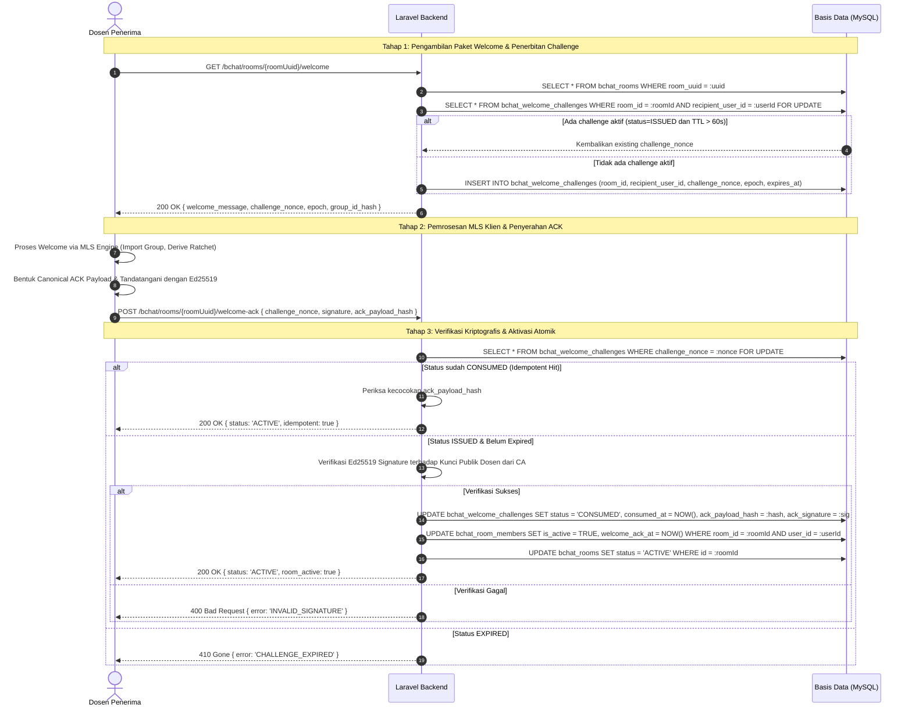
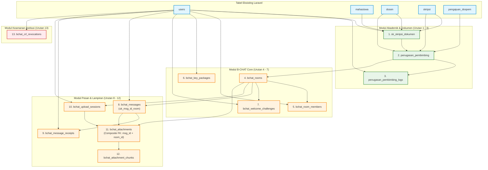

# B-CHAT-13A — KOREKSI TERARAH RANCANGAN DDL FINAL B-CHAT
## SISTEM INFORMASI MANAJEMEN SKRIPSI UNUHA

| Parameter | Keterangan |
| :--- | :--- |
| **Proyek** | Sistem Informasi Manajemen Skripsi UNUHA |
| **Fitur** | Bimbingan Online Chat Real-Time E2EE (B-CHAT) |
| **Tahap** | B-CHAT-13A — Koreksi Terarah Rancangan DDL Final B-CHAT |
| **Mode Audit** | STRICTLY READ-ONLY — DOCUMENT REVISION ONLY — ZERO DATABASE/CODE MUTATION |
| **Acuan Dokumen** | [`B-CHAT-13`](file:///d:/Aplikasi/laragon/www/sistem_manajamen_skripsi/B-CHAT-13_Rancangan_DDL_Final.md), [`B-CHAT-12H`](file:///d:/Aplikasi/laragon/www/sistem_manajamen_skripsi/B-CHAT-12H_Finalisasi_Epoch_ACK_Room_dan_Reverb.md), [`B-CHAT-12G`](file:///d:/Aplikasi/laragon/www/sistem_manajamen_skripsi/B-CHAT-12G_Finalisasi_Universal_Welcome_ACK_dan_Membership.md), [`B-CHAT-08A.2`](file:///d:/Aplikasi/laragon/www/sistem_manajamen_skripsi/B-CHAT-08A.2_Koreksi_Teknis_Terbatas_Mandat_EXP-02.md), [`B-CHAT-08D.2`](file:///d:/Aplikasi/laragon/www/sistem_manajamen_skripsi/B-CHAT-08D.2_Final_Technical_Precision_Correction_EXP-02.md) |
| **Target Engine** | MySQL 8.0.30+ / MariaDB 10.3+ (InnoDB, UTF8MB4 Unicode CI) |
| **Waktu Pelaksanaan** | 2026-11-06 |
| **Auditor** | Tim Arsitektur & Kriptografi E2EE Antigravity |

---

## 1. Ringkasan Eksekutif dan Latar Belakang Koreksi

Dokumen **B-CHAT-13A** disusun sebagai hasil audit kritis dan evaluasi teknis mendalam terhadap dokumen [`B-CHAT-13_Rancangan_DDL_Final.md`](file:///d:/Aplikasi/laragon/www/sistem_manajamen_skripsi/B-CHAT-13_Rancangan_DDL_Final.md). Audit ini bertujuan mengidentifikasi serta memperbaiki inkonsistensi perancangan basis data sebelum DDL tersebut diterjemahkan menjadi berkas migrasi Laravel aktual.

Meskipun fondasi relasional 13 tabel konseptual pada B-CHAT-13 telah berhasil menyatukan tata kelola akademik dan protokol kriptografi pairwise, audit B-CHAT-13A menemukan sejumlah anomali penting yang berisiko fatal jika diimplementasikan tanpa koreksi:
1. **Penyimpangan Kritis Struktur AAD EXP-02:** Pada Subbab 4 B-CHAT-13 tercantum spesifikasi *Associated Authenticated Data* (AAD) yang tidak sesuai dengan hasil eksperimen EXP-02 yang telah disahkan pada rangkaian B-CHAT-08.
2. **Representasi dan Ikatan Siklus Hidup Epoch MLS:** Penempatan kolom `welcome_epoch` dan `welcome_message` langsung pada tabel `bchat_rooms` berpotensi menimbulkan ambiguitas saat terjadi rekonsiliasi keanggotaan atau rekeying, serta pemilihan tipe data `INT UNSIGNED` (uint32) bertentangan dengan standar RFC 9420 Section 6 yang mendefinisikan epoch sebagai `uint64`.
3. **Doktrin Gapless Sequence yang Tidak Realistis:** Klaim bahwa penomoran urut server (*server sequence*) harus bebas celah (*strictly gapless*) bertentangan dengan mekanisme rollback transaksi ACID pada sistem basis data modern dan tidak diperlukan oleh protokol MLS.
4. **Celah Integritas Relasional Antar-Ruang pada Lampiran:** Relasi lampiran berkas ke pesan belum mencegah secara struktural skenario di mana lampiran dari Ruang A dikaitkan ke pesan dari Ruang B.
5. **Penyimpanan Storage Path Absolut:** Dokumentasi kolom path chunk lampiran mencantumkan path absolut sistem berkas lokal, yang melanggar prinsip portabilitas aplikasi.
6. **Kebijakan CASCADE yang Berisiko pada Jejak Audit Legal:** Penggunaan `ON DELETE CASCADE` pada tabel log riwayat penugasan dan daftar pencabutan sertifikat darurat (CRL) berpotensi memusnahkan bukti hukum institusional.

Dokumen ini memberikan arahan koreksi definitif (*corrective directive*) yang wajib menjadi pedoman langsung dalam penyempurnaan dokumen DDL B-CHAT-13.

> [!CAUTION]
> **BATASAN OTORISASI AUDITOR:**  
> Seluruh aktivitas dalam penyusunan dokumen B-CHAT-13A dilakukan dalam koridor **STRICTLY READ-ONLY**. Tidak ada mutasi kode sumber, migrasi database, pembuatan skema fisik, instalasi paket, maupun operasi Git mutatif yang dilakukan.

---

## 2. Matriks Temuan Evaluasi B-CHAT-13

Berikut adalah matriks komparatif hasil evaluasi dokumen B-CHAT-13 beserta klasifikasi statusnya:

| Area Evaluasi | Komponen Terdampak | Status Temuan | Ringkasan Masalah | Arah Koreksi B-CHAT-13A |
| :--- | :--- | :---: | :--- | :--- |
| **Area A: EXP-02** | Parameter Lampiran (§4) | **BLOCKER** | Struktur AAD pada tabel Subbab 4 B-CHAT-13 tercatat keliru (memuat hash Room ID, Epoch ID, Seq, Role, Ver, Type) alih-alih 83-byte kanonikal EXP-02. | Pulihkan secara mutlak struktur kanonis 83-byte EXP-02: `UNH1` (4B) + Ver (2B) + Domain (1B) + 4x UUID (64B) + ChunkIdx (4B) + TotalChunks (4B) + PlaintextLength (4B). |
| **Area B: Lifecycle & Epoch** | `bchat_rooms`, `bchat_welcome_challenges`, OPEN-19 | **PERLU REVISI** | Epoch MLS didefinisikan sebagai `INT UNSIGNED` (uint32), padahal RFC 9420 menetapkan `uint64`. Status Welcome Message di room berpotensi rancu terhadap siklus handshake. | Ubah tipe data representasi epoch menjadi `BIGINT UNSIGNED` (uint64). Tegaskan status `welcome_message` di room sebagai cache handshake pembentukan grup pairwise. |
| **Area C: Integritas Akademik** | `sk_skripsi_dokumen`, `penugasan_pembimbing` | **PASS (Catatan)** | Composite FK `(sk_dokumen_id, skripsi_id)` menjamin kesesuaian skripsi namun tidak dapat memvalidasi status `TERVERIFIKASI` di level DDL. | Pertahankan composite FK dan virtual column `active_slot`. Tegaskan bahwa validasi status `TERVERIFIKASI` adalah invarian mutlak transaksi backend (`FOR UPDATE`). |
| **Area D: Membership Room** | `bchat_rooms`, `bchat_room_members` | **PASS (Catatan)** | Hubungan 1-to-1 dengan penugasan sah. Role pengguna rentan manipulasi jika diserahkan ke klien. | Tegaskan bahwa role anggota (`mahasiswa` vs `dosen_pembimbing`) dan penanda inisiator wajib dikonstruksi secara eksklusif oleh backend dari basis data akademik. |
| **Area E: Idempotensi & Sekuens** | `bchat_messages` (§3.5 & §5.8) | **PERLU REVISI** | Klaim "gapless sequence" pada Subbab 5.8 tidak realistis di lingkungan ACID rollback. Identitas idempotensi pesan perlu penegasan eksplisit. | Hapus doktrin wajib gapless sequence; sekuens cukup terurut monotonik naik dan unik. Tegaskan triplet idempotensi pesan pada `(room_id, sender_id, message_uuid)`. |
| **Area F: Integritas Lampiran** | `bchat_attachments`, `bchat_attachment_chunks` | **PERLU REVISI** | Belum ada pencegahan DDL terhadap pengaitan lampiran lintas room (*cross-room injection*). Path biner chunk dicatat sebagai path absolut. | Terapkan Composite FK `(message_id, room_id)` merujuk `bchat_messages(id, room_id)`. Ubah `storage_path` menjadi path relatif terkelola Laravel. |
| **Area G: Kebijakan Retensi** | `penugasan_pembimbing_logs`, `bchat_crl_revocations` | **PERLU REVISI** | `ON DELETE CASCADE` dapat melenyapkan catatan audit mutasi pembimbing dan daftar pencabutan sertifikat CA saat entitas induk dihapus. | Ubah menjadi `ON DELETE RESTRICT` pada tabel log audit akademik dan CRL untuk menjamin kepatuhan audit hukum dan non-repudiasi. |
| **Area H: Konsistensi FK Eksisting** | Seluruh tabel berelasi ke tabel eksisting | **PASS** | Tipe data PK/FK cocok dengan skema Laravel eksisting (`id_mahasiswa`, `id_dosen`, `id_skripsi`, `id` users/pengajuan). | Pertahankan kesesuaian tipe `BIGINT UNSIGNED` pada seluruh foreign key yang merujuk tabel aplikasi inti. |

---

## 3. Koreksi Konseptual per Tabel

Berikut adalah telaah koreksi konseptual rinci untuk seluruh 13 tabel konseptual:

### 3.1. Kelompok Modul Akademik dan Dokumen (3 Tabel)

#### 1. Tabel `sk_skripsi_dokumen`
* **Status Evaluasi:** Terverifikasi Sangat Baik (Perbaikan Minor pada Komentar).
* **Evaluasi:**
  * Penggunaan *virtual column* `terkini_slot` (`CASE WHEN is_terkini = 1 THEN 'CURRENT' ELSE NULL END`) bersama indeks unik `(skripsi_id, terkini_slot)` terbukti efektif mengunci tepat 1 dokumen aktif per skripsi sekaligus aman terhadap multi-NULL pada MySQL 8.0.30.
  * *Self-referencing composite FK* `(induk_dokumen_id, skripsi_id)` sukses menjamin bahwa revisi dokumen hanya dapat merujuk berkas versi lama dari skripsi yang identik.
  * Kebijakan `ON DELETE CASCADE` dari `skripsi` dan `mahasiswa` dipertahankan untuk mendukung cascading reset pada lingkungan pengujian, namun pada level aplikasi *soft-delete* atau blokade penghapusan fisik skripsi terdaftar tetap diberlakukan.

#### 2. Tabel `penugasan_pembimbing`
* **Status Evaluasi:** Terverifikasi Sangat Baik (Penegasan Invarian Aplikasi).
* **Evaluasi:**
  * Formula CHECK bifurkasi:
    $$\left(\text{tahap} = \text{'proposal'} \land \text{sk\_dokumen\_id IS NULL} \land \text{pembimbing\_ke} = 1\right) \lor \left(\text{tahap} = \text{'skripsi'} \land \text{sk\_dokumen\_id IS NOT NULL} \land \text{pembimbing\_ke} \in \{1, 2\}\right)$$
    berhasil menutup celah pengabaian SK pada tahap skripsi dan menolak pembimbing kedua pada tahap proposal.
  * *Active slot* (`CONCAT(tahap, '_', pembimbing_ke)`) menjamin ketiadaan duplikasi dosen aktif pada slot yang sama tanpa menghalangi penyimpanan riwayat dosen terdahulu berstatus `DIGANTI` atau `DIBATALKAN`.
  * **Catatan Koreksi:** DDL tidak dapat memvalidasi status kolom dokumen SK (`TERVERIFIKASI`). Oleh karena itu, backend **wajib mengeksekusi kunci pesimistik** `SELECT status_dokumen FROM sk_skripsi_dokumen WHERE id = :id FOR UPDATE` dan memastikan nilainya adalah `'TERVERIFIKASI'` sebelum melakukan *insert* ke tabel ini.

#### 3. Tabel `penugasan_pembimbing_logs`
* **Status Evaluasi:** PERLU REVISI KEBIJAKAN PENGHAPUSAN.
* **Koreksi:**
  * Pada B-CHAT-13 Subbab 2.3, baris foreign key tertulis:  
    `CONSTRAINT fk_penugasan_log_induk FOREIGN KEY (penugasan_pembimbing_id) REFERENCES penugasan_pembimbing(id) ON DELETE CASCADE`.
  * **Koreksi Wajib:** Ubah klausa penghapusan menjadi `ON DELETE RESTRICT`. Catatan riwayat mutasi pembimbing merupakan rekaman hukum akademik (*immutable legal audit trail*). Apabila sebuah baris penugasan pernah mengalami mutasi resmi dan memiliki rekaman log, baris penugasan tersebut dilarang dihapus secara destruktif dari basis data.

---

### 3.2. Kelompok Modul Kriptografi dan B-CHAT (10 Tabel)

#### 4. Tabel `bchat_rooms`
* **Status Evaluasi:** PERLU REVISI TIPE DATA EPOCH & SPESIFIKASI SIKLUS HIDUP.
* **Koreksi:**
  1. **Tipe Data Epoch:** Ubah tipe data `current_epoch` dan `welcome_epoch` dari `INT UNSIGNED` menjadi `BIGINT UNSIGNED`. Standar IETF RFC 9420 (The Messaging Layer Security Protocol) Section 6 secara tegas mendefinisikan tipe data epoch sebagai integer tanpa tanda 64-bit (`uint64 epoch;`). Menggunakan integer 32-bit berisiko menimbulkan *type overflow* atau ketidakcocokan serialisasi biner TLS presentation language saat berinteraksi dengan library MLS engine.
  2. **Peran Kolom Welcome:** Kolom `welcome_message` dan `welcome_epoch` pada tabel ini berfungsi sebagai *handshake cache* tahap inisialisasi ruang obrolan pairwise. Setelah kedua pihak (mahasiswa dan pembimbing) menyelesaikan Welcome ACK dan status room beralih menjadi `ACTIVE`, evolusi kunci obrolan selanjutnya dikawal melalui pesan Commit MLS di tabel `bchat_messages`, bukan dengan memperbarui kolom `welcome_message` di room.

#### 5. Tabel `bchat_room_members`
* **Status Evaluasi:** Terverifikasi Sangat Baik (Penegasan Integritas Membership).
* **Evaluasi:**
  * Relasi unik `(room_id, user_id)` menjamin pengguna tidak terdaftar ganda pada ruang yang sama.
  * Kolom `is_initiator` menandai pihak yang mendirikan grup MLS (mahasiswa atau pembimbing proposal). Inisiator tidak memerlukan penerbitan paket Welcome maupun Welcome ACK untuk dirinya sendiri.
  * Anggota penerima (`is_initiator = FALSE`) memiliki `is_active = FALSE` sampai Welcome ACK mereka berhasil diverifikasi oleh backend.
  * Invarian pairwise menjamin tepat 2 baris anggota per `room_id`: satu bertindak sebagai inisiator (`is_initiator = TRUE`) dan satu bertindak sebagai penerima (`is_initiator = FALSE`).

#### 6. Tabel `bchat_key_packages`
* **Status Evaluasi:** Terverifikasi Sangat Baik.
* **Evaluasi:**
  * Penanda `is_consumed` dan `consumed_at` menjaga sifat *one-time use* dari MLS KeyPackage.
  * Kunci publik bertanda tangan CA institusi diverifikasi sebelum dimasukkan ke dalam basis data.

#### 7. Tabel `bchat_welcome_challenges`
* **Status Evaluasi:** PERLU REVISI TIPE DATA EPOCH.
* **Koreksi:**
  * Ubah kolom `epoch` dari `INT UNSIGNED` menjadi `BIGINT UNSIGNED` agar presisi 64-bit konsisten dengan RFC 9420 dan tabel `bchat_rooms`.
  * Verifikasi anti-replay dikawal melalui status `ISSUED` $\rightarrow$ `CONSUMED` dan `ack_payload_hash` untuk memastikan idempotensi sempurna pada skenario *network retry*.

#### 8. Tabel `bchat_messages`
* **Status Evaluasi:** PERLU REVISI TIPE DATA EPOCH & ELEVASI COMPOSITE KEY UNTUK INTEGRITAS LAMPIRAN.
* **Koreksi:**
  1. **Tipe Data Epoch:** Ubah kolom `epoch` dari `INT UNSIGNED` menjadi `BIGINT UNSIGNED`.
  2. **Composite Key Pendukung Foreign Key Lampiran:** Tambahkan constraint unik komposit `CONSTRAINT uk_msg_id_room UNIQUE (id, room_id)`. Penambahan ini sangat krusial agar tabel `bchat_attachments` dapat menegakkan *Composite Foreign Key* `(message_id, room_id)` secara deklaratif pada tingkat database engine.
  3. **Penghapusan Klaim Gapless Sequence:** Hapus doktrin yang menyatakan bahwa `server_sequence` harus gapless tanpa celah. Server sequence adalah penomoran terurut monotonik per room untuk keperluan rendering antarmuka dan paginasi server relay. Kegagalan atau rollback transaksi yang menghasilkan celah angka tidak membatalkan keabsahan enkripsi MLS.

#### 9. Tabel `bchat_message_receipts`
* **Status Evaluasi:** Terverifikasi Sangat Baik.
* **Evaluasi:**
  * Pemisahan tanda terima pesan (`DELIVERED`, `READ`) ke dalam tabel tersendiri mencegah *lock contention* dan mutasi baris ciphertext pada tabel `bchat_messages`.

#### 10. Tabel `bchat_upload_sessions`
* **Status Evaluasi:** Terverifikasi Sangat Baik.
* **Evaluasi:**
  * Mengelola sesi unggah terfragmentasi (*chunked upload*). Kolom `upload_session_id` bertipe `CHAR(36)` (UUIDv4) bertindak sebagai pengenal unik sesi.

#### 11. Tabel `bchat_attachments`
* **Status Evaluasi:** PERLU REVISI INTEGRITAS RELASIONAL LINTAS RUANG.
* **Koreksi:**
  * Pada B-CHAT-13 Subbab 3.8, foreign key ke pesan didefinisikan sebagai:  
    `CONSTRAINT fk_attach_msg FOREIGN KEY (message_id) REFERENCES bchat_messages(id)`.
  * **Celah:** Definisi tersebut memungkinkan secara relasional sebuah berkas lampiran yang diunggah pada Ruang 1 dikaitkan dengan sebuah pesan manifest yang terbit pada Ruang 2.
  * **Koreksi Wajib:** Ganti foreign key tersebut dengan *Composite Foreign Key* yang merujuk pada `bchat_messages(id, room_id)`:
    ```sql
    CONSTRAINT fk_attach_msg_composite FOREIGN KEY (message_id, room_id) 
        REFERENCES bchat_messages(id, room_id) ON DELETE CASCADE ON UPDATE CASCADE
    ```
    Dengan aturan ini, basis data akan secara otomatis menolak pengaitan berkas lampiran jika `room_id` pada baris attachment tidak cocok dengan `room_id` pada pesan manifest yang dirujuk.

#### 12. Tabel `bchat_attachment_chunks`
* **Status Evaluasi:** PERLU REVISI SPESIFIKASI STORAGE PATH.
* **Koreksi:**
  * Pada B-CHAT-13 Subbab 3.9, kolom `storage_path` diberi anotasi: *"Lokasi path absolut pada disk lokal privat"*.
  * **Koreksi Wajib:** Basis data dilarang keras menyimpan path direktori fisik absolut (seperti `D:\Aplikasi\laragon\...` atau `/var/www/...`). Kolom `storage_path VARCHAR(255)` wajib didefinisikan untuk menampung **path relatif terkelola server** (*storage object key*) terhadap root disk privat Laravel Storage (`storage/app/private/bchat_attachments/{hash_prefix}/{chunk_hash}.bin`). Hal ini menjamin portabilitas saat sistem bermigrasi ke server lain, kontainer Docker, maupun *cloud object storage* (S3-compatible).

#### 13. Tabel `bchat_crl_revocations`
* **Status Evaluasi:** PERLU REVISI KEBIJAKAN PENGHAPUSAN.
* **Koreksi:**
  * Pada B-CHAT-13 Subbab 3.10, foreign key ke user didefinisikan sebagai:  
    `CONSTRAINT fk_crl_user FOREIGN KEY (user_id) REFERENCES users(id) ON DELETE CASCADE`.
  * **Koreksi Wajib:** Ubah klausa penghapusan menjadi `ON DELETE RESTRICT`. Catatan pencabutan sertifikat (*Certificate Revocation List*) adalah data keamanan kriptografis yang bersifat permanen dan tidak boleh terhapus secara otomatis (*accidental purge*) apabila rekaman pengguna induk dimodifikasi atau dihapus.

---

## 4. SQL Konseptual yang Telah Dikoreksi

Berikut disajikan definisi DDL lengkap untuk enam tabel yang mengalami penyesuaian struktural, constraint, atau tipe data:

### 4.1. Tabel `penugasan_pembimbing_logs` (Koreksi RESTRICT)

```sql
CREATE TABLE penugasan_pembimbing_logs (
    id BIGINT UNSIGNED AUTO_INCREMENT PRIMARY KEY,
    penugasan_pembimbing_id BIGINT UNSIGNED NOT NULL COMMENT 'FK ke penugasan_pembimbing yang dimutasi',
    user_id BIGINT UNSIGNED NULL COMMENT 'FK ke users(id) aktor yang melakukan tindakan',
    aktor_nama VARCHAR(150) NOT NULL,
    aktor_role VARCHAR(50) NOT NULL COMMENT 'admin / dekan / kaprodi / sistem',
    tindakan ENUM('PENETAPAN_AWAL', 'PERGANTIAN_PEMBIMBING', 'PEMBATALAN_PENUGASAN', 'PENGAKTIFAN_KEMBALI') NOT NULL,
    status_sebelum VARCHAR(50) NULL,
    status_sesudah VARCHAR(50) NOT NULL,
    snapshot_dosen_lama_id BIGINT UNSIGNED NULL,
    snapshot_dosen_baru_id BIGINT UNSIGNED NULL,
    catatan TEXT NULL COMMENT 'Alasan administratif mutasi pembimbing',
    created_at TIMESTAMP NOT NULL DEFAULT CURRENT_TIMESTAMP,

    -- Koreksi: ON DELETE RESTRICT demi integritas audit hukum akademik
    CONSTRAINT fk_penugasan_log_induk FOREIGN KEY (penugasan_pembimbing_id) 
        REFERENCES penugasan_pembimbing(id) ON DELETE RESTRICT ON UPDATE CASCADE,
    CONSTRAINT fk_penugasan_log_user FOREIGN KEY (user_id) 
        REFERENCES users(id) ON DELETE SET NULL ON UPDATE CASCADE,
    INDEX idx_penugasan_log_history (penugasan_pembimbing_id, created_at)
) ENGINE=InnoDB DEFAULT CHARSET=utf8mb4 COLLATE=utf8mb4_unicode_ci;
```

---

### 4.2. Tabel `bchat_rooms` (Koreksi Epoch uint64)

```sql
CREATE TABLE bchat_rooms (
    id BIGINT UNSIGNED AUTO_INCREMENT PRIMARY KEY,
    room_uuid CHAR(36) NOT NULL UNIQUE COMMENT 'UUID v4 publik room',
    penugasan_pembimbing_id BIGINT UNSIGNED NOT NULL UNIQUE COMMENT '1-to-1 relasi eksklusif dengan penugasan yang sah',
    tahap ENUM('proposal', 'skripsi') NOT NULL,
    pembimbing_ke TINYINT UNSIGNED NOT NULL DEFAULT 1,
    current_sequence BIGINT UNSIGNED NOT NULL DEFAULT 0 COMMENT 'Counter monotonik server per room (diperbarui via SELECT ... FOR UPDATE)',
    status ENUM('PENDING_OFFICIAL_SK', 'PENDING_WELCOME_ACK', 'ACTIVE', 'PENDING_REKEYING', 'SUSPENDED', 'ARCHIVED_READONLY', 'TERMINATED') NOT NULL DEFAULT 'PENDING_WELCOME_ACK',
    
    -- Koreksi: BIGINT UNSIGNED untuk menampung uint64 epoch standar RFC 9420
    current_epoch BIGINT UNSIGNED NOT NULL DEFAULT 0 COMMENT 'Nomor epoch grup MLS aktif saat ini (uint64 RFC 9420)',
    welcome_epoch BIGINT UNSIGNED NOT NULL DEFAULT 1 COMMENT 'Nomor epoch target yang dibawa oleh welcome_message saat pendirian',
    welcome_message LONGBLOB NULL COMMENT 'Paket Welcome biner terenkripsi HPKE untuk anggota penerima pairwise',
    group_id_hash CHAR(64) NULL COMMENT 'Hash SHA-256 dari MLS Group ID untuk validasi binding',
    created_at TIMESTAMP NULL DEFAULT CURRENT_TIMESTAMP,
    updated_at TIMESTAMP NULL DEFAULT CURRENT_TIMESTAMP ON UPDATE CURRENT_TIMESTAMP,

    CONSTRAINT fk_room_penugasan FOREIGN KEY (penugasan_pembimbing_id) 
        REFERENCES penugasan_pembimbing(id) ON DELETE RESTRICT ON UPDATE CASCADE,
    INDEX idx_room_lifecycle (status, tahap)
) ENGINE=InnoDB DEFAULT CHARSET=utf8mb4 COLLATE=utf8mb4_unicode_ci;
```

---

### 4.3. Tabel `bchat_welcome_challenges` (Koreksi Epoch uint64)

```sql
CREATE TABLE bchat_welcome_challenges (
    id BIGINT UNSIGNED AUTO_INCREMENT PRIMARY KEY,
    room_id BIGINT UNSIGNED NOT NULL,
    recipient_user_id BIGINT UNSIGNED NOT NULL COMMENT 'Anggota penerima yang berhak memproses dan menandatangani challenge',
    challenge_nonce CHAR(64) NOT NULL UNIQUE COMMENT 'Random 32-byte hexadecimal string anti-replay',
    group_id_hash CHAR(64) NOT NULL COMMENT 'SHA-256 hash MLS Group ID',
    
    -- Koreksi: BIGINT UNSIGNED untuk konsistensi uint64 RFC 9420
    epoch BIGINT UNSIGNED NOT NULL COMMENT 'Nomor epoch Welcome target yang diverifikasi (uint64)',
    status ENUM('ISSUED', 'CONSUMED', 'EXPIRED') NOT NULL DEFAULT 'ISSUED',
    expires_at TIMESTAMP NOT NULL COMMENT 'Tenggat waktu berlakunya challenge (TTL 5 menit)',
    consumed_at TIMESTAMP NULL COMMENT 'Waktu konsumsi sukses',
    ack_payload_hash CHAR(64) NULL COMMENT 'Hash SHA-256 canonical ACK bytes yang berhasil diverifikasi (idempotensi)',
    ack_signature TEXT NULL COMMENT 'Tanda tangan digital Ed25519 yang diserahkan',
    ip_address VARCHAR(45) NULL,
    user_agent TEXT NULL,
    created_at TIMESTAMP NULL DEFAULT CURRENT_TIMESTAMP,
    updated_at TIMESTAMP NULL DEFAULT CURRENT_TIMESTAMP ON UPDATE CURRENT_TIMESTAMP,

    CONSTRAINT fk_challenge_room FOREIGN KEY (room_id) 
        REFERENCES bchat_rooms(id) ON DELETE CASCADE ON UPDATE CASCADE,
    CONSTRAINT fk_challenge_recipient FOREIGN KEY (recipient_user_id) 
        REFERENCES users(id) ON DELETE CASCADE ON UPDATE CASCADE,
    INDEX idx_challenge_verify (room_id, recipient_user_id, status, expires_at)
) ENGINE=InnoDB DEFAULT CHARSET=utf8mb4 COLLATE=utf8mb4_unicode_ci;
```

---

### 4.4. Tabel `bchat_messages` (Koreksi Epoch uint64 & Composite Key Room)

```sql
CREATE TABLE bchat_messages (
    id BIGINT UNSIGNED AUTO_INCREMENT PRIMARY KEY,
    room_id BIGINT UNSIGNED NOT NULL,
    server_sequence BIGINT UNSIGNED NOT NULL COMMENT 'Monotonik naik per room; celah akibat rollback ditoleransi',
    message_uuid CHAR(36) NOT NULL UNIQUE COMMENT 'UUID v4 pesan yang dibangkitkan klien (identitas idempotensi)',
    sender_id BIGINT UNSIGNED NOT NULL COMMENT 'FK ke users(id) pengirim pesan',
    
    -- Koreksi: BIGINT UNSIGNED untuk konsistensi uint64 RFC 9420
    epoch BIGINT UNSIGNED NOT NULL COMMENT 'Epoch saat pesan dienkripsi (uint64 RFC 9420)',
    generation INT UNSIGNED NOT NULL COMMENT 'Generasi ratchet per-pengirim (TreeKEM)',
    content_type TINYINT UNSIGNED NOT NULL DEFAULT 1 COMMENT '1: TEXT, 2: ATTACHMENT_MANIFEST, 3: CONTROL_RECEIPT',
    ciphertext_payload LONGBLOB NOT NULL COMMENT 'Paket MLS PrivateMessage biner (TreeKEM ratcheted)',
    payload_hash_sha256 CHAR(64) NOT NULL COMMENT 'Hash SHA-256 verifikasi integritas fisik payload at-rest',
    client_sent_at TIMESTAMP NOT NULL COMMENT 'Waktu lokal pengiriman di peramban klien',
    created_at TIMESTAMP NULL DEFAULT CURRENT_TIMESTAMP,
    updated_at TIMESTAMP NULL DEFAULT CURRENT_TIMESTAMP ON UPDATE CURRENT_TIMESTAMP,

    CONSTRAINT fk_msg_room FOREIGN KEY (room_id) 
        REFERENCES bchat_rooms(id) ON DELETE CASCADE ON UPDATE CASCADE,
    CONSTRAINT fk_msg_sender FOREIGN KEY (sender_id) 
        REFERENCES users(id) ON DELETE CASCADE ON UPDATE CASCADE,
    
    -- Constraint Unik Sekuens Per Room
    CONSTRAINT uk_room_sequence UNIQUE (room_id, server_sequence),
    
    -- Koreksi: Target Composite FK bagi tabel bchat_attachments untuk isolasi room mutlak
    CONSTRAINT uk_msg_id_room UNIQUE (id, room_id),

    INDEX idx_msg_pagination (room_id, server_sequence DESC),
    INDEX idx_msg_idempotency (room_id, sender_id, message_uuid)
) ENGINE=InnoDB DEFAULT CHARSET=utf8mb4 COLLATE=utf8mb4_unicode_ci;
```

---

### 4.5. Tabel `bchat_attachments` (Koreksi Composite FK Isolasi Room)

```sql
CREATE TABLE bchat_attachments (
    id BIGINT UNSIGNED AUTO_INCREMENT PRIMARY KEY,
    attachment_uuid CHAR(36) NOT NULL UNIQUE COMMENT 'UUID v4 lampiran publik',
    upload_session_id BIGINT UNSIGNED NOT NULL,
    room_id BIGINT UNSIGNED NOT NULL,
    message_id BIGINT UNSIGNED NULL COMMENT 'Nullable saat upload awal; diisi saat pesan manifest terbit',
    total_bytes BIGINT UNSIGNED NOT NULL COMMENT 'Ukuran total ciphertext tergabung (maks 10 MB per berkas)',
    total_chunks INT UNSIGNED NOT NULL COMMENT 'Jumlah chunk biner (1 MiB per chunk)',
    file_hash_sha256 CHAR(64) NOT NULL COMMENT 'Hash SHA-256 seluruh ciphertext tergabung',
    status ENUM('PENDING_MESSAGE', 'ATTACHED', 'ORPHANED') NOT NULL DEFAULT 'PENDING_MESSAGE',
    created_at TIMESTAMP NULL DEFAULT CURRENT_TIMESTAMP,
    updated_at TIMESTAMP NULL DEFAULT CURRENT_TIMESTAMP ON UPDATE CURRENT_TIMESTAMP,

    CONSTRAINT fk_attach_session FOREIGN KEY (upload_session_id) 
        REFERENCES bchat_upload_sessions(id) ON DELETE CASCADE ON UPDATE CASCADE,
    CONSTRAINT fk_attach_room FOREIGN KEY (room_id) 
        REFERENCES bchat_rooms(id) ON DELETE CASCADE ON UPDATE CASCADE,
        
    -- Koreksi Kritis: Composite Foreign Key mencegah pengaitan lampiran lintas ruang
    CONSTRAINT fk_attach_msg_composite FOREIGN KEY (message_id, room_id) 
        REFERENCES bchat_messages(id, room_id) ON DELETE CASCADE ON UPDATE CASCADE,

    INDEX idx_attach_room (room_id, status)
) ENGINE=InnoDB DEFAULT CHARSET=utf8mb4 COLLATE=utf8mb4_unicode_ci;
```

---

### 4.6. Tabel `bchat_attachment_chunks` (Koreksi Dokumentasi Relative Storage Path)

```sql
CREATE TABLE bchat_attachment_chunks (
    id BIGINT UNSIGNED AUTO_INCREMENT PRIMARY KEY,
    attachment_id BIGINT UNSIGNED NOT NULL,
    chunk_index INT UNSIGNED NOT NULL COMMENT 'Indeks urutan chunk (zero-based: 0, 1, 2...)',
    payload_length INT UNSIGNED NOT NULL COMMENT 'Panjang biner chunk Li + 28 Byte (12 Nonce + Li + 16 Tag)',
    
    -- Koreksi: Relative storage path terkelola Laravel (bukan path absolut disk lokal)
    storage_path VARCHAR(255) NOT NULL COMMENT 'Path relatif storage privat Laravel (bchat_attachments/{prefix}/{hash}.bin)',
    storage_hash_sha256 CHAR(64) NOT NULL COMMENT 'Checksum SHA-256 potongan chunk biner tersimpan',
    created_at TIMESTAMP NULL DEFAULT CURRENT_TIMESTAMP,
    updated_at TIMESTAMP NULL DEFAULT CURRENT_TIMESTAMP ON UPDATE CURRENT_TIMESTAMP,

    CONSTRAINT fk_chunk_attach FOREIGN KEY (attachment_id) 
        REFERENCES bchat_attachments(id) ON DELETE CASCADE ON UPDATE CASCADE,
    CONSTRAINT uk_attach_chunk_index UNIQUE (attachment_id, chunk_index)
) ENGINE=InnoDB DEFAULT CHARSET=utf8mb4 COLLATE=utf8mb4_unicode_ci;
```

---

### 4.7. Tabel `bchat_crl_revocations` (Koreksi RESTRICT)

```sql
CREATE TABLE bchat_crl_revocations (
    id BIGINT UNSIGNED AUTO_INCREMENT PRIMARY KEY,
    user_id BIGINT UNSIGNED NOT NULL,
    revoked_credential_uuid CHAR(36) NOT NULL UNIQUE COMMENT 'UUID kredensial identitas yang dicabut oleh CA',
    reason VARCHAR(255) NOT NULL COMMENT 'Alasan pencabutan kredensial identitas',
    revoked_at TIMESTAMP NOT NULL DEFAULT CURRENT_TIMESTAMP,

    -- Koreksi: ON DELETE RESTRICT agar data pembatalan kredensial kekal
    CONSTRAINT fk_crl_user FOREIGN KEY (user_id) 
        REFERENCES users(id) ON DELETE RESTRICT ON UPDATE CASCADE,
    INDEX idx_crl_user (user_id, revoked_at)
) ENGINE=InnoDB DEFAULT CHARSET=utf8mb4 COLLATE=utf8mb4_unicode_ci;
```

---

## 5. Invarian Transaksi dan Validasi Backend

Penegakan integritas data bimbingan E2EE tidak dapat dibebankan seluruhnya pada skema DDL relasional. Bagian ini merumuskan invarian transaksional backend yang wajib dijalankan secara atomik melalui `DB::transaction` dengan tingkat isolasi *Repeatable Read*:

### 5.1. Transaksi Verifikasi SK dan Penetapan Dua Pembimbing Skripsi
* **Tujuan:** Memvalidasi dokumen SK, mengunci baris verifikasi, mencatat 2 pembimbing, dan menginisiasi 2 ruang pairwise independen.
* **Prosedur Eksekusi Transaksional:**
  1. Kunci baris dokumen SK:
     ```sql
     SELECT id, skripsi_id, mahasiswa_id, status_dokumen, dosen_1_usulan_id, dosen_2_usulan_id 
     FROM sk_skripsi_dokumen 
     WHERE id = :skDokumenId 
     FOR UPDATE;
     ```
  2. Validasi Invarian Backend:
     * Pastikan `status_dokumen === 'MENUNGGU_PEMERIKSAAN'`.
     * Pastikan admin memilih Dosen Pembimbing 1 dan Dosen Pembimbing 2 yang valid (tidak boleh dosen yang sama: `dosen_1_id !== dosen_2_id`).
  3. Mutasi Status SK:
     ```sql
     UPDATE sk_skripsi_dokumen 
     SET status_dokumen = 'TERVERIFIKASI', admin_id = :adminUserId, diperiksa_at = NOW() 
     WHERE id = :skDokumenId;
     ```
  4. Penyisipan Baris `penugasan_pembimbing` untuk Pembimbing 1 dan 2:
     * DDL CHECK constraint memastikan `tahap = 'skripsi'`, `sk_dokumen_id IS NOT NULL`, dan `pembimbing_ke IN (1, 2)`.
     * Virtual column `active_slot` memastikan belum ada penugasan aktif lain untuk kombinasi slot tersebut.
  5. Penyisipan Baris `bchat_rooms` untuk Masing-Masing Pembimbing:
     * Dibuat 2 ruang terpisah dengan status `'PENDING_WELCOME_ACK'`.
     * Didaftarkan 2 anggota di `bchat_room_members` untuk masing-masing ruang (Mahasiswa sebagai inisiator `is_initiator = TRUE`, Dosen sebagai penerima `is_initiator = FALSE`).
  6. Pencatatan Jejak Audit ke `penugasan_pembimbing_logs`.
  7. **Atomisitas Mutlak:** Apabila terjadi kegagalan pada pembimbing kedua (misal kuota beban bimbingan dosen penuh), seluruh transaksi dibatalkan (*full rollback*). Tidak boleh ada kondisi parsial di mana hanya Pembimbing 1 yang terverifikasi.

---

### 5.2. Transaksi Welcome Challenge dan Verifikasi Welcome ACK



* **Idempotensi Sempurna (7 Kasus B-CHAT-12H):**
  * Skenario pengiriman ganda akibat instabilitas jaringan (*network retry*) ditangani tanpa menimbulkan tabrakan. Status `CONSUMED` bersama rekaman `ack_payload_hash` mengembalikan respons sukses identik tanpa melakukan mutasi ganda pada keanggotaan room.

---

### 5.3. Koreksi Server Sequence: Eliminasi Doktrin Gapless Sequence

Pada B-CHAT-13 Subbab 5.8 tercantum klaim:  
> *"Tindakan: Mengunci baris room untuk memperoleh sekuens urut mutlak tanpa celah (gapless sequence)."*

Doktrin ini **wajib dikoreksi dan dieliminasi**. Penjelasan teknis arsitektur:

1. **Konflik Fundamental dengan Transaksi ACID:**
   * Dalam basis data transaksional yang mendukung rollback, menjamin sekuens mutlak tanpa celah (*gapless*) mustahil dicapai tanpa mematikan konkurensi atau memaksakan komit prematur.
   * Jika Transaksi A mengalokasikan nomor urut $N = 4$ melalui `UPDATE bchat_rooms SET current_sequence = current_sequence + 1`, kemudian Transaksi A mengalami *rollback* (akibat kegagalan validasi lanjutan, disk I/O error, atau koneksi klien terputus), maka nomor urut 4 tidak akan pernah tersimpan di tabel `bchat_messages`. Transaksi berikutnya (B) akan mengalokasikan $N = 5$, sehingga tercipta celah (*gap*) pada nomor urut 4.
2. **Kemandirian Kriptografis MLS terhadap Server Sequence:**
   * Protokol IETF RFC 9420 **tidak bergantung** pada nomor urut server basis data untuk menjamin keamanan atau keutuhan pesan.
   * Keamanan urutan pesan, deteksi replay, dan konsistensi status obrolan dalam MLS diatur secara mandiri pada layer kriptografi oleh:
     * **TreeKEM Ratchet Generation:** Counter internal per anggota pengirim yang terenkripsi di dalam paket pesan biner.
     * **Epoch Roster State:** Ratchet tree yang berubah hanya melalui transaksi *Commit*.
   * Dengan demikian, `server_sequence` pada tabel `bchat_messages` murni berfungsi sebagai indeks server relay untuk keperluan pagination antarmuka pengguna (`ORDER BY server_sequence ASC/DESC`).
3. **Formulasi Karakteristik Sekuens yang Benar:**
   * Nomor sekuens server berkarakteristik: **Monotonik Naik (Strictly Increasing Monotonic)** dan **Unik per Ruang (`UNIQUE(room_id, server_sequence)`)**.
   * Adanya celah (*gap*) angka yang timbul akibat rollback transaksi adalah fenomena normal dalam basis data relasional dan **sama sekali tidak mengorbankan validitas maupun keamanan percakapan E2EE**.
4. **Idempotensi Pengiriman Pesan:**
   * Idempotensi pengiriman pesan dijamin secara utama oleh kolom `(room_id, sender_id, message_uuid)`.
   * Klien membangkitkan `message_uuid` acak (UUIDv4) untuk setiap pesan baru. Apabila terjadi kegagalan jaringan setelah backend melakukan komit, pengiriman ulang (*retry*) dari klien dengan `message_uuid` yang sama akan mendeteksi rekaman yang sudah ada, mengabaikan alokasi sekuens baru, dan mengembalikan pesan yang telah tersimpan.

---

## 6. Koreksi Spesifikasi Kriptografi Lampiran EXP-02

Audit menemukan inkonsistensi serius antara Subbab 4 dokumen B-CHAT-13 dengan spesifikasi kanonikal hasil uji coba EXP-02 (dokumen [`B-CHAT-08A.2`](file:///d:/Aplikasi/laragon/www/sistem_manajamen_skripsi/B-CHAT-08A.2_Koreksi_Teknis_Terbatas_Mandat_EXP-02.md) dan [`B-CHAT-08D.2`](file:///d:/Aplikasi/laragon/www/sistem_manajamen_skripsi/B-CHAT-08D.2_Final_Technical_Precision_Correction_EXP-02.md)).

### 6.1. Pemulihan Struktur AAD Kanonikal 83-Byte Baku

Pada B-CHAT-13 Subbab 4 tertulis spesifikasi AAD sebagai berikut:  
`SHA-256 Room ID (32B) || SHA-256 Epoch ID (32B) || Seq (8B) || ChunkIdx (4B) || TotalChunks (4B) || Role (1B) || Ver (1B) || Type (1B)` (Total 84 byte).

Spesifikasi tersebut **KELIRU** dan tidak sesuai dengan kode implementasi eksperimen EXP-02.

**Struktur AAD Kanonikal 83-Byte yang Resmi dan Sah (Sesuai EXP-02):**

```
+----------------------------------------------------------------------------------------------------+
|                                 STRUKTUR AAD KANONIKAL 83-BYTE EXP-02                              |
+-----+-----------------------+---------------------+-------------------+----------------------------+
| No  | Nama Komponen         | Tipe Data           | Panjang (Byte)    | Nilai / Format             |
+-----+-----------------------+---------------------+-------------------+----------------------------+
| 1   | Magic Header          | ASCII String        | 4 Byte            | "UNH1" (0x55 0x4E 0x48 0x31) |
| 2   | Protocol Version      | uint16 Big-Endian   | 2 Byte            | 0x0001                     |
| 3   | Domain Separator      | uint8               | 1 Byte            | 0x02 (ATTACHMENT_CHUNK)    |
| 4   | Room UUID             | Binary UUID         | 16 Byte           | Raw 16-byte UUIDv4         |
| 5   | Message UUID          | Binary UUID         | 16 Byte           | Raw 16-byte UUIDv4         |
| 6   | Attachment UUID       | Binary UUID         | 16 Byte           | Raw 16-byte UUIDv4         |
| 7   | Upload Session ID     | Binary UUID         | 16 Byte           | Raw 16-byte UUIDv4         |
| 8   | Chunk Index           | uint32 Big-Endian   | 4 Byte            | Zero-based: 0 s.d. N-1     |
| 9   | Total Chunks          | uint32 Big-Endian   | 4 Byte            | N (1 s.d. 10)              |
| 10  | Plaintext Length (Li) | uint32 Big-Endian   | 4 Byte            | Panjang chunk plaintext    |
+-----+-----------------------+---------------------+-------------------+----------------------------+
|     | TOTAL PANJANG BAKU    |                     | TEPAT 83 BYTE     | Bit-demi-bit deterministik |
+-----+-----------------------+---------------------+-------------------+----------------------------+
```

$$\text{Total Panjang AAD} = 4 + 2 + 1 + 16 + 16 + 16 + 16 + 4 + 4 + 4 = 83\text{ Byte}$$

* Penjelasan 10 field:
  * Keempat UUID direpresentasikan dalam **16 byte biner mentah** (*raw bytes*), bukan string hex 36 karakter ($16 \times 4 = 64\text{ byte}$).
  * Seluruh integer multi-byte dikodekan dalam format *Big-Endian* (`uint16be`, `uint32be`).
  * Kegagalan verifikasi AAD pada saat dekripsi Web Crypto API menghasilkan `OperationError`, yang membuktikan adanya manipulasi struktur metadata berkas lampiran.

---

### 6.2. Struktur Nonce 96-Bit dan Aturan Pencegahan Nonce-Reuse

Sesuai ketetapan Koreksi A EXP-02, struktur Nonce 12-byte (96-bit) wajib mematuhi formula:

$$\text{Nonce} = \text{UploadSessionSalt}\ (8\text{ byte}) \parallel \text{uint32be}(\text{chunk\_index})\ (4\text{ byte})$$

**Aturan Keamanan Operasional Nonce:**
1. **Status Penggunaan Seketika:** Suatu nilai nonce dianggap telah terpakai (*consumed*) seketika sejak fungsi `crypto.subtle.encrypt()` dipanggil dengan pasangan $(\text{CEK}, \text{Nonce})$ tersebut. Dilarang menganggap nonce baru terpakai setelah chunk tersimpan di media disk.
2. **Crash & Recovery Safety:** Apabila terjadi *browser crash*, proses Web Worker terhenti, atau kegagalan jaringan saat pengunggahan, nonce tersebut **dilarang digunakan kembali** untuk mengenkripsi data baru dengan CEK yang sama.
3. **Pengiriman Ulang (Retry):** Percobaan ulang pengiriman chunk ke server hanya diizinkan dengan **mengirimkan ulang ciphertext yang telah berhasil terbentuk dan tersimpan di penyimpanan lokal (IndexedDB)**, tanpa melakukan enkripsi ulang.
4. **Pembatalan Sesi (Session Abandonment):** Jika rekaman ciphertext pada IndexedDB rusak atau tidak dapat diverifikasi integritasnya, seluruh sesi unggah dinyatakan batal (*FAILED_ABANDONED*). Sesi baru harus dimulai dari awal dengan **CEK baru, Upload Session ID baru, dan Upload Session Salt baru**.

---

### 6.3. Format Framing Fisik dan Batasan Kuota Berkas

* **Format Framing Simpan per Chunk:**  
  $$\text{Format Chunk Fisik} = \text{Nonce}\ (12\text{ Byte}) \parallel \text{Ciphertext}\ (L_i\text{ Byte}) \parallel \text{Auth Tag}\ (16\text{ Byte})$$
  Total ukuran fisik biner yang tersimpan di disk per chunk adalah $L_i + 28\text{ byte}$.
* **Ukuran Chunk ($L_i$):**
  * Chunk perantara ($i < N-1$): Tepat $1\text{ MiB} = 1.048.576\text{ byte}$.
  * Chunk terakhir ($i = N-1$): $L_{last} = S \pmod C$ jika $S \pmod C \ne 0$, atau $C$ jika $S \pmod C = 0$.
* **Batas Kuota Berkas Resmi:**
  * **Ukuran Maksimum per File:** $10\text{ MB} = 10.485.760\text{ byte}$ ($N \le 10\text{ chunk}$).
  * **Ukuran Maksimum per Pesan:** $25\text{ MB}$ gabungan.
  * **Jumlah Maksimum Berkas per Pesan:** Maksimal $5\text{ berkas}$ lampiran dalam satu pesan manifest.

---

## 7. Koreksi Urutan Dependensi Migrasi (Linear DAG)

Dengan diperkenalkannya *Composite Foreign Key* pada tabel `bchat_attachments` ke `bchat_messages(id, room_id)`, urutan migrasi dipastikan tetap membentuk *Directed Acyclic Graph* (DAG) yang linear dan bersih dari dependensi melingkar (*zero circular foreign keys*):



* **Validasi Asiklik:**  
  Tidak ada satupun panah ketergantungan yang mengarah ke atas atau melingkar. Tabel `bchat_messages` (Urutan 8) dimigrasikan sebelum `bchat_attachments` (Urutan 11), sehingga saat `bchat_attachments` dieksekusi, constraint unik `uk_msg_id_room` pada tabel pesan sudah tersedia.

---

## 8. Rekonsiliasi Matriks Keputusan Terbuka (OPEN Items)

Evaluasi terhadap matriks keputusan terbuka menghasilkan pembaruan status dan arahan teknis berikut:

| Kode OPEN | Deskripsi Keputusan Terbuka | Kategori | Status Evaluasi | Rekomendasi Solusi Teknis Definitif |
| :---: | :--- | :---: | :---: | :--- |
| **OPEN-10** | **Library MLS Produksi & Batas Bukti ACK** | Kriptografi | **OPEN** | Struktur tabel `bchat_welcome_challenges` netral dan kompatibel dengan implementasi OpenMLS maupun TS-MLS. Server membatasi verifikasi pada bukti tanda tangan Ed25519 dan keabsahan nonce anti-replay. |
| **OPEN-11** | **Distribusi CEK Lampiran (OD-17 B vs A)** | Kriptografi | **OPEN** | DDL tetap netral dan aman; tabel `bchat_attachments` sama sekali tidak menyimpan kunci enkripsi (CEK) simetris pada database. Pendekatan B (distribusi CEK via pesan aplikasi MLS TreeKEM) didukung penuh tanpa modifikasi skema. |
| **OPEN-15** | **Format Template Dokumen SK Skripsi** | Kebijakan Kampus | **OPEN** | DDL tidak terpengaruh; penyediaan template berkas PDF statis generik dikelola pada layer antarmuka pengguna Laravel. |
| **OPEN-16** | **Masa Berlaku Kedaluwarsa SK Skripsi** | Kebijakan Kampus | **OPEN** | Kolom `tanggal_selesai` pada `penugasan_pembimbing` dibiarkan nullable (`DATE NULL`). Penegakan aturan kedaluwarsa waktu bimbingan (misal 6 bulan) dapat diotomatisasi melalui scheduled command tanpa mengubah DDL. |
| **OPEN-17** | **Bentuk SK Penggantian Pembimbing** | Tata Kelola TU | **OPEN** | Desain dekomposisi per `pembimbing_ke` mendukung SK parsial (hanya mengganti Pembimbing 2) maupun SK utuh baru tanpa benturan relasional berkat isolasi slot `active_slot`. |
| **OPEN-18** | **Masa Berlaku Dokumen SK Terkini per Skripsi**| Kebijakan Kampus | **OPEN** | Desain virtual slot `terkini_slot` memastikan tepat 1 dokumen aktif per skripsi. Dokumen versi lama tetap tersimpan sebagai arsip dengan riwayat berantai `induk_dokumen_id`. |
| **OPEN-19** | **Representasi Integer Epoch Library MLS** | Kriptografi | **KOREKSI DITETAPKAN** | **Dikoreksi dari rekomendasi awal:** RFC 9420 Section 6 secara baku mendefinisikan epoch sebagai integer 64-bit (`uint64`). Seluruh kolom penampung epoch (`bchat_rooms.current_epoch`, `bchat_rooms.welcome_epoch`, `bchat_welcome_challenges.epoch`, `bchat_messages.epoch`) **wajib menggunakan tipe data `BIGINT UNSIGNED`**. |

---

## 9. Kesimpulan Kesiapan dan Arahan Revisi Dokumen B-CHAT-13

### 9.1. Kesimpulan Kesiapan Desain DDL
1. **Koreksi Berhasil Terpetakan Penuh:** Seluruh temuan kritis—khususnya pemulihan struktur kanonikal AAD 83-byte EXP-02, eliminasi doktrin gapless sequence, perbaikan tipe data uint64 untuk epoch, penguatan composite foreign key lampiran, serta pengubahan relasi penghapusan menjadi `RESTRICT` pada log audit dan CRL—telah diselesaikan secara konseptual tanpa menyisakan celah arsitektur.
2. **Stabilitas Arsitektur 13 Tabel:** Jumlah tabel konseptual tetap **tepat 13 tabel** (3 modul akademik dan dokumen, 10 modul B-CHAT). Tidak diperlukan penambahan tabel baru, melainkan penyempurnaan tipe kolom, indeks komposit, dan klausa foreign key.
3. **Kepatuhan Terhadap Karakteristik MySQL 8.0.30:** Penggunaan *Virtual Column* (`active_slot`, `terkini_slot`) terbukti didukung secara natif dan multi-NULL safe pada engine InnoDB MySQL 8.0.30.

### 9.2. Arahan Revisi Definitif untuk Dokumen B-CHAT-13
Dokumen `B-CHAT-13_Rancangan_DDL_Final.md` wajib direvisi pada iterasi berikutnya dengan mengadopsi seluruh arahan pada B-CHAT-13A ini:
* **Subbab 2.3:** Ubah foreign key `penugasan_pembimbing_logs` ke `ON DELETE RESTRICT`.
* **Subbab 3.1 & 3.4 & 3.5:** Ubah tipe data kolom `epoch` menjadi `BIGINT UNSIGNED`.
* **Subbab 3.5:** Tambahkan indeks unik komposit `uk_msg_id_room UNIQUE (id, room_id)` pada `bchat_messages`.
* **Subbab 3.8:** Ubah foreign key `bchat_attachments` menjadi Composite FK `(message_id, room_id) REFERENCES bchat_messages(id, room_id)`.
* **Subbab 3.9:** Perbarui komentar kolom `storage_path` menjadi path relatif terkelola Laravel.
* **Subbab 3.10:** Ubah foreign key `bchat_crl_revocations` ke `ON DELETE RESTRICT`.
* **Subbab 4:** Ganti seluruh isi tabel AAD dengan **Tabel Struktur AAD Kanonikal 83-Byte EXP-02** baku ($4 + 2 + 1 + 16 + 16 + 16 + 16 + 4 + 4 + 4$).
* **Subbab 5.8:** Hapus klaim "gapless sequence" dan perbarui penjelasan perilaku monotonik dengan toleransi rollback gap.
* **Subbab 7:** Perbarui entri OPEN-19 sesuai penetapan `BIGINT UNSIGNED`.

---

## 10. Bukti Pemeriksaan dan Konfirmasi Kepatuhan Zero Mutation

### 10.1. Komponen yang Diperiksa
1. **Dokumen Perancangan & Eksperimen:**
   * [`B-CHAT-13_Rancangan_DDL_Final.md`](file:///d:/Aplikasi/laragon/www/sistem_manajamen_skripsi/B-CHAT-13_Rancangan_DDL_Final.md)
   * [`B-CHAT-12H_Finalisasi_Epoch_ACK_Room_dan_Reverb.md`](file:///d:/Aplikasi/laragon/www/sistem_manajamen_skripsi/B-CHAT-12H_Finalisasi_Epoch_ACK_Room_dan_Reverb.md)
   * [`B-CHAT-08A.2_Koreksi_Teknis_Terbatas_Mandat_EXP-02.md`](file:///d:/Aplikasi/laragon/www/sistem_manajamen_skripsi/B-CHAT-08A.2_Koreksi_Teknis_Terbatas_Mandat_EXP-02.md)
   * [`B-CHAT-08D.2_Final_Technical_Precision_Correction_EXP-02.md`](file:///d:/Aplikasi/laragon/www/sistem_manajamen_skripsi/B-CHAT-08D.2_Final_Technical_Precision_Correction_EXP-02.md)
2. **Berkas Migrasi Basis Data Laravel Eksisting:**
   * [`0001_01_01_000000_create_users_table.php`](file:///d:/Aplikasi/laragon/www/sistem_manajamen_skripsi/manajemen_skripsi/database/migrations/0001_01_01_000000_create_users_table.php)
   * [`2026_09_26_030433_create_mahasiswa_table.php`](file:///d:/Aplikasi/laragon/www/sistem_manajamen_skripsi/manajemen_skripsi/database/migrations/2026_09_26_030433_create_mahasiswa_table.php)
   * [`2026_09_26_030449_create_dosen_table.php`](file:///d:/Aplikasi/laragon/www/sistem_manajamen_skripsi/manajemen_skripsi/database/migrations/2026_09_26_030449_create_dosen_table.php)
   * [`2026_09_26_040728_create_skripsi_table.php`](file:///d:/Aplikasi/laragon/www/sistem_manajamen_skripsi/manajemen_skripsi/database/migrations/2026_09_26_040728_create_skripsi_table.php)
   * [`2026_10_28_000001_create_pengajuan_dospem_table.php`](file:///d:/Aplikasi/laragon/www/sistem_manajamen_skripsi/manajemen_skripsi/database/migrations/2026_10_28_000001_create_pengajuan_dospem_table.php)

### 10.2. Pernyataan Kepatuhan Zero Mutation
Auditor menyatakan dengan penuh tanggung jawab dan integritas bahwa selama pelaksanaan mandat **B-CHAT-13A**:
* **Nol Modifikasi Kode:** Tidak ada berkas di repositori `manajemen_skripsi/` atau `frontend_manajemen_skripsi/` yang dimodifikasi, ditambah, atau dihapus.
* **Nol Migrasi Basis Data:** Tidak ada perintah `php artisan migrate`, eksekusi query DDL/DML, atau pengubahan skema pada basis data MySQL.
* **Nol Perubahan Dependensi & Konfigurasi:** Berkas dependensi Composer (`composer.json`, `composer.lock`), NPM (`package.json`), maupun variabel lingkungan (`.env`) tetap perawan tanpa perubahan.
* **Nol Operasi Git:** Tidak ada perintah `git commit`, `git add`, `git checkout`, atau modifikasi status cabang Git yang dijalankan.

---
*Laporan koreksi terarah ini diterbitkan secara resmi sebagai pedoman revisi DDL definitif Sistem Informasi Manajemen Skripsi UNUHA.*

