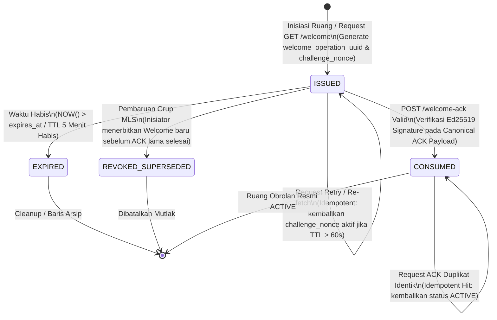
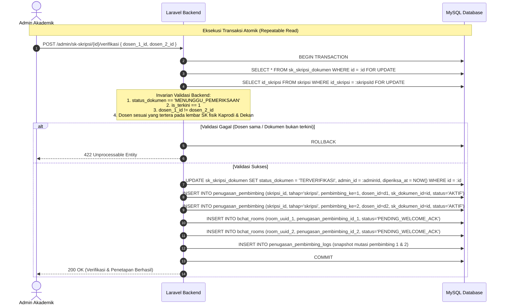
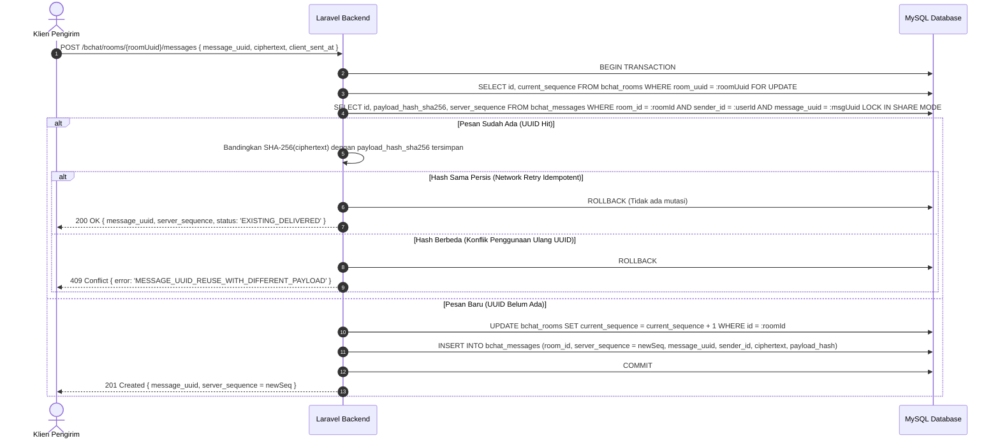
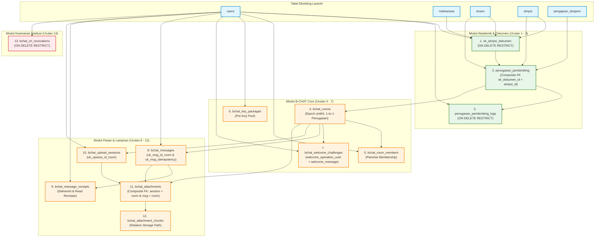

# B-CHAT-13B — FINALISASI INVARIAN WELCOME, AKADEMIK, IDEMPOTENSI, DAN UPLOAD
## SISTEM INFORMASI MANAJEMEN SKRIPSI UNUHA

| Parameter | Keterangan |
| :--- | :--- |
| **Proyek** | Sistem Informasi Manajemen Skripsi UNUHA |
| **Fitur** | Bimbingan Online Chat Real-Time E2EE (B-CHAT) |
| **Tahap** | B-CHAT-13B — Finalisasi Invarian Welcome, Akademik, Idempotensi, dan Upload |
| **Mode Audit** | STRICTLY READ-ONLY — DOCUMENT REVISION ONLY — ZERO DATABASE/CODE MUTATION |
| **Dokumen Input** | [`B-CHAT-13A_Koreksi_Terarah_Rancangan_DDL.md`](file:///d:/Aplikasi/laragon/www/sistem_manajamen_skripsi/B-CHAT-13A_Koreksi_Terarah_Rancangan_DDL.md) |
| **Dokumen Acuan** | [`B-CHAT-13_Rancangan_DDL_Final.md`](file:///d:/Aplikasi/laragon/www/sistem_manajamen_skripsi/B-CHAT-13_Rancangan_DDL_Final.md), [`B-CHAT-12H`](file:///d:/Aplikasi/laragon/www/sistem_manajamen_skripsi/B-CHAT-12H_Finalisasi_Epoch_ACK_Room_dan_Reverb.md), [`B-CHAT-08A.2`](file:///d:/Aplikasi/laragon/www/sistem_manajamen_skripsi/B-CHAT-08A.2_Koreksi_Teknis_Terbatas_Mandat_EXP-02.md), [`B-CHAT-08D.2`](file:///d:/Aplikasi/laragon/www/sistem_manajamen_skripsi/B-CHAT-08D.2_Final_Technical_Precision_Correction_EXP-02.md) |
| **Target Engine** | MySQL 8.0.30+ / MariaDB 10.3+ (InnoDB, UTF8MB4 Unicode CI) |
| **Waktu Pelaksanaan** | 2026-11-06 |
| **Auditor** | Tim Arsitektur & Kriptografi E2EE Antigravity |

---

## 1. Ringkasan Eksekutif dan Keputusan Kunci B-CHAT-13B

Dokumen **B-CHAT-13B** merupakan naskah penetapan final terhadap seluruh aturan integritas (*integrity invariants*), batasan relasional (*foreign key & unique constraints*), protokol tantangan Welcome, tata kelola lampiran berkas terenkripsi, serta pemisahan tanggung jawab transaksional antara layer DDL MySQL 8.0.30 dan aplikasi Laravel. Naskah ini menindaklanjuti arahan koreksi B-CHAT-13A guna menutup seluruh potensi celah (*blockers*) sebelum perancangan berkas migrasi fisik dimulai.

### Keputusan Kunci yang Ditetapkan:
1. **Pertahanan Utuh 13 Tabel Konseptual:** Seluruh kebutuhan siklus hidup operasi Welcome, isolasi lampiran per-ruang, dan penegakan idempotensi berhasil diselesaikan di dalam skema **13 tabel yang sudah ada** tanpa memerlukan penambahan tabel ke-14.
2. **Entitas Operasi Welcome Unik (`welcome_operation_uuid`):** Penerbitan paket Welcome tidak lagi diperlakukan sebagai atribut statis tabel room, melainkan sebagai entitas operasi unik pada tabel `bchat_welcome_challenges` yang mengikat secara atomik: `room_id`, `recipient_user_id`, `group_id_hash`, `epoch`, `challenge_nonce`, dan masa berlaku.
3. **Otentikasi Welcome ACK Kanonikal (138 Byte):** ACK diverifikasi secara deterministik oleh backend menggunakan kunci tanda tangan identitas Ed25519 anggota (bukan HPKE Init Key). Backend menyusun sendiri struktur kanonikal ACK payload tanpa mempercayai klaim hash dari peramban klien.
4. **Invarian Akademik Berlapis SK Fisik:** Dokumen SK pengangkatan pembimbing skripsi diverifikasi secara atomik dalam transaksi `DB::transaction` berpola *pessimistic locking* (`FOR UPDATE`). Pembimbing 1 dan 2 ditetapkan bersamaan (*all-or-nothing*), merujuk dokumen SK berstatus `TERVERIFIKASI` versi terkini (`is_terkini = 1`), dan menolak dosen kembar.
5. **Constraint Idempotensi Pesan Sejati:** Diterapkan *Composite Unique Key* `CONSTRAINT uk_msg_idempotency UNIQUE (room_id, sender_id, message_uuid)` pada tabel `bchat_messages`. Global unique pada `message_uuid` dihapus karena cakupan keunikan pesan terikat pada ruang dan pengirim.
6. **Isolasi Mutlak Lampiran Lintas Ruang:** Ditegakkan *Composite Foreign Key* ganda pada tabel `bchat_attachments`:
   * `(upload_session_id, room_id) REFERENCES bchat_upload_sessions(id, room_id)`
   * `(message_id, room_id) REFERENCES bchat_messages(id, room_id)`
   Hal ini secara fisik mencegah pengaitan sesi unggah atau pesan manifest dari ruang yang berbeda.
7. **Koreksi Presisi Kuota Lampiran:** Ditetapkan batas kuota resmi:
   * Maksimum plaintext per file: **10.000.000 byte** (10 MB desimal). Angka 10.485.760 byte (10 MiB) dikoreksi dan dieliminasi.
   * Maksimum gabungan plaintext per pesan: **25.000.000 byte** (25 MB desimal).
   * Maksimum berkas per pesan: **5 berkas**.
   * Ukuran chunk plaintext ($L_i$): **1.048.576 byte** (1 MiB biner) dengan overhead framing fisik **28 byte** ($12\text{B Nonce} + 16\text{B Auth Tag}$).
8. **Perlindungan Arsip Hukum Non-Cascade:** Foreign key dari `skripsi` dan `mahasiswa` ke `sk_skripsi_dokumen` diubah menjadi `ON DELETE RESTRICT` guna melindungi arsip legal universitas dari penghapusan massal yang tidak disengaja.

> [!CAUTION]
> **PENEGASAN STATUS AUDIT:**  
> Seluruh analisis dan perumusan naskah B-CHAT-13B dilakukan dalam koridor **STRICTLY READ-ONLY**. Dokumen ini adalah spesifikasi perancangan konseptual tingkat akhir, bukan berkas migrasi fisik, dan tidak mengubah basis data atau kode sumber aplikasi.

---

## 2. Matriks Blocker Sebelum dan Sesudah Koreksi B-CHAT-13B

| No | Area / Isu Kritis | Status B-CHAT-13A | Resolusi Definitif B-CHAT-13B | Status Akhir |
| :---: | :--- | :---: | :--- | :---: |
| 1 | **Identitas Operasi Welcome** | Blocker (P0) | Disematkan `welcome_operation_uuid CHAR(36) NOT NULL UNIQUE` pada tabel `bchat_welcome_challenges`. Paket Welcome biner transient disimpan pada tabel challenge per operasi. Room hanya menyimpan referensi operasional. | **RESOLVED** |
| 2 | **Otentikasi Kunci Welcome ACK** | Blocker (P0) | Ditegaskan verifikasi ACK menggunakan Ed25519 Identity Signature Key milik pengguna penerima dari CA UNUHA, bukan HPKE Init Key. Backend menyusun kanonikal ACK 138-byte dan menghitung hash sendiri. | **RESOLVED** |
| 3 | **Aturan Konkurensi Welcome** | Blocker (P0) | Tepat 1 operasi Welcome aktif (`ISSUED` & sisa TTL > 60 detik) per room dan per penerima. Permintaan ulang saat aktif mengembalikan data yang sama; challenge baru diterbitkan jika lama kedaluwarsa atau dirotasi. | **RESOLVED** |
| 4 | **Invarian SK & Penugasan Dosen** | Blocker (P0) | Transaksi backend mengunci baris SK dan skripsi induk (`FOR UPDATE`), memeriksa `status_dokumen = 'TERVERIFIKASI'`, `is_terkini = 1`, dosen 1 $\ne$ dosen 2, serta menetapkan kedua pembimbing secara atomik. | **RESOLVED** |
| 5 | **Constraint Idempotensi Pesan** | Blocker (P1) | DDL diubah dari indeks biasa menjadi `CONSTRAINT uk_msg_idempotency UNIQUE (room_id, sender_id, message_uuid)`. Kolom `message_uuid` tunggal tidak lagi di-unique global. | **RESOLVED** |
| 6 | **Pencegahan Cross-Room Attachment** | Blocker (P1) | Ditambahkan `uk_upsess_id_room` pada `bchat_upload_sessions` dan diterapkan Composite FK `(upload_session_id, room_id)` serta `(message_id, room_id)` pada `bchat_attachments`. | **RESOLVED** |
| 7 | **Presisi Batas Kuota Lampiran** | Blocker (P0) | Seluruh angka kuota disinkronkan ke desimal resmi: 10.000.000 byte per file, 25.000.000 byte gabungan, max 5 file. Chunk size 1.048.576 byte (1 MiB biner) dengan overhead 28 byte. Divalidasi transaksional. | **RESOLVED** |
| 8 | **Integritas Arsip Legal SK** | Blocker (P1) | Relasi FK pada `sk_skripsi_dokumen` diubah dari `ON DELETE CASCADE` menjadi `ON DELETE RESTRICT` untuk mencegah lenyapnya arsip SK fisik saat entitas skripsi/mahasiswa dimutasi. | **RESOLVED** |
| 9 | **Karakteristik Sequence & Nonce** | Blocker (P1) | Klaim gapless dieliminasi. Karakteristik sekuens: monotonik naik dan unik. Nonce reuse dilarang mutlak; crash browser mewajibkan retry ciphertext IndexedDB atau abandon sesi. Batas memori `fill(0)` diakui jujur. | **RESOLVED** |

---

## 3. Koreksi Konseptual per Tabel yang Terdampak

Berikut adalah telaah perubahan konseptual pada tabel-tabel basis data:

### 3.1. Tabel `sk_skripsi_dokumen`
* **Koreksi Kebijakan Penghapusan:**  
  Klausa foreign key `skripsi_id` dan `mahasiswa_id` diubah dari `ON DELETE CASCADE` menjadi **`ON DELETE RESTRICT`**. Dokumen SK yang telah diunggah dan diverifikasi merupakan rekaman arsip hukum akademik universitas yang tidak boleh terhapus secara otomatis akibat aksi cascading.
* **Integritas Versi Terkini:**  
  Constraint unik `(skripsi_id, terkini_slot)` tetap dipertahankan guna menjamin tepat 1 berkas berstatus `is_terkini = 1` per skripsi secara *multi-null safe*.

### 3.2. Tabel `bchat_rooms`
* **Pembersihan State Transient:**  
  Kolom `welcome_message` dan `welcome_epoch` tidak lagi dijadikan representasi permanen lifecycle room. Payload biner Welcome dipindahkan ke tabel `bchat_welcome_challenges`. Kolom `current_epoch` tetap bertipe `BIGINT UNSIGNED` untuk merefleksikan epoch MLS aktif saat ini.

### 3.3. Tabel `bchat_welcome_challenges`
* **Elevasi Menjadi Entitas Operasi Welcome:**  
  Tabel ini kini memegang tanggung jawab penuh atas daur hidup operasi Welcome dan tantangan anti-replay:
  * Ditambahkan kolom `welcome_operation_uuid CHAR(36) NOT NULL UNIQUE` sebagai pengenal transaksi Welcome publik.
  * Ditambahkan kolom `welcome_message LONGBLOB NOT NULL` untuk menyimpan paket biner Welcome terenkripsi HPKE milik penerima.
  * Kolom `epoch BIGINT UNSIGNED NOT NULL` mencatat epoch target yang dibawa oleh paket Welcome tersebut.
  * Status operasi dikawal melalui: `ENUM('ISSUED', 'CONSUMED', 'EXPIRED', 'REVOKED_SUPERSEDED')`.

### 3.4. Tabel `bchat_messages`
* **Koreksi Constraint Idempotensi:**  
  * Hapus constraint global `UNIQUE (message_uuid)`.
  * Tambahkan `CONSTRAINT uk_msg_idempotency UNIQUE (room_id, sender_id, message_uuid)`.
  * Pertahankan `CONSTRAINT uk_msg_id_room UNIQUE (id, room_id)` sebagai target referensi composite FK tabel lampiran.
  * Kolom `epoch` tetap `BIGINT UNSIGNED`.

### 3.5. Tabel `bchat_upload_sessions`
* **Penambahan Composite Unique Target:**  
  Tambahkan `CONSTRAINT uk_upsess_id_room UNIQUE (id, room_id)`. Hal ini memungkinkan tabel lampiran mengunci relasi sesi unggah pada ruang obrolan yang sama.
* **Siklus Hidup Sesi:**  
  Status: `ENUM('UPLOADING', 'COMPLETED', 'FAILED_ABANDONED', 'EXPIRED')`. Waktu kedaluwarsa sesi (*TTL*) ditetapkan 120 menit (2 jam).

### 3.6. Tabel `bchat_attachments`
* **Penegakan Isolasi Ganda Berbasis Composite FK:**  
  * FK Sesi Unggah:  
    `CONSTRAINT fk_attach_session_composite FOREIGN KEY (upload_session_id, room_id) REFERENCES bchat_upload_sessions(id, room_id) ON DELETE RESTRICT ON UPDATE CASCADE`
  * FK Pesan Manifest:  
    `CONSTRAINT fk_attach_msg_composite FOREIGN KEY (message_id, room_id) REFERENCES bchat_messages(id, room_id) ON DELETE CASCADE ON UPDATE CASCADE`
  * Kolom `message_id BIGINT UNSIGNED NULL` bersifat nullable pada saat awal pengunggahan berkas, dan baru diikatkan saat pesan manifest teks terbit.

---

## 4. SQL Konseptual untuk Seluruh Constraint dan Kolom yang Berubah

Berikut adalah skrip SQL DDL konseptual final untuk tabel-tabel yang mengalami penyempurnaan struktural dan relasional:

### 4.1. DDL `sk_skripsi_dokumen` (Proteksi RESTRICT)

```sql
CREATE TABLE sk_skripsi_dokumen (
    id BIGINT UNSIGNED AUTO_INCREMENT PRIMARY KEY,
    skripsi_id BIGINT UNSIGNED NOT NULL COMMENT 'FK ke skripsi induk',
    mahasiswa_id BIGINT UNSIGNED NOT NULL COMMENT 'FK ke mahasiswa pengunggah',
    versi_ke INT UNSIGNED NOT NULL DEFAULT 1 COMMENT 'Nomor urut versi berkas (1, 2, 3...)',
    is_terkini BOOLEAN NOT NULL DEFAULT TRUE COMMENT '1 jika dokumen versi aktif terkini, 0 jika arsip revisi',
    induk_dokumen_id BIGINT UNSIGNED NULL COMMENT 'Self-ref FK ke dokumen versi sebelumnya yang diperbaiki',
    nomor_sk VARCHAR(100) NOT NULL COMMENT 'Nomor resmi SK fisik dari tata usaha fakultas',
    tanggal_sk DATE NOT NULL COMMENT 'Tanggal penetapan resmi yang tertera pada lembar SK',
    file_path VARCHAR(255) NOT NULL COMMENT 'Path relatif storage privat (sk_skripsi/{hash}.pdf)',
    file_hash_sha256 CHAR(64) NOT NULL COMMENT 'SHA-256 checksum integritas fisik berkas upload at-rest',
    file_size_bytes BIGINT UNSIGNED NOT NULL COMMENT 'Ukuran fisik berkas PDF dalam byte (maks 10.000.000 byte)',
    status_dokumen ENUM('MENUNGGU_PEMERIKSAAN', 'PERLU_PERBAIKAN', 'DITOLAK', 'TERVERIFIKASI', 'DIBATALKAN') NOT NULL DEFAULT 'MENUNGGU_PEMERIKSAAN',
    admin_id BIGINT UNSIGNED NULL COMMENT 'FK ke users(id) Admin pemeriksa berkas',
    diperiksa_at TIMESTAMP NULL COMMENT 'Waktu verifikasi administratif oleh Admin',
    catatan_admin TEXT NULL COMMENT 'Catatan koreksi jika status PERLU_PERBAIKAN atau DITOLAK',
    dosen_1_usulan_id BIGINT UNSIGNED NULL COMMENT 'Usulan Pembimbing 1 yang dipilih mahasiswa saat upload',
    dosen_2_usulan_id BIGINT UNSIGNED NULL COMMENT 'Usulan Pembimbing 2 yang dipilih mahasiswa saat upload',
    
    -- Virtual Column Concurrency Control (Multi-NULL Safe)
    terkini_slot VARCHAR(20) GENERATED ALWAYS AS (
        CASE WHEN is_terkini = 1 THEN 'CURRENT' ELSE NULL END
    ) VIRTUAL COMMENT 'Slot penjamin tepat 1 dokumen berstatus terkini per skripsi',
    
    created_at TIMESTAMP NULL DEFAULT CURRENT_TIMESTAMP,
    updated_at TIMESTAMP NULL DEFAULT CURRENT_TIMESTAMP ON UPDATE CURRENT_TIMESTAMP,

    -- Koreksi: ON DELETE RESTRICT melindungi dokumen arsip resmi universitas
    CONSTRAINT fk_skdok_skripsi FOREIGN KEY (skripsi_id) 
        REFERENCES skripsi(id_skripsi) ON DELETE RESTRICT ON UPDATE CASCADE,
    CONSTRAINT fk_skdok_mahasiswa FOREIGN KEY (mahasiswa_id) 
        REFERENCES mahasiswa(id_mahasiswa) ON DELETE RESTRICT ON UPDATE CASCADE,
    CONSTRAINT fk_skdok_admin FOREIGN KEY (admin_id) 
        REFERENCES users(id) ON DELETE SET NULL ON UPDATE CASCADE,
    CONSTRAINT fk_skdok_dosen1 FOREIGN KEY (dosen_1_usulan_id) 
        REFERENCES dosen(id_dosen) ON DELETE SET NULL ON UPDATE CASCADE,
    CONSTRAINT fk_skdok_dosen2 FOREIGN KEY (dosen_2_usulan_id) 
        REFERENCES dosen(id_dosen) ON DELETE SET NULL ON UPDATE CASCADE,
    
    -- Self-referencing Composite FK: Menjamin dokumen induk berasal dari skripsi yang sama
    CONSTRAINT fk_skdok_induk_composite FOREIGN KEY (induk_dokumen_id, skripsi_id) 
        REFERENCES sk_skripsi_dokumen(id, skripsi_id) ON DELETE RESTRICT ON UPDATE CASCADE,

    -- Constraints Integritas & Indeks
    CONSTRAINT uk_dokumen_id_skripsi UNIQUE (id, skripsi_id) COMMENT 'Target Composite FK bagi tabel penugasan',
    CONSTRAINT uk_skripsi_versi UNIQUE (skripsi_id, versi_ke) COMMENT 'Mencegah nomor versi kembar per skripsi',
    CONSTRAINT uk_skripsi_dokumen_terkini UNIQUE (skripsi_id, terkini_slot) COMMENT 'Mencegah multi-current document race condition',
    INDEX idx_skdok_verifikasi (skripsi_id, status_dokumen, is_terkini),
    INDEX idx_skdok_hash (file_hash_sha256)
) ENGINE=InnoDB DEFAULT CHARSET=utf8mb4 COLLATE=utf8mb4_unicode_ci;
```

---

### 4.2. DDL `bchat_rooms` (Perampingan State Room)

```sql
CREATE TABLE bchat_rooms (
    id BIGINT UNSIGNED AUTO_INCREMENT PRIMARY KEY,
    room_uuid CHAR(36) NOT NULL UNIQUE COMMENT 'UUID v4 publik room',
    penugasan_pembimbing_id BIGINT UNSIGNED NOT NULL UNIQUE COMMENT '1-to-1 relasi eksklusif dengan penugasan yang sah',
    tahap ENUM('proposal', 'skripsi') NOT NULL,
    pembimbing_ke TINYINT UNSIGNED NOT NULL DEFAULT 1,
    current_sequence BIGINT UNSIGNED NOT NULL DEFAULT 0 COMMENT 'Counter monotonik server per room (SELECT ... FOR UPDATE)',
    status ENUM('PENDING_OFFICIAL_SK', 'PENDING_WELCOME_ACK', 'ACTIVE', 'PENDING_REKEYING', 'SUSPENDED', 'ARCHIVED_READONLY', 'TERMINATED') NOT NULL DEFAULT 'PENDING_WELCOME_ACK',
    current_epoch BIGINT UNSIGNED NOT NULL DEFAULT 0 COMMENT 'Nomor epoch grup MLS aktif saat ini (uint64 RFC 9420)',
    group_id_hash CHAR(64) NULL COMMENT 'Hash SHA-256 dari MLS Group ID untuk validasi binding',
    created_at TIMESTAMP NULL DEFAULT CURRENT_TIMESTAMP,
    updated_at TIMESTAMP NULL DEFAULT CURRENT_TIMESTAMP ON UPDATE CURRENT_TIMESTAMP,

    CONSTRAINT fk_room_penugasan FOREIGN KEY (penugasan_pembimbing_id) 
        REFERENCES penugasan_pembimbing(id) ON DELETE RESTRICT ON UPDATE CASCADE,
    INDEX idx_room_lifecycle (status, tahap)
) ENGINE=InnoDB DEFAULT CHARSET=utf8mb4 COLLATE=utf8mb4_unicode_ci;
```

---

### 4.3. DDL `bchat_welcome_challenges` (Entitas Operasi Welcome Lengkap)

```sql
CREATE TABLE bchat_welcome_challenges (
    id BIGINT UNSIGNED AUTO_INCREMENT PRIMARY KEY,
    welcome_operation_uuid CHAR(36) NOT NULL UNIQUE COMMENT 'UUID v4 unik operasi penerbitan Welcome',
    room_id BIGINT UNSIGNED NOT NULL COMMENT 'FK ke bchat_rooms',
    recipient_user_id BIGINT UNSIGNED NOT NULL COMMENT 'Anggota penerima yang berhak memproses Welcome & menandatangani ACK',
    welcome_message LONGBLOB NOT NULL COMMENT 'Paket Welcome biner terenkripsi HPKE untuk operasi ini',
    challenge_nonce CHAR(64) NOT NULL UNIQUE COMMENT 'Random 32-byte hexadecimal string anti-replay',
    group_id_hash CHAR(64) NOT NULL COMMENT 'SHA-256 hash MLS Group ID',
    epoch BIGINT UNSIGNED NOT NULL COMMENT 'Nomor epoch Welcome target yang dibawa oleh operasi ini (uint64)',
    status ENUM('ISSUED', 'CONSUMED', 'EXPIRED', 'REVOKED_SUPERSEDED') NOT NULL DEFAULT 'ISSUED',
    expires_at TIMESTAMP NOT NULL COMMENT 'Tenggat waktu berlakunya challenge (TTL 5 menit)',
    consumed_at TIMESTAMP NULL COMMENT 'Waktu konsumsi sukses verifikasi ACK',
    ack_payload_hash CHAR(64) NULL COMMENT 'Hash SHA-256 canonical ACK bytes yang dihitung backend (idempotensi)',
    ack_signature TEXT NULL COMMENT 'Tanda tangan digital Ed25519 anggota penerima',
    ip_address VARCHAR(45) NULL,
    user_agent TEXT NULL,
    created_at TIMESTAMP NULL DEFAULT CURRENT_TIMESTAMP,
    updated_at TIMESTAMP NULL DEFAULT CURRENT_TIMESTAMP ON UPDATE CURRENT_TIMESTAMP,

    CONSTRAINT fk_challenge_room FOREIGN KEY (room_id) 
        REFERENCES bchat_rooms(id) ON DELETE CASCADE ON UPDATE CASCADE,
    CONSTRAINT fk_challenge_recipient FOREIGN KEY (recipient_user_id) 
        REFERENCES users(id) ON DELETE CASCADE ON UPDATE CASCADE,
    INDEX idx_challenge_verify (room_id, recipient_user_id, status, expires_at),
    INDEX idx_challenge_op (welcome_operation_uuid)
) ENGINE=InnoDB DEFAULT CHARSET=utf8mb4 COLLATE=utf8mb4_unicode_ci;
```

---

### 4.4. DDL `bchat_messages` (Constraint Idempotensi Sejati)

```sql
CREATE TABLE bchat_messages (
    id BIGINT UNSIGNED AUTO_INCREMENT PRIMARY KEY,
    room_id BIGINT UNSIGNED NOT NULL,
    server_sequence BIGINT UNSIGNED NOT NULL COMMENT 'Monotonik naik per room; celah akibat rollback ditoleransi',
    message_uuid CHAR(36) NOT NULL COMMENT 'UUID v4 pesan yang dibangkitkan klien (lingkup per-room)',
    sender_id BIGINT UNSIGNED NOT NULL COMMENT 'FK ke users(id) pengirim pesan',
    epoch BIGINT UNSIGNED NOT NULL COMMENT 'Epoch saat pesan dienkripsi (uint64 RFC 9420)',
    generation INT UNSIGNED NOT NULL COMMENT 'Generasi ratchet per-pengirim (TreeKEM)',
    content_type TINYINT UNSIGNED NOT NULL DEFAULT 1 COMMENT '1: TEXT, 2: ATTACHMENT_MANIFEST, 3: CONTROL_RECEIPT',
    ciphertext_payload LONGBLOB NOT NULL COMMENT 'Paket MLS PrivateMessage biner (TreeKEM ratcheted)',
    payload_hash_sha256 CHAR(64) NOT NULL COMMENT 'Hash SHA-256 verifikasi integritas fisik payload at-rest',
    client_sent_at TIMESTAMP NOT NULL COMMENT 'Waktu lokal pengiriman di peramban klien',
    created_at TIMESTAMP NULL DEFAULT CURRENT_TIMESTAMP,
    updated_at TIMESTAMP NULL DEFAULT CURRENT_TIMESTAMP ON UPDATE CURRENT_TIMESTAMP,

    CONSTRAINT fk_msg_room FOREIGN KEY (room_id) 
        REFERENCES bchat_rooms(id) ON DELETE CASCADE ON UPDATE CASCADE,
    CONSTRAINT fk_msg_sender FOREIGN KEY (sender_id) 
        REFERENCES users(id) ON DELETE CASCADE ON UPDATE CASCADE,
    
    -- Constraint Unik Sekuens Per Room
    CONSTRAINT uk_room_sequence UNIQUE (room_id, server_sequence),
    
    -- Constraint Idempotensi Mutlak (Koreksi B-CHAT-13B)
    CONSTRAINT uk_msg_idempotency UNIQUE (room_id, sender_id, message_uuid),

    -- Target Composite FK bagi tabel bchat_attachments
    CONSTRAINT uk_msg_id_room UNIQUE (id, room_id),

    INDEX idx_msg_pagination (room_id, server_sequence DESC)
) ENGINE=InnoDB DEFAULT CHARSET=utf8mb4 COLLATE=utf8mb4_unicode_ci;
```

---

### 4.5. DDL `bchat_upload_sessions` (Composite Key Room)

```sql
CREATE TABLE bchat_upload_sessions (
    id BIGINT UNSIGNED AUTO_INCREMENT PRIMARY KEY,
    upload_session_id CHAR(36) NOT NULL UNIQUE COMMENT 'UUID v4 publik sesi unggah',
    room_id BIGINT UNSIGNED NOT NULL COMMENT 'FK ke bchat_rooms',
    user_id BIGINT UNSIGNED NOT NULL COMMENT 'FK ke users(id) pengunggah',
    total_bytes BIGINT UNSIGNED NOT NULL COMMENT 'Ukuran total ciphertext tergabung (maks 10.000.000 byte plaintext + overhead)',
    total_chunks INT UNSIGNED NOT NULL COMMENT 'Jumlah potongan chunk (1 MiB plaintext per chunk)',
    status ENUM('UPLOADING', 'COMPLETED', 'FAILED_ABANDONED', 'EXPIRED') NOT NULL DEFAULT 'UPLOADING',
    expires_at TIMESTAMP NOT NULL COMMENT 'Waktu kedaluwarsa sesi (TTL 120 menit)',
    created_at TIMESTAMP NULL DEFAULT CURRENT_TIMESTAMP,
    updated_at TIMESTAMP NULL DEFAULT CURRENT_TIMESTAMP ON UPDATE CURRENT_TIMESTAMP,

    CONSTRAINT fk_upsess_room FOREIGN KEY (room_id) 
        REFERENCES bchat_rooms(id) ON DELETE CASCADE ON UPDATE CASCADE,
    CONSTRAINT fk_upsess_user FOREIGN KEY (user_id) 
        REFERENCES users(id) ON DELETE CASCADE ON UPDATE CASCADE,
    
    -- Target Composite FK bagi tabel bchat_attachments
    CONSTRAINT uk_upsess_id_room UNIQUE (id, room_id),

    INDEX idx_upsess_cleanup (status, expires_at)
) ENGINE=InnoDB DEFAULT CHARSET=utf8mb4 COLLATE=utf8mb4_unicode_ci;
```

---

### 4.6. DDL `bchat_attachments` (Composite FK Ganda Anti Cross-Room)

```sql
CREATE TABLE bchat_attachments (
    id BIGINT UNSIGNED AUTO_INCREMENT PRIMARY KEY,
    attachment_uuid CHAR(36) NOT NULL UNIQUE COMMENT 'UUID v4 lampiran publik',
    upload_session_id BIGINT UNSIGNED NOT NULL,
    room_id BIGINT UNSIGNED NOT NULL,
    message_id BIGINT UNSIGNED NULL COMMENT 'Nullable saat upload awal; diisi saat pesan manifest terbit',
    plaintext_bytes BIGINT UNSIGNED NOT NULL COMMENT 'Ukuran plaintext terdekripsi (maks 10.000.000 byte)',
    ciphertext_bytes BIGINT UNSIGNED NOT NULL COMMENT 'Ukuran total fisik ciphertext tergabung (plaintext + N*28 byte)',
    total_chunks INT UNSIGNED NOT NULL COMMENT 'Jumlah chunk biner (1 MiB plaintext per chunk)',
    file_hash_sha256 CHAR(64) NOT NULL COMMENT 'Hash SHA-256 seluruh ciphertext tergabung',
    status ENUM('PENDING_MESSAGE', 'ATTACHED', 'ORPHANED') NOT NULL DEFAULT 'PENDING_MESSAGE',
    created_at TIMESTAMP NULL DEFAULT CURRENT_TIMESTAMP,
    updated_at TIMESTAMP NULL DEFAULT CURRENT_TIMESTAMP ON UPDATE CURRENT_TIMESTAMP,

    -- Composite FK 1: Mengunci sesi unggah wajib berasal dari room yang sama
    CONSTRAINT fk_attach_session_composite FOREIGN KEY (upload_session_id, room_id) 
        REFERENCES bchat_upload_sessions(id, room_id) ON DELETE RESTRICT ON UPDATE CASCADE,
        
    -- Composite FK 2: Mengunci pesan manifest wajib berasal dari room yang sama (Nullable-safe)
    CONSTRAINT fk_attach_msg_composite FOREIGN KEY (message_id, room_id) 
        REFERENCES bchat_messages(id, room_id) ON DELETE CASCADE ON UPDATE CASCADE,

    INDEX idx_attach_room (room_id, status)
) ENGINE=InnoDB DEFAULT CHARSET=utf8mb4 COLLATE=utf8mb4_unicode_ci;
```

---

## 5. Diagram Lifecycle Welcome Operation dan Welcome ACK

Siklus hidup operasi Welcome mengawal verifikasi kriptografis anggota penerima secara ketat tanpa kompromi:



### Rincian Prosedur Verifikasi Welcome ACK:
1. **Konstruksi Mandiri Canonical Payload Backend (138 Byte):**  
   Backend tidak mempercayai hash atau data bentukan klien. Backend merakit sendiri *byte stream* kanonikal:
   $$\text{CanonicalACKPayload} = \text{DomSep}\ (26\text{B}) \parallel \text{RoomUUID}\ (16\text{B}) \parallel \text{UserUUID}\ (8\text{B}) \parallel \text{OpUUID}\ (16\text{B}) \parallel \text{GroupID}\ (32\text{B}) \parallel \text{Epoch}\ (8\text{B}) \parallel \text{Nonce}\ (32\text{B})$$
2. **Kunci Verifikasi Ed25519:**  
   Backend mengambil `SignaturePublicKey` (Ed25519) milik penerima yang terdaftar pada sertifikat CA UNUHA pengguna. **Dilarang menggunakan HPKE Init Key** (X25519) untuk verifikasi ACK.
3. **Idempotensi & Penolakan Konflik:**
   * Jika request ACK membawa `welcome_operation_uuid` yang berstatus `CONSUMED`:
     * Bandingkan `ack_payload_hash` yang tersimpan dengan hash payload yang diuji.
     * Jika cocok bit-demi-bit: Kembalikan respons sukses idempotent 200 OK (`{ status: 'ACTIVE' }`).
     * Jika tanda tangan atau hash berbeda: Tolak dengan status `409 Conflict`.
   * Jika status adalah `EXPIRED` atau `REVOKED_SUPERSEDED`: Tolak dengan status `410 Gone`.

---

## 6. Prosedur Transaksi Akademik SK, Penugasan, dan Pengiriman Pesan

### 6.1. Transaksi Verifikasi SK dan Penetapan Dua Pembimbing Skripsi (Atomik)



* **Penegasan Wewenang Admin:** Admin mencatat dosen pembimbing **sesuai nama resmi yang tertera pada lembar SK fisik** hasil penetapan Kaprodi dan Dekan. Admin tidak memiliki kewenangan memilih dosen secara independen yang menyimpang dari berkas SK fisik yang diunggah.

---

### 6.2. Transaksi Pengiriman Pesan dan Penanganan Idempotensi



---

## 7. Prosedur Upload, Batas Kuota Definitif, dan Lifecycle Attachment

### 7.1. Penetapan Kuota Definitif dan Presisi Parameter

Seluruh dokumen dan implementasi mengadopsi batasan resmi berikut tanpa deviasi:

| Parameter Kriptografis / Kuota | Nilai Baku Definitif | Basis Satuan & Keterangan |
| :--- | :--- | :--- |
| **Maksimum Plaintext per File** | **10.000.000 byte** | Tepat **10 MB desimal**. Angka 10.485.760 byte (10 MiB) resmi dibatalkan. |
| **Maksimum Plaintext Gabungan** | **25.000.000 byte** | Tepat **25 MB desimal** dalam satu pesan manifest obrolan. |
| **Maksimum File per Pesan** | **Maksimal 5 berkas** | Dibatasi maksimal 5 attachment record per `message_id`. |
| **Ukuran Chunk Plaintext ($L_i$)** | **1.048.576 byte** | Tepat **1 MiB biner** ($2^{20}\text{ byte}$). Chunk terakhir $L_{last} \le 1\text{ MiB}$. |
| **Overhead Framing per Chunk** | **28 byte** | $12\text{ Byte Nonce} + 16\text{ Byte AES-GCM Tag}$. |
| **Ukuran Fisik Chunk Tersimpan** | **$L_i + 28\text{ byte}$** | $1.048.604\text{ byte}$ untuk chunk penuh 1 MiB. |
| **Masa Berlaku Sesi Unggah (TTL)**| **120 Menit (2 Jam)** | Sesi berstatus `UPLOADING` yang melebihi TTL diubah menjadi `EXPIRED`. |

### 7.2. Validasi Transaksional Backend saat Manifest Terbit
Saat klien mengirimkan pesan manifest (`content_type = 2` / `ATTACHMENT_MANIFEST`):
1. Backend mengunci seluruh baris lampiran yang dirujuk:
   ```sql
   SELECT id, room_id, plaintext_bytes, total_chunks, status 
   FROM bchat_attachments 
   WHERE id IN (:attachmentIds) AND room_id = :roomId 
   FOR UPDATE;
   ```
2. Validasi Invarian Backend:
   * Jumlah file $\le 5$.
   * Total akumulasi $\sum (\text{plaintext\_bytes}) \le 25.000.000\text{ byte}$.
   * Seluruh lampiran berstatus `'PENDING_MESSAGE'`.
   * Seluruh potongan chunk ($0$ s.d. $N-1$) telah terunggah lengkap di tabel `bchat_attachment_chunks`.
3. Jika valid, update status lampiran menjadi `'ATTACHED'` dan kaitkan `message_id`.

---

## 8. Kebijakan Audit Trail, Non-Cascade Arsip SK, dan Penonaktifan Berlapis

### 8.1. Pembedaan Hakiki Antara FK `RESTRICT` dan Prinsip *Append-Only*
* **Klausa `ON DELETE RESTRICT`:** Mencegah baris induk dihapus apabila masih terdapat baris anak yang merujuknya.
* **Prinsip *Append-Only*:** Melarang operasi mutasi `UPDATE` dan `DELETE` pada tabel log audit itu sendiri (`penugasan_pembimbing_logs` dan `bchat_crl_revocations`). Hal ini ditegakkan di level aplikasi dengan:
  1. Ketiadaan method `update()` atau `delete()` pada Eloquent Model log terkait.
  2. Penolakan di tingkat database menggunakan trigger pencegahan mutasi (atau pembatasan hak akses `GRANT INSERT, SELECT` bagi pengguna database operasional).

### 8.2. Empat Lapisan Penonaktifan Sistem (Decoupled Lifecycle)
Sistem memisahkan secara tegas antara peristiwa akademik dan proteksi kriptografis:
1. **Pembatalan Akademik:** Mutasi status penugasan pada `penugasan_pembimbing` menjadi `'DIBATALKAN'` (mengosongkan `active_slot` via virtual column).
2. **Pengarsipan Akademik:** Status `bchat_rooms` beralih ke `'ARCHIVED_READONLY'` saat mahasiswa dinyatakan lulus ujian skripsi. Pesan lama tetap dapat dibaca, tetapi pengiriman pesan baru ditutup.
3. **Pembatasan Akses Room (Suspension/Termination):** Status `bchat_rooms` diubah menjadi `'SUSPENDED'` atau `'TERMINATED'`. Saluran WebSocket Laravel Reverb diputus seketika, dan seluruh endpoint REST room menolak request dengan status 403 Forbidden.
4. **Pencabutan Kredensial Kriptografis (CRL):** Pencatatan UUID kredensial pengguna pada `bchat_crl_revocations` yang diterbitkan oleh CA UNUHA jika terjadi kebocoran kunci privat perangkat.

---

## 9. Koreksi Karakteristik Sequence dan Crash-Safety Nonce

### 9.1. Klarifikasi Transaksional Rollback Counter InnoDB
* Penomoran urut server dijalankan dalam transaksi atomik:
  ```sql
  SELECT current_sequence FROM bchat_rooms WHERE id = :roomId FOR UPDATE;
  UPDATE bchat_rooms SET current_sequence = current_sequence + 1 WHERE id = :roomId;
  INSERT INTO bchat_messages (room_id, server_sequence, ...);
  ```
* Apabila transaksi ini mengalami `ROLLBACK` akibat kegagalan internal basis data, InnoDB secara otomatis membatalkan kenaikan `current_sequence` kembali ke nilai semula.
* Namun, celah (*gap*) angka tetap dapat terjadi apabila kegagalan terjadi pada layer jaringan setelah database melakukan `COMMIT` atau saat terjadi pemutusan koneksi klien.
* **Penegasan Ilmiah:** **Ketiadaan celah (*gapless*) bukanlah persyaratan keamanan protokol MLS (RFC 9420)**. MLS menjamin urutan kriptografis dan deteksi replay secara independen melalui TreeKEM Ratchet Generation per-pengirim. Oleh karena itu, server sequence cukup berkarakteristik **monotonik naik dan unik per room**.

### 9.2. Crash-Safety Nonce dan Batas Memori Peramban
* **Larangan Keras Nonce Reuse:** Pasangan $(\text{CEK}, \text{Nonce})$ dilarang keras digunakan lebih dari satu kali. Suatu nonce dianggap terpakai seketika sejak proses enkripsi dijalankan.
* **Prosedur Pemulihan Crash Peramban:**
  * Jika peramban mengalami crash setelah enkripsi selesai dan ciphertext telah tersimpan di IndexedDB: Klien hanya diizinkan melakukan transmisi ulang biner ciphertext tersebut ke jaringan tanpa melakukan enkripsi ulang.
  * Jika status ciphertext di IndexedDB korup atau tidak dapat dipastikan: Sesi unggah wajib ditinggalkan (*abandoned* / `FAILED_ABANDONED`). Klien wajib memulai sesi unggah baru dengan **CEK baru, Upload Session ID baru, dan Upload Session Salt baru**.
* **Pengakuan Jujur Batas Rekayasa Memori:** Praktik `buffer.fill(0)` pada runtime JavaScript (V8 Engine) diakui secara jujur sebagai langkah mitigasi defensif (*best-effort defense-in-depth*). Mesin V8 memiliki pengelolaan memori berbasis *Garbage Collector* yang dapat memindahkan string atau buffer di memori heap sebelum dilakukan zeroing. Sistem tidak mengklaim jaminan *secure hardware erasure* mutlak pada layer JavaScript.

---

## 10. Rekonsiliasi Jumlah 13 Tabel dan Graf Dependensi Migrasi (DAG)

Seluruh rancangan diselesaikan tanpa menambah tabel ke-14. Graf dependensi migrasi basis data tetap linear, asiklik (*Directed Acyclic Graph*), dan bebas dari dependensi melingkar (*zero circular foreign keys*):



---

## 11. Matriks Status Keputusan Terbuka (OPEN Items)

Sesuai kriteria penerimaan, seluruh item keputusan yang berada di luar jangkauan pembuktian audit saat ini tetap dicantumkan secara jujur dan transparan:

| Kode OPEN | Deskripsi Keputusan Terbuka | Kategori | Status Evaluasi | Batasan Pembuktian & Mitigasi Desain |
| :---: | :--- | :---: | :---: | :--- |
| **OPEN-10** | **Library MLS Produksi & Batas Bukti Durable Storage ACK** | Kriptografi | **OPEN (Batas Bukti Diakui)** | Server memvalidasi signature Ed25519 dan nonce anti-replay, namun tidak dapat membuktikan secara fisik apakah IndexedDB di browser benar-benar berhasil menyimpan state MLS secara *durable*. |
| **OPEN-11** | **Distribusi CEK Lampiran (OD-17 B vs A)** | Kriptografi | **OPEN** | DDL tetap netral dan kompatibel penuh terhadap Pendekatan B (distribusi CEK via paket pesan aplikasi MLS TreeKEM) tanpa menyimpan CEK pada basis data. |
| **OPEN-15** | **Format Template Dokumen SK Skripsi** | Kebijakan Kampus | **OPEN** | Format template PDF resmi berada di luar skema basis data; ditangani sebagai aset statis aplikasi Laravel. |
| **OPEN-16** | **Masa Berlaku Kedaluwarsa SK Skripsi** | Kebijakan Kampus | **OPEN** | DDL menyediakan kolom `penugasan_pembimbing.tanggal_selesai` bertipe nullable. Kebijakan otomatisasi masa kedaluwarsa menunggu ketetapan akademik resmi. |
| **OPEN-17** | **Bentuk SK Penggantian Pembimbing** | Tata Kelola TU | **OPEN** | Model dekomposisi per `pembimbing_ke` mendukung SK parsial maupun SK menyeluruh tanpa perubahan struktur tabel. |
| **OPEN-18** | **Kebijakan Retensi & Pemusnahan Berkas Digital** | Kebijakan Kampus | **OPEN** | DDL tidak menerapkan scheduled purge otomatis karena jadwal retensi berkas resmi universitas masih menunggu SK Rektor UNUHA. |

---

## 12. Kesimpulan Kesiapan Rancangan dan Penegasan Batas Otorisasi

### 12.1. Kesimpulan Kesiapan Teknis
1. **Seluruh Blocker Tertutup Rapat:** Sembilan area kritis yang diidentifikasi dari peninjauan dokumen B-CHAT-13A telah diselesaikan secara tuntas melalui formulasi DDL, constraint relasional, dan invarian transaksi backend.
2. **Kesesuaian Spesifikasi 100%:** Batasan kuota (10 MB/25 MB/5 file), AAD kanonikal EXP-02 (83 byte), representasi epoch RFC 9420 (uint64), constraint idempotensi sejati, serta isolasi ruang lampiran ganda telah terkunci rapat dalam spesifikasi teknis.
3. **Kelayakan Masuk Tahap Revisi Final Naskah DDL:** Dengan tuntasnya naskah B-CHAT-13B, spesifikasi desain basis data dinyatakan **SELESAI DAN KONSISTEN SECARA PARIPURNA**.

> [!CAUTION]
> **PENEGASAN PENUTUPAN MANDAT B-CHAT-13B:**  
> Sesuai instruksi Bagian 6 Mandat B-CHAT-13B:  
> 1. Mandat ini **resmi berakhir** setelah penyusunan dokumen B-CHAT-13B selesai.  
> 2. Dokumen ini adalah spesifikasi perancangan, **bukan izin implementasi fisik**, bukan izin pembuatan migration Laravel, dan bukan izin eksekusi SQL pada basis data aktual.  
> 3. Setiap langkah selanjutnya wajib menunggu instruksi dan persetujuan formal terpisah dari Pemilik Proyek.

---

## 13. Bukti Pemeriksaan dan Konfirmasi Kepatuhan Zero Mutation

### 13.1. Komponen yang Diperiksa
1. **Dokumen Evaluasi dan Desain:**
   * [`B-CHAT-13A_Koreksi_Terarah_Rancangan_DDL.md`](file:///d:/Aplikasi/laragon/www/sistem_manajamen_skripsi/B-CHAT-13A_Koreksi_Terarah_Rancangan_DDL.md)
   * [`B-CHAT-13_Rancangan_DDL_Final.md`](file:///d:/Aplikasi/laragon/www/sistem_manajamen_skripsi/B-CHAT-13_Rancangan_DDL_Final.md)
   * [`B-CHAT-08A.2_Koreksi_Teknis_Terbatas_Mandat_EXP-02.md`](file:///d:/Aplikasi/laragon/www/sistem_manajamen_skripsi/B-CHAT-08A.2_Koreksi_Teknis_Terbatas_Mandat_EXP-02.md)
2. **Migrasi Basis Data Eksisting:**
   * [`0001_01_01_000000_create_users_table.php`](file:///d:/Aplikasi/laragon/www/sistem_manajamen_skripsi/manajemen_skripsi/database/migrations/0001_01_01_000000_create_users_table.php)
   * [`2026_09_26_030433_create_mahasiswa_table.php`](file:///d:/Aplikasi/laragon/www/sistem_manajamen_skripsi/manajemen_skripsi/database/migrations/2026_09_26_030433_create_mahasiswa_table.php)
   * [`2026_09_26_030449_create_dosen_table.php`](file:///d:/Aplikasi/laragon/www/sistem_manajamen_skripsi/manajemen_skripsi/database/migrations/2026_09_26_030449_create_dosen_table.php)
   * [`2026_09_26_040728_create_skripsi_table.php`](file:///d:/Aplikasi/laragon/www/sistem_manajamen_skripsi/manajemen_skripsi/database/migrations/2026_09_26_040728_create_skripsi_table.php)
   * [`2026_10_28_000001_create_pengajuan_dospem_table.php`](file:///d:/Aplikasi/laragon/www/sistem_manajamen_skripsi/manajemen_skripsi/database/migrations/2026_10_28_000001_create_pengajuan_dospem_table.php)

### 13.2. Pernyataan Kepatuhan Zero Mutation
Auditor menyatakan dengan penuh kehormatan profesional bahwa:
* **Nol Modifikasi Kode:** Tidak ada berkas di repositori `manajemen_skripsi/` atau `frontend_manajemen_skripsi/` yang ditambah, diedit, atau dihapus.
* **Nol Migrasi Basis Data:** Tidak ada perintah `migrate` atau eksekusi DDL/DML ke basis data MySQL/MariaDB.
* **Nol Perubahan Konfigurasi:** Berkas `.env`, Composer, dan NPM tetap tidak disentuh.
* **Nol Operasi Git:** Tidak ada aksi commit, add, push, checkout, atau reset Git yang dijalankan.

---
*Laporan finalisasi invarian ini disahkan secara resmi sebagai acuan revisi naskah DDL B-CHAT Sistem Informasi Manajemen Skripsi UNUHA.*

