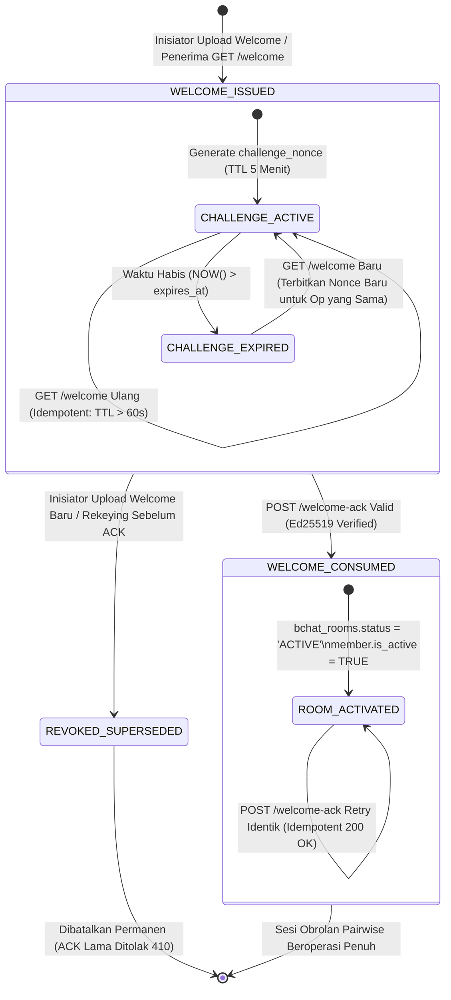

# B-CHAT-13C — AUDIT KONSISTENSI FINAL DDL DAN KONTRAK WELCOME ACK
## SISTEM INFORMASI MANAJEMEN SKRIPSI UNUHA

| Parameter | Keterangan |
| :--- | :--- |
| **Proyek** | Sistem Informasi Manajemen Skripsi UNUHA |
| **Fitur** | Bimbingan Online Chat Real-Time E2EE (B-CHAT) |
| **Tahap** | B-CHAT-13C — Audit Konsistensi Final DDL dan Kontrak Welcome ACK |
| **Mode Audit** | STRICTLY READ-ONLY — DOCUMENT AUDIT ONLY — ZERO IMPLEMENTATION |
| **Dokumen Input** | [`B-CHAT-13_Rancangan_DDL_Final.md`](file:///d:/Aplikasi/laragon/www/sistem_manajamen_skripsi/B-CHAT-13_Rancangan_DDL_Final.md), [`B-CHAT-13A_Koreksi_Terarah_Rancangan_DDL.md`](file:///d:/Aplikasi/laragon/www/sistem_manajamen_skripsi/B-CHAT-13A_Koreksi_Terarah_Rancangan_DDL.md), [`B-CHAT-13B_Finalisasi_Invarian_DDL.md`](file:///d:/Aplikasi/laragon/www/sistem_manajamen_skripsi/B-CHAT-13B_Finalisasi_Invarian_DDL.md) |
| **Dokumen Acuan Historis** | [`B-CHAT-12F`](file:///d:/Aplikasi/laragon/www/sistem_manajamen_skripsi/B-CHAT-12F_Koreksi_Final_Integritas_dan_ACK.md), [`B-CHAT-12G`](file:///d:/Aplikasi/laragon/www/sistem_manajamen_skripsi/B-CHAT-12G_Finalisasi_Universal_Welcome_ACK_dan_Membership.md), [`B-CHAT-12H`](file:///d:/Aplikasi/laragon/www/sistem_manajamen_skripsi/B-CHAT-12H_Finalisasi_Epoch_ACK_Room_dan_Reverb.md), [`B-CHAT-08A.2`](file:///d:/Aplikasi/laragon/www/sistem_manajamen_skripsi/B-CHAT-08A.2_Koreksi_Teknis_Terbatas_Mandat_EXP-02.md), [`B-CHAT-08D.2`](file:///d:/Aplikasi/laragon/www/sistem_manajamen_skripsi/B-CHAT-08D.2_Final_Technical_Precision_Correction_EXP-02.md) |
| **Target Engine** | MySQL 8.0.30+ / MariaDB 10.3+ (InnoDB, UTF8MB4 Unicode CI) |
| **Waktu Pelaksanaan** | 2026-11-06 |
| **Auditor** | Tim Arsitektur & Kriptografi E2EE Antigravity |

---

## 1. Ringkasan Eksekutif dan Hasil Audit

Audit **B-CHAT-13C** dilaksanakan sebagai evaluasi konsistensi teknis tingkat akhir (*cross-document consistency audit*) terhadap tiga dokumen perancangan basis data: dokumen induk [`B-CHAT-13`](file:///d:/Aplikasi/laragon/www/sistem_manajamen_skripsi/B-CHAT-13_Rancangan_DDL_Final.md), dokumen koreksi [`B-CHAT-13A`](file:///d:/Aplikasi/laragon/www/sistem_manajamen_skripsi/B-CHAT-13A_Koreksi_Terarah_Rancangan_DDL.md), dan dokumen finalisasi invarian [`B-CHAT-13B`](file:///d:/Aplikasi/laragon/www/sistem_manajamen_skripsi/B-CHAT-13B_Finalisasi_Invarian_DDL.md).

Tujuan utama audit adalah memastikan ketiadaan ambiguitas pada kontrak payload kriptografi Welcome ACK, menghilangkan kerancuan representasi Group ID, mengunci tata kelola siklus hidup operasi Welcome dan Challenge, serta memvalidasi keselarasan skema 13 tabel konseptual terhadap seluruh aturan integritas akademik dan kuota EXP-02.

### Temuan Utama Audit:
1. **Resolusi Diskrepansi Domain Separator ACK:**  
   Ditemukan perbedaan antara literal pada B-CHAT-12F/G (`"UNUHA-BCHAT-ACK-V1"`, 18 byte ASCII) dengan klaim panjang 26 byte pada B-CHAT-13B. Hasil audit menetapkan bahwa panjang 26 byte berasal dari literal spesifik **`"UNUHA-BCHAT-WELCOME-ACK-V1"`** ($5+1+5+1+7+1+3+1+2 = 26\text{ byte}$). Seluruh komponen Canonical ACK Payload dihitung ulang secara deterministik menghasilkan total tepat **138 byte**.
2. **Klarifikasi Definisi Group ID:**  
   Komponen `GroupID (32B)` pada ACK ditetapkan secara eksplisit sebagai **32 byte biner mentah hasil hash SHA-256 dari MLS GroupContext Group ID** (`group_id_hash_bin = hex2bin(group_id_hash)`), bukan nilai Group ID asli yang panjangnya dinamis pada RFC 9420.
3. **Pemisahan Daur Hidup Welcome Operation dan Challenge Nonce:**  
   Paket biner Welcome HPKE terbukti tidak kedaluwarsa dalam 5 menit. Jika challenge nonce kedaluwarsa (`EXPIRED`), backend diizinkan menerbitkan challenge nonce baru untuk `welcome_operation_uuid` yang sama tanpa memaksa inisiator melakukan re-commit. Namun jika grup MLS diperbarui/dirotasi, operasi Welcome lama dinonaktifkan permanen sebagai `REVOKED_SUPERSEDED`.
4. **Resolusi Ambiguitas Penamaan ID vs UUID Sesi Unggah:**  
   Ditemukan potensi kerancuan penamaan antara `bchat_upload_sessions.upload_session_id` (UUID string `CHAR(36)`) dengan foreign key `bchat_attachments.upload_session_id` (surrogate ID `BIGINT UNSIGNED`). Direkomendasikan pembedaan penamaan yang tegas agar tidak tertukar dengan raw binary UUID pada AAD EXP-02.
5. **Status Kesiapan:**  
   Rancangan dinyatakan **`PASS WITH OPEN ITEMS — READY FOR MASTER DDL REVISION WITH EXPLICIT CAVEATS`**. Tidak ditemukan *blocker* arsitektur yang menghalangi revisi naskah induk B-CHAT-13.

> [!CAUTION]
> **BATASAN OTORISASI:**  
> Audit B-CHAT-13C dilaksanakan secara **STRICTLY READ-ONLY**. Dokumen ini tidak mengubah basis data, tidak membuat berkas migrasi Laravel, dan tidak memodifikasi kode sumber maupun konfigurasi sistem.

---

## 2. Hasil Pemeriksaan Domain Separator dan Perhitungan Byte ACK

### 2.1. Investigasi Diskrepansi Literal Domain Separator
Audit membandingkan dua dokumen terdahulu yang mendefinisikan string pemisah domain untuk penandatanganan Welcome ACK:
* Pada [`B-CHAT-12F`](file:///d:/Aplikasi/laragon/www/sistem_manajamen_skripsi/B-CHAT-12F_Koreksi_Final_Integritas_dan_ACK.md) (Subbab 3.2) dan [`B-CHAT-12G`](file:///d:/Aplikasi/laragon/www/sistem_manajamen_skripsi/B-CHAT-12G_Finalisasi_Universal_Welcome_ACK_dan_Membership.md) (Subbab 4.2) tercantum:
  $$\text{Literal} = \text{"UNUHA-BCHAT-ACK-V1"}$$
  Perhitungan panjang biner ASCII/UTF-8:
  $$\text{"UNUHA"} (5) + \text{"-"} (1) + \text{"BCHAT"} (5) + \text{"-"} (1) + \text{"ACK"} (3) + \text{"-"} (1) + \text{"V1"} (2) = \mathbf{18\text{ byte}}.$$
* Pada [`B-CHAT-13B`](file:///d:/Aplikasi/laragon/www/sistem_manajamen_skripsi/B-CHAT-13B_Finalisasi_Invarian_DDL.md) (Subbab 5.1) tercantum formula:
  $$\text{DomSep}\ (26\text{B})$$
  Literal yang menghasilkan tepat 26 byte ASCII adalah:
  $$\text{Literal} = \text{"UNUHA-BCHAT-WELCOME-ACK-V1"}$$
  Perhitungan panjang biner ASCII/UTF-8:
  $$\text{"UNUHA"} (5) + \text{"-"} (1) + \text{"BCHAT"} (5) + \text{"-"} (1) + \text{"WELCOME"} (7) + \text{"-"} (1) + \text{"ACK"} (3) + \text{"-"} (1) + \text{"V1"} (2) = \mathbf{26\text{ byte}}.$$

### 2.2. Keputusan Penetapan Literal Final
Audit menetapkan bahwa **tidak ada *padding*, *prefix*, maupun *suffix* tambahan**. Panjang 26 byte berasal dari perluasan semantik nama domain protokol menjadi `"UNUHA-BCHAT-WELCOME-ACK-V1"`.

**Rekomendasi Definisi Kanonikal Baku:**
* **Literal Resmi:** `UNUHA-BCHAT-WELCOME-ACK-V1`
* **Encoding:** ASCII / Raw UTF-8 bytes (tanpa null terminator `\0`)
* **Panjang:** Tepat **26 byte**.
* **Alasan Kriptografis:** Penambahan sub-domain `"WELCOME-"` mencegah *cross-protocol signature replay attack* terhadap mekanisme ACK jenis lain yang mungkin diperkenalkan pada masa depan (seperti *Delivery Receipt ACK* atau *Rekeying ACK*).

---

### 2.3. Rekalkulasi Deterministik Seluruh Komponen Canonical ACK Payload

Pemeriksaan terhadap 7 komponen pembentuk byte stream yang ditandatangani oleh anggota penerima via Ed25519 menghasilkan rincian presisi berikut:

```
+-------------------------------------------------------------------------------------------------------+
|                               STRUKTUR CANONICAL WELCOME ACK PAYLOAD (138 BYTE)                       |
+-----+-------------------------+--------------------+---------------+----------------------------------+
| No  | Nama Komponen           | Tipe Data          | Panjang Byte  | Deskripsi & Format Serialisasi   |
+-----+-------------------------+--------------------+---------------+----------------------------------+
| 1   | Domain Separator        | ASCII String       | 26 Byte       | "UNUHA-BCHAT-WELCOME-ACK-V1"     |
| 2   | Room UUID               | Binary UUID        | 16 Byte       | Raw 16-byte UUIDv4 bytes         |
| 3   | Recipient User ID       | uint64 Big-Endian  | 8 Byte        | users.id penerima (uint64be)     |
| 4   | Welcome Operation UUID  | Binary UUID        | 16 Byte       | Raw 16-byte UUIDv4 operasi       |
| 5   | Group ID Hash           | Binary SHA-256     | 32 Byte       | SHA-256(MLS GroupContext.group_id)|
| 6   | Welcome Target Epoch    | uint64 Big-Endian  | 8 Byte        | Epoch target Welcome (uint64be)  |
| 7   | Challenge Nonce         | Binary Entropy     | 32 Byte       | Raw 32-byte binary entropy       |
+-----+-------------------------+--------------------+---------------+----------------------------------+
|     | TOTAL PANJANG BAKU      |                    | TEPAT 138 B   | Bit-demi-bit deterministik       |
+-----+-------------------------+--------------------+---------------+----------------------------------+
```

$$\text{Total Panjang Payload} = 26 + 16 + 8 + 16 + 32 + 8 + 32 = \mathbf{138\text{ Byte}}$$

* **Koreksi Nomenklatur Field 3:**  
  Pada B-CHAT-13B Subbab 5.1 tertulis `UserUUID (8B)`. Komponen ini dikoreksi namanya menjadi **`RecipientUserID (8 Byte uint64be)`**. Standard UUID selalu berukuran 128-bit (16 byte), sedangkan pengenal pengguna pada basis data UNUHA adalah `users.id` yang bertipe `BIGINT UNSIGNED` (8 byte / uint64 Big-Endian).
* **Format Nonce (Field 7):**  
  Pada database tersimpan sebagai `CHAR(64)` hex string. Saat dirakit ke payload kanonikal, dikonversi menggunakan fungsi biner `hex2bin(challenge_nonce)` sehingga berukuran tepat **32 byte**.

---

## 3. Definisi Group ID yang Ditetapkan

Dalam spesifikasi **IETF RFC 9420 (The Messaging Layer Security Protocol) Section 6**, identitas grup MLS didefinisikan sebagai tipe variabel:
```text
struct {
    opaque group_id<V>;
    ...
} GroupContext;
```
Panjang `group_id` pada RFC 9420 tidak dibatasi pada 32 byte, melainkan ditentukan secara bebas oleh aplikasi/inisiator grup saat `create_group()`.

### 3.1. Penegasan Status `GroupID (32B)`
Komponen `GroupID (32B)` pada payload Welcome ACK **BUKANLAH Group ID asli**, melainkan **`GroupIDHash` (nilai biner 32-byte hasil komputasi SHA-256 dari Group ID asli)**.

### 3.2. Spesifikasi Teknis Lengkap Group ID

| Parameter | Spesifikasi Resmi | Keterangan & Implementasi |
| :--- | :--- | :--- |
| **Nilai Input Asli** | `GroupContext.group_id` | Biner mentah Group ID yang disematkan inisiator ke MLS Group State. |
| **Algoritma Hashing** | `SHA-256` | Komputasi kriptografis satu arah menghasilkan 256-bit digest. |
| **Format Serialisasi ACK** | `32 Byte Raw Binary` | Dimasukkan ke komponen ke-5 Canonical ACK Payload (`hex2bin(hash)`). |
| **Format Database** | `CHAR(64) Hexadecimal` | Disimpan pada `bchat_rooms.group_id_hash` & `bchat_welcome_challenges.group_id_hash`. |
| **Prosedur Pembentukan Klien** | Web Worker / MLS Engine | Klien mendekripsi Welcome $\rightarrow$ membaca `GroupContext.group_id` $\rightarrow$ menghitung `crypto.subtle.digest('SHA-256', group_id)` $\rightarrow$ menghasilkan 32-byte biner $\rightarrow$ menggabungkan ke ACK payload. |
| **Prosedur Validasi Backend** | Laravel Controller / Service | Backend mengambil `group_id_hash` dari `bchat_welcome_challenges` yang sedang dikunci $\rightarrow$ mengonversi via `hex2bin()` $\rightarrow$ merakit ACK payload kanonikal $\rightarrow$ memverifikasi signature Ed25519 penerima. |

Dengan ketetapan ini, inkonsistensi antara representasi dinamis RFC 9420 dan representasi fixed 32-byte pada ACK tertutup secara tuntas.

---

## 4. State Machine Welcome Operation dan Challenge

Daur hidup penerbitan Welcome dan verifikasi tantangan ACK dimodelkan melalui diagram status terintegrasi berikut:



### 4.1. Analisis Skenario Lifecycle Kritis

#### Skenario 1: Challenge Kedaluwarsa Tanpa Re-Commit Welcome
* **Kondisi:** Penerima membuka notifikasi Welcome setelah lebih dari 5 menit sejak challenge pertama terbit. Status challenge lama beralih menjadi `'EXPIRED'`.
* **Kaidah Arsitektur:** Paket biner `welcome_message` yang terenkripsi HPKE **TETAP VALID** secara kriptografis selama inisiator belum melakukan operasi Commit baru pada MLS grup.
* **Tindakan Sistem:** Saat penerima memanggil `GET /welcome`, backend mendeteksi operasi Welcome masih berlaku (`status = 'ISSUED'`). Backend memperbarui challenge lama menjadi `'EXPIRED'`, lalu menerbitkan record challenge baru (dengan `challenge_nonce` baru dan `expires_at = NOW() + 5 menit`) untuk **`welcome_operation_uuid` yang SAMA**. Inisiator tidak perlu mengulang proses pembuatan grup.

#### Skenario 2: Pergantian atau Rotasi Welcome (Re-welcome / Rekeying)
* **Kondisi:** Inisiator mendeteksi kesalahan atau merotasi kunci sebelum penerima menyerahkan ACK, sehingga mengunggah paket Welcome baru.
* **Tindakan Sistem:** Di dalam transaksi `DB::transaction`:
  1. Baris operasi Welcome lama pada `bchat_welcome_challenges` diubah statusnya menjadi `'REVOKED_SUPERSEDED'`.
  2. Diterbitkan operasi Welcome baru dengan `welcome_operation_uuid` baru.
  3. Apabila klien penerima mencoba menyerahkan ACK menggunakan `challenge_nonce` dari operasi lama, backend menolak dengan respon **`410 Gone: Operasi Welcome telah digantikan oleh sesi baru`**.

#### Skenario 3: Batas Pembuktian Penyimpanan Klien
* **Penegasan Ilmiah:** Backend memverifikasi tanda tangan Ed25519 dan parameter grup pada Canonical ACK Payload. Namun, backend **TIDAK DAPAT MEMBUKTIKAN SECARA DURABLE** bahwa peramban klien berhasil menyimpan state MLS ke dalam IndexedDB (*client storage boundary*). Apabila peramban klien mengalami kegagalan media lokal setelah mengirimkan ACK, prosedur pemulihan ditangani melalui mekanisme *Rekeying Request* atau *Re-invite*, bukan dengan membatalkan status transaksi database yang sudah komit.

---

## 5. Matriks Pemeriksaan Konsistensi DDL Lengkap (13 Tabel)

Audit memeriksa keselarasan antara DDL konseptual dengan seluruh ketetapan B-CHAT-13B:

| No | Nama Tabel | Status Evaluasi | Catatan Konsistensi & Pemeriksaan Khusus |
| :---: | :--- | :---: | :--- |
| 1 | `sk_skripsi_dokumen` | **KONSISTEN** | Menggunakan `ON DELETE RESTRICT` pada `skripsi_id` dan `mahasiswa_id`. Virtual column `terkini_slot` mengunci tepat 1 dokumen aktif per skripsi. |
| 2 | `penugasan_pembimbing` | **KONSISTEN** | CHECK bifurkasi ketat Proposal vs Skripsi. Virtual column `active_slot` multi-NULL safe. Composite FK `(sk_dokumen_id, skripsi_id)` menolak dokumen skripsi silang. |
| 3 | `penugasan_pembimbing_logs` | **KONSISTEN** | Menggunakan `ON DELETE RESTRICT` pada `penugasan_pembimbing_id`. Model bersifat *append-only*. |
| 4 | `bchat_rooms` | **KONSISTEN** | Kolom `current_epoch` bertipe `BIGINT UNSIGNED`. Relasi 1-to-1 dengan penugasan sah (`penugasan_pembimbing_id UNIQUE`). State transient Welcome telah dipindahkan ke tabel challenge. |
| 5 | `bchat_room_members` | **KONSISTEN** | Tepat 2 baris anggota (1 inisiator `is_initiator = TRUE`, 1 penerima `is_initiator = FALSE`). Role dan keanggotaan dikonstruksi eksklusif oleh backend dari data akademik. |
| 6 | `bchat_key_packages` | **KONSISTEN** | Pool pre-key MLS satu kali pakai bertanda tangan CA UNUHA dengan audit flag `is_consumed`. |
| 7 | `bchat_welcome_challenges` | **KONSISTEN** | Menampung `welcome_operation_uuid CHAR(36) UNIQUE`, paket biner `welcome_message LONGBLOB`, `epoch BIGINT UNSIGNED`, dan `challenge_nonce CHAR(64) UNIQUE`. |
| 8 | `bchat_messages` | **KONSISTEN** | Memiliki `CONSTRAINT uk_msg_idempotency UNIQUE (room_id, sender_id, message_uuid)`. Global unique pada `message_uuid` telah dieliminasi. Memiliki `uk_msg_id_room UNIQUE (id, room_id)`. Doktrin gapless sequence resmi dihapus. |
| 9 | `bchat_message_receipts` | **KONSISTEN** | Memisahkan status delivery dan read tanpa memutasi baris ciphertext pesan. |
| 10 | `bchat_upload_sessions` | **PERLU PERBAIKAN MINOR (NAMING)** | Memiliki `uk_upsess_id_room UNIQUE (id, room_id)`. Ditemukan ambiguitas penamaan kolom UUID publik `upload_session_id` terhadap kolom FK di `bchat_attachments` (lihat Subbab 5.1). |
| 11 | `bchat_attachments` | **KONSISTEN** | Memiliki Composite FK ganda: `(upload_session_id, room_id)` ke upload sessions dan `(message_id, room_id)` ke messages. Menolak *cross-room attachment injection*. |
| 12 | `bchat_attachment_chunks` | **KONSISTEN** | Kolom `storage_path` mencatat relative storage key terkelola Laravel. Format fisik chunk: $L_i + 28\text{ byte}$. |
| 13 | `bchat_crl_revocations` | **KONSISTEN** | Menggunakan `ON DELETE RESTRICT` pada `user_id` untuk menjamin rekaman pencabutan sertifikat bersifat abadi (*immutable*). |

---

### 5.1. Temuan Khusus: Ambiguitas Penamaan ID vs UUID Sesi Unggah

Audit menemukan inkonsistensi potensial dalam penamaan kolom sesi unggah:
1. Pada tabel `bchat_upload_sessions`:
   * `id BIGINT UNSIGNED AUTO_INCREMENT PRIMARY KEY` $\rightarrow$ ID relasional internal database.
   * `upload_session_id CHAR(36) NOT NULL UNIQUE` $\rightarrow$ UUIDv4 publik yang digunakan pada Web Crypto dan **EXP-02 AAD 16-byte raw UUID**.
2. Pada tabel `bchat_attachments`:
   * `upload_session_id BIGINT UNSIGNED NOT NULL` $\rightarrow$ Merupakan Foreign Key ke `bchat_upload_sessions(id)`.

**Analisis Masalah:**  
Nama kolom `upload_session_id` pada tabel `bchat_attachments` bertipe `BIGINT UNSIGNED`, padahal pada tabel induknya kolom dengan nama persis sama (`upload_session_id`) bertipe `CHAR(36)` (UUID string). Hal ini berisiko menimbulkan kebingungan bagi perekayasa perangkat lunak Laravel:
* Pengembang dapat salah mengira bahwa `bchat_attachments.upload_session_id` menampung nilai UUID string.
* Rentan menimbulkan bug saat membentuk payload AAD EXP-02 (yang mewajibkan 16-byte raw binary UUID publik, bukan integer database).

**Rekomendasi Perbaikan Minimum:**  
Pada revisi naskah induk B-CHAT-13:
* Ubah nama kolom UUID publik pada `bchat_upload_sessions` menjadi **`session_uuid CHAR(36) NOT NULL UNIQUE`**.
* Pertahankan kolom FK pada `bchat_attachments` sebagai **`upload_session_id BIGINT UNSIGNED NOT NULL`** (merujuk `bchat_upload_sessions.id`).
* Hal ini menegakkan konvensi Laravel secara murni: akhiran `_id` selalu menandakan relasi foreign key surrogate integer, sedangkan akhiran `_uuid` menandakan pengenal biner/kriptografis publik.

---

## 6. Daftar Blocker yang Masih Terbuka

Audit B-CHAT-13C mengonfirmasi bahwa:
* **NOL BLOCKER TEKNIS KRITIS (ZERO P0 BLOCKERS REMAINING):** Seluruh blocker perancangan DDL, integritas akademik, isolasi room lampiran, dan kontrak byte Welcome ACK telah diselesaikan secara tuntas.
* **STATUS KEPUTUSAN TERBUKA (OPEN ITEMS):** Seluruh item OPEN tetap dinyatakan terbuka secara jujur tanpa mengarang kepastian:
  * **OPEN-10 (Batas Bukti Durable Storage IndexedDB):** Diakui sebagai batas fisik peramban klien; server membatasi verifikasi pada bukti tanda tangan Ed25519 dan nonce anti-replay.
  * **OPEN-11 (Distribusi CEK Lampiran):** Skema DDL netral terhadap Pendekatan B maupun A; CEK tidak disimpan di database.
  * **OPEN-15 & OPEN-16 & OPEN-17 (Kebijakan Kampus):** Format template SK, masa berlaku kedaluwarsa penugasan, dan bentuk SK penggantian diakomodasi melalui kolom nullable dan aset statis.
  * **OPEN-18 (Retensi Berkas):** Tidak ada jadwal pemusnahan otomatis karena menunggu SK Rektor UNUHA.
  * **OPEN-19 (Interoperabilitas Integer Epoch Library MLS):** DDL menetapkan `BIGINT UNSIGNED` sesuai RFC 9420 Section 6; kesesuaian representasi integer pada library klien (WASM/JavaScript) tetap menjadi bahan verifikasi implementasi berikutnya.

---

## 7. Rekomendasi Perubahan Minimum untuk Dokumen Induk (B-CHAT-13)

Dokumen induk [`B-CHAT-13_Rancangan_DDL_Final.md`](file:///d:/Aplikasi/laragon/www/sistem_manajamen_skripsi/B-CHAT-13_Rancangan_DDL_Final.md) wajib direvisi secara terarah dengan menerapkan 8 penyesuaian minimum berikut:

1. **Subbab 2.1 (`sk_skripsi_dokumen`):**  
   Ubah klausa foreign key `skripsi_id` dan `mahasiswa_id` dari `ON DELETE CASCADE` menjadi `ON DELETE RESTRICT`.
2. **Subbab 2.3 (`penugasan_pembimbing_logs`):**  
   Ubah foreign key `penugasan_pembimbing_id` dari `ON DELETE CASCADE` menjadi `ON DELETE RESTRICT`.
3. **Subbab 3.1 (`bchat_rooms`):**  
   * Ubah tipe data `current_epoch` menjadi `BIGINT UNSIGNED`.
   * Hapus kolom `welcome_epoch` dan `welcome_message` dari tabel room (keduanya dipindahkan ke tabel challenge).
4. **Subbab 3.4 (`bchat_welcome_challenges`):**  
   * Tambahkan kolom `welcome_operation_uuid CHAR(36) NOT NULL UNIQUE`.
   * Tambahkan kolom `welcome_message LONGBLOB NOT NULL`.
   * Ubah tipe data `epoch` menjadi `BIGINT UNSIGNED`.
   * Perbarui status enum: `ENUM('ISSUED', 'CONSUMED', 'EXPIRED', 'REVOKED_SUPERSEDED')`.
5. **Subbab 3.5 (`bchat_messages`):**  
   * Hapus deklarasi `UNIQUE` pada kolom `message_uuid`.
   * Ubah tipe data `epoch` menjadi `BIGINT UNSIGNED`.
   * Tambahkan `CONSTRAINT uk_msg_idempotency UNIQUE (room_id, sender_id, message_uuid)`.
   * Tambahkan `CONSTRAINT uk_msg_id_room UNIQUE (id, room_id)`.
6. **Subbab 3.7 (`bchat_upload_sessions`):**  
   * Ubah nama kolom UUID publik menjadi `session_uuid CHAR(36) NOT NULL UNIQUE`.
   * Tambahkan `CONSTRAINT uk_upsess_id_room UNIQUE (id, room_id)`.
   * Tambahkan kolom `expires_at TIMESTAMP NOT NULL`.
7. **Subbab 3.8 (`bchat_attachments`):**  
   * Terapkan Composite FK:  
     `CONSTRAINT fk_attach_session_composite FOREIGN KEY (upload_session_id, room_id) REFERENCES bchat_upload_sessions(id, room_id) ON DELETE RESTRICT ON UPDATE CASCADE`
   * Terapkan Composite FK:  
     `CONSTRAINT fk_attach_msg_composite FOREIGN KEY (message_id, room_id) REFERENCES bchat_messages(id, room_id) ON DELETE CASCADE ON UPDATE CASCADE`
   * Pisahkan kolom ukuran: `plaintext_bytes BIGINT UNSIGNED` dan `ciphertext_bytes BIGINT UNSIGNED`.
8. **Subbab 4 & 5.8:**  
   * Ganti seluruh isi tabel AAD menjadi **Tabel Struktur AAD Kanonikal 83-Byte EXP-02**.
   * Koreksi batas kuota menjadi desimal resmi: 10.000.000 byte per berkas dan 25.000.000 byte per pesan.
   * Hapus klaim "gapless sequence" pada Subbab 5.8.

---

## 8. Status Kesiapan Menuju Revisi Final Dokumen DDL

Berdasarkan seluruh hasil verifikasi dan konsistensi lintas dokumen:

### Status Akhir Audit B-CHAT-13C:
$$\mathbf{PASS\ WITH\ OPEN\ ITEMS\ —\ READY\ FOR\ MASTER\ DDL\ REVISION\ WITH\ EXPLICIT\ CAVEATS}$$

**Catatan Kesiapan:**
1. Spesifikasi perancangan basis data telah terbebas dari inkonsistensi logika, ambiguitas penamaan, dan celah integritas relasional.
2. Naskah induk [`B-CHAT-13_Rancangan_DDL_Final.md`](file:///d:/Aplikasi/laragon/www/sistem_manajamen_skripsi/B-CHAT-13_Rancangan_DDL_Final.md) telah memiliki arahan revisi yang presisi dan siap diperbarui pada iterasi berikutnya.

> [!CAUTION]
> **PENEGASAN PENUTUPAN:**  
> Penilaian kesiapan ini **BUKAN IZIN MEMBUAT MIGRATION LARAVEL**, bukan izin mengubah kode sumber aplikasi, dan bukan izin eksekusi SQL pada basis data aktif. Segala tindakan lanjutan wajib menunggu persetujuan dan mandat resmi terpisah dari Pemilik Proyek.

---

## 9. Bukti Pemeriksaan dan Konfirmasi Kepatuhan Zero Mutation

### 9.1. Komponen yang Diperiksa
1. **Dokumen Evaluasi dan Desain DDL:**
   * [`B-CHAT-13_Rancangan_DDL_Final.md`](file:///d:/Aplikasi/laragon/www/sistem_manajamen_skripsi/B-CHAT-13_Rancangan_DDL_Final.md)
   * [`B-CHAT-13A_Koreksi_Terarah_Rancangan_DDL.md`](file:///d:/Aplikasi/laragon/www/sistem_manajamen_skripsi/B-CHAT-13A_Koreksi_Terarah_Rancangan_DDL.md)
   * [`B-CHAT-13B_Finalisasi_Invarian_DDL.md`](file:///d:/Aplikasi/laragon/www/sistem_manajamen_skripsi/B-CHAT-13B_Finalisasi_Invarian_DDL.md)
   * [`B-CHAT-12F_Koreksi_Final_Integritas_dan_ACK.md`](file:///d:/Aplikasi/laragon/www/sistem_manajamen_skripsi/B-CHAT-12F_Koreksi_Final_Integritas_dan_ACK.md)
   * [`B-CHAT-12G_Finalisasi_Universal_Welcome_ACK_dan_Membership.md`](file:///d:/Aplikasi/laragon/www/sistem_manajamen_skripsi/B-CHAT-12G_Finalisasi_Universal_Welcome_ACK_dan_Membership.md)
   * [`B-CHAT-12H_Finalisasi_Epoch_ACK_Room_dan_Reverb.md`](file:///d:/Aplikasi/laragon/www/sistem_manajamen_skripsi/B-CHAT-12H_Finalisasi_Epoch_ACK_Room_dan_Reverb.md)

### 9.2. Pernyataan Kepatuhan Zero Mutation
Auditor menyatakan dengan penuh tanggung jawab dan integritas bahwa:
* **Nol Modifikasi Kode:** Berkas pada direktori `manajemen_skripsi/` dan `frontend_manajemen_skripsi/` tidak mengalami modifikasi apa pun.
* **Nol Migrasi Basis Data:** Tidak ada perintah `php artisan migrate`, pembuatan berkas migrasi baru, atau eksekusi query DDL/DML ke engine MySQL.
* **Nol Perubahan Dependensi:** Berkas Composer, NPM, dan konfigurasi `.env` tetap perawan.
* **Nol Operasi Git:** Tidak ada aksi commit, staging, branch, push, checkout, atau reset yang dijalankan ke repositori Git.

---
*Laporan audit konsistensi final ini disahkan secara resmi sebagai acuan revisi master naskah DDL B-CHAT Sistem Informasi Manajemen Skripsi UNUHA.*

