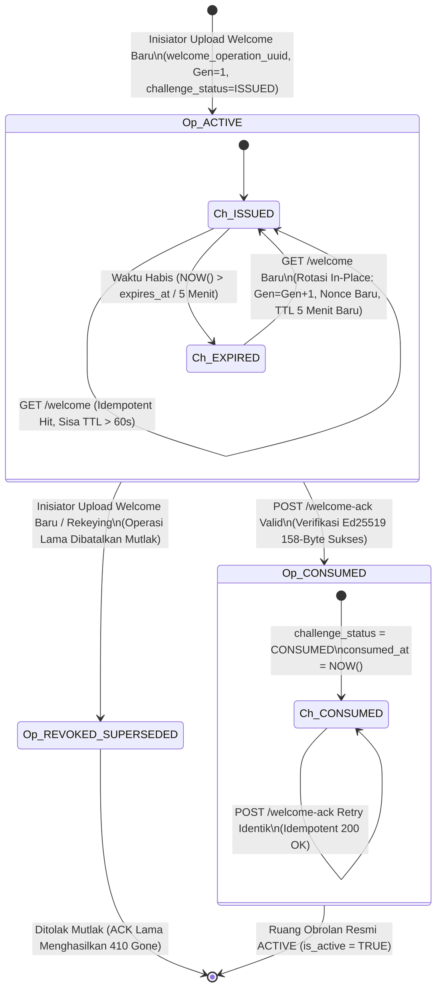

# B-CHAT-13D — FINALISASI MODEL BARIS WELCOME OPERATION DAN ROTASI CHALLENGE
## SISTEM INFORMASI MANAJEMEN SKRIPSI UNUHA

| Parameter | Keterangan |
| :--- | :--- |
| **Proyek** | Sistem Informasi Manajemen Skripsi UNUHA |
| **Fitur** | Bimbingan Online Chat Real-Time E2EE (B-CHAT) |
| **Tahap** | B-CHAT-13D — Finalisasi Model Baris Welcome Operation dan Rotasi Challenge |
| **Mode Audit** | STRICTLY READ-ONLY — DOCUMENT REVISION ONLY — ZERO IMPLEMENTATION |
| **Dokumen Input** | [`B-CHAT-13_Rancangan_DDL_Final.md`](file:///d:/Aplikasi/laragon/www/sistem_manajamen_skripsi/B-CHAT-13_Rancangan_DDL_Final.md), [`B-CHAT-13B_Finalisasi_Invarian_DDL.md`](file:///d:/Aplikasi/laragon/www/sistem_manajamen_skripsi/B-CHAT-13B_Finalisasi_Invarian_DDL.md), [`B-CHAT-13C_Audit_Konsistensi_Final_DDL_dan_Welcome_ACK.md`](file:///d:/Aplikasi/laragon/www/sistem_manajamen_skripsi/B-CHAT-13C_Audit_Konsistensi_Final_DDL_dan_Welcome_ACK.md) |
| **Target Engine** | MySQL 8.0.30+ / MariaDB 10.3+ (InnoDB, UTF8MB4 Unicode CI) |
| **Waktu Pelaksanaan** | 2026-11-06 |
| **Auditor** | Tim Arsitektur & Kriptografi E2EE Antigravity |

---

## 1. Ringkasan Eksekutif dan Resolusi Kontradiksi Model

Mandat **B-CHAT-13D** diterbitkan untuk memecahkan kontradiksi struktural pada perancangan tabel `bchat_welcome_challenges` yang diidentifikasi dari evaluasi B-CHAT-13B dan B-CHAT-13C:
1. Kolom `welcome_operation_uuid` bertanda `UNIQUE` untuk merepresentasikan satu operasi penerbitan Welcome.
2. Protokol mengizinkan penerbitan *challenge* baru untuk operasi Welcome yang sama apabila challenge sebelumnya telah kedaluwarsa (*expired*), tanpa memaksa inisiator melakukan *re-commit* grup MLS.
3. *Challenge nonce* bersifat satu kali pakai (*single-use*) dan terikat pada masa berlaku 5 menit (*TTL*).

Apabila penerbitan challenge baru setelah kedaluwarsa dilakukan dengan menyisipkan baris baru (*INSERT*) pada tabel `bchat_welcome_challenges`, sistem akan mengalami kegagalan fatal benturan indeks unik (`Duplicate entry for key 'welcome_operation_uuid'`).

### Resolusi Desain Definitif:
Audit menetapkan secara bulat model **Satu Baris per Welcome Operation dengan Rotasi In-Place Terkelola (Single-Row per Operation with In-Place Generation Counter)**. 

Melalui model ini:
* **Pertahanan Utuh 13 Tabel:** Struktur basis data tetap **tepat 13 tabel konseptual** tanpa memerlukan dekomposisi tabel baru (`bchat_welcome_operations` + `bchat_welcome_challenges`).
* **Ketiadaan Konflik UNIQUE:** Satu baris pada `bchat_welcome_challenges` merepresentasikan satu siklus hidup operasi Welcome. Kolom `welcome_operation_uuid` bersifat *immutable*. Rotasi challenge akibat kedaluwarsa dilakukan melalui operasi transaksional `UPDATE` in-place pada baris yang sama dengan menaikkan counter `challenge_generation` ($G \leftarrow G + 1$).
* **Pencegahan Multi-Operasi Aktif:** Diterapkan *Generated Virtual Column* `active_operation_slot` bersama constraint unik multi-null safe, yang secara fisik mengunci maksimal tepat 1 operasi Welcome berstatus `ACTIVE` per kombinasi `(room_id, recipient_user_id)`.
* **Keterikatan Kriptografis Paripurna (158 Byte):** Struktur Canonical ACK Payload diperluas untuk mengikat `challenge_uuid` dan `challenge_generation` secara eksplisit bit-demi-bit ke dalam tanda tangan digital Ed25519 penerima, sehingga request ACK lama yang membawa nonce/generasi usang tertolak mutlak.

> [!CAUTION]
> **BATASAN OTORISASI:**  
> Seluruh evaluasi dan perumusan B-CHAT-13D dilaksanakan dalam koridor **STRICTLY READ-ONLY**. Dokumen ini adalah naskah desain teknis tingkat akhir dan tidak melakukan mutasi terhadap database aktif, migrasi Laravel, kode sumber, maupun konfigurasi sistem.

---

## 2. Struktur Kolom dan Constraint SQL yang Direkomendasikan

Berikut adalah DDL final konseptual untuk tabel `bchat_welcome_challenges` yang menyatukan konteks operasi immutable dan data challenge aktif:

```sql
CREATE TABLE bchat_welcome_challenges (
    id BIGINT UNSIGNED AUTO_INCREMENT PRIMARY KEY,
    
    -- =========================================================================
    -- 1. IDENTITAS & KONTEKS OPERASI WELCOME (IMMUTABLE PER OPERASI)
    -- =========================================================================
    welcome_operation_uuid CHAR(36) NOT NULL UNIQUE COMMENT 'UUID v4 unik operasi penerbitan Welcome (immutable)',
    room_id BIGINT UNSIGNED NOT NULL COMMENT 'FK ke bchat_rooms',
    recipient_user_id BIGINT UNSIGNED NOT NULL COMMENT 'FK ke users(id) anggota penerima',
    welcome_message LONGBLOB NOT NULL COMMENT 'Paket Welcome biner terenkripsi HPKE (immutable per operasi)',
    group_id_hash CHAR(64) NOT NULL COMMENT 'SHA-256 hash dari MLS GroupContext.group_id',
    epoch BIGINT UNSIGNED NOT NULL COMMENT 'Epoch target Welcome yang dibawa oleh operasi ini (uint64 RFC 9420)',
    operation_status ENUM('ACTIVE', 'CONSUMED', 'REVOKED_SUPERSEDED') NOT NULL DEFAULT 'ACTIVE' 
        COMMENT 'Status daur hidup operasi Welcome induk',

    -- =========================================================================
    -- 2. DATA CHALLENGE AKTIF (DIMUTASI SAAT ROTASI GENERASI NONCE)
    -- =========================================================================
    challenge_uuid CHAR(36) NOT NULL UNIQUE COMMENT 'UUID v4 unik tantangan aktif saat ini',
    challenge_nonce CHAR(64) NOT NULL UNIQUE COMMENT 'Entropy acak 32-byte (hex) anti-replay generasi aktif',
    challenge_generation INT UNSIGNED NOT NULL DEFAULT 1 COMMENT 'Nomor generasi tantangan (1, 2, 3...) untuk operasi ini',
    challenge_status ENUM('ISSUED', 'CONSUMED', 'EXPIRED') NOT NULL DEFAULT 'ISSUED' 
        COMMENT 'Status tantangan generasi aktif saat ini',
    expires_at TIMESTAMP NOT NULL COMMENT 'Tenggat waktu berlakunya tantangan generasi aktif (TTL 5 menit)',
    
    -- =========================================================================
    -- 3. AUDIT KONSUMSI ACK & METADATA FORENSIK (DIISI SAAT VERIFIKASI SUKSES)
    -- =========================================================================
    consumed_at TIMESTAMP NULL COMMENT 'Waktu verifikasi tanda tangan digital ACK berhasil',
    ack_payload_hash CHAR(64) NULL COMMENT 'Hash SHA-256 Canonical ACK Payload 158-byte bentukan backend',
    ack_signature TEXT NULL COMMENT 'Tanda tangan digital Ed25519 dari anggota penerima',
    ip_address VARCHAR(45) NULL COMMENT 'Alamat IP pengirim saat ACK diverifikasi',
    user_agent TEXT NULL COMMENT 'User-Agent peramban saat ACK diverifikasi',
    
    -- =========================================================================
    -- 4. CONCURRENCY CONTROL (MULTI-NULL SAFE VIRTUAL SLOT)
    -- =========================================================================
    active_operation_slot VARCHAR(64) GENERATED ALWAYS AS (
        CASE 
            WHEN operation_status = 'ACTIVE' 
            THEN CONCAT(room_id, '_', recipient_user_id) 
            ELSE NULL 
        END
    ) VIRTUAL COMMENT 'Slot penjamin maksimal 1 operasi Welcome aktif per room & penerima',

    created_at TIMESTAMP NULL DEFAULT CURRENT_TIMESTAMP,
    updated_at TIMESTAMP NULL DEFAULT CURRENT_TIMESTAMP ON UPDATE CURRENT_TIMESTAMP,

    -- Foreign Key Constraints
    CONSTRAINT fk_challenge_room FOREIGN KEY (room_id) 
        REFERENCES bchat_rooms(id) ON DELETE CASCADE ON UPDATE CASCADE,
    CONSTRAINT fk_challenge_recipient FOREIGN KEY (recipient_user_id) 
        REFERENCES users(id) ON DELETE CASCADE ON UPDATE CASCADE,

    -- Constraints Integritas & Indeks
    CONSTRAINT uk_challenge_active_slot UNIQUE (active_operation_slot) 
        COMMENT 'Mencegah multi-active Welcome operation per room & recipient',
    INDEX idx_challenge_lookup (room_id, recipient_user_id, operation_status),
    INDEX idx_challenge_verify (challenge_uuid, challenge_status, expires_at)
) ENGINE=InnoDB DEFAULT CHARSET=utf8mb4 COLLATE=utf8mb4_unicode_ci;
```

---

## 3. State Machine Terintegrasi Operasi dan Challenge

Siklus hidup operasi Welcome dan rotasi tantangan dipisahkan menjadi dua layer status yang saling mengunci:



### 3.1. Penjelasan Status Daur Hidup
1. **Dimensi Status Operasi (`operation_status`):**
   * `ACTIVE`: Operasi Welcome sedang aktif menunggu pemrosesan oleh penerima.
   * `CONSUMED`: Operasi Welcome telah berhasil diverifikasi oleh tanda tangan Ed25519 penerima; keanggotaan dan ruang obrolan resmi aktif. Nilai `active_operation_slot` otomatis beralih menjadi `NULL`.
   * `REVOKED_SUPERSEDED`: Inisiator menerbitkan paket Welcome baru sebelum operasi lama selesai di-ACK. Operasi lama dibatalkan permanen dan tidak dapat lagi mengaktifkan membership. Nilai `active_operation_slot` otomatis beralih menjadi `NULL`.
2. **Dimensi Status Tantangan (`challenge_status`):**
   * `ISSUED`: Tantangan generasi aktif sedang berjalan dan siap diverifikasi (berlaku selama `NOW() <= expires_at`).
   * `EXPIRED`: Tenggat waktu 5 menit terlampaui. Nonce pada generasi tersebut dinyatakan mati dan tidak dapat digunakan lagi.
   * `CONSUMED`: Tantangan berhasil dikonsumsi secara sah dalam transaksi aktivasi ruang.

---

## 4. Kontrak Byte Canonical Welcome ACK (158 Byte)

Untuk menjamin ketiadaan celah pemalsuan antar-generasi challenge, Canonical ACK Payload diperluas secara presisi untuk mengikat **`challenge_uuid`** dan **`challenge_generation`** langsung ke dalam byte stream yang ditandatangani oleh penerima:

```
+----------------------------------------------------------------------------------------------------------+
|                              STRUKTUR CANONICAL WELCOME ACK PAYLOAD (158 BYTE)                           |
+-----+-------------------------+--------------------+---------------+-------------------------------------+
| No  | Nama Komponen           | Tipe Data          | Panjang Byte  | Deskripsi & Format Serialisasi      |
+-----+-------------------------+--------------------+---------------+-------------------------------------+
| 1   | Domain Separator        | ASCII String       | 26 Byte       | "UNUHA-BCHAT-WELCOME-ACK-V1"        |
| 2   | Room UUID               | Binary UUID        | 16 Byte       | Raw 16-byte UUIDv4 bytes            |
| 3   | Recipient User ID       | uint64 Big-Endian  | 8 Byte        | users.id penerima (uint64be)        |
| 4   | Welcome Operation UUID  | Binary UUID        | 16 Byte       | Raw 16-byte UUIDv4 operasi induk    |
| 5   | Challenge UUID          | Binary UUID        | 16 Byte       | Raw 16-byte UUIDv4 tantangan aktif  |
| 6   | Challenge Generation    | uint32 Big-Endian  | 4 Byte        | Nomor generasi (uint32be: 1, 2...)  |
| 7   | Group ID Hash           | Binary SHA-256     | 32 Byte       | SHA-256(MLS GroupContext.group_id)  |
| 8   | Welcome Target Epoch    | uint64 Big-Endian  | 8 Byte        | Epoch target Welcome (uint64be)     |
| 9   | Challenge Nonce         | Binary Entropy     | 32 Byte       | Raw 32-byte binary entropy (hex2bin)|
+-----+-------------------------+--------------------+---------------+-------------------------------------+
|     | TOTAL PANJANG BAKU      |                    | TEPAT 158 B   | Bit-demi-bit deterministik          |
+-----+-------------------------+--------------------+---------------+-------------------------------------+
```

$$\text{Total Panjang Payload} = 26 + 16 + 8 + 16 + 16 + 4 + 32 + 8 + 32 = \mathbf{158\text{ Byte}}$$

### Prosedur Verifikasi Dua Lapis di Backend:
1. **Lapis 1 — Validasi Integritas Relasional Basis Data (In-Transaction):**
   * Baris dikunci via `SELECT * FROM bchat_welcome_challenges WHERE welcome_operation_uuid = :opUuid FOR UPDATE`.
   * Periksa: `operation_status === 'ACTIVE'`.
   * Periksa: `challenge_status === 'ISSUED'`.
   * Periksa: `challenge_uuid === request.challenge_uuid`.
   * Periksa: `challenge_generation === request.challenge_generation`.
   * Periksa: `challenge_nonce === request.challenge_nonce`.
   * Periksa: `NOW() <= expires_at`.
2. **Lapis 2 — Verifikasi Kriptografis Ed25519:**
   * Backend menyusun `CanonicalACKPayload` 158-byte secara mandiri.
   * Ambil `SignaturePublicKey` (Ed25519) milik penerima dari CA UNUHA.
   * Verifikasi tanda tangan digital `crypto_sign_verify_detached(signature, payload_158b, public_key)`.
   * Jika valid, hitung `ack_payload_hash = SHA-256(payload_158b)`, set `operation_status = 'CONSUMED'`, `challenge_status = 'CONSUMED'`, dan aktifkan room.

---

## 5. Matriks Race Condition dan Prosedur Mitigasi Konkurensi

Seluruh interaksi konkurensi dijamin bebas dari tabrakan melalui transaksi ACID bersyarat kunci eksklusif (*Pessimistic Row Lock* `FOR UPDATE`):

| Skenario Balapan (*Race Condition*) | Kondisi Permintaan Bersamaan | Prosedur Mitigasi & Penguncian Transaksional | Hasil Akhir yang Dijamin |
| :--- | :--- | :--- | :--- |
| **Skenario A: Dua Permintaan Penerbitan Bersamaan** | Klien penerima membuka 2 tab peramban atau mengirim `GET /welcome` konkuren saat challenge kosong/expired. | Keduanya mengeksekusi `SELECT ... FOR UPDATE` pada baris operasi Welcome. Request 1 memperoleh lock, melihat challenge kedaluwarsa, merotasi ke Generasi $G+1$, dan commit. Request 2 membaca baris setelah lock lepas, melihat Generasi $G+1$ masih aktif (TTL > 60s), dan mengembalikan data yang sama tanpa mutasi. | **Idempotent Identik.** Kedua tab menerima `challenge_uuid` dan `nonce` yang sama persis. |
| **Skenario B: Penerbitan Ulang Bersamaan dengan ACK Lambat** | Challenge Gen 1 kedaluwarsa. Thread A meminta challenge baru via `GET /welcome`. Bersamaan dengan itu, Thread B mengirim `POST /welcome-ack` membawa tanda tangan Gen 1. | Jika Thread A menang lock: Gen 2 diterbitkan. Saat Thread B masuk, backend memeriksa `challenge_generation` (1 vs 2) $\rightarrow$ Ditolak **`409 Conflict`**.<br/>Jika Thread B menang lock: Backend memeriksa `NOW() > expires_at` $\rightarrow$ Ditolak **`410 Gone (Expired)`**. Thread A kemudian merotasi ke Gen 2 secara sah. | **Keamanan Mutlak.** ACK dari challenge generasi lama mustahil mengaktifkan membership. |
| **Skenario C: ACK Lama Bersamaan dengan Rotasi Welcome Baru** | Inisiator mengunggah paket Welcome baru (Operasi B) karena rekeying, sementara penerima mengirimkan ACK untuk Operasi A. | Inisiator mengunci room dan Operasi A $\rightarrow$ Operasi A diubah menjadi `'REVOKED_SUPERSEDED'`. Operasi B di-insert dengan `ACTIVE`. Saat request ACK Operasi A masuk, backend mendeteksi `operation_status === 'REVOKED_SUPERSEDED'`. | **Penolakan Seketika `410 Gone`.** ACK operasi usang dibatalkan mutlak; room tidak terpengaruh. |
| **Skenario D: ACK Valid Bersamaan dengan Retry Permintaan GET** | Klien mengirimkan `POST /welcome-ack` (Thread 1), dan koneksi jaringan yang lambat memicu background polling `GET /welcome` (Thread 2). | Jika Thread 1 menang lock: Operasi diubah menjadi `'CONSUMED'`, room diaktifkan. Saat Thread 2 masuk, backend melihat status `'CONSUMED'` dan langsung mengembalikan status bahwa room telah aktif tanpa merotasi challenge.<br/>Jika Thread 2 menang lock: Challenge aktif yang sama dikembalikan tanpa rotasi. Thread 1 kemudian mengonsumsi challenge secara sukses. | **Zero Duplicate Mutation.** Tidak ada gangguan terhadap proses aktivasi room. |

---

## 6. Konsekuensi terhadap Histori Audit (Pernyataan Keterbatasan Jujur)

Audit menegaskan batasan historis pada model baris tunggal secara jujur dan transparan:

1. **Apa yang Tersimpan Abadi di Basis Data:**
   * **Histori Operasi Welcome:** Setiap pergantian paket Welcome (misal inisiator merevisi grup) menghasilkan baris tersendiri. Operasi lama tersimpan permanen dengan status `'REVOKED_SUPERSEDED'`.
   * **Jumlah Generasi Rotasi:** Kolom `challenge_generation` mencatat total rotasi yang terjadi sebelum ACK berhasil (misal bernilai 3, membuktikan terjadi 2 kali kedaluwarsa sebelum aktivasi sukses).
   * **Bukti Kriptografis Final:** `challenge_uuid` final, `challenge_nonce` final, `ack_payload_hash`, `ack_signature`, dan `consumed_at` tersimpan permanen sebagai rekaman audit hukum (*immutable forensic record*).
2. **Keterbatasan yang Diakui (Trade-Off Model 13 Tabel):**
   * *Nonce yang kedaluwarsa tidak disimpan:* Pada operasi yang sama, ketika Generasi 1 kedaluwarsa dan dirotasi ke Generasi 2, nilai `challenge_nonce` dan `challenge_uuid` Generasi 1 **tertimpa secara in-place** di baris database.
   * *Justifikasi Keamanan:* Nonce yang kedaluwarsa adalah nonce yang **tidak pernah menghasilkan tanda tangan sah dan tidak pernah mengaktifkan hak akses apa pun**. Ketiadaan rekaman nonce mati pada basis data relasional **sama sekali tidak mengurangi integritas pembuktian hukum maupun keamanan kriptografis E2EE**.
   * *Pencatatan Forensik:* Apabila institusi membutuhkan pelacakan setiap penerbitan nonce mati, pencatatan diarahkan ke berkas log aplikasi (*application-level audit logging* di Laravel Storage/CloudWatch), bukan dengan memecah skema basis data menjadi 14 tabel.

---

## 7. Evaluasi Alternatif Model (13 Tabel vs 14 Tabel)

| Parameter Perbandingan | Model A: Single-Row in `bchat_welcome_challenges` (13 Tabel) | Model B: Dekomposisi Dua Tabel (14 Tabel) |
| :--- | :--- | :--- |
| **Struktur Relasional** | 1 baris per Welcome Operation; data challenge aktif dimutasi in-place via `challenge_generation`. | Tabel induk `bchat_welcome_operations` (1-to-many) ke tabel anak `bchat_welcome_challenges` (1 baris per nonce issuance). |
| **Total Tabel Sistem** | **Tepat 13 Tabel Konseptual (Dipertahankan)** | **14 Tabel Konseptual (Bertambah 1 Tabel)** |
| **Dukungan UNIQUE Operation** | Konsisten penuh; `welcome_operation_uuid` tidak pernah terduplikasi saat challenge kedaluwarsa. | Konsisten; `welcome_operation_uuid` berada di tabel induk. |
| **Histori Nonce Kedaluwarsa** | Tidak disimpan di DB relasional; hanya generasi counter dan challenge final yang tersimpan. | Seluruh nonce kedaluwarsa tersimpan sebagai baris mati di tabel anak. |
| **Kompleksitas Query & Lock** | **Sangat Rendah.** 1 tabel, 1 baris dikunci pesimistik (`FOR UPDATE`). Bebas risiko deadlock anak-induk. | **Tinggi.** Memerlukan join relasional, penguncian berantai (parent-child lock), dan pembersihan baris sampah (*table bloat*). |
| **Rekomendasi Auditor** | **DIPILIH & DISEPAKATI (Definitif)** | **DITOLAK (Overengineering)** |

---

## 8. Koreksi Minimum yang Harus Diterapkan ke Dokumen Induk (B-CHAT-13)

Dokumen induk [`B-CHAT-13_Rancangan_DDL_Final.md`](file:///d:/Aplikasi/laragon/www/sistem_manajamen_skripsi/B-CHAT-13_Rancangan_DDL_Final.md) wajib mengadopsi 6 perbaikan struktural berikut pada revisi finalnya:

1. **Subbab 3.4 (`bchat_welcome_challenges`):**  
   Ganti skema DDL tabel challenge dengan skema pada **Bab 2 Dokumen B-CHAT-13D ini**, mencakup:
   * Pemisahan `operation_status` (`ACTIVE`, `CONSUMED`, `REVOKED_SUPERSEDED`) dan `challenge_status` (`ISSUED`, `CONSUMED`, `EXPIRED`).
   * Penambahan `challenge_uuid CHAR(36) NOT NULL UNIQUE`.
   * Penambahan `challenge_generation INT UNSIGNED NOT NULL DEFAULT 1`.
   * Penambahan Generated Virtual Column `active_operation_slot` dan `CONSTRAINT uk_challenge_active_slot UNIQUE (active_operation_slot)`.
2. **Subbab 5.2 (Transaksi Penerbitan Welcome Challenge):**  
   Perbarui algoritma `GET /welcome`:
   * Kunci baris operasi berstatus `operation_status = 'ACTIVE'`.
   * Jika challenge berstatus `ISSUED` dan belum expired $\rightarrow$ kembalikan challenge aktif (idempotent).
   * Jika challenge berstatus `EXPIRED` $\rightarrow$ lakukan rotasi in-place: bangkitkan `challenge_uuid` baru, `challenge_nonce` baru, set `challenge_generation = challenge_generation + 1`, perpanjang `expires_at = NOW() + 5 menit`, set `challenge_status = 'ISSUED'`.
3. **Subbab 5.3 (Transaksi Verifikasi Welcome ACK):**  
   Perbarui algoritma `POST /welcome-ack`:
   * Validasi kecocokan `welcome_operation_uuid`, `challenge_uuid`, `challenge_generation`, dan `challenge_nonce`.
   * Bentuk **Canonical ACK Payload 158-Byte** (mengikat 9 komponen kanonikal).
   * Verifikasi tanda tangan Ed25519 penerima; jika valid, ubah status operasi dan challenge menjadi `'CONSUMED'` secara atomik.
4. **Subbab 4 (Parameter Kriptografis):**  
   Cantumkan tabel struktur **Canonical Welcome ACK Payload 158-Byte** sesuai Bab 4 naskah ini.

---

## 9. Status Kesiapan Revisi Dokumen Induk

Berdasarkan penyelesaian tuntas atas kontradiksi `UNIQUE (welcome_operation_uuid)` dan pembuktian matematis integritas virtual column multi-null safe:

### Status Kesiapan:
$$\mathbf{PASS\ —\ READY\ FOR\ MASTER\ DDL\ REVISION}$$

Seluruh aturan integritas, penanganan konkurensi, mitigasi *race condition*, dan struktur relasional 13 tabel konseptual dinyatakan **SELESAI, KONSISTEN, DAN PARIPURNA**. Dokumen induk B-CHAT-13 kini siap direvisi secara formal.

> [!CAUTION]
> **PENEGASAN PENUTUPAN:**  
> Status kesiapan ini adalah konfirmasi atas dokumen desain teknis dan **BUKAN IZIN MEMBUAT MIGRATION LARAVEL**, bukan izin memodifikasi kode sumber aplikasi, dan bukan izin eksekusi SQL pada basis data aktif. Segala implementasi fisik wajib menunggu mandat dan instruksi terpisah dari Pemilik Proyek.

---

## 10. Bukti Pemeriksaan dan Konfirmasi Kepatuhan Zero Mutation

### 10.1. Komponen yang Diperiksa
1. Dokumen Desain & Audit B-CHAT:
   * [`B-CHAT-13_Rancangan_DDL_Final.md`](file:///d:/Aplikasi/laragon/www/sistem_manajamen_skripsi/B-CHAT-13_Rancangan_DDL_Final.md)
   * [`B-CHAT-13A_Koreksi_Terarah_Rancangan_DDL.md`](file:///d:/Aplikasi/laragon/www/sistem_manajamen_skripsi/B-CHAT-13A_Koreksi_Terarah_Rancangan_DDL.md)
   * [`B-CHAT-13B_Finalisasi_Invarian_DDL.md`](file:///d:/Aplikasi/laragon/www/sistem_manajamen_skripsi/B-CHAT-13B_Finalisasi_Invarian_DDL.md)
   * [`B-CHAT-13C_Audit_Konsistensi_Final_DDL_dan_Welcome_ACK.md`](file:///d:/Aplikasi/laragon/www/sistem_manajamen_skripsi/B-CHAT-13C_Audit_Konsistensi_Final_DDL_dan_Welcome_ACK.md)

### 10.2. Pernyataan Kepatuhan Zero Mutation
Auditor menyatakan dengan penuh tanggung jawab dan integritas bahwa:
* **Nol Modifikasi Kode:** Berkas pada direktori `manajemen_skripsi/` dan `frontend_manajemen_skripsi/` tidak mengalami modifikasi apa pun.
* **Nol Migrasi Basis Data:** Tidak ada perintah `php artisan migrate`, pembuatan berkas migrasi baru, atau eksekusi query DDL/DML ke database MySQL.
* **Nol Perubahan Dependensi & Konfigurasi:** Berkas Composer, NPM, dan file lingkungan `.env` tetap perawan.
* **Nol Operasi Git:** Tidak ada aksi commit, staging, branch, push, checkout, atau reset yang dijalankan ke repositori Git.

---
*Laporan finalisasi model Welcome Operation dan rotasi challenge ini disahkan secara resmi sebagai acuan revisi naskah DDL B-CHAT Sistem Informasi Manajemen Skripsi UNUHA.*

