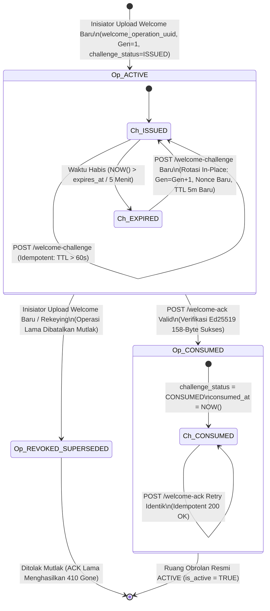
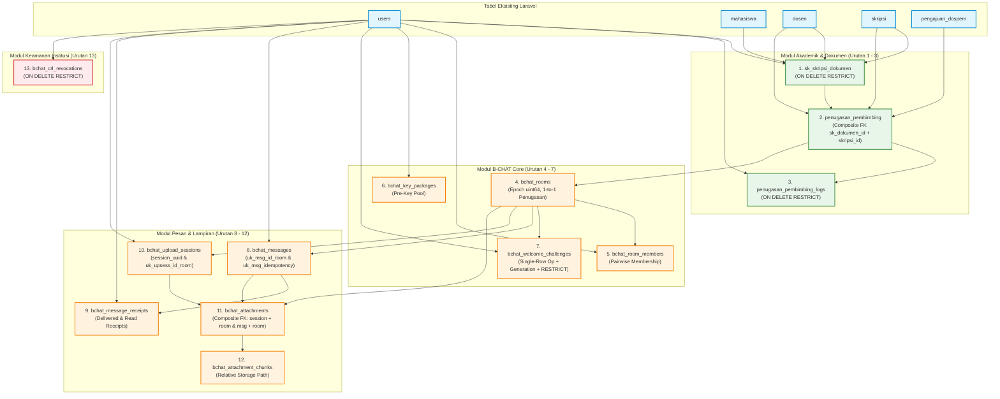

# B-CHAT-13 — RANCANGAN DDL FINAL SISTEM BIMBINGAN ONLINE E2EE (TERPADU)
## SISTEM INFORMASI MANAJEMEN SKRIPSI UNUHA

| Parameter | Keterangan |
| :--- | :--- |
| **Proyek** | Sistem Informasi Manajemen Skripsi UNUHA |
| **Fitur** | Bimbingan Online Chat Real-Time E2EE (B-CHAT) |
| **Tahap** | B-CHAT-13 — Rancangan DDL Final Terpadu (Konsolidasi 13A s.d. 13D) |
| **Mode Audit** | STRICTLY READ-ONLY — DESIGN ONLY — ZERO DATABASE/CODE MUTATION |
| **Acuan Arsitektur** | [`B-CHAT-09`](file:///d:/Aplikasi/laragon/www/sistem_manajamen_skripsi/B-CHAT-09_Keputusan_Arsitektur_E2EE.md), [`B-CHAT-11E`](file:///d:/Aplikasi/laragon/www/sistem_manajamen_skripsi/B-CHAT-11E_Laporan_Penegasan_Status.md), [`B-CHAT-12A`](file:///d:/Aplikasi/laragon/www/sistem_manajamen_skripsi/B-CHAT-12A_Rekonsiliasi_GAP_Kesiapan_Implementasi.md) s.d. [`B-CHAT-12H`](file:///d:/Aplikasi/laragon/www/sistem_manajamen_skripsi/B-CHAT-12H_Finalisasi_Epoch_ACK_Room_dan_Reverb.md), [`B-CHAT-13A`](file:///d:/Aplikasi/laragon/www/sistem_manajamen_skripsi/B-CHAT-13A_Koreksi_Terarah_Rancangan_DDL.md) s.d. [`B-CHAT-13D`](file:///d:/Aplikasi/laragon/www/sistem_manajamen_skripsi/B-CHAT-13D_Finalisasi_Model_Welcome_Operation_Challenge.md) |
| **Target Engine** | MySQL 8.0.30+ / MariaDB 10.3+ (InnoDB, UTF8MB4 Unicode CI) |
| **Waktu Pelaksanaan** | 2026-11-06 |
| **Auditor** | Tim Arsitektur & Kriptografi E2EE Antigravity |

---

## 1. Ringkasan Eksekutif dan Rekonsiliasi Nomenklatur Tabel

Dokumen **B-CHAT-13 (Terpadu)** merupakan naskah teknis definitif dan tunggal rancangan struktur basis data (*Data Definition Language / DDL*) untuk mendukung integrasi fitur **Bimbingan Online Chat Real-Time E2EE**. Dokumen ini mengintegrasikan seluruh konsensus tata kelola akademik universitas, kepatuhan protokol kriptografi RFC 9420 (MLS), enkripsi berkas lampiran EXP-02 (AES-256-GCM), pemisahan operasi Welcome dan tantangan anti-replay, serta pencegahan kondisi balapan (*race condition*) yang telah dimatangkan secara berkesinambungan dari B-CHAT-09 hingga B-CHAT-13D.

Naskah ini menggantikan seluruh draf parsial terdahulu dan menjadi satu-satunya acuan perancangan skema relasional bagi tim pengembang.

### 1.1. Rekonsiliasi Jumlah dan Nomenklatur 13 Tabel Konseptual
Struktur data dipertahankan secara stabil pada **tepat 13 tabel konseptual** yang terbagi dalam dua kelompok fungsional:

1. **Paket Modul Akademik dan Dokumen (3 Tabel):**
   * `sk_skripsi_dokumen`: Menyimpan berkas fisik scan PDF SK pembimbing skripsi yang diunggah mahasiswa, riwayat versi berantai (*linked multi-record*), hash integritas SHA-256, slot dokumen aktif terkini, dan proteksi arsip hukum `ON DELETE RESTRICT`.
   * `penugasan_pembimbing`: Entitas operasional hak bimbingan dosen untuk Proposal (tanpa SK) dan Skripsi (merujuk SK terverifikasi), ordinal peran pembimbing (1 dan 2), serta virtual column `active_slot`.
   * `penugasan_pembimbing_logs`: Audit trail append-only yang merekam setiap peristiwa mutasi penugasan dosen (penetapan awal, pergantian dosen, pembatalan), aktor pelaksana, dan snapshot historis berproteksi `ON DELETE RESTRICT`.
2. **Paket Modul Kriptografi dan B-CHAT (10 Tabel):**
   * `bchat_rooms`: Metadata ruang obrolan pairwise 1-to-1 dengan penugasan sah, sekuens server monotonik terurut, status lifecycle, dan nomor epoch MLS aktif (`BIGINT UNSIGNED`).
   * `bchat_room_members`: Keanggotaan mahasiswa dan dosen, penanda inisiator (`is_initiator = TRUE`) vs penerima Welcome, dan status konfirmasi aktivasi (`is_active`).
   * `bchat_key_packages`: Pool pre-key MLS satu kali pakai bertanda tangan digital CA institusi UNUHA.
   * `bchat_welcome_challenges`: Entitas operasi Welcome unik (`welcome_operation_uuid`), paket biner Welcome HPKE, tantangan anti-replay terotasi *in-place* (`challenge_generation`), bukti tanda tangan Ed25519 (Canonical ACK 158-byte), dan slot operasi aktif multi-null safe berproteksi `ON DELETE RESTRICT`.
   * `bchat_messages`: Rekaman ciphertext aplikasi MLS (PrivateMessage TreeKEM), epoch uint64, generasi ratchet, hash integritas payload, serta constraint idempotensi mutlak `UNIQUE(room_id, sender_id, message_uuid)`.
   * `bchat_message_receipts`: Status pengiriman (*delivered*) dan pembacaan (*read*) terpisah per pengguna tanpa memutasi ciphertext pesan.
   * `bchat_upload_sessions`: Sesi unggah berkas terfragmentasi (*chunked upload*) dengan UUID publik `session_uuid` dan constraint komposit `(id, room_id)`.
   * `bchat_attachments`: Metadata berkas terenkripsi AES-256-GCM dengan Composite FK ganda anti *cross-room injection*, pemisahan ukuran plaintext dan ciphertext, serta status pengaitan manifest.
   * `bchat_attachment_chunks`: Lokasi fisik potongan ciphertext biner pada path relatif storage privat Laravel (`storage/app/private/bchat_attachments/`).
   * `bchat_crl_revocations`: Daftar pencabutan kredensial identitas darurat institusi berproteksi `ON DELETE RESTRICT`.

---

## 2. Rincian DDL Tiga Tabel Akademik dan Dokumen

### 2.1. Tabel `sk_skripsi_dokumen`
* **Tujuan:** Menyimpan berkas fisik scan SK skripsi hasil pengurusan offline, mengelola riwayat versi dokumen anti-overwrite, dan mencatat hasil verifikasi administratif Admin.
* **Karakteristik:** Multi-record terhubung, self-referencing composite FK, virtual slot `terkini_slot`, dan proteksi arsip hukum `ON DELETE RESTRICT`.

```sql
CREATE TABLE sk_skripsi_dokumen (
    id BIGINT UNSIGNED AUTO_INCREMENT PRIMARY KEY,
    skripsi_id BIGINT UNSIGNED NOT NULL COMMENT 'FK ke skripsi induk',
    mahasiswa_id BIGINT UNSIGNED NOT NULL COMMENT 'FK ke mahasiswa pengunggah',
    versi_ke INT UNSIGNED NOT NULL DEFAULT 1 COMMENT 'Nomor urut versi berkas (1, 2, 3...)',
    is_terkini BOOLEAN NOT NULL DEFAULT TRUE COMMENT '1 jika dokumen versi aktif terkini, 0 jika arsip revisi',
    induk_dokumen_id BIGINT UNSIGNED NULL COMMENT 'Self-ref FK ke dokumen versi sebelumnya yang diperbaiki',
    nomor_sk VARCHAR(100) NOT NULL COMMENT 'Nomor resmi SK fisik dari tata usaha fakultas',
    tanggal_sk DATE NOT NULL COMMENT 'Tanggal penetapan resmi yang tertera pada lembar SK',
    file_path VARCHAR(255) NOT NULL COMMENT 'Path relatif storage privat (sk_skripsi/{hash}.pdf)',
    file_hash_sha256 CHAR(64) NOT NULL COMMENT 'SHA-256 checksum integritas fisik berkas upload at-rest',
    file_size_bytes BIGINT UNSIGNED NOT NULL COMMENT 'Ukuran fisik berkas PDF dalam byte (maks 10.000.000 byte)',
    status_dokumen ENUM('MENUNGGU_PEMERIKSAAN', 'PERLU_PERBAIKAN', 'DITOLAK', 'TERVERIFIKASI', 'DIBATALKAN') NOT NULL DEFAULT 'MENUNGGU_PEMERIKSAAN',
    admin_id BIGINT UNSIGNED NULL COMMENT 'FK ke users(id) Admin pemeriksa berkas',
    diperiksa_at TIMESTAMP NULL COMMENT 'Waktu verifikasi administratif oleh Admin',
    catatan_admin TEXT NULL COMMENT 'Catatan koreksi jika status PERLU_PERBAIKAN atau DITOLAK',
    dosen_1_usulan_id BIGINT UNSIGNED NULL COMMENT 'Usulan Pembimbing 1 yang dipilih mahasiswa saat upload',
    dosen_2_usulan_id BIGINT UNSIGNED NULL COMMENT 'Usulan Pembimbing 2 yang dipilih mahasiswa saat upload',
    
    -- Virtual Column Concurrency Control (Multi-NULL Safe)
    terkini_slot VARCHAR(20) GENERATED ALWAYS AS (
        CASE WHEN is_terkini = 1 THEN 'CURRENT' ELSE NULL END
    ) VIRTUAL COMMENT 'Slot penjamin tepat 1 dokumen berstatus terkini per skripsi',
    
    created_at TIMESTAMP NULL DEFAULT CURRENT_TIMESTAMP,
    updated_at TIMESTAMP NULL DEFAULT CURRENT_TIMESTAMP ON UPDATE CURRENT_TIMESTAMP,

    -- Foreign Key Constraints (ON DELETE RESTRICT melindungi arsip resmi negara/universitas)
    CONSTRAINT fk_skdok_skripsi FOREIGN KEY (skripsi_id) 
        REFERENCES skripsi(id_skripsi) ON DELETE RESTRICT ON UPDATE CASCADE,
    CONSTRAINT fk_skdok_mahasiswa FOREIGN KEY (mahasiswa_id) 
        REFERENCES mahasiswa(id_mahasiswa) ON DELETE RESTRICT ON UPDATE CASCADE,
    CONSTRAINT fk_skdok_admin FOREIGN KEY (admin_id) 
        REFERENCES users(id) ON DELETE SET NULL ON UPDATE CASCADE,
    CONSTRAINT fk_skdok_dosen1 FOREIGN KEY (dosen_1_usulan_id) 
        REFERENCES dosen(id_dosen) ON DELETE SET NULL ON UPDATE CASCADE,
    CONSTRAINT fk_skdok_dosen2 FOREIGN KEY (dosen_2_usulan_id) 
        REFERENCES dosen(id_dosen) ON DELETE SET NULL ON UPDATE CASCADE,
    
    -- Self-referencing Composite FK: Menjamin dokumen induk berasal dari skripsi yang sama
    CONSTRAINT fk_skdok_induk_composite FOREIGN KEY (induk_dokumen_id, skripsi_id) 
        REFERENCES sk_skripsi_dokumen(id, skripsi_id) ON DELETE RESTRICT ON UPDATE CASCADE,

    -- Constraints Integritas & Indeks
    CONSTRAINT uk_dokumen_id_skripsi UNIQUE (id, skripsi_id) COMMENT 'Target Composite FK bagi tabel penugasan',
    CONSTRAINT uk_skripsi_versi UNIQUE (skripsi_id, versi_ke) COMMENT 'Mencegah nomor versi kembar per skripsi',
    CONSTRAINT uk_skripsi_dokumen_terkini UNIQUE (skripsi_id, terkini_slot) COMMENT 'Mencegah multi-current document race condition',
    INDEX idx_skdok_verifikasi (skripsi_id, status_dokumen, is_terkini),
    INDEX idx_skdok_hash (file_hash_sha256)
) ENGINE=InnoDB DEFAULT CHARSET=utf8mb4 COLLATE=utf8mb4_unicode_ci;
```

---

### 2.2. Tabel `penugasan_pembimbing`
* **Tujuan:** Menjadi sumber kebenaran operasional hak bimbingan dosen terhadap skripsi mahasiswa, menaungi Proposal (tanpa SK) maupun Skripsi (dengan SK offline), memisahkan ordinal pembimbing 1 dan 2, serta mencegah benturan pergantian dosen via *active slot*.
* **Karakteristik:** Bifurkasi CHECK constraint ketat, composite FK anti-tukar skripsi, virtual column `active_slot`.

```sql
CREATE TABLE penugasan_pembimbing (
    id BIGINT UNSIGNED AUTO_INCREMENT PRIMARY KEY,
    skripsi_id BIGINT UNSIGNED NOT NULL COMMENT 'FK ke skripsi induk',
    tahap ENUM('proposal', 'skripsi') NOT NULL COMMENT 'Tahap bimbingan akademik',
    pembimbing_ke TINYINT UNSIGNED NOT NULL COMMENT 'Ordinal: 1 (Proposal / Pembimbing Utama), 2 (Pembimbing Pendamping)',
    dosen_id BIGINT UNSIGNED NOT NULL COMMENT 'FK ke dosen yang ditugaskan',
    sk_dokumen_id BIGINT UNSIGNED NULL COMMENT 'FK ke sk_skripsi_dokumen; WAJIB NULL jika proposal, WAJIB TERISI jika skripsi',
    pengajuan_dospem_id BIGINT UNSIGNED NULL COMMENT 'FK ke pengajuan_dospem (khusus tahap proposal)',
    status_penugasan ENUM('AKTIF', 'DIGANTI', 'DIBATALKAN') NOT NULL DEFAULT 'AKTIF',
    tanggal_mulai DATE NOT NULL COMMENT 'Tanggal dimulainya penugasan pembimbing',
    tanggal_selesai DATE NULL COMMENT 'Tanggal berakhirnya penugasan (jika diganti/dibatalkan/lulus)',
    digantikan_oleh_id BIGINT UNSIGNED NULL COMMENT 'Self-ref FK ke penugasan baru yang menggantikan posisi ini',
    
    -- Virtual Column Concurrency Control (Multi-NULL Safe)
    active_slot VARCHAR(50) GENERATED ALWAYS AS (
        CASE 
            WHEN status_penugasan = 'AKTIF' 
            THEN CONCAT(tahap, '_', pembimbing_ke) 
            ELSE NULL 
        END
    ) VIRTUAL COMMENT 'Slot penjamin tepat 1 dosen aktif per kombinasi tahap & nomor pembimbing',

    created_at TIMESTAMP NULL DEFAULT CURRENT_TIMESTAMP,
    updated_at TIMESTAMP NULL DEFAULT CURRENT_TIMESTAMP ON UPDATE CURRENT_TIMESTAMP,

    -- Foreign Key Constraints
    CONSTRAINT fk_penugasan_skripsi FOREIGN KEY (skripsi_id) 
        REFERENCES skripsi(id_skripsi) ON DELETE CASCADE ON UPDATE CASCADE,
    CONSTRAINT fk_penugasan_dosen FOREIGN KEY (dosen_id) 
        REFERENCES dosen(id_dosen) ON DELETE RESTRICT ON UPDATE CASCADE,
    CONSTRAINT fk_penugasan_pengajuan FOREIGN KEY (pengajuan_dospem_id) 
        REFERENCES pengajuan_dospem(id) ON DELETE SET NULL ON UPDATE CASCADE,
    CONSTRAINT fk_penugasan_silsilah FOREIGN KEY (digantikan_oleh_id) 
        REFERENCES penugasan_pembimbing(id) ON DELETE SET NULL ON UPDATE CASCADE,

    -- Composite FK: Menjamin dokumen SK yang dirujuk benar-benar milik skripsi yang sama
    CONSTRAINT fk_penugasan_sk_composite FOREIGN KEY (sk_dokumen_id, skripsi_id) 
        REFERENCES sk_skripsi_dokumen(id, skripsi_id) ON DELETE RESTRICT ON UPDATE CASCADE,

    -- Constraints Integritas Ketat (Bifurkasi Proposal vs Skripsi Tanpa Celah)
    CONSTRAINT chk_penugasan_tahap_sk_bifurcation CHECK (
        (tahap = 'proposal' AND sk_dokumen_id IS NULL AND pembimbing_ke = 1)
        OR
        (tahap = 'skripsi' AND sk_dokumen_id IS NOT NULL AND pembimbing_ke IN (1, 2))
    ),
    
    -- Constraint Domain Ordinal
    CONSTRAINT chk_penugasan_pembimbing_ke_domain CHECK (pembimbing_ke IN (1, 2)),

    -- Indeks Unik Slot Aktif (Multi-NULL Safe)
    CONSTRAINT uk_skripsi_active_slot UNIQUE (skripsi_id, active_slot),
    INDEX idx_penugasan_dosen_beban (dosen_id, status_penugasan),
    INDEX idx_penugasan_lookup (skripsi_id, tahap, status_penugasan)
) ENGINE=InnoDB DEFAULT CHARSET=utf8mb4 COLLATE=utf8mb4_unicode_ci;
```

---

### 2.3. Tabel `penugasan_pembimbing_logs`
* **Tujuan:** Menyimpan audit trail append-only atas setiap aksi perubahan penugasan pembimbing (penetapan admin, pergantian dosen, pembatalan), aktor pelaksana, dan snapshot historis.
* **Karakteristik:** Bersifat *append-only* dengan proteksi `ON DELETE RESTRICT`.

```sql
CREATE TABLE penugasan_pembimbing_logs (
    id BIGINT UNSIGNED AUTO_INCREMENT PRIMARY KEY,
    penugasan_pembimbing_id BIGINT UNSIGNED NOT NULL COMMENT 'FK ke penugasan_pembimbing yang dimutasi',
    user_id BIGINT UNSIGNED NULL COMMENT 'FK ke users(id) aktor yang melakukan tindakan',
    aktor_nama VARCHAR(150) NOT NULL,
    aktor_role VARCHAR(50) NOT NULL COMMENT 'admin / dekan / kaprodi / sistem',
    tindakan ENUM('PENETAPAN_AWAL', 'PERGANTIAN_PEMBIMBING', 'PEMBATALAN_PENUGASAN', 'PENGAKTIFAN_KEMBALI') NOT NULL,
    status_sebelum VARCHAR(50) NULL,
    status_sesudah VARCHAR(50) NOT NULL,
    snapshot_dosen_lama_id BIGINT UNSIGNED NULL,
    snapshot_dosen_baru_id BIGINT UNSIGNED NULL,
    catatan TEXT NULL COMMENT 'Alasan administratif mutasi pembimbing',
    created_at TIMESTAMP NOT NULL DEFAULT CURRENT_TIMESTAMP,

    -- ON DELETE RESTRICT melindungi integritas jejak audit akademik
    CONSTRAINT fk_penugasan_log_induk FOREIGN KEY (penugasan_pembimbing_id) 
        REFERENCES penugasan_pembimbing(id) ON DELETE RESTRICT ON UPDATE CASCADE,
    CONSTRAINT fk_penugasan_log_user FOREIGN KEY (user_id) 
        REFERENCES users(id) ON DELETE SET NULL ON UPDATE CASCADE,
    INDEX idx_penugasan_log_history (penugasan_pembimbing_id, created_at)
) ENGINE=InnoDB DEFAULT CHARSET=utf8mb4 COLLATE=utf8mb4_unicode_ci;
```

---

## 3. Rincian DDL Sepuluh Tabel B-CHAT

### 3.1. Tabel `bchat_rooms`
* **Tujuan:** Menyimpan ruang bimbingan pairwise E2EE, counter sekuens monotonik, status siklus hidup room, dan epoch MLS aktif.
* **Karakteristik:** Hubungan eksklusif 1-to-1 dengan penugasan sah, epoch bertipe 64-bit (`BIGINT UNSIGNED`), serta bebas dari state transient Welcome (dipindahkan ke tabel challenge).

```sql
CREATE TABLE bchat_rooms (
    id BIGINT UNSIGNED AUTO_INCREMENT PRIMARY KEY,
    room_uuid CHAR(36) NOT NULL UNIQUE COMMENT 'UUID v4 publik room',
    penugasan_pembimbing_id BIGINT UNSIGNED NOT NULL UNIQUE COMMENT '1-to-1 relasi eksklusif dengan penugasan yang sah',
    tahap ENUM('proposal', 'skripsi') NOT NULL,
    pembimbing_ke TINYINT UNSIGNED NOT NULL DEFAULT 1,
    current_sequence BIGINT UNSIGNED NOT NULL DEFAULT 0 COMMENT 'Counter monotonik server per room (SELECT ... FOR UPDATE)',
    status ENUM('PENDING_OFFICIAL_SK', 'PENDING_WELCOME_ACK', 'ACTIVE', 'PENDING_REKEYING', 'SUSPENDED', 'ARCHIVED_READONLY', 'TERMINATED') NOT NULL DEFAULT 'PENDING_WELCOME_ACK',
    current_epoch BIGINT UNSIGNED NOT NULL DEFAULT 0 COMMENT 'Nomor epoch grup MLS aktif saat ini (uint64 RFC 9420)',
    group_id_hash CHAR(64) NULL COMMENT 'Hash SHA-256 dari MLS GroupContext.group_id untuk validasi binding',
    created_at TIMESTAMP NULL DEFAULT CURRENT_TIMESTAMP,
    updated_at TIMESTAMP NULL DEFAULT CURRENT_TIMESTAMP ON UPDATE CURRENT_TIMESTAMP,

    CONSTRAINT fk_room_penugasan FOREIGN KEY (penugasan_pembimbing_id) 
        REFERENCES penugasan_pembimbing(id) ON DELETE RESTRICT ON UPDATE CASCADE,
    INDEX idx_room_lifecycle (status, tahap)
) ENGINE=InnoDB DEFAULT CHARSET=utf8mb4 COLLATE=utf8mb4_unicode_ci;
```

---

### 3.2. Tabel `bchat_room_members`
* **Tujuan:** Mencatat keanggotaan mahasiswa dan dosen pembimbing pada ruang pairwise, peran fungsional inisiator vs penerima, status keaktifan, dan timestamp verifikasi ACK.

```sql
CREATE TABLE bchat_room_members (
    id BIGINT UNSIGNED AUTO_INCREMENT PRIMARY KEY,
    room_id BIGINT UNSIGNED NOT NULL,
    user_id BIGINT UNSIGNED NOT NULL,
    role ENUM('mahasiswa', 'dosen_pembimbing') NOT NULL,
    is_initiator BOOLEAN NOT NULL DEFAULT FALSE COMMENT '1 jika inisiator pembuat MLS Group (bebas ACK), 0 jika penerima Welcome',
    is_active BOOLEAN NOT NULL DEFAULT FALSE COMMENT '1 jika anggota aktif dan diizinkan kirim pesan; diubah 1 setelah ACK sah',
    joined_at_epoch BIGINT UNSIGNED NOT NULL DEFAULT 0 COMMENT 'Epoch saat anggota resmi bergabung (uint64)',
    welcome_ack_at TIMESTAMP NULL COMMENT 'Waktu verifikasi tanda tangan digital Welcome ACK oleh server',
    created_at TIMESTAMP NULL DEFAULT CURRENT_TIMESTAMP,
    updated_at TIMESTAMP NULL DEFAULT CURRENT_TIMESTAMP ON UPDATE CURRENT_TIMESTAMP,

    CONSTRAINT fk_member_room FOREIGN KEY (room_id) 
        REFERENCES bchat_rooms(id) ON DELETE CASCADE ON UPDATE CASCADE,
    CONSTRAINT fk_member_user FOREIGN KEY (user_id) 
        REFERENCES users(id) ON DELETE CASCADE ON UPDATE CASCADE,
    CONSTRAINT uk_room_member UNIQUE (room_id, user_id),
    INDEX idx_member_auth (user_id, is_active)
) ENGINE=InnoDB DEFAULT CHARSET=utf8mb4 COLLATE=utf8mb4_unicode_ci;
```

---

### 3.3. Tabel `bchat_key_packages`
* **Tujuan:** Menampung pool pre-key / KeyPackage MLS satu kali pakai milik pengguna bertanda tangan CA UNUHA, siap dikonsumsi saat pembentukan grup.

```sql
CREATE TABLE bchat_key_packages (
    id BIGINT UNSIGNED AUTO_INCREMENT PRIMARY KEY,
    user_id BIGINT UNSIGNED NOT NULL,
    key_package_hash CHAR(64) NOT NULL UNIQUE COMMENT 'Hash SHA-256 data biner KeyPackage',
    key_package_data LONGBLOB NOT NULL COMMENT 'Paket biner KeyPackage MLS bertanda tangan digital CA Ed25519',
    is_consumed BOOLEAN NOT NULL DEFAULT FALSE COMMENT '1 jika sudah digunakan untuk Add proposal, 0 jika masih tersedia',
    consumed_at TIMESTAMP NULL,
    created_at TIMESTAMP NULL DEFAULT CURRENT_TIMESTAMP,
    updated_at TIMESTAMP NULL DEFAULT CURRENT_TIMESTAMP ON UPDATE CURRENT_TIMESTAMP,

    CONSTRAINT fk_keypkg_user FOREIGN KEY (user_id) 
        REFERENCES users(id) ON DELETE CASCADE ON UPDATE CASCADE,
    INDEX idx_keypkg_available (user_id, is_consumed)
) ENGINE=InnoDB DEFAULT CHARSET=utf8mb4 COLLATE=utf8mb4_unicode_ci;
```

---

### 3.4. Tabel `bchat_welcome_challenges`
* **Tujuan:** Mengelola daur hidup operasi penerbitan Welcome (`welcome_operation_uuid`), paket biner Welcome HPKE, tantangan anti-replay terotasi *in-place* (`challenge_generation`), bukti tanda tangan Ed25519 (Canonical ACK 158-byte), dan slot operasi aktif berproteksi `ON DELETE RESTRICT`.

```sql
CREATE TABLE bchat_welcome_challenges (
    id BIGINT UNSIGNED AUTO_INCREMENT PRIMARY KEY,
    
    -- Konteks Operasi Welcome (Immutable per Operasi)
    welcome_operation_uuid CHAR(36) NOT NULL UNIQUE COMMENT 'UUID v4 unik operasi penerbitan Welcome (immutable)',
    room_id BIGINT UNSIGNED NOT NULL COMMENT 'FK ke bchat_rooms',
    recipient_user_id BIGINT UNSIGNED NOT NULL COMMENT 'FK ke users(id) anggota penerima',
    welcome_message LONGBLOB NOT NULL COMMENT 'Paket Welcome biner terenkripsi HPKE (immutable per operasi)',
    group_id_hash CHAR(64) NOT NULL COMMENT 'SHA-256 hash dari MLS GroupContext.group_id',
    epoch BIGINT UNSIGNED NOT NULL COMMENT 'Epoch target Welcome yang dibawa operasi ini (uint64 RFC 9420)',
    operation_status ENUM('ACTIVE', 'CONSUMED', 'REVOKED_SUPERSEDED') NOT NULL DEFAULT 'ACTIVE' 
        COMMENT 'Status daur hidup operasi Welcome induk',

    -- Data Challenge Aktif (Dimutasi saat Rotasi Generasi Nonce)
    challenge_uuid CHAR(36) NOT NULL UNIQUE COMMENT 'UUID v4 unik tantangan aktif saat ini',
    challenge_nonce CHAR(64) NOT NULL UNIQUE COMMENT 'Entropy acak 32-byte (hex) anti-replay generasi aktif',
    challenge_generation INT UNSIGNED NOT NULL DEFAULT 1 COMMENT 'Nomor generasi tantangan (1, 2, 3...) untuk operasi ini',
    challenge_status ENUM('ISSUED', 'CONSUMED', 'EXPIRED') NOT NULL DEFAULT 'ISSUED' 
        COMMENT 'Status tantangan generasi aktif saat ini',
    expires_at TIMESTAMP NOT NULL COMMENT 'Tenggat waktu berlakunya tantangan generasi aktif (TTL 5 menit)',
    
    -- Audit Konsumsi ACK & Metadata Forensik
    consumed_at TIMESTAMP NULL COMMENT 'Waktu verifikasi tanda tangan digital ACK berhasil',
    ack_payload_hash CHAR(64) NULL COMMENT 'Hash SHA-256 Canonical ACK Payload 158-byte bentukan backend',
    ack_signature TEXT NULL COMMENT 'Tanda tangan digital Ed25519 dari anggota penerima',
    ip_address VARCHAR(45) NULL COMMENT 'Alamat IP saat verifikasi ACK',
    user_agent TEXT NULL COMMENT 'User-Agent peramban saat verifikasi ACK',
    
    -- Concurrency Control (Multi-NULL Safe Virtual Slot)
    active_operation_slot VARCHAR(64) GENERATED ALWAYS AS (
        CASE 
            WHEN operation_status = 'ACTIVE' 
            THEN CONCAT(room_id, '_', recipient_user_id) 
            ELSE NULL 
        END
    ) VIRTUAL COMMENT 'Slot penjamin maksimal 1 operasi Welcome aktif per room & penerima',

    created_at TIMESTAMP NULL DEFAULT CURRENT_TIMESTAMP,
    updated_at TIMESTAMP NULL DEFAULT CURRENT_TIMESTAMP ON UPDATE CURRENT_TIMESTAMP,

    -- ON DELETE RESTRICT melindungi rekaman bukti forensik persetujuan kriptografis
    CONSTRAINT fk_challenge_room FOREIGN KEY (room_id) 
        REFERENCES bchat_rooms(id) ON DELETE RESTRICT ON UPDATE CASCADE,
    CONSTRAINT fk_challenge_recipient FOREIGN KEY (recipient_user_id) 
        REFERENCES users(id) ON DELETE RESTRICT ON UPDATE CASCADE,

    -- Constraints Integritas & Indeks
    CONSTRAINT uk_challenge_active_slot UNIQUE (active_operation_slot),
    INDEX idx_challenge_lookup (room_id, recipient_user_id, operation_status),
    INDEX idx_challenge_verify (challenge_uuid, challenge_status, expires_at)
) ENGINE=InnoDB DEFAULT CHARSET=utf8mb4 COLLATE=utf8mb4_unicode_ci;
```

---

### 3.5. Tabel `bchat_messages`
* **Tujuan:** Menyimpan rekaman ciphertext pesan aplikasi MLS (PrivateMessage TreeKEM), sekuens server monotonik naik, epoch uint64, generasi ratchet, dan hash verifikasi integritas fisik at-rest.
* **Karakteristik:** Constraint idempotensi mutlak pada `(room_id, sender_id, message_uuid)`, composite key `(id, room_id)` pendukung isolasi lampiran, dan penomoran monotonik toleran terhadap celah (*rollback gap*).

```sql
CREATE TABLE bchat_messages (
    id BIGINT UNSIGNED AUTO_INCREMENT PRIMARY KEY,
    room_id BIGINT UNSIGNED NOT NULL,
    server_sequence BIGINT UNSIGNED NOT NULL COMMENT 'Monotonik naik per room; celah akibat rollback ditoleransi',
    message_uuid CHAR(36) NOT NULL COMMENT 'UUID v4 pesan yang dibangkitkan klien (lingkup per-room)',
    sender_id BIGINT UNSIGNED NOT NULL COMMENT 'FK ke users(id) pengirim pesan',
    epoch BIGINT UNSIGNED NOT NULL COMMENT 'Epoch saat pesan dienkripsi (uint64 RFC 9420)',
    generation INT UNSIGNED NOT NULL COMMENT 'Generasi ratchet per-pengirim (TreeKEM)',
    content_type TINYINT UNSIGNED NOT NULL DEFAULT 1 COMMENT '1: TEXT, 2: ATTACHMENT_MANIFEST, 3: CONTROL_RECEIPT',
    ciphertext_payload LONGBLOB NOT NULL COMMENT 'Paket MLS PrivateMessage biner (TreeKEM ratcheted)',
    payload_hash_sha256 CHAR(64) NOT NULL COMMENT 'Hash SHA-256 verifikasi integritas fisik payload at-rest',
    client_sent_at TIMESTAMP NOT NULL COMMENT 'Waktu lokal pengiriman di peramban klien',
    created_at TIMESTAMP NULL DEFAULT CURRENT_TIMESTAMP,
    updated_at TIMESTAMP NULL DEFAULT CURRENT_TIMESTAMP ON UPDATE CURRENT_TIMESTAMP,

    CONSTRAINT fk_msg_room FOREIGN KEY (room_id) 
        REFERENCES bchat_rooms(id) ON DELETE CASCADE ON UPDATE CASCADE,
    CONSTRAINT fk_msg_sender FOREIGN KEY (sender_id) 
        REFERENCES users(id) ON DELETE CASCADE ON UPDATE CASCADE,
    
    -- Constraint Unik Sekuens Per Room
    CONSTRAINT uk_room_sequence UNIQUE (room_id, server_sequence),
    
    -- Constraint Idempotensi Mutlak (Scope: Ruang, Pengirim, UUID Pesan)
    CONSTRAINT uk_msg_idempotency UNIQUE (room_id, sender_id, message_uuid),

    -- Target Composite FK bagi tabel bchat_attachments
    CONSTRAINT uk_msg_id_room UNIQUE (id, room_id),

    INDEX idx_msg_pagination (room_id, server_sequence DESC)
) ENGINE=InnoDB DEFAULT CHARSET=utf8mb4 COLLATE=utf8mb4_unicode_ci;
```

---

### 3.6. Tabel `bchat_message_receipts`
* **Tujuan:** Mencatat status pengiriman (`DELIVERED`) dan pembacaan (`READ`) pesan per pengguna tanpa memutasi baris ciphertext pesan.

```sql
CREATE TABLE bchat_message_receipts (
    id BIGINT UNSIGNED AUTO_INCREMENT PRIMARY KEY,
    message_id BIGINT UNSIGNED NOT NULL,
    user_id BIGINT UNSIGNED NOT NULL,
    status ENUM('DELIVERED', 'READ') NOT NULL,
    status_at TIMESTAMP NOT NULL DEFAULT CURRENT_TIMESTAMP,

    CONSTRAINT fk_receipt_msg FOREIGN KEY (message_id) 
        REFERENCES bchat_messages(id) ON DELETE CASCADE ON UPDATE CASCADE,
    CONSTRAINT fk_receipt_user FOREIGN KEY (user_id) 
        REFERENCES users(id) ON DELETE CASCADE ON UPDATE CASCADE,
    CONSTRAINT uk_msg_user_status UNIQUE (message_id, user_id, status),
    INDEX idx_receipt_lookup (user_id, status)
) ENGINE=InnoDB DEFAULT CHARSET=utf8mb4 COLLATE=utf8mb4_unicode_ci;
```

---

### 3.7. Tabel `bchat_upload_sessions`
* **Tujuan:** Mengelola siklus sesi unggah berkas terfragmentasi (*chunked upload*) dengan pembedaan tegas antara surrogate ID database dan UUID publik (`session_uuid`).

```sql
CREATE TABLE bchat_upload_sessions (
    id BIGINT UNSIGNED AUTO_INCREMENT PRIMARY KEY,
    session_uuid CHAR(36) NOT NULL UNIQUE COMMENT 'UUID v4 publik sesi unggah (digunakan pada AAD EXP-02)',
    room_id BIGINT UNSIGNED NOT NULL COMMENT 'FK ke bchat_rooms',
    user_id BIGINT UNSIGNED NOT NULL COMMENT 'FK ke users(id) pengunggah',
    total_bytes BIGINT UNSIGNED NOT NULL COMMENT 'Ukuran total ciphertext tergabung (maks 10.000.000 byte plaintext + overhead)',
    total_chunks INT UNSIGNED NOT NULL COMMENT 'Jumlah potongan chunk (1 MiB plaintext per chunk)',
    status ENUM('UPLOADING', 'COMPLETED', 'FAILED_ABANDONED', 'EXPIRED') NOT NULL DEFAULT 'UPLOADING',
    expires_at TIMESTAMP NOT NULL COMMENT 'Waktu kedaluwarsa sesi (TTL 120 menit)',
    created_at TIMESTAMP NULL DEFAULT CURRENT_TIMESTAMP,
    updated_at TIMESTAMP NULL DEFAULT CURRENT_TIMESTAMP ON UPDATE CURRENT_TIMESTAMP,

    CONSTRAINT fk_upsess_room FOREIGN KEY (room_id) 
        REFERENCES bchat_rooms(id) ON DELETE CASCADE ON UPDATE CASCADE,
    CONSTRAINT fk_upsess_user FOREIGN KEY (user_id) 
        REFERENCES users(id) ON DELETE CASCADE ON UPDATE CASCADE,
    
    -- Target Composite FK bagi tabel bchat_attachments
    CONSTRAINT uk_upsess_id_room UNIQUE (id, room_id),

    INDEX idx_upsess_cleanup (status, expires_at)
) ENGINE=InnoDB DEFAULT CHARSET=utf8mb4 COLLATE=utf8mb4_unicode_ci;
```

---

### 3.8. Tabel `bchat_attachments`
* **Tujuan:** Mencatat berkas lampiran terenkripsi AES-256-GCM, total chunk, ukuran byte, dan SHA-256 hash ciphertext gabungan.
* **Karakteristik:** Menegakkan isolasi ruang ganda berbasis Composite FK ke sesi unggah dan pesan manifest.

```sql
CREATE TABLE bchat_attachments (
    id BIGINT UNSIGNED AUTO_INCREMENT PRIMARY KEY,
    attachment_uuid CHAR(36) NOT NULL UNIQUE COMMENT 'UUID v4 lampiran publik',
    upload_session_id BIGINT UNSIGNED NOT NULL COMMENT 'FK ke bchat_upload_sessions(id)',
    room_id BIGINT UNSIGNED NOT NULL,
    message_id BIGINT UNSIGNED NULL COMMENT 'Nullable saat upload awal; diisi saat pesan manifest terbit',
    plaintext_bytes BIGINT UNSIGNED NOT NULL COMMENT 'Ukuran plaintext terdekripsi (maks 10.000.000 byte)',
    ciphertext_bytes BIGINT UNSIGNED NOT NULL COMMENT 'Ukuran total fisik ciphertext tergabung (plaintext + N*28 byte)',
    total_chunks INT UNSIGNED NOT NULL COMMENT 'Jumlah chunk biner (1 MiB plaintext per chunk)',
    file_hash_sha256 CHAR(64) NOT NULL COMMENT 'Hash SHA-256 seluruh ciphertext tergabung',
    status ENUM('PENDING_MESSAGE', 'ATTACHED', 'ORPHANED') NOT NULL DEFAULT 'PENDING_MESSAGE',
    created_at TIMESTAMP NULL DEFAULT CURRENT_TIMESTAMP,
    updated_at TIMESTAMP NULL DEFAULT CURRENT_TIMESTAMP ON UPDATE CURRENT_TIMESTAMP,

    -- Composite FK 1: Mengunci sesi unggah wajib berasal dari room yang sama
    CONSTRAINT fk_attach_session_composite FOREIGN KEY (upload_session_id, room_id) 
        REFERENCES bchat_upload_sessions(id, room_id) ON DELETE RESTRICT ON UPDATE CASCADE,
        
    -- Composite FK 2: Mengunci pesan manifest wajib berasal dari room yang sama (Nullable-safe)
    CONSTRAINT fk_attach_msg_composite FOREIGN KEY (message_id, room_id) 
        REFERENCES bchat_messages(id, room_id) ON DELETE CASCADE ON UPDATE CASCADE,

    INDEX idx_attach_room (room_id, status)
) ENGINE=InnoDB DEFAULT CHARSET=utf8mb4 COLLATE=utf8mb4_unicode_ci;
```

---

### 3.9. Tabel `bchat_attachment_chunks`
* **Tujuan:** Mencatat lokasi fisik penyimpanan potongan chunk biner ciphertext pada path relatif storage privat Laravel (`storage/app/private/bchat_attachments/`).

```sql
CREATE TABLE bchat_attachment_chunks (
    id BIGINT UNSIGNED AUTO_INCREMENT PRIMARY KEY,
    attachment_id BIGINT UNSIGNED NOT NULL,
    chunk_index INT UNSIGNED NOT NULL COMMENT 'Indeks urutan chunk (zero-based: 0, 1, 2...)',
    payload_length INT UNSIGNED NOT NULL COMMENT 'Panjang biner chunk Li + 28 Byte (12 Nonce + Li + 16 Tag)',
    storage_path VARCHAR(255) NOT NULL COMMENT 'Path relatif storage privat Laravel (bchat_attachments/{prefix}/{hash}.bin)',
    storage_hash_sha256 CHAR(64) NOT NULL COMMENT 'Checksum SHA-256 potongan chunk biner tersimpan',
    created_at TIMESTAMP NULL DEFAULT CURRENT_TIMESTAMP,
    updated_at TIMESTAMP NULL DEFAULT CURRENT_TIMESTAMP ON UPDATE CURRENT_TIMESTAMP,

    CONSTRAINT fk_chunk_attach FOREIGN KEY (attachment_id) 
        REFERENCES bchat_attachments(id) ON DELETE CASCADE ON UPDATE CASCADE,
    CONSTRAINT uk_attach_chunk_index UNIQUE (attachment_id, chunk_index)
) ENGINE=InnoDB DEFAULT CHARSET=utf8mb4 COLLATE=utf8mb4_unicode_ci;
```

---

### 3.10. Tabel `bchat_crl_revocations`
* **Tujuan:** Menyimpan daftar pencabutan kredensial identitas pengguna yang diterbitkan oleh CA UNUHA jika terjadi kompromi keamanan darurat.
* **Karakteristik:** Bersifat permanen (*immutable*) dengan proteksi `ON DELETE RESTRICT`.

```sql
CREATE TABLE bchat_crl_revocations (
    id BIGINT UNSIGNED AUTO_INCREMENT PRIMARY KEY,
    user_id BIGINT UNSIGNED NOT NULL,
    revoked_credential_uuid CHAR(36) NOT NULL UNIQUE COMMENT 'UUID kredensial identitas yang dicabut oleh CA',
    reason VARCHAR(255) NOT NULL COMMENT 'Alasan pencabutan kredensial identitas',
    revoked_at TIMESTAMP NOT NULL DEFAULT CURRENT_TIMESTAMP,

    -- ON DELETE RESTRICT menjamin rekaman pencabutan kredensial bersifat abadi
    CONSTRAINT fk_crl_user FOREIGN KEY (user_id) 
        REFERENCES users(id) ON DELETE RESTRICT ON UPDATE CASCADE,
    INDEX idx_crl_user (user_id, revoked_at)
) ENGINE=InnoDB DEFAULT CHARSET=utf8mb4 COLLATE=utf8mb4_unicode_ci;
```

---

## 4. Parameter Kriptografis EXP-02 dan Kontrak Welcome ACK

### 4.1. Parameter Enkripsi Berkas Lampiran EXP-02
Arsitektur penyimpanan berkas lampiran mempertahankan seluruh parameter standar yang terbukti pada eksperimen EXP-02 ([`B-CHAT-08A.2`](file:///d:/Aplikasi/laragon/www/sistem_manajamen_skripsi/B-CHAT-08A.2_Koreksi_Teknis_Terbatas_Mandat_EXP-02.md)):

| Parameter Kriptografis | Nilai Baku Definitif | Basis Satuan & Penegakan Keamanan |
| :--- | :--- | :--- |
| **Algoritma Simetris** | `AES-256-GCM` | Authenticated Encryption with Associated Data (AEAD). |
| **Kunci Enkripsi (CEK)** | `256-bit (32 Byte)` | Dibangkitkan lokal per sesi unggah, didistribusikan via MLS Application Payload (OD-17 B). |
| **Panjang Nonce / IV** | `96-bit (12 Byte)` | $\text{Nonce} = \text{UploadSessionSalt}\ (8\text{B}) \parallel \text{uint32be}(\text{chunk\_index})\ (4\text{B})$. |
| **Authentication Tag** | `128-bit (16 Byte)` | Integritas dan otentisitas potongan chunk. |
| **Ukuran Chunk ($L_i$)**| `1 MiB (1.048.576 Byte)` | Chunk terakhir $L_{last} \le 1\text{ MiB}$. |
| **Format Chunk Fisik** | `Nonce (12B) \|\| Ciphertext (Li) \|\| Tag (16B)` | Total panjang biner tersimpan per chunk adalah $L_i + 28\text{ byte}$. |
| **Maksimum per Berkas** | **10.000.000 byte** | Tepat **10 MB desimal** (bukan 10 MiB). |
| **Maksimum per Pesan** | **25.000.000 byte** | Tepat **25 MB desimal** gabungan plaintext per satu pesan manifest. |
| **Maksimum Jumlah Berkas**| **Maksimal 5 berkas** | Dibatasi maksimal 5 attachment record per `message_id`. |

#### Struktur Associated Authenticated Data (AAD) Kanonikal 83-Byte Baku EXP-02:
```
+----------------------------------------------------------------------------------------------------+
|                                 STRUKTUR AAD KANONIKAL 83-BYTE EXP-02                              |
+-----+-----------------------+---------------------+-------------------+----------------------------+
| No  | Nama Komponen         | Tipe Data           | Panjang (Byte)    | Nilai / Format             |
+-----+-----------------------+---------------------+-------------------+----------------------------+
| 1   | Magic Header          | ASCII String        | 4 Byte            | "UNH1" (0x55 0x4E 0x48 0x31) |
| 2   | Protocol Version      | uint16 Big-Endian   | 2 Byte            | 0x0001                     |
| 3   | Domain Separator      | uint8               | 1 Byte            | 0x02 (ATTACHMENT_CHUNK)    |
| 4   | Room UUID             | Binary UUID         | 16 Byte           | Raw 16-byte UUIDv4 bytes   |
| 5   | Message UUID          | Binary UUID         | 16 Byte           | Raw 16-byte UUIDv4 bytes   |
| 6   | Attachment UUID       | Binary UUID         | 16 Byte           | Raw 16-byte UUIDv4 bytes   |
| 7   | Upload Session ID     | Binary UUID         | 16 Byte           | Raw 16-byte UUIDv4 (session_uuid) |
| 8   | Chunk Index           | uint32 Big-Endian   | 4 Byte            | Zero-based: 0 s.d. N-1     |
| 9   | Total Chunks          | uint32 Big-Endian   | 4 Byte            | N (1 s.d. 10)              |
| 10  | Plaintext Length (Li) | uint32 Big-Endian   | 4 Byte            | Panjang chunk plaintext    |
+-----+-----------------------+---------------------+-------------------+----------------------------+
|     | TOTAL PANJANG BAKU    |                     | TEPAT 83 BYTE     | Bit-demi-bit deterministik |
+-----+-----------------------+---------------------+-------------------+----------------------------+
```

#### Aturan Crash-Safety Nonce dan Batas Memori Peramban:
1. **Status Penggunaan Seketika:** Suatu nilai nonce dianggap telah terpakai (*consumed*) seketika sejak fungsi `crypto.subtle.encrypt()` dipanggil. Dilarang keras menggunakan ulang pasangan $(\text{CEK}, \text{Nonce})$ yang sama.
2. **Crash & Recovery Safety:** Apabila browser crash setelah enkripsi dan ciphertext telah tersimpan di IndexedDB, peramban hanya diizinkan mentransmisikan ulang biner ciphertext tersebut ke jaringan tanpa enkripsi ulang.
3. **Pembatalan Sesi (Session Abandonment):** Jika status persistensi ciphertext pada IndexedDB korup atau tidak dapat dibuktikan, sesi unggah wajib di-*abandon* (`FAILED_ABANDONED`). Sesi baru harus dimulai dari awal dengan CEK baru, Session UUID baru, dan Salt baru.
4. **Kejujuran Batas Memori Peramban:** Praktik `buffer.fill(0)` diakui sebagai langkah mitigasi defensif (*best-effort defense-in-depth*). Mesin V8 memiliki pengelolaan memori dinamis berbasis Garbage Collector yang tidak dapat menjamin penghapusan perangkat keras (*secure hardware erasure*) secara absolut pada layer JavaScript.

---

### 4.2. Kontrak Canonical Welcome ACK 158-Byte
Sesuai hasil audit B-CHAT-13C dan B-CHAT-13D, struktur byte stream yang ditandatangani oleh anggota penerima via Ed25519 mengikat 9 komponen kanonikal secara berurutan:

```
+----------------------------------------------------------------------------------------------------------+
|                              STRUKTUR CANONICAL WELCOME ACK PAYLOAD (158 BYTE)                           |
+-----+-------------------------+--------------------+---------------+-------------------------------------+
| No  | Nama Komponen           | Tipe Data          | Panjang Byte  | Deskripsi & Format Serialisasi      |
+-----+-------------------------+--------------------+---------------+-------------------------------------+
| 1   | Domain Separator        | ASCII String       | 26 Byte       | "UNUHA-BCHAT-WELCOME-ACK-V1"        |
| 2   | Room UUID               | Binary UUID        | 16 Byte       | Raw 16-byte UUIDv4 bytes            |
| 3   | Recipient User ID       | uint64 Big-Endian  | 8 Byte        | users.id penerima (uint64be)        |
| 4   | Welcome Operation UUID  | Binary UUID        | 16 Byte       | Raw 16-byte UUIDv4 operasi induk    |
| 5   | Challenge UUID          | Binary UUID        | 16 Byte       | Raw 16-byte UUIDv4 tantangan aktif  |
| 6   | Challenge Generation    | uint32 Big-Endian  | 4 Byte        | Nomor generasi (uint32be: 1, 2...)  |
| 7   | Group ID Hash           | Binary SHA-256     | 32 Byte       | SHA-256(MLS GroupContext.group_id)  |
| 8   | Welcome Target Epoch    | uint64 Big-Endian  | 8 Byte        | Epoch target Welcome (uint64be)     |
| 9   | Challenge Nonce         | Binary Entropy     | 32 Byte       | Raw 32-byte binary entropy (hex2bin)|
+-----+-------------------------+--------------------+---------------+-------------------------------------+
|     | TOTAL PANJANG BAKU      |                    | TEPAT 158 B   | Bit-demi-bit deterministik          |
+-----+-------------------------+--------------------+---------------+-------------------------------------+
```

$$\text{Total Panjang Payload} = 26 + 16 + 8 + 16 + 16 + 4 + 32 + 8 + 32 = \mathbf{158\text{ Byte}}$$

* **Kunci Verifikasi:** Wajib menggunakan **Signature Public Key (Ed25519)** milik anggota penerima yang terdaftar di CA UNUHA (**bukan HPKE Init Key**).
* **Konstruksi Mandiri:** Backend merakit sendiri 158 byte kanonikal tersebut di dalam transaksi sebelum mengeksekusi verifikasi tanda tangan digital. Hash atau klaim payload dari klien tidak dipercayai.

---

## 5. Dokumentasi Transaksi Atomik, Siklus Hidup Sistem, dan Mitigasi Race Condition

Sembilan alur transaksi kritis dikawal menggunakan transaksi ACID dengan tingkat isolasi *Repeatable Read*:

### 5.1. Transaksi 1: Verifikasi SK dan Penetapan Dua Pembimbing Skripsi (Atomik)
* **Tindakan:** Memverifikasi dokumen SK fisik, mencatat 2 penugasan pembimbing, dan menginisiasi 2 ruang pairwise independen.
* **Prosedur Eksekusi:**
  1. Kunci baris dokumen SK dan skripsi:
     ```sql
     SELECT id, skripsi_id, status_dokumen, is_terkini FROM sk_skripsi_dokumen WHERE id = :id FOR UPDATE;
     SELECT id_skripsi FROM skripsi WHERE id_skripsi = :skripsiId FOR UPDATE;
     ```
  2. Validasi Invarian Backend:
     * Pastikan `status_dokumen === 'MENUNGGU_PEMERIKSAAN'`.
     * Pastikan `is_terkini === 1`.
     * Pastikan Dosen Pembimbing 1 dan 2 **sesuai lembar fisik SK resmi yang telah disahkan Kaprodi dan Dekan** (Admin tidak memilih secara independen).
     * Pastikan `dosen_1_id !== dosen_2_id` (menolak dosen kembar).
  3. Mutasi Status SK:
     ```sql
     UPDATE sk_skripsi_dokumen 
     SET status_dokumen = 'TERVERIFIKASI', admin_id = :adminId, diperiksa_at = NOW() 
     WHERE id = :id;
     ```
  4. Penyisipan 2 Baris `penugasan_pembimbing` (Pembimbing 1 dan 2) merujuk `sk_dokumen_id` yang sama.
  5. Penyisipan 2 Baris `bchat_rooms` berstatus `'PENDING_WELCOME_ACK'` dan pendaftaran anggota di `bchat_room_members`.
  6. **Atomisitas:** Jika salah satu penugasan gagal (misal kuota bimbingan penuh), seluruh transaksi dibatalkan (*full rollback*).

---

### 5.2. Transaksi 2: Permintaan Paket Welcome dan Penerbitan/Rotasi Challenge
* **Tindakan:** Mengambil paket Welcome dan menerbitkan tantangan anti-replay melalui endpoint mutatif **`POST /api/bchat/rooms/{roomUuid}/welcome-challenge`**.
* **Prosedur Eksekusi:**
  1. Kunci baris operasi Welcome aktif:
     ```sql
     SELECT * FROM bchat_welcome_challenges 
     WHERE room_id = :roomId AND recipient_user_id = :userId AND operation_status = 'ACTIVE' 
     FOR UPDATE;
     ```
  2. Evaluasi Status & Rotasi In-Place:
     * **Kasus A (Challenge Aktif & Sisa TTL > 60 Detik):**  
       Kembalikan data challenge generasi saat ini tanpa mutasi (idempotent).
     * **Kasus B (Challenge Kedaluwarsa `NOW() > expires_at`):**  
       Lakukan rotasi challenge *in-place* menggunakan CSPRNG:
       ```sql
       UPDATE bchat_welcome_challenges SET 
           challenge_uuid = :newUuid,
           challenge_nonce = :newNonceHex,
           challenge_generation = challenge_generation + 1,
           challenge_status = 'ISSUED',
           expires_at = DATE_ADD(NOW(), INTERVAL 5 MINUTE),
           updated_at = NOW()
       WHERE id = :challengeId;
       ```
  3. Kembalikan paket `{ welcome_operation_uuid, welcome_message, challenge_uuid, challenge_nonce, challenge_generation, epoch, group_id_hash, expires_at }`.

---

### 5.3. Transaksi 3: Konsumsi Welcome ACK dan Aktivasi Ruang
* **Tindakan:** Memverifikasi tanda tangan digital Ed25519 dan mengaktifkan keanggotaan serta status room melalui **`POST /api/bchat/rooms/{roomUuid}/welcome-ack`**.
* **Prosedur Eksekusi:**
  1. Kunci baris challenge dan membership:
     ```sql
     SELECT * FROM bchat_welcome_challenges WHERE welcome_operation_uuid = :opUuid FOR UPDATE;
     SELECT * FROM bchat_room_members WHERE room_id = :roomId AND user_id = :userId FOR UPDATE;
     SELECT * FROM bchat_rooms WHERE id = :roomId FOR UPDATE;
     ```
  2. Evaluasi Idempotensi & Validitas:
     * Jika `operation_status === 'CONSUMED'`:
       Bandingkan hash payload kanonikal dengan `ack_payload_hash` tersimpan. Jika cocok bit-demi-bit, kembalikan 200 OK (Idempotent Success). Jika tanda tangan/hash berbeda, tolak **`409 Conflict`**.
     * Jika `operation_status === 'REVOKED_SUPERSEDED'`: Tolak **`410 Gone`**.
     * Jika `challenge_status !== 'ISSUED'` atau `NOW() > expires_at`:  
       Update `challenge_status = 'EXPIRED'`, tolak **`410 Gone (Challenge Expired)`**.
     * Jika `request.challenge_uuid !== challenge_uuid` atau `request.challenge_generation !== challenge_generation`:  
       Tolak **`409 Conflict (Stale Challenge Generation)`**.
  3. Verifikasi Tanda Tangan Kriptografis:
     * Rakit `CanonicalACKPayload` 158-byte.
     * Verifikasi via kunci publik Ed25519 penerima dari CA.
  4. Konsumsi Sukses:
     ```sql
     UPDATE bchat_welcome_challenges SET 
         operation_status = 'CONSUMED',
         challenge_status = 'CONSUMED',
         consumed_at = NOW(),
         ack_payload_hash = :hash158,
         ack_signature = :sig,
         ip_address = :ip,
         user_agent = :ua 
     WHERE id = :challengeId;
     
     UPDATE bchat_room_members SET is_active = TRUE, welcome_ack_at = NOW(), joined_at_epoch = :epoch 
     WHERE id = :memberId;
     
     UPDATE bchat_rooms SET status = 'ACTIVE', current_epoch = :epoch WHERE id = :roomId;
     ```

---

### 5.4. Mitigasi Empat Skenario Balapan (Race Condition Matrix)

```
+--------------------------------------------------------------------------------------------------------------------+
|                                      MATRIKS PENCEGAHAN RACE CONDITION WELCOME                                     |
+----+------------------------------------+-------------------------------------------+------------------------------+
| No | Skenario Balapan                   | Prosedur Penguncian Baris (FOR UPDATE)    | Jaminan Hasil Akhir          |
+----+------------------------------------+-------------------------------------------+------------------------------+
| 1  | 2x POST /welcome-challenge Serentak| Request 1 merotasi/mengambil challenge;   | Idempotent Identik.          |
|    | (Tab ganda peramban penerima)      | Request 2 membaca baris setelah lock lepas| Tidak ada nonce ganda.       |
+----+------------------------------------+-------------------------------------------+------------------------------+
| 2  | Rotasi Challenge vs ACK Usang      | Jika Rotasi menang: Gen naik ke G+1. ACK  | Keamanan Mutlak.             |
|    | (ACK tiba setelah rotasi berjalan) | Gen G ditolak 409 Conflict. Jika ACK      | ACK usang mustahil           |
|    |                                    | menang: diuji expiry (tolak jika lewat).  | mengaktifkan membership.     |
+----+------------------------------------+-------------------------------------------+------------------------------+
| 3  | ACK Lama vs Welcome Baru           | Inisiator mengubah Operasi A menjadi      | Penolakan Seketika 410 Gone. |
|    | (Inisiator rekeying/re-welcome)    | REVOKED_SUPERSEDED. ACK Operasi A terbaca | Room bersih dari operasi     |
|    |                                    | berstatus superseded.                     | yang telah dibatalkan.       |
+----+------------------------------------+-------------------------------------------+------------------------------+
| 4  | ACK Valid vs Polling Request       | ACK menang: status CONSUMED & ACTIVE.     | Zero Duplicate Mutation.     |
|    | (Koneksi jaringan tidak stabil)    | Polling membaca room aktif tanpa rotasi.  | Tidak ada tabrakan status.   |
+----+------------------------------------+-------------------------------------------+------------------------------+
```

---

### 5.5. State Machine Terpadu Welcome Operation dan Challenge



---

### 5.6. Transaksi 4: Penggantian Dosen Pembimbing (Zero Impact Pairwise)
* **Tindakan:** Mengganti salah satu pembimbing skripsi berdasarkan SK perubahan.
* **Isolasi Pairwise:** Penugasan lama diubah `'DIGANTI'` (mengosongkan `active_slot`), room lama diubah `'ARCHIVED_READONLY'`. Dibuat baris penugasan baru dan room baru. **Room pembimbing lainnya TETAP AKTIF tanpa terganggu (Zero Impact).**

---

### 5.7. Transaksi 5: Pembatalan Penugasan dan Penonaktifan Empat Lapis
* **Tindakan:** Memisahkan peristiwa akademik dari pembatasan akses dan pencabutan kriptografis:
  1. *Pembatalan Akademik:* `penugasan_pembimbing.status_penugasan = 'DIBATALKAN'` (mengosongkan `active_slot`).
  2. *Pengarsipan Akademik:* `bchat_rooms.status = 'ARCHIVED_READONLY'` saat mahasiswa lulus ujian skripsi.
  3. *Pembatasan Akses Room:* `bchat_rooms.status = 'TERMINATED'` / `'SUSPENDED'`. WebSocket Reverb diputus paksa.
  4. *Pencabutan Kredensial (CRL):* Pencatatan UUID kredensial pada `bchat_crl_revocations` jika terjadi kebocoran kunci perangkat.

---

### 5.8. Transaksi 6: Inisialisasi Sesi Unggah dan Validasi Manifest Lampiran
* **Tindakan:** Klien mengunggah potongan biner berekstensi chunk, lalu mempublikasikan pesan manifest lampiran (`content_type = 2`).
* **Validasi Transaksional Backend saat Manifest Terbit:**
  ```sql
  SELECT id, room_id, plaintext_bytes, total_chunks, status 
  FROM bchat_attachments 
  WHERE id IN (:attachmentIds) AND room_id = :roomId 
  FOR UPDATE;
  ```
  Backend memvalidasi secara atomik:
  * Jumlah berkas $\le 5$.
  * Total akumulasi $\sum (\text{plaintext\_bytes}) \le 25.000.000\text{ byte}$.
  * Seluruh potongan chunk ($0$ s.d. $N-1$) telah terunggah lengkap di tabel `bchat_attachment_chunks`.
  * Status diubah menjadi `'ATTACHED'` dan diikatkan ke `message_id`.

---

### 5.9. Transaksi 7: Pengiriman Pesan dan Penomoran Monotonik Terurut
* **Tindakan:** Mengalokasikan nomor urut server dan mencegah duplikasi pesan jaringan.
* **Eksekusi:**
  1. Kunci baris room dan periksa idempotensi:
     ```sql
     SELECT current_sequence FROM bchat_rooms WHERE id = :roomId FOR UPDATE;
     SELECT id, payload_hash_sha256, server_sequence FROM bchat_messages 
     WHERE room_id = :roomId AND sender_id = :userId AND message_uuid = :msgUuid 
     LOCK IN SHARE MODE;
     ```
  2. Evaluasi Idempotensi:
     * Jika `message_uuid` sudah ada dan hash payload identik $\rightarrow$ Kembalikan data pesan tersimpan (Idempotent 200 OK / 201 Created).
     * Jika `message_uuid` sudah ada dan hash payload berbeda $\rightarrow$ Tolak **`409 Conflict (Payload Mismatch)`**.
  3. Alokasi Monotonik:
     ```sql
     UPDATE bchat_rooms SET current_sequence = current_sequence + 1 WHERE id = :roomId;
     INSERT INTO bchat_messages (room_id, server_sequence, message_uuid, sender_id, epoch, generation, content_type, ciphertext_payload, payload_hash_sha256, client_sent_at) 
     VALUES (:roomId, :newSeq, :msgUuid, :userId, :epoch, :gen, :type, :payload, :hash, :sentAt);
     ```
  * **Karakteristik Sekuens:** Nomor sekuens server berkarakteristik **monotonik naik dan unik per room**. Celah (*gap*) akibat rollback transaksi diizinkan penuh karena protokol MLS (RFC 9420) mengawal integritas urutan pesan secara mandiri melalui *TreeKEM ratchet generation*.

---

## 6. Urutan Dependensi Migrasi Basis Data (13 Tabel Linear DAG)

Seluruh 13 tabel konseptual tersusun dalam graf terarah asiklik (*Directed Acyclic Graph*) linear tanpa dependensi melingkar (*zero circular foreign keys*):



---

## 7. Matriks Rekonsiliasi OPEN Items

Seluruh item keputusan terbuka (*Open Decisions*) dipetakan batas pembuktiannya secara jujur dan transparan:

| Kode OPEN | Deskripsi Keputusan Terbuka | Kategori | Status | Batasan Desain & Perilaku Non-Destruktif |
| :---: | :--- | :---: | :---: | :--- |
| **OPEN-10** | **Library MLS Produksi & Batas Bukti Durable Storage ACK** | Kriptografi | **OPEN** | Server membuktikan signature Ed25519 dan nonce anti-replay, namun tidak dapat membuktikan secara fisik bahwa IndexedDB di browser berhasil menyimpan state MLS secara *durable* (*client storage boundary*). |
| **OPEN-11** | **Distribusi CEK Lampiran (OD-17 B vs A)** | Kriptografi | **OPEN** | DDL netral terhadap kedua pendekatan; tabel `bchat_attachments` tidak menyimpan CEK di basis data. Pendekatan B didukung penuh tanpa modifikasi skema. |
| **OPEN-15** | **Format Template Dokumen SK Skripsi** | Kebijakan Kampus | **OPEN** | Template PDF resmi dikelola sebagai aset statis aplikasi; tidak memengaruhi skema database. |
| **OPEN-16** | **Masa Berlaku Kedaluwarsa SK Skripsi** | Kebijakan Kampus | **OPEN** | Kolom `tanggal_selesai` pada penugasan dibiarkan nullable. Penegakan otomatisasi kedaluwarsa menunggu aturan akademik resmi universitas. |
| **OPEN-17** | **Bentuk SK Penggantian Pembimbing** | Tata Kelola TU | **OPEN** | Model dekomposisi per `pembimbing_ke` mendukung SK parsial maupun SK utuh baru berkat slot unik `active_slot`. |
| **OPEN-18** | **Kebijakan Retensi & Pemusnahan Berkas Digital** | Kebijakan Kampus | **OPEN** | DDL menerapkan perilaku non-destruktif (`ON DELETE RESTRICT`) pada arsip SK, log penugasan, CRL, dan tantangan Welcome. Pemusnahan berkas otomatis ditiadakan sampai terbit SK Rektor UNUHA. |
| **OPEN-19** | **Representasi Integer Epoch Library MLS** | Kriptografi | **OPEN (DDL Ditetapkan)** | DDL menetapkan tipe data `BIGINT UNSIGNED` (uint64 RFC 9420 Section 6). Kesesuaian representasi integer pada library klien (WASM/JavaScript) tetap menjadi materi verifikasi saat integrasi implementasi. |

---

## 8. Evaluasi Kesiapan Akhir

### 8.1. Kesimpulan Kesiapan Teknis
1. **Konsistensi Struktur Relasional Paripurna:** Seluruh 13 tabel konseptual telah terdefinisi secara presisi, lengkap dengan tipe data MySQL 8, signedness, panjang kolom, default values, composite foreign key, dan generated virtual column.
2. **Ketiadaan Konflik Antar-Keputusan:** Seluruh kontradiksi antara `UNIQUE (welcome_operation_uuid)` dengan rotasi challenge kedaluwarsa telah terpecahkan tuntas melalui model *single-row in-place generation counter*.
3. **Integritas Konkurensi & Anti-Replay:** Pola *Active Slot* pada penugasan dan Welcome operation serta *Canonical ACK 158-Byte* menjamin basis data kebal terhadap tabrakan data ganda dan serangan pemalsuan lintas generasi.
4. **Kelayakan Rantai Foreign Key:** Graf dependensi 13 tabel membentuk DAG murni yang dapat dieksekusi linear tanpa kesalahan constraint referensial.

### 8.2. Rekomendasi Status:
$$\mathbf{PASS\ WITH\ OPEN\ ITEMS\ —\ MASTER\ DDL\ DOCUMENT\ CONSOLIDATED}$$

Naskah perancangan DDL terpadu ini dinyatakan **LENGKAP, KONSISTEN, DAN PARIPURNA**, serta resmi menjadi acuan teknis tunggal menuju tahap penyusunan berkas migrasi Laravel.

> [!CAUTION]
> **PENEGASAN STATUS OTORISASI:**  
> Penilaian kesiapan ini adalah konfirmasi atas naskah dokumen desain DDL terpadu. Dokumen ini **BUKAN IZIN MEMBUAT MIGRATION LARAVEL**, bukan izin mengubah kode sumber aplikasi, dan bukan izin eksekusi SQL pada basis data aktif. Segala tindakan implementasi fisik wajib menunggu mandat dan persetujuan formal terpisah dari Pemilik Proyek.

---

## 9. Bukti Pemeriksaan dan Konfirmasi Zero Mutation

### 9.1. Komponen yang Diperiksa
1. Dokumen Acuan Historis:
   - [`B-CHAT-09_Keputusan_Arsitektur_E2EE.md`](file:///d:/Aplikasi/laragon/www/sistem_manajamen_skripsi/B-CHAT-09_Keputusan_Arsitektur_E2EE.md)
   - [`B-CHAT-11E_Laporan_Penegasan_Status.md`](file:///d:/Aplikasi/laragon/www/sistem_manajamen_skripsi/B-CHAT-11E_Laporan_Penegasan_Status.md)
   - [`B-CHAT-12A`](file:///d:/Aplikasi/laragon/www/sistem_manajamen_skripsi/B-CHAT-12A_Rekonsiliasi_GAP_Kesiapan_Implementasi.md) s.d. [`B-CHAT-12H`](file:///d:/Aplikasi/laragon/www/sistem_manajamen_skripsi/B-CHAT-12H_Finalisasi_Epoch_ACK_Room_dan_Reverb.md)
   - [`B-CHAT-13A`](file:///d:/Aplikasi/laragon/www/sistem_manajamen_skripsi/B-CHAT-13A_Koreksi_Terarah_Rancangan_DDL.md), [`B-CHAT-13B`](file:///d:/Aplikasi/laragon/www/sistem_manajamen_skripsi/B-CHAT-13B_Finalisasi_Invarian_DDL.md), [`B-CHAT-13C`](file:///d:/Aplikasi/laragon/www/sistem_manajamen_skripsi/B-CHAT-13C_Audit_Konsistensi_Final_DDL_dan_Welcome_ACK.md), [`B-CHAT-13D`](file:///d:/Aplikasi/laragon/www/sistem_manajamen_skripsi/B-CHAT-13D_Finalisasi_Model_Welcome_Operation_Challenge.md)
2. Kode Sumber & Migrasi Eksisting:
   - [`0001_01_01_000000_create_users_table.php`](file:///d:/Aplikasi/laragon/www/sistem_manajamen_skripsi/manajemen_skripsi/database/migrations/0001_01_01_000000_create_users_table.php)
   - [`2026_09_26_030433_create_mahasiswa_table.php`](file:///d:/Aplikasi/laragon/www/sistem_manajamen_skripsi/manajemen_skripsi/database/migrations/2026_09_26_030433_create_mahasiswa_table.php)
   - [`2026_09_26_030449_create_dosen_table.php`](file:///d:/Aplikasi/laragon/www/sistem_manajamen_skripsi/manajemen_skripsi/database/migrations/2026_09_26_030449_create_dosen_table.php)
   - [`2026_09_26_040728_create_skripsi_table.php`](file:///d:/Aplikasi/laragon/www/sistem_manajamen_skripsi/manajemen_skripsi/database/migrations/2026_09_26_040728_create_skripsi_table.php)
   - [`2026_10_28_000001_create_pengajuan_dospem_table.php`](file:///d:/Aplikasi/laragon/www/sistem_manajamen_skripsi/manajemen_skripsi/database/migrations/2026_10_28_000001_create_pengajuan_dospem_table.php)

### 9.2. Pernyataan Kepatuhan Zero Mutation
Auditor menyatakan dengan integritas profesional tertinggi bahwa selama pelaksanaan mandat **B-CHAT-13E**:
* **Nol Modifikasi Kode:** Berkas kode sumber pada `manajemen_skripsi/` dan `frontend_manajemen_skripsi/` tidak mengalami penambahan, pengeditan, atau penghapusan.
* **Nol Migrasi Basis Data:** Tidak ada perintah `php artisan migrate`, pembuatan berkas migrasi fisik baru, atau eksekusi perintah DDL/DML ke database MySQL.
* **Nol Perubahan Dependensi & Konfigurasi:** Berkas Composer, NPM, dan file lingkungan `.env` tetap perawan.
* **Nol Operasi Git:** Tidak ada aksi commit, staging, branch, push, checkout, atau reset yang dijalankan ke repositori Git.

---
*Naskah DDL final terpadu ini disahkan secara resmi sebagai acuan tunggal perancangan migrasi basis data Sistem Informasi Manajemen Skripsi UNUHA.*
