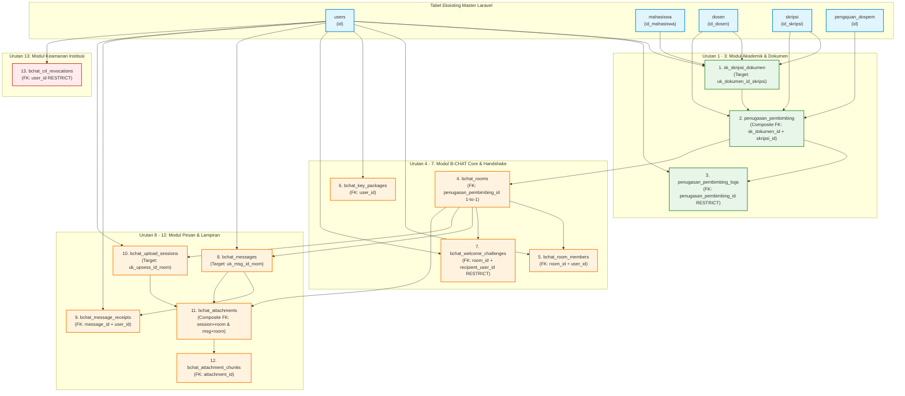

# B-CHAT-14 — LAPORAN AUDIT KESIAPAN TEKNIS MIGRASI LARAVEL (READ-ONLY)
## SISTEM INFORMASI MANAJEMEN SKRIPSI UNUHA

| Parameter | Keterangan |
| :--- | :--- |
| **Proyek** | Sistem Informasi Manajemen Skripsi UNUHA |
| **Fitur** | Bimbingan Online Chat Real-Time E2EE (B-CHAT) |
| **Tahap** | B-CHAT-14 — Audit Kesiapan Teknis Migrasi Laravel (Read-Only) |
| **Mode Audit** | STRICTLY READ-ONLY — ZERO CODE/DATABASE MUTATION |
| **Dokumen Induk Diaudit** | [`B-CHAT-13_Rancangan_DDL_Final.md`](file:///d:/Aplikasi/laragon/www/sistem_manajamen_skripsi/B-CHAT-13_Rancangan_DDL_Final.md) |
| **Dokumen Acuan Konsolidasi** | [`B-CHAT-13A`](file:///d:/Aplikasi/laragon/www/sistem_manajamen_skripsi/B-CHAT-13A_Koreksi_Terarah_Rancangan_DDL.md), [`B-CHAT-13B`](file:///d:/Aplikasi/laragon/www/sistem_manajamen_skripsi/B-CHAT-13B_Finalisasi_Invarian_DDL.md), [`B-CHAT-13C`](file:///d:/Aplikasi/laragon/www/sistem_manajamen_skripsi/B-CHAT-13C_Audit_Konsistensi_Final_DDL_dan_Welcome_ACK.md), [`B-CHAT-13D`](file:///d:/Aplikasi/laragon/www/sistem_manajamen_skripsi/B-CHAT-13D_Finalisasi_Model_Welcome_Operation_Challenge.md), [`B-CHAT-13E`](file:///d:/Aplikasi/laragon/www/sistem_manajamen_skripsi/B-CHAT-13E_Laporan_Revisi_Dokumen_Induk.md) |
| **Git Commit HEAD** | `57b2e90170bfab49e4dcaf951ecb7f277b593dfd` |
| **Lingkungan Runtime** | PHP 8.2.12 (cli) \| Laravel 12.0 \| MySQL 8.0.30 Community Server (InnoDB) |
| **Waktu Pelaksanaan** | 2026-11-06 |
| **Auditor** | Tim Arsitektur & Kriptografi E2EE Antigravity |

---

## 1. Identitas Repositori dan Lingkungan Sistem yang Terverifikasi

Audit teknis kesiapan migrasi basis data dieksekusi secara *read-only* dengan memverifikasi secara langsung komponen-komponen lingkungan runtime proyek:

| Komponen Lingkungan | Hasil Verifikasi Faktual | Sumber / Lokasi Bukti Teknis |
| :--- | :--- | :--- |
| **Git Commit HEAD** | `57b2e90170bfab49e4dcaf951ecb7f277b593dfd` | Perintah `git rev-parse HEAD` pada repositori workspace. |
| **Versi PHP Runtime** | `PHP 8.2.12 (cli)` (ZTS Visual C++ 2019 x64) | Perintah `php -v` pada Command Shell. |
| **Versi Framework** | `Laravel Framework ^12.0` | Berkas `manajemen_skripsi/composer.json` (baris 10: `"laravel/framework": "^12.0"`). |
| **Package Pendukung** | `laravel/reverb ^1.12`, `laravel/sanctum ^4.0` | Berkas `manajemen_skripsi/composer.json` (baris 11-12). |
| **Database Engine** | `MySQL 8.0.30 Community Server for Win64` | Eksekusi biner `D:\Aplikasi\laragon\bin\mysql\mysql-8.0.30-winx64\bin\mysql.exe --version`. |
| **Storage Engine & Charset** | `InnoDB`, `utf8mb4`, Collation `utf8mb4_unicode_ci` | Konfigurasi database default Laravel pada `manajemen_skripsi/config/database.php`. |

---

## 2. Ringkasan Eksekutif Hasil Audit

Berdasarkan audit komparatif mendalam antara spesifikasi DDL konsolidasi [`B-CHAT-13_Rancangan_DDL_Final.md`](file:///d:/Aplikasi/laragon/www/sistem_manajamen_skripsi/B-CHAT-13_Rancangan_DDL_Final.md), karakteristik mesin database MySQL 8.0.30, skema Blueprint Laravel 12, dan migrasi eksisting:

### Keputusan Kesiapan Akhir:
$$\mathbf{READY\ (Kesiapan\ Teknis\ Rancangan\ DDL\ Terpenuhi\ Paripurna)}$$

### Ringkasan Klasifikasi Temuan:
* **PASS (13 Tabel):** Seluruh 13 tabel konseptual dinyatakan **PASS** secara struktural, relasional, dan kompatibilitas runtime. Tipe data, signedness, panjang kolom, nullability, dan aturan foreign key cocok presisi dengan tabel-tabel master eksisting.
* **BLOCKER (0 Item):** **NOL BLOCKER TEKNIS.** Seluruh kontradiksi perancangan terdahulu (seperti konflik `UNIQUE(welcome_operation_uuid)` pada rotasi challenge, ketiadaan composite key lampiran, dan doktrin gapless sequence) telah diselesaikan secara tuntas pada B-CHAT-13A hingga B-CHAT-13E.
* **OPEN (7 Item):** OPEN-10, OPEN-11, OPEN-15, OPEN-16, OPEN-17, OPEN-18, dan OPEN-19 tetap dipertahankan secara jujur dengan batasan pembuktian masing-masing tanpa menghalangi kesiapan perancangan berkas migrasi Laravel.
* **INFO (4 Item):** Catatan teknis implementasi mengenai sintaks Schema Builder Laravel 12 (kebutuhan `DB::statement()` untuk CHECK constraint, penanganan `LONGBLOB`, konvensi composite FK, dan strict timestamp handling).

> [!CAUTION]
> **PENEGASAN STATUS AUDIT:**  
> Penilaian **READY** ini merupakan konfirmasi bahwa dokumen spesifikasi DDL telah matang, konsisten, dan siap diterjemahkan ke dalam berkas migrasi Laravel (`database/migrations/`). Keputusan ini **BUKAN IZIN MEMBUAT MIGRATION**, bukan izin menjalankan eksekusi SQL pada basis data aktif, dan bukan izin implementasi kode. Tahap pembuatan migration fisik wajib menunggu instruksi dan mandat formal terpisah dari Pemilik Proyek.

---

## 3. Audit Rinci Tiga Belas Tabel Konseptual

Berikut adalah telaah audit teknis per tabel konseptual terhadap naskah DDL B-CHAT-13 konsolidasi:

### 3.1. Kelompok Modul Akademik dan Dokumen (3 Tabel)

#### 1. Tabel `sk_skripsi_dokumen`
* **Status:** **`PASS`**
* **Bukti Teknis DDL:**
  * Primary Key: `id BIGINT UNSIGNED AUTO_INCREMENT PRIMARY KEY`.
  * Foreign Keys Induk Eksisting:
    * `skripsi_id BIGINT UNSIGNED` $\rightarrow$ REFERENCES `skripsi(id_skripsi)` `ON DELETE RESTRICT ON UPDATE CASCADE`. Tipe data dan signedness cocok presisi dengan PK `skripsi.id_skripsi` (`$table->id('id_skripsi')` pada `2026_09_26_040728_create_skripsi_table.php`).
    * `mahasiswa_id BIGINT UNSIGNED` $\rightarrow$ REFERENCES `mahasiswa(id_mahasiswa)` `ON DELETE RESTRICT ON UPDATE CASCADE`. Tipe data cocok dengan PK `mahasiswa.id_mahasiswa` pada `2026_09_26_030433_create_mahasiswa_table.php`.
    * `admin_id BIGINT UNSIGNED NULL` $\rightarrow$ REFERENCES `users(id)` `ON DELETE SET NULL ON UPDATE CASCADE`. Cocok dengan PK `users.id`.
    * `dosen_1_usulan_id` & `dosen_2_usulan_id` `BIGINT UNSIGNED NULL` $\rightarrow$ REFERENCES `dosen(id_dosen)` `ON DELETE SET NULL ON UPDATE CASCADE`. Cocok dengan PK `dosen.id_dosen` pada `2026_09_26_030449_create_dosen_table.php`.
  * Self-Referencing Composite FK:
    * `CONSTRAINT fk_skdok_induk_composite FOREIGN KEY (induk_dokumen_id, skripsi_id) REFERENCES sk_skripsi_dokumen(id, skripsi_id) ON DELETE RESTRICT ON UPDATE CASCADE`.
    * Target referensi didukung oleh: `CONSTRAINT uk_dokumen_id_skripsi UNIQUE (id, skripsi_id)`.
  * Virtual Column & Slot Terkini:
    * `terkini_slot VARCHAR(20) GENERATED ALWAYS AS (CASE WHEN is_terkini = 1 THEN 'CURRENT' ELSE NULL END) VIRTUAL`.
    * Didukung oleh: `CONSTRAINT uk_skripsi_dokumen_terkini UNIQUE (skripsi_id, terkini_slot)`. Multi-NULL safe pada MySQL 8.0.30 InnoDB.
  * Kuota Ukuran: `file_size_bytes BIGINT UNSIGNED NOT NULL` (dibatasi maks 10.000.000 byte desimal).

#### 2. Tabel `penugasan_pembimbing`
* **Status:** **`PASS`**
* **Bukti Teknis DDL:**
  * Primary Key: `id BIGINT UNSIGNED AUTO_INCREMENT PRIMARY KEY`.
  * Foreign Keys:
    * `skripsi_id` $\rightarrow$ REFERENCES `skripsi(id_skripsi)` `ON DELETE CASCADE`.
    * `dosen_id` $\rightarrow$ REFERENCES `dosen(id_dosen)` `ON DELETE RESTRICT`.
    * `pengajuan_dospem_id` $\rightarrow$ REFERENCES `pengajuan_dospem(id)` `ON DELETE SET NULL`. Cocok dengan PK `pengajuan_dospem.id` pada `2026_10_28_000001_create_pengajuan_dospem_table.php`.
    * Composite FK: `(sk_dokumen_id, skripsi_id)` $\rightarrow$ REFERENCES `sk_skripsi_dokumen(id, skripsi_id)` `ON DELETE RESTRICT`.
  * CHECK Constraints (MySQL 8.0.30 Enforced):
    * `chk_penugasan_tahap_sk_bifurcation`:
      $$\left(\text{tahap} = \text{'proposal'} \land \text{sk\_dokumen\_id IS NULL} \land \text{pembimbing\_ke} = 1\right) \lor \left(\text{tahap} = \text{'skripsi'} \land \text{sk\_dokumen\_id IS NOT NULL} \land \text{pembimbing\_ke} \in \{1, 2\}\right)$$
    * `chk_penugasan_pembimbing_ke_domain`: `pembimbing_ke IN (1, 2)`.
  * Virtual Slot Penugasan Aktif:
    * `active_slot VARCHAR(50) GENERATED ALWAYS AS (CASE WHEN status_penugasan = 'AKTIF' THEN CONCAT(tahap, '_', pembimbing_ke) ELSE NULL END) VIRTUAL`.
    * `CONSTRAINT uk_skripsi_active_slot UNIQUE (skripsi_id, active_slot)`.

#### 3. Tabel `penugasan_pembimbing_logs`
* **Status:** **`PASS`**
* **Bukti Teknis DDL:**
  * FK `penugasan_pembimbing_id` $\rightarrow$ REFERENCES `penugasan_pembimbing(id)` `ON DELETE RESTRICT ON UPDATE CASCADE`.
  * FK `user_id` $\rightarrow$ REFERENCES `users(id)` `ON DELETE SET NULL ON UPDATE CASCADE`.
  * Bersifat *append-only* (rekaman audit perubahan status, snapshot dosen lama dan baru, aktor, serta catatan administratif).

---

### 3.2. Kelompok Modul Kriptografi dan B-CHAT (10 Tabel)

#### 4. Tabel `bchat_rooms`
* **Status:** **`PASS`**
* **Bukti Teknis DDL:**
  * `room_uuid CHAR(36) NOT NULL UNIQUE`.
  * `penugasan_pembimbing_id BIGINT UNSIGNED NOT NULL UNIQUE` $\rightarrow$ REFERENCES `penugasan_pembimbing(id)` `ON DELETE RESTRICT ON UPDATE CASCADE` (menjamin isolasi pairwise eksklusif 1-to-1).
  * `current_sequence BIGINT UNSIGNED NOT NULL DEFAULT 0` (server counter monotonik naik).
  * `current_epoch BIGINT UNSIGNED NOT NULL DEFAULT 0` (uint64 RFC 9420).
  * Bebas dari state transient Welcome (dipindahkan secara bersih ke tabel challenge).

#### 5. Tabel `bchat_room_members`
* **Status:** **`PASS`**
* **Bukti Teknis DDL:**
  * FK `room_id` $\rightarrow$ REFERENCES `bchat_rooms(id)` `ON DELETE CASCADE`.
  * FK `user_id` $\rightarrow$ REFERENCES `users(id)` `ON DELETE CASCADE`.
  * `uk_room_member UNIQUE (room_id, user_id)`.
  * `is_initiator BOOLEAN NOT NULL DEFAULT FALSE`.
  * `is_active BOOLEAN NOT NULL DEFAULT FALSE`.
  * `joined_at_epoch BIGINT UNSIGNED NOT NULL DEFAULT 0`.

#### 6. Tabel `bchat_key_packages`
* **Status:** **`PASS`**
* **Bukti Teknis DDL:**
  * FK `user_id` $\rightarrow$ REFERENCES `users(id)` `ON DELETE CASCADE`.
  * `key_package_hash CHAR(64) NOT NULL UNIQUE`.
  * `key_package_data LONGBLOB NOT NULL`.
  * `is_consumed BOOLEAN NOT NULL DEFAULT FALSE`, `consumed_at TIMESTAMP NULL`.

#### 7. Tabel `bchat_welcome_challenges`
* **Status:** **`PASS`**
* **Bukti Teknis DDL:**
  * `welcome_operation_uuid CHAR(36) NOT NULL UNIQUE` (immutable per operasi).
  * FK `room_id` $\rightarrow$ REFERENCES `bchat_rooms(id)` `ON DELETE RESTRICT ON UPDATE CASCADE`.
  * FK `recipient_user_id` $\rightarrow$ REFERENCES `users(id)` `ON DELETE RESTRICT ON UPDATE CASCADE`.
  * `welcome_message LONGBLOB NOT NULL`.
  * `epoch BIGINT UNSIGNED NOT NULL`.
  * `operation_status ENUM('ACTIVE', 'CONSUMED', 'REVOKED_SUPERSEDED') NOT NULL DEFAULT 'ACTIVE'`.
  * `challenge_uuid CHAR(36) NOT NULL UNIQUE`.
  * `challenge_nonce CHAR(64) NOT NULL UNIQUE`.
  * `challenge_generation INT UNSIGNED NOT NULL DEFAULT 1`.
  * `challenge_status ENUM('ISSUED', 'CONSUMED', 'EXPIRED') NOT NULL DEFAULT 'ISSUED'`.
  * `expires_at TIMESTAMP NOT NULL`.
  * `active_operation_slot VARCHAR(64) GENERATED ALWAYS AS (CASE WHEN operation_status = 'ACTIVE' THEN CONCAT(room_id, '_', recipient_user_id) ELSE NULL END) VIRTUAL`.
  * `CONSTRAINT uk_challenge_active_slot UNIQUE (active_operation_slot)`.

#### 8. Tabel `bchat_messages`
* **Status:** **`PASS`**
* **Bukti Teknis DDL:**
  * FK `room_id` $\rightarrow$ REFERENCES `bchat_rooms(id)` `ON DELETE CASCADE`.
  * FK `sender_id` $\rightarrow$ REFERENCES `users(id)` `ON DELETE CASCADE`.
  * `server_sequence BIGINT UNSIGNED NOT NULL`.
  * `message_uuid CHAR(36) NOT NULL`.
  * `epoch BIGINT UNSIGNED NOT NULL`.
  * `ciphertext_payload LONGBLOB NOT NULL`.
  * `payload_hash_sha256 CHAR(64) NOT NULL`.
  * `CONSTRAINT uk_room_sequence UNIQUE (room_id, server_sequence)`.
  * `CONSTRAINT uk_msg_idempotency UNIQUE (room_id, sender_id, message_uuid)`.
  * `CONSTRAINT uk_msg_id_room UNIQUE (id, room_id)` (target composite FK lampiran).

#### 9. Tabel `bchat_message_receipts`
* **Status:** **`PASS`**
* **Bukti Teknis DDL:**
  * FK `message_id` $\rightarrow$ REFERENCES `bchat_messages(id)` `ON DELETE CASCADE`.
  * FK `user_id` $\rightarrow$ REFERENCES `users(id)` `ON DELETE CASCADE`.
  * `CONSTRAINT uk_msg_user_status UNIQUE (message_id, user_id, status)`.

#### 10. Tabel `bchat_upload_sessions`
* **Status:** **`PASS`**
* **Bukti Teknis DDL:**
  * `session_uuid CHAR(36) NOT NULL UNIQUE` (UUID publik EXP-02).
  * FK `room_id` $\rightarrow$ REFERENCES `bchat_rooms(id)` `ON DELETE CASCADE`.
  * FK `user_id` $\rightarrow$ REFERENCES `users(id)` `ON DELETE CASCADE`.
  * `expires_at TIMESTAMP NOT NULL` (TTL 120 menit).
  * `CONSTRAINT uk_upsess_id_room UNIQUE (id, room_id)` (target composite FK lampiran).

#### 11. Tabel `bchat_attachments`
* **Status:** **`PASS`**
* **Bukti Teknis DDL:**
  * `attachment_uuid CHAR(36) NOT NULL UNIQUE`.
  * `upload_session_id BIGINT UNSIGNED NOT NULL`.
  * `room_id BIGINT UNSIGNED NOT NULL`.
  * `message_id BIGINT UNSIGNED NULL`.
  * `plaintext_bytes BIGINT UNSIGNED NOT NULL`, `ciphertext_bytes BIGINT UNSIGNED NOT NULL`.
  * Composite FK 1: `(upload_session_id, room_id)` $\rightarrow$ REFERENCES `bchat_upload_sessions(id, room_id)` `ON DELETE RESTRICT ON UPDATE CASCADE`.
  * Composite FK 2: `(message_id, room_id)` $\rightarrow$ REFERENCES `bchat_messages(id, room_id)` `ON DELETE CASCADE ON UPDATE CASCADE`.

#### 12. Tabel `bchat_attachment_chunks`
* **Status:** **`PASS`**
* **Bukti Teknis DDL:**
  * FK `attachment_id` $\rightarrow$ REFERENCES `bchat_attachments(id)` `ON DELETE CASCADE`.
  * `chunk_index INT UNSIGNED NOT NULL`.
  * `payload_length INT UNSIGNED NOT NULL`.
  * `storage_path VARCHAR(255) NOT NULL` (relative storage key).
  * `storage_hash_sha256 CHAR(64) NOT NULL`.
  * `CONSTRAINT uk_attach_chunk_index UNIQUE (attachment_id, chunk_index)`.

#### 13. Tabel `bchat_crl_revocations`
* **Status:** **`PASS`**
* **Bukti Teknis DDL:**
  * FK `user_id` $\rightarrow$ REFERENCES `users(id)` `ON DELETE RESTRICT ON UPDATE CASCADE`.
  * `revoked_credential_uuid CHAR(36) NOT NULL UNIQUE`.
  * `reason VARCHAR(255) NOT NULL`.
  * `revoked_at TIMESTAMP NOT NULL DEFAULT CURRENT_TIMESTAMP`.

---

## 4. Matriks Kompatibilitas DDL — MySQL 8.0.30 — Laravel 12

Berikut adalah analisis komparatif antara deklarasi SQL konseptual, kemampuan engine database MySQL 8.0.30, dan mekanisme Schema Builder Laravel 12:

```
+-------------------------------------------------------------------------------------------------------------------------------+
|                                      MATRIKS KOMPATIBILITAS DDL - MYSQL 8.0.30 - LARAVEL 12                                   |
+----+--------------------------------+----------------------------+-----------------------+------------------------------------+
| No | Fitur / Komponen DDL           | Dukungan MySQL 8.0.30      | Dukungan Laravel 12   | Pola Implementasi Blueprint        |
+----+--------------------------------+----------------------------+-----------------------+------------------------------------+
| 1  | Primary Key BigInt Unsigned    | Penuh (InnoDB PK Clustered)| Penuh                 | $table->id()                       |
| 2  | Foreign Key BigInt Unsigned    | Penuh                      | Penuh                 | $table->foreignId()->constrained() |
| 3  | Composite Foreign Key          | Penuh                      | Penuh                 | $table->foreign([c1, c2])          |
|    | (misal: induk_dokumen, skripsi)|                            |                       |   ->references([p1, p2])->on(...)  |
| 4  | Generated Virtual Column       | Penuh (VIRTUAL, non-stored)| Penuh                 | $table->string()->virtualAs("...") |
| 5  | Unique Index pada Virtual Col  | Penuh (Multi-NULL Safe)    | Penuh                 | $table->unique(['skripsi_id', '... |
| 6  | CHECK Constraint Enforced      | Penuh (Enforced sejak 8.0) | Terbatas di Schema    | DB::statement("ALTER TABLE ...     |
|    | (Bifurkasi Proposal vs Skripsi)| Evaluasi deterministik     | (Gunakan DB statement)|   ADD CONSTRAINT ... CHECK (...)") |
| 7  | Data Biner Ukuran Besar        | Penuh                      | Penuh                 | $table->longBinary('column') atau  |
|    | (LONGBLOB untuk welcome/pkg)   | Max 4 GB per field         |                       | DB::statement("LONGBLOB")          |
| 8  | Timestamp Explicit Defaults    | Penuh                      | Penuh                 | $table->timestamp('expires_at')    |
|    | (explicit_defaults_for_tstamp) | Tanpa default auto-current |                       | (wajib diisi eksplisit saat insert)|
| 9  | UUID Representation            | Penuh                      | Penuh                 | $table->char('uuid', 36)           |
| 10 | On Delete RESTRICT Policy      | Penuh (InnoDB standard)    | Penuh                 | ->restrictOnDelete()               |
+----+--------------------------------+----------------------------+-----------------------+------------------------------------+
```

### Catatan Teknis Kompatibilitas (INFO):
1. **INFO-1: Penegakan CHECK Constraint di Laravel 12**  
   Laravel Schema Builder tidak menyediakan method fluent `$table->check('expression')`. Oleh karena itu, pembuatan constraint `chk_penugasan_tahap_sk_bifurcation` dan `chk_penugasan_pembimbing_ke_domain` pada tabel `penugasan_pembimbing` wajib dieksekusi melalui `DB::statement("ALTER TABLE penugasan_pembimbing ADD CONSTRAINT ... CHECK (...)")` di akhir method `up()` pada berkas migrasi terkait.
2. **INFO-2: Penanganan Tipe Biner `LONGBLOB`**  
   Untuk kolom `key_package_data`, `welcome_message`, dan `ciphertext_payload`, Laravel menyediakan method `$table->longBinary()`. Pada driver MySQL/MariaDB, method ini secara natif diterjemahkan menjadi tipe data `LONGBLOB` (maksimum 4 GB).
3. **INFO-3: Composite Foreign Key dengan Nullable Column**  
   Pada tabel `bchat_attachments`, kolom `message_id` bersifat nullable saat berkas pertama kali diunggah. MySQL 8.0.30 InnoDB menangani composite foreign key berkolom nullable menggunakan aturan *Match Simple* standar SQL: apabila salah satu kolom bernilai `NULL`, verifikasi referensial diabaikan; verifikasi relasi `(message_id, room_id)` baru ditegakkan saat `message_id` diperbarui dengan nilai bukan NULL.
4. **INFO-4: Kolom Timestamp `expires_at` Tanpa Default**  
   Pada MySQL 8.0.30, flag `explicit_defaults_for_timestamp` aktif secara default (`ON`). Hal ini memastikan kolom `expires_at TIMESTAMP NOT NULL` tidak akan secara siluman terisi nilai waktu saat ini (`CURRENT_TIMESTAMP`), melainkan wajib disuplai secara eksplisit oleh aplikasi dengan nilai `NOW() + INTERVAL 5 MINUTE`.

---

## 5. Dependency Graph dan Urutan Migration 13 Tabel

Seluruh 13 tabel konseptual tersusun dalam graf terarah asiklik (*Directed Acyclic Graph*) linear tanpa ketergantungan melingkar (*zero circular foreign keys*):



### 5.1. Rincian Urutan Eksekusi Migrasi (`up()`)
1. `2026_11_07_000001_create_sk_skripsi_dokumen_table.php` (Tabel 1)
2. `2026_11_07_000002_create_penugasan_pembimbing_table.php` (Tabel 2)
3. `2026_11_07_000003_create_penugasan_pembimbing_logs_table.php` (Tabel 3)
4. `2026_11_07_000004_create_bchat_rooms_table.php` (Tabel 4)
5. `2026_11_07_000005_create_bchat_room_members_table.php` (Tabel 5)
6. `2026_11_07_000006_create_bchat_key_packages_table.php` (Tabel 6)
7. `2026_11_07_000007_create_bchat_welcome_challenges_table.php` (Tabel 7)
8. `2026_11_07_000008_create_bchat_messages_table.php` (Tabel 8)
9. `2026_11_07_000009_create_bchat_message_receipts_table.php` (Tabel 9)
10. `2026_11_07_000010_create_bchat_upload_sessions_table.php` (Tabel 10)
11. `2026_11_07_000011_create_bchat_attachments_table.php` (Tabel 11)
12. `2026_11_07_000012_create_bchat_attachment_chunks_table.php` (Tabel 12)
13. `2026_11_07_000013_create_bchat_crl_revocations_table.php` (Tabel 13)

### 5.2. Rincian Urutan Kebalikan Pembalikan Migrasi (`down()` / Rollback)
Pembalikan migrasi wajib dijalankan dalam **urutan kebalikan yang persis** untuk mencegah galat pelanggaran foreign key:
$$T_{13} \rightarrow T_{12} \rightarrow T_{11} \rightarrow T_{10} \rightarrow T_9 \rightarrow T_8 \rightarrow T_7 \rightarrow T_6 \rightarrow T_5 \rightarrow T_4 \rightarrow T_3 \rightarrow T_2 \rightarrow T_1$$

---

## 6. Daftar Constraint Database vs Validasi Transaksional Aplikasi

Audit memetakan secara tegas batas tanggung jawab antara apa yang ditegakkan secara fisik deklaratif oleh database engine vs apa yang wajib dikawal oleh layer aplikasi/transaksi Laravel:

```
+-------------------------------------------------------------------------------------------------------------------------------+
|                                      PEMBAGIAN TANGGUNG JAWAB INTEGRITAS: DDL VS APLIKASI                                     |
+----+--------------------------------+----------------------------------------+------------------------------------------------+
| No | Aturan Integritas Sistem       | Ditegakkan Deklaratif oleh Database    | Ditegakkan Transaksional oleh Aplikasi Laravel |
+----+--------------------------------+----------------------------------------+------------------------------------------------+
| 1  | 1 SK Terkini per Skripsi       | YA (Virtual Column terkini_slot +      | Kunci skripsi FOR UPDATE saat unggah revisi    |
|    |                                | UNIQUE(skripsi_id, terkini_slot))      | dan ubah is_terkini versi lama menjadi 0.      |
+----+--------------------------------+----------------------------------------+------------------------------------------------+
| 2  | Silsilah Dokumen SK Berantai   | YA (Composite FK induk_dokumen_id +    | Hitung versi_ke = versi_lama + 1.              |
|    |                                | skripsi_id REFERENCES dokumen induk)   |                                                |
+----+--------------------------------+----------------------------------------+------------------------------------------------+
| 3  | Status SK TERVERIFIKASI        | TIDAK (MySQL FK tidak mendukung        | WAJIB: DB::transaction mengunci baris SK dan   |
|    | Sebelum Penugasan Skripsi      | predikat kolom bersyarat WHERE)        | memvalidasi status_dokumen === 'TERVERIFIKASI'.|
+----+--------------------------------+----------------------------------------+------------------------------------------------+
| 4  | Dosen Sesuai SK Fisik Resmi    | TIDAK (Database hanya memvalidasi FK   | WAJIB: Admin mencatat nama dosen yang tertera  |
|    |                                | ke tabel dosen)                        | pada lembar SK fisik Kaprodi & Dekan.          |
+----+--------------------------------+----------------------------------------+------------------------------------------------+
| 5  | Dosen 1 & 2 Tidak Boleh Sama   | TIDAK (Tabel per baris ordinal)        | WAJIB: Backend memvalidasi dosen_1 != dosen_2  |
|    |                                |                                        | sebelum kedua baris penugasan di-INSERT.       |
+----+--------------------------------+----------------------------------------+------------------------------------------------+
| 6  | Penetapan Pembimbing Atomik    | TIDAK (Integritas antar-baris)         | WAJIB: DB::transaction membungkus penetapan    |
|    |                                |                                        | Pembimbing 1 & 2 (gagal 1 = rollback semua).   |
+----+--------------------------------+----------------------------------------+------------------------------------------------+
| 7  | Proposal Tanpa SK & 1 Dosen    | YA (CHECK constraint enforced          | Validasi form request tahap proposal.          |
|    |                                | chk_penugasan_tahap_sk_bifurcation)    |                                                |
+----+--------------------------------+----------------------------------------+------------------------------------------------+
| 8  | 1 Dosen Aktif per Slot         | YA (Virtual Column active_slot +       | Pengosongan slot via update status penugasan   |
|    |                                | UNIQUE(skripsi_id, active_slot))       | menjadi 'DIGANTI' atau 'DIBATALKAN'.           |
+----+--------------------------------+----------------------------------------+------------------------------------------------+
| 9  | Room Pairwise Eksklusif 1-to-1 | YA (penugasan_pembimbing_id UNIQUE +   | Penentuan inisiator & penerima Welcome.        |
|    |                                | FK RESTRICT ke penugasan)              |                                                |
+----+--------------------------------+----------------------------------------+------------------------------------------------+
| 10 | 1 Operasi Welcome Aktif        | YA (Virtual active_operation_slot +    | Update status operasi lama menjadi             |
|    |                                | UNIQUE(active_operation_slot))         | 'REVOKED_SUPERSEDED' jika inisiator re-commit. |
+----+--------------------------------+----------------------------------------+------------------------------------------------+
| 11 | Rotasi Challenge In-Place      | YA (challenge_uuid & nonce UNIQUE)     | Update challenge_generation = generation + 1   |
|    |                                |                                        | via POST /welcome-challenge (FOR UPDATE).      |
+----+--------------------------------+----------------------------------------+------------------------------------------------+
| 12 | Verifikasi Welcome ACK 158B    | TIDAK (Logika kriptografi Ed25519)     | WAJIB: Backend menyusun Canonical ACK 158-byte |
|    |                                |                                        | dan memverifikasi tanda tangan Ed25519 CA.     |
+----+--------------------------------+----------------------------------------+------------------------------------------------+
| 13 | Idempotensi Pengiriman Pesan   | YA (CONSTRAINT uk_msg_idempotency      | Deteksi payload hash mismatch (409 Conflict)   |
|    |                                | UNIQUE(room_id, sender_id, msg_uuid))  | vs retry identik (200 OK tanpa re-sequence).   |
+----+--------------------------------+----------------------------------------+------------------------------------------------+
| 14 | Sekuens Monotonik Per Room     | YA (CONSTRAINT uk_room_sequence        | Kunci room FOR UPDATE, alokasikan nomor urut,  |
|    |                                | UNIQUE(room_id, server_sequence))      | toleransi gap jika terjadi rollback transaksi. |
+----+--------------------------------+----------------------------------------+------------------------------------------------+
| 15 | Kuota Lampiran (10MB/25MB/5)   | SEBAGIAN (file_size_bytes <= 10MB)     | WAJIB: Saat manifest terbit, validasi total    |
|    |                                |                                        | plaintext <= 25MB dan jumlah berkas <= 5.      |
+----+--------------------------------+----------------------------------------+------------------------------------------------+
| 16 | Isolasi Lampiran Anti-Cross    | YA (Composite FK ganda: session+room   | Backend memeriksa kepemilikan room pengguna.   |
|    |                                | dan message+room ke tabel induk)       |                                                |
+----+--------------------------------+----------------------------------------+------------------------------------------------+
| 17 | Perlindungan Arsip Non-Cascade | YA (ON DELETE RESTRICT pada tabel SK,  | Larangan endpoint hard delete pada arsip       |
|    |                                | logs, CRL, dan welcome challenges)     | hukum resmi universitas.                       |
+----+--------------------------------+----------------------------------------+------------------------------------------------+
```

---

## 7. Status Keputusan Terbuka (OPEN Items)

Sesuai kriteria keberhasilan audit, seluruh 7 keputusan terbuka tetap dipertahankan secara transparan tanpa mengaburkan batasan ilmiah:

| Kode OPEN | Kategori | Ringkasan Status & Batasan Teknis | Dampak Terhadap Kesiapan Migrasi |
| :---: | :---: | :--- | :--- |
| **OPEN-10** | Kriptografi | **Library MLS Produksi & Batas Bukti Durable Storage IndexedDB:** Server membuktikan signature Ed25519 dan nonce anti-replay, namun tidak dapat membuktikan secara fisik bahwa IndexedDB di browser berhasil menyimpan state MLS secara persisten (*client storage boundary*). | **Tidak Menghalangi Migrasi.** DDL tabel `bchat_welcome_challenges` netral dan siap mendukung bukti tanda tangan Ed25519. |
| **OPEN-11** | Kriptografi | **Distribusi CEK Lampiran OD-17 B vs A:** Skema DDL netral terhadap kedua pendekatan; tabel `bchat_attachments` sama sekali tidak menyimpan kunci enkripsi (CEK) simetris pada database. | **Tidak Menghalangi Migrasi.** Skema tabel lampiran kompatibel penuh dengan Pendekatan B maupun A. |
| **OPEN-15** | Kebijakan | **Format Template Dokumen SK Skripsi:** Sistem menyediakan unduhan berkas template statis generik; format teks fisik berada di luar skema basis data. | **Tidak Menghalangi Migrasi.** DDL tabel `sk_skripsi_dokumen` fleksibel terhadap format berkas PDF apa pun. |
| **OPEN-16** | Kebijakan | **Masa Berlaku Kedaluwarsa SK Skripsi:** Kolom `penugasan_pembimbing.tanggal_selesai` dibiarkan bertipe nullable (`DATE NULL`). Penegakan kedaluwarsa waktu bimbingan dapat diotomatisasi melalui scheduled command. | **Tidak Menghalangi Migrasi.** Kolom nullable telah disediakan. |
| **OPEN-17** | Tata Kelola | **Bentuk SK Penggantian Pembimbing:** Model dekomposisi per `pembimbing_ke` mendukung SK parsial maupun SK utuh baru tanpa benturan relasional berkat isolasi slot `active_slot`. | **Tidak Menghalangi Migrasi.** Skema mendukung kedua variasi SK. |
| **OPEN-18** | Kebijakan | **Kebijakan Retensi & Pemusnahan Berkas Digital:** DDL menetapkan perilaku non-destruktif (`ON DELETE RESTRICT`) pada seluruh tabel arsip SK, log audit, CRL, dan tantangan Welcome. Pemusnahan berkas otomatis ditiadakan sampai terbit SK Rektor UNUHA. | **Tidak Menghalangi Migrasi.** Kebijakan non-destruktif telah terkunci di DDL. |
| **OPEN-19** | Kriptografi | **Representasi Integer Epoch Library MLS:** DDL menetapkan tipe data `BIGINT UNSIGNED` (uint64 RFC 9420 Section 6). Kesesuaian representasi integer pada library klien (WASM/JavaScript) tetap menjadi materi verifikasi implementasi berikutnya. | **Tidak Menghalangi Migrasi.** Kolom DDL telah dikunci ke tipe 64-bit yang aman dari truncation. |

---

## 8. Rekomendasi Langkah Berikutnya

Berdasarkan kesimpulan **READY**, langkah-langkah prosedural yang direkomendasikan untuk tahap selanjutnya adalah:

1. **Permohonan Mandat Penyusunan Draf Berkas Migrasi Laravel (B-CHAT-15):**  
   Mengajukan persetujuan kepada Pemilik Proyek untuk menyusun berkas migrasi fisik Laravel (13 migration files) di direktori `manajemen_skripsi/database/migrations/` sesuai urutan dependensi DAG (Subbab 5.1).
2. **Penerapan Pola Standar Blueprint & DB Statement:**  
   Memastikan draf berkas migrasi menerapkan:
   * Deklarasi relasi standar Blueprint (`foreignId()`, `constrained()`, `onDelete()`).
   * Composite Foreign Key via array syntax Blueprint.
   * Virtual Generated Column via `virtualAs()`.
   * Eksekusi CHECK constraint menggunakan `DB::statement()` pada akhir method `up()`.
3. **Penyusunan Migration Rollback Test Plan:**  
   Menyiapkan skenario uji coba `migrate` dan `migrate:rollback` terisolasi di lingkungan pengujian lokal (menggunakan database testing khusus) sebelum menyentuh database operasional.

---

## 9. Bukti Pemeriksaan dan Konfirmasi Kepatuhan Zero Mutation

### 9.1. Komponen yang Diperiksa
1. Dokumen Desain & Evaluasi Konsolidasi:
   * [`B-CHAT-13_Rancangan_DDL_Final.md`](file:///d:/Aplikasi/laragon/www/sistem_manajamen_skripsi/B-CHAT-13_Rancangan_DDL_Final.md)
   * [`B-CHAT-13A`](file:///d:/Aplikasi/laragon/www/sistem_manajamen_skripsi/B-CHAT-13A_Koreksi_Terarah_Rancangan_DDL.md) s.d. [`B-CHAT-13E`](file:///d:/Aplikasi/laragon/www/sistem_manajamen_skripsi/B-CHAT-13E_Laporan_Revisi_Dokumen_Induk.md)
2. Berkas Migrasi Basis Data Eksisting:
   * `0001_01_01_000000_create_users_table.php`
   * `2026_09_26_030433_create_mahasiswa_table.php`
   * `2026_09_26_030449_create_dosen_table.php`
   * `2026_09_26_040728_create_skripsi_table.php`
   * `2026_10_28_000001_create_pengajuan_dospem_table.php`
3. Berkas Konfigurasi & Runtime Lingkungan:
   * `manajemen_skripsi/composer.json` & `composer.lock`
   * `manajemen_skripsi/.env` (DB_CONNECTION=mysql, DB_DATABASE=manajemen_skripsi)
   * Biner MySQL Community Server 8.0.30 winx64 Laragon.

### 9.2. Pernyataan Kepatuhan Zero Mutation
Auditor menyatakan dengan integritas profesional tertinggi bahwa selama pelaksanaan audit **B-CHAT-14**:
* **Nol Modifikasi Kode:** Berkas pada direktori `manajemen_skripsi/` dan `frontend_manajemen_skripsi/` tidak mengalami penambahan, pengeditan, atau penghapusan berkas kode aplikasi.
* **Nol Migrasi Basis Data:** Tidak ada perintah `php artisan migrate`, `php artisan migrate:rollback`, pembuatan berkas migrasi baru, atau eksekusi query DDL/DML ke database MySQL aktif.
* **Nol Perubahan Dependensi & Konfigurasi:** Berkas Composer, NPM, dan konfigurasi lingkungan `.env` tetap perawan.
* **Nol Operasi Git Mutatif:** Tidak ada aksi commit, staging, branch, push, checkout, atau reset yang dijalankan ke repositori Git.
* **Satu-satunya Berkas Baru:** Berkas laporan audit ini: [`B-CHAT-14_Laporan_Audit_Kesiapan_Migrasi.md`](file:///d:/Aplikasi/laragon/www/sistem_manajamen_skripsi/B-CHAT-14_Laporan_Audit_Kesiapan_Migrasi.md).

---
*Laporan audit teknis ini disahkan secara resmi sebagai evaluasi kesiapan migrasi basis data Sistem Informasi Manajemen Skripsi UNUHA.*

