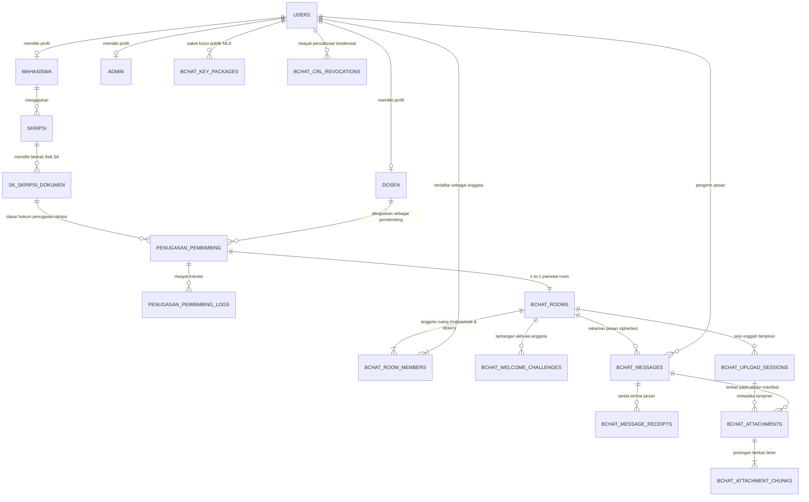
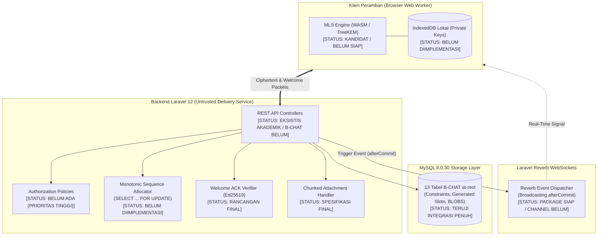

# LAPORAN AUDIT TEKNIS KESIAPAN IMPLEMENTASI BACKEND TAHAP PERTAMA (B-CHAT-16)

**Proyek:** Sistem Informasi Manajemen Skripsi UNUHA  
**Fitur:** Bimbingan Online Chat Real-Time End-to-End Encryption (B-CHAT)  
**Dokumen Acuan:**
- `B-CHAT-13_Rancangan_DDL_Final.md` (Dokumen Induk DDL Final)
- `B-CHAT-11_Spesifikasi_Integrasi_E2EE.md` (Spesifikasi Integrasi Arsitektur)
- `B-CHAT-15D_Laporan_Pengujian_Integrasi_Migrasi.md` (Hasil Pengujian Integrasi 13 Migrasi MySQL 8.0.30)
- Source code backend Laravel 12 pada repository `manajemen_skripsi/`

**Mode Audit:** STRICTLY READ-ONLY — AUDIT AND PLAN ONLY  
**Tanggal Audit:** 06 November 2026  
**Status Evaluasi:** `PASS WITH OPEN ITEMS — BACKEND IMPLEMENTATION PLAN READY`

---

## DAFTAR ISI
1. [Ringkasan Eksekutif](#1-ringkasan-eksekutif)
2. [Git HEAD dan Status Repository](#2-git-head-dan-status-repository)
3. [Kondisi Backend Aktual](#3-kondisi-backend-aktual)
4. [Matriks Model Akademik Existing](#4-matriks-model-akademik-existing)
5. [Matriks 13 Model B-CHAT](#5-matriks-13-model-b-chat)
6. [Diagram dan Tabel Relasi](#6-diagram-dan-tabel-relasi)
7. [Matriks Authorization dan Batas Identitas](#7-matriks-authorization-dan-batas-identitas)
8. [Peta Tanggung Jawab Komponen Arsitektural](#8-peta-tanggung-jawab-komponen-arsitektural)
9. [Dependency Graph Implementasi Backend (12 Langkah)](#9-dependency-graph-implementasi-backend-12-langkah)
10. [Daftar Blocker dan Open Items](#10-daftar-blocker-dan-open-items)
11. [Rekomendasi Fitur Backend Pertama](#11-rekomendasi-fitur-backend-pertama)
12. [Rekomendasi Draf Mandat Implementasi Tahap Selanjutnya (B-CHAT-17)](#12-rekomendasi-draf-mandat-implementasi-tahap-selanjutnya-b-chat-17)
13. [Kriteria Selesai dan Penegasan Status](#13-kriteria-selesai-dan-penegasan-status)

---

## 1. Ringkasan Eksekutif

Audit B-CHAT-16 dilakukan untuk menilai kesiapan implementasi backend Laravel 12 bagi fitur Bimbingan Online Chat Real-Time E2EE (B-CHAT), menyusul keberhasilan pengujian integrasi penuh 13 migrasi pada database terisolasi di tahap B-CHAT-15D.

Pemeriksaan dilakukan secara menyeluruh terhadap arsitektur backend eksisting, meliputi model akademik, routing API, broadcast channels, middleware peran, serta dependensi Laravel Sanctum dan Reverb.

### Temuan Kunci Audit:
1. **Kesiapan Struktural Skema Data:**
   13 berkas migrasi yang tersusun di `manajemen_skripsi/database/migrations/2026_11_07_*` telah terbukti 100% kompatibel dengan Laravel 12 dan MySQL 8.0.30 (lolos pengujian forward migration, inspeksi katalog sistem `information_schema`, dan rollback bersih pada B-CHAT-15D). Tipe fisik `longblob` (4 GB) terpasang nyata pada kolom ciphertext dan key package.
2. **Ketiadaan Lapisan Policy Eksisting:**
   Aplikasi backend saat ini **belum memiliki folder `app/Policies/`**. Seluruh otorisasi saat ini dikelola secara prosedural di dalam controller dengan middleware `role:mahasiswa`, `role:dosen`, dan `admin`. Untuk B-CHAT, mutlak diperlukan pembentukan lapisan Laravel Policy terdedikasi guna menjamin integritas isolasi akses antar-ruang obrolan, perlindungan privasi metadata akademik, dan pencegahan eskalasi hak istimewa.
3. **Pemisahan Identitas Mahasiswa/Dosen vs Akun Pengguna:**
   Terdapat distingsi fundamental antara Primary Key entitas profil akademik dengan PK akun pengguna:
   - `User`: PK `id` (`BIGINT UNSIGNED`).
   - `Mahasiswa`: PK `id_mahasiswa` (`BIGINT UNSIGNED`), FK `user_id` $\rightarrow$ `users(id)`.
   - `Dosen`: PK `id_dosen` (`BIGINT UNSIGNED`), FK `user_id` $\rightarrow$ `users(id)`.
   Pada tabel B-CHAT:
   - `penugasan_pembimbing.dosen_id` mengikat ke `dosen.id_dosen`.
   - `bchat_room_members.user_id`, `bchat_messages.sender_id`, dan `bchat_welcome_challenges.recipient_user_id` mengikat langsung ke `users.id`.
   Resolusi penelusuran relasi `dosen.user_id` $\leftrightarrow$ `users.id` wajib diimplementasikan secara konsisten pada lapisan model dan service.
4. **Isolasi Fitur Akademik vs Kriptografi MLS:**
   Pengembangan backend dapat dan harus dipisahkan secara tegas antara modul manajemen penugasan akademik (SK Dokumen dan Penugasan Pembimbing) dengan modul komunikasi kriptografi MLS. Modul akademik memiliki **ketergantungan nol (zero dependency)** terhadap kesiapan pustaka MLS di frontend (WASM) dan dapat diimplementasikan, diuji, serta dideploy lebih awal dengan risiko teknis yang minimal.

---

## 2. Git HEAD dan Status Repository

Berdasarkan inspeksi Git pada repositori `d:\Aplikasi\laragon\www\sistem_manajamen_skripsi`:

- **Git HEAD SHA:** `57b2e90170bfab49e4dcaf951ecb7f277b593dfd`
- **Current Branch:** `main`
- **Status Working Tree:** Bersih dari modifikasi mutatif tidak berwenang pada berkas migrasi; berkas draf migrasi 13 tabel B-CHAT tersimpan rapi sebagai berkas baru yang telah diverifikasi pada B-CHAT-15D.
- **Versi Runtime & Framework:**
  - PHP: `8.2.12` (cli) ZTS Visual C++ 2019 x64
  - Laravel Framework: `12.46.0`
  - MySQL Engine: `8.0.30`

---

## 3. Kondisi Backend Aktual

### A. Struktur Direktori Backend
Direktori backend berada pada path `manajemen_skripsi/`:
```text
manajemen_skripsi/
├── app/
│   ├── Events/
│   │   └── AcademicNotificationBroadcasted.php
│   ├── Http/
│   │   ├── Controllers/
│   │   │   ├── Admin/
│   │   │   │   ├── PengajuanDospemAdminController.php
│   │   │   │   └── PenugasanKaprodiController.php
│   │   │   ├── Mahasiswa/
│   │   │   │   └── PengajuanDospemMahasiswaController.php
│   │   │   ├── AdminController.php
│   │   │   ├── BimbinganController.php
│   │   │   ├── DosenController.php
│   │   │   ├── DosenPAController.php
│   │   │   ├── DosenPembimbingController.php
│   │   │   ├── MahasiswaController.php
│   │   │   ├── NotificationController.php
│   │   │   ├── PengajuanJudulController.php
│   │   │   ├── SkripsiController.php
│   │   │   └── UserController.php
│   │   └── Middleware/
│   │       ├── EnsureEmailIsVerified.php
│   │       ├── EnsureUserIsAdmin.php
│   │       └── EnsureUserIsRole.php
│   ├── Models/ (19 Model eksisting)
│   ├── Policies/ (TIDAK ADA / BELUM DIBENTUK)
│   ├── Providers/
│   │   └── AppServiceProvider.php
│   └── Services/
│       ├── AcademicNotificationDispatcher.php
│       └── NotificationService.php
├── bootstrap/
│   └── app.php
├── config/
│   ├── broadcasting.php (Reverb driver configured)
│   ├── queue.php (Database connection default)
│   ├── reverb.php
│   └── sanctum.php
├── database/
│   └── migrations/ (Termasuk 13 berkas migrasi B-CHAT di 2026_11_07_*)
└── routes/
    ├── api.php
    ├── channels.php
    └── web.php
```

### B. Dependensi Paket Composer (`composer.json`)
Sesuai inspeksi [`composer.json`](file:///d:/Aplikasi/laragon/www/sistem_manajamen_skripsi/manajemen_skripsi/composer.json#L9-L14):
- `"laravel/framework": "^12.0"` (Terpasang v12.46.0)
- `"laravel/sanctum": "^4.0"` (Autentikasi token & stateful SPA)
- `"laravel/reverb": "^1.12"` (WebSocket server official Laravel)
- `"laravel/tinker": "^2.10.1"`

### C. Konfigurasi Autentikasi dan Broadcasting
1. **Sanctum Stateful Middleware:**  
   Dikonfigurasi pada [`bootstrap/app.php:19-21`](file:///d:/Aplikasi/laragon/www/sistem_manajamen_skripsi/manajemen_skripsi/bootstrap/app.php#L19-L21) dengan `EnsureFrontendRequestsAreStateful::class` pada pipeline rute API.
2. **Broadcasting Channel Configuration:**  
   Dikonfigurasi pada [`bootstrap/app.php:14-17`](file:///d:/Aplikasi/laragon/www/sistem_manajamen_skripsi/manajemen_skripsi/bootstrap/app.php#L14-L17) mengarah ke `routes/channels.php` dengan middleware array `['api', 'auth:sanctum']`.
3. **Broadcasting Channel Eksisting:**  
   Pada [`routes/channels.php:17-19`](file:///d:/Aplikasi/laragon/www/sistem_manajamen_skripsi/manajemen_skripsi/routes/channels.php#L17-L19), terdaftar channel privat `users.{userId}.notifications` yang memvalidasi `(int) $user->id === (int) $userId`.
4. **Queue Connection:**  
   [`config/queue.php:16`](file:///d:/Aplikasi/laragon/www/sistem_manajamen_skripsi/manajemen_skripsi/config/queue.php#L16) menetapkan `'default' => env('QUEUE_CONNECTION', 'database')`. Distribusi event real-time Reverb untuk B-CHAT wajib menggunakan event yang mengimplementasikan `ShouldBroadcast` dan dieksekusi secara asinkron melalui queue pekerja (worker).

---

## 4. Matriks Model Akademik Existing

Tabel berikut menyajikan pemetaan komparatif terhadap model-model domain akademik yang berinteraksi langsung dengan alur penugasan dan data skripsi:

| Model | Berkas Model | Tabel Database | Primary Key | Foreign Key Penting | Sifat & Timestamps | Keterangan Relasi ke B-CHAT |
| :--- | :--- | :--- | :--- | :--- | :--- | :--- |
| **User** | [`User.php`](file:///d:/Aplikasi/laragon/www/sistem_manajamen_skripsi/manajemen_skripsi/app/Models/User.php#L11-L69) | `users` | `id` (BIGINT UNSIGNED) | - | Timestamps: Ya. `$fillable`: name, email, password, role, nomor_induk. | Target FK untuk `bchat_room_members.user_id`, `bchat_messages.sender_id`, `bchat_welcome_challenges.recipient_user_id`, dan `sk_skripsi_dokumen.admin_id`. |
| **Mahasiswa** | [`Mahasiswa.php`](file:///d:/Aplikasi/laragon/www/sistem_manajamen_skripsi/manajemen_skripsi/app/Models/Mahasiswa.php#L8-L51) | `mahasiswa` | `id_mahasiswa` (BIGINT UNSIGNED) | `user_id` $\rightarrow$ `users(id)` | Timestamps: Ya. Relasi `user()`, `skripsi()`. | Mahasiswa pengaju bimbingan. Terikat ke `sk_skripsi_dokumen.mahasiswa_id`. Akun chat menggunakan `mahasiswa.user_id`. |
| **Dosen** | [`Dosen.php`](file:///d:/Aplikasi/laragon/www/sistem_manajamen_skripsi/manajemen_skripsi/app/Models/Dosen.php#L8-L61) | `dosen` | `id_dosen` (BIGINT UNSIGNED) | `user_id` $\rightarrow$ `users(id)` | Timestamps: Ya. Relasi `user()`, `dosenPembimbing()`. | Target FK untuk `penugasan_pembimbing.dosen_id`, `sk_skripsi_dokumen.dosen_1_usulan_id`, dan `dosen_2_usulan_id`. Akun chat menggunakan `dosen.user_id`. |
| **Admin** | [`Admin.php`](file:///d:/Aplikasi/laragon/www/sistem_manajamen_skripsi/manajemen_skripsi/app/Models/Admin.php#L8-L28) | `admin` | `id_admin` (BIGINT UNSIGNED) | `users_id` $\rightarrow$ `users(id)` | Timestamps: Ya. Perhatikan nama FK: `users_id`. | Administrator verifikator berkas SK fisik dan penerbit penugasan pembimbing. |
| **Skripsi** | [`Skripsi.php`](file:///d:/Aplikasi/laragon/www/sistem_manajamen_skripsi/manajemen_skripsi/app/Models/Skripsi.php#L8-L66) | `skripsi` | `id_skripsi` (BIGINT UNSIGNED) | `id_mahasiswa` $\rightarrow$ `mahasiswa(id_mahasiswa)` | Timestamps: **TIDAK** (`public $timestamps = false;`). | Entitas induk bagi `sk_skripsi_dokumen` dan `penugasan_pembimbing`. Status judul wajib `'disetujui'`. |
| **PengajuanDospem** | [`PengajuanDospem.php`](file:///d:/Aplikasi/laragon/www/sistem_manajamen_skripsi/manajemen_skripsi/app/Models/PengajuanDospem.php#L11-L66) | `pengajuan_dospem` | `id` (BIGINT UNSIGNED) | `skripsi_id` $\rightarrow$ `skripsi(id_skripsi)`, `mahasiswa_id` $\rightarrow$ `mahasiswa(id_mahasiswa)`, `dosen_id` $\rightarrow$ `dosen(id_dosen)` | Timestamps: Ya. Status: `menunggu_penetapan`, `ditetapkan`, `ditolak`. | Menjadi dasar penetapan penugasan pembimbing khusus **tahap proposal** (`penugasan_pembimbing.pengajuan_dospem_id`). |
| **DosenPembimbing** (Legacy) | [`DosenPembimbing.php`](file:///d:/Aplikasi/laragon/www/sistem_manajamen_skripsi/manajemen_skripsi/app/Models/DosenPembimbing.php#L8-L35) | `dosen_pembimbing` | `id_pembimbing` (BIGINT UNSIGNED) | `id_skripsi` $\rightarrow$ `skripsi(id_skripsi)`, `id_dosen` $\rightarrow$ `dosen(id_dosen)` | Timestamps: **TIDAK** (`public $timestamps = false;`). | Tabel legacy operasional SIM Skripsi awal. Tidak mendukung role pembimbing 1 & 2, tidak memiliki status lifecycle aktif/diganti, dan tidak memiliki relasi SK. |

> [!IMPORTANT]
> **Anti-Ambigu Identitas Aktor Chat:**
> Pada tabel `dosen`, pengenal unik adalah `id_dosen`. Namun pada tabel otentikasi Sanctum dan keanggotaan ruang obrolan B-CHAT (`bchat_room_members`), identitas yang digunakan adalah `users.id`.
> Jika sistem mengevaluasi hak akses ruang seorang dosen yang login, sistem wajib mengonversi:
> `auth()->id()` $\equiv$ `users.id` $\leftrightarrow$ `Dosen::where('user_id', auth()->id())->first()->id_dosen` $\equiv$ `penugasan_pembimbing.dosen_id`.

---

## 5. Matriks 13 Model B-CHAT

Tabel-tabel B-CHAT yang telah divalidasi pada migrasi B-CHAT-15D membutuhkan representasi model Eloquent dengan spesifikasi teknis berikut:

| No | Nama Model Diusulkan | Nama Tabel | Karakteristik Kunci & Kolom Unik | Relasi Eloquent Kunci | Casts & Atribut Khusus | Pertimbangan Keamanan & Mutabilitas |
| :---: | :--- | :--- | :--- | :--- | :--- | :--- |
| **1** | `SkSkripsiDokumen` | `sk_skripsi_dokumen` | PK: `id`. Unique: `['id', 'skripsi_id']`, `['skripsi_id', 'versi_ke']`, `['skripsi_id', 'terkini_slot']`. | `belongsTo(Skripsi, 'skripsi_id', 'id_skripsi')`<br>`belongsTo(Mahasiswa, 'mahasiswa_id', 'id_mahasiswa')`<br>`belongsTo(User, 'admin_id', 'id')`<br>`hasMany(PenugasanPembimbing, 'sk_dokumen_id', 'id')` | `is_terkini`: `boolean`<br>`tanggal_sk`: `date`<br>`diperiksa_at`: `datetime`<br>`file_size_bytes`: `integer` | Virtual column `terkini_slot` mengunci maksimal 1 dokumen terkini per skripsi. Berkas fisik PDF disimpan pada storage privat terproteksi. |
| **2** | `PenugasanPembimbing` | `penugasan_pembimbing` | PK: `id`. Unique: `['skripsi_id', 'active_slot']`. CHECK: bifurkasi proposal vs skripsi. | `belongsTo(Skripsi, 'skripsi_id', 'id_skripsi')`<br>`belongsTo(Dosen, 'dosen_id', 'id_dosen')`<br>`belongsTo(SkSkripsiDokumen, 'sk_dokumen_id', 'id')`<br>`belongsTo(PengajuanDospem, 'pengajuan_dospem_id', 'id')`<br>`hasOne(BchatRoom, 'penugasan_pembimbing_id', 'id')`<br>`hasMany(PenugasanPembimbingLog, 'penugasan_pembimbing_id', 'id')` | `pembimbing_ke`: `integer`<br>`tanggal_mulai`: `date`<br>`tanggal_selesai`: `date` | Virtual column `active_slot` menjamin tepat 1 dosen aktif per slot `tahap_pembimbing_ke`. FK composite `['sk_dokumen_id', 'skripsi_id']` menjamin integritas skripsi. |
| **3** | `PenugasanPembimbingLog` | `penugasan_pembimbing_logs` | PK: `id`. Index: `penugasan_pembimbing_id`. | `belongsTo(PenugasanPembimbing, 'penugasan_pembimbing_id', 'id')`<br>`belongsTo(User, 'user_id', 'id')` | `created_at`: `datetime` | **APPEND-ONLY.** Nonaktifkan `updated_at` (`const UPDATED_AT = null;`). Dilarang di-update atau di-delete oleh aplikasi. |
| **4** | `BchatRoom` | `bchat_rooms` | PK: `id`. Unique: `room_uuid`, `penugasan_pembimbing_id`. | `belongsTo(PenugasanPembimbing, 'penugasan_pembimbing_id', 'id')`<br>`hasMany(BchatRoomMember, 'room_id', 'id')`<br>`hasMany(BchatMessage, 'room_id', 'id')`<br>`hasMany(BchatWelcomeChallenge, 'room_id', 'id')`<br>`hasMany(BchatUploadSession, 'room_id', 'id')` | `current_sequence`: `integer`<br>`current_epoch`: `integer` | Sequence counter monotonik per room dikelola via `SELECT ... FOR UPDATE`. Status 7 state machine lifecycle. |
| **5** | `BchatRoomMember` | `bchat_room_members` | PK: `id`. Unique: `['room_id', 'user_id']`. | `belongsTo(BchatRoom, 'room_id', 'id')`<br>`belongsTo(User, 'user_id', 'id')` | `is_initiator`: `boolean`<br>`is_active`: `boolean`<br>`joined_at_epoch`: `integer`<br>`welcome_ack_at`: `datetime` | `is_active` hanya dimutasi menjadi `true` setelah verifikasi tanda tangan digital Welcome ACK sah oleh server. |
| **6** | `BchatKeyPackage` | `bchat_key_packages` | PK: `id`. Unique: `key_package_hash`. | `belongsTo(User, 'user_id', 'id')` | `is_consumed`: `boolean`<br>`consumed_at`: `datetime`<br>`key_package_data`: Raw Binary (`longblob`) | Satu paket hanya boleh dikonsumsi sekali (`is_consumed = 1`). Kolom biner tidak boleh di-serialize ke string UTF-8 biasa. |
| **7** | `BchatWelcomeChallenge` | `bchat_welcome_challenges` | PK: `id`. Unique: `welcome_operation_uuid`, `challenge_uuid`, `challenge_nonce`, `active_operation_slot`. | `belongsTo(BchatRoom, 'room_id', 'id')`<br>`belongsTo(User, 'recipient_user_id', 'id')` | `epoch`: `integer`<br>`challenge_generation`: `integer`<br>`expires_at`: `datetime`<br>`consumed_at`: `datetime`<br>`welcome_message`: Raw Binary (`longblob`) | Model representasi **Satu Baris Per Welcome Operation**. Nonce dirotasi in-place dengan monotonik counter `challenge_generation`. Slot aktif dijamin virtual column. |
| **8** | `BchatMessage` | `bchat_messages` | PK: `id`. Unique: `['room_id', 'server_sequence']`, `['room_id', 'sender_id', 'message_uuid']`, `['id', 'room_id']`. | `belongsTo(BchatRoom, 'room_id', 'id')`<br>`belongsTo(User, 'sender_id', 'id')`<br>`hasMany(BchatMessageReceipt, 'message_id', 'id')`<br>`hasMany(BchatAttachment, 'message_id', 'id')` | `server_sequence`: `integer`<br>`epoch`: `integer`<br>`generation`: `integer`<br>`content_type`: `integer`<br>`client_sent_at`: `datetime`<br>`ciphertext_payload`: Raw Binary (`longblob`) | **APPEND-ONLY & IDEMPOTEN.** Payload adalah MLS PrivateMessage murni. Server bertindak sebagai untrusted Delivery Service tanpa kemampuan inspeksi plaintext. |
| **9** | `BchatMessageReceipt` | `bchat_message_receipts` | PK: `id`. Unique: `['message_id', 'user_id', 'status']`. | `belongsTo(BchatMessage, 'message_id', 'id')`<br>`belongsTo(User, 'user_id', 'id')` | `status_at`: `datetime` | **APPEND-ONLY.** Nonaktifkan timestamps standar (`public $timestamps = false;`). Mencatat status tanda terima DELIVERED dan READ. |
| **10** | `BchatUploadSession` | `bchat_upload_sessions` | PK: `id`. Unique: `session_uuid`, `['id', 'room_id']`. | `belongsTo(BchatRoom, 'room_id', 'id')`<br>`belongsTo(User, 'user_id', 'id')`<br>`hasMany(BchatAttachment, 'upload_session_id', 'id')` | `total_bytes`: `integer`<br>`total_chunks`: `integer`<br>`expires_at`: `datetime` | TTL sesi 120 menit. Mengunci kuota ciphertext per lampiran (maks 10 MB plaintext + chunk overhead). |
| **11** | `BchatAttachment` | `bchat_attachments` | PK: `id`. Unique: `attachment_uuid`. Composite FK ke upload session & message. | `belongsTo(BchatUploadSession, 'upload_session_id', 'id')`<br>`belongsTo(BchatMessage, 'message_id', 'id')`<br>`hasMany(BchatAttachmentChunk, 'attachment_id', 'id')` | `plaintext_bytes`: `integer`<br>`ciphertext_bytes`: `integer`<br>`total_chunks`: `integer` | Relasi composite mengunci kepemilikan ruang yang sama antara session, message, dan attachment. Status awal `PENDING_MESSAGE`. |
| **12** | `BchatAttachmentChunk` | `bchat_attachment_chunks` | PK: `id`. Unique: `['attachment_id', 'chunk_index']`. | `belongsTo(BchatAttachment, 'attachment_id', 'id')` | `chunk_index`: `integer`<br>`payload_length`: `integer` | Potongan biner ciphertext (1 MiB + 28B overhead) disimpan pada storage disk terisolasi. Integritas dicek via SHA-256 at-rest. |
| **13** | `BchatCrlRevocation` | `bchat_crl_revocations` | PK: `id`. Unique: `revoked_credential_uuid`. | `belongsTo(User, 'user_id', 'id')` | `revoked_at`: `datetime` | **APPEND-ONLY.** Rekaman pencabutan kredensial identitas Ed25519 oleh Certificate Authority (CA) kampus. `ON DELETE RESTRICT`. |

---

## 6. Diagram dan Tabel Relasi

### A. Diagram Arsitektur Relasi Domain Akademik & B-CHAT


### B. Tabel Penegasan Bifurkasi Akademik (Proposal vs Skripsi)

Struktur tabel `penugasan_pembimbing` menerapkan constraint integritas kaku melalui constraint MySQL:
`chk_penugasan_tahap_sk_bifurcation`:

| Parameter Domain | Tahap Proposal | Tahap Skripsi |
| :--- | :--- | :--- |
| **Jumlah Pembimbing Aktif** | Tepat 1 pembimbing (`pembimbing_ke = 1`). | Tepat 2 pembimbing (`pembimbing_ke = 1` dan `pembimbing_ke = 2`). |
| **Kebutuhan SK Pembimbing** | **TIDAK BUTUH SK** (`sk_dokumen_id IS NULL`). | **MUTLAK WAJIB SK REKTOR/DEKAN** (`sk_dokumen_id IS NOT NULL`). |
| **Sumber Penugasan Sistem** | Berdasarkan pengajuan judul & pengajuan dospem proposal yang disetujui Kaprodi/Admin (`pengajuan_dospem_id IS NOT NULL`). | Berdasarkan unggahan berkas SK fisik yang diverifikasi oleh Admin (`sk_dokumen_id IS NOT NULL`). |
| **Alur Pengurusan SK** | Tidak ada alur SK pada tahap proposal. | Mahasiswa mengurus SK secara offline ke fakultas (tanda tangan Dekan/Kaprodi), lalu mengunggah scan PDF ke sistem. |
| **Peran Sistem Informasi** | Mencatat penetapan dosen pembimbing proposal. | Memverifikasi kelengkapan scan PDF dan menerbitkan penugasan formal. **Sistem tidak membuat nomor SK atau menyediakan tanda tangan digital SK**. |
| **Pembentukan Bchat Room** | Terbentuk dengan status `PENDING_WELCOME_ACK` saat penetapan disetujui. | Terbentuk dengan status `PENDING_WELCOME_ACK` **hanya setelah** berkas SK berstatus `TERVERIFIKASI`. |

---

## 7. Matriks Authorization dan Batas Identitas

### A. Matriks Otorisasi Berdasarkan Peran Pengguna

| Aksi / Resource | Mahasiswa | Dosen Pembimbing | Administrator | Mekanisme Otorisasi Direkomendasikan |
| :--- | :---: | :---: | :---: | :--- |
| **Unggah Berkas PDF SK Skripsi** | Diizinkan (hanya untuk skripsi miliknya sendiri) | Ditolak | Ditolak | `SkSkripsiDokumenPolicy@create` memverifikasi `auth()->user()->mahasiswa->id_mahasiswa === skripsi.id_mahasiswa`. |
| **Verifikasi / Tolak SK Dokumen** | Ditolak | Ditolak | Diizinkan | Middleware `EnsureUserIsAdmin` + `SkSkripsiDokumenPolicy@verify`. |
| **Penetapan Penugasan Pembimbing** | Ditolak | Ditolak | Diizinkan | Middleware `EnsureUserIsAdmin` + transaksi atomik verifikasi status SK. |
| **Melihat Metadata Ruang Obrolan** | Diizinkan (hanya room miliknya) | Diizinkan (hanya jika berstatus penugasan `AKTIF`) | Diizinkan (hanya untuk pengawasan kepatuhan akademik) | `BchatRoomPolicy@view`: verifikasi keanggotaan eksplisit atau role admin. |
| **Kirim Pesan Ciphertext E2EE** | Diizinkan (wajib `is_active = 1`) | Diizinkan (wajib `is_active = 1`) | **DITOLAK MUTLAK (403)** | `BchatRoomPolicy@sendMessage`: Admin tidak boleh mengirim pesan atas nama pengguna lain. |
| **Melihat / Mengunduh Pesan E2EE** | Diizinkan (hanya ciphertext miliknya) | Diizinkan (hanya ciphertext miliknya) | **DITOLAK MUTLAK (403)** | Server tidak memiliki kunci dekripsi; Admin tidak boleh mengakses endpoint pesan room. |
| **Verifikasi Welcome ACK** | Diizinkan (jika berstatus inisiator/penerima sah) | Diizinkan (jika berstatus inisiator/penerima sah) | Ditolak | Endpoint Welcome ACK: verifikasi tanda tangan digital Ed25519 terhadap challenge aktif. |
| **Unggah Chunk Lampiran Terenkripsi** | Diizinkan (anggota aktif room) | Diizinkan (anggota aktif room) | Ditolak | `BchatUploadPolicy@uploadChunk`: verifikasi session aktif & kuota ukuran. |
| **Langganan Channel Reverb WebSocket** | Diizinkan (`private-bchat.room.{uuid}`) | Diizinkan (`private-bchat.room.{uuid}`) | Ditolak | Callback `routes/channels.php` memverifikasi `bchat_room_members.is_active = 1`. |

### B. Batas Keras Keamanan (Security Boundaries)
1. **Otorisasi WebSocket Tidak Menggantikan Otorisasi REST API:**  
   Keberhasilan koneksi WebSocket Reverb hanya mengizinkan penerimaan sinyal event real-time (notifikasi bahwa ada pesan baru). Pengambilan ciphertext payload, pengunggahan pesan, dan pengunggahan chunk lampiran **wajib melalui validasi otorisasi penuh pada setiap HTTP REST request**.
2. **Status Membership DB $\neq$ Kepemilikan State Kriptografi MLS:**  
   Nilai `is_active = 1` di tabel database hanyalah rekaman administratif bahwa server telah memvalidasi Welcome ACK. Server **tidak memiliki kapasitas untuk menjamin** bahwa peramban klien saat ini masih memegang leaf private key lokal di IndexedDB. Jika kunci lokal terhapus, klien harus meminta re-keying atau inisiasi ulang sesi.
3. **Admin Excluded from E2EE Group:**  
   Administrator sistem memiliki hak penuh dalam ranah akademik (membatalkan penugasan, memverifikasi dokumen SK, mencabut akun), namun **secara kriptografis diisolasi keluar dari MLS TreeKEM Group**. Admin tidak pernah didaftarkan sebagai anggota di `bchat_room_members` dan tidak memiliki kunci privat untuk mendekripsi percakapan bimbingan mahasiswa.

---

## 8. Peta Tanggung Jawab Komponen Arsitektural

Peta ini membedakan secara tegas peran masing-masing komponen teknis serta status kesiapan implementasinya:



| Komponen | Status Implementasi | Tanggung Jawab Utama | Hal yang DILARANG Dilakukan Komponen |
| :--- | :---: | :--- | :--- |
| **REST API (Laravel 12)** | Terpasang untuk modul akademik; **Belum ada untuk B-CHAT** | - Sumber kebenaran metadata persisten.<br>- Validasi skema request & rate limiting.<br>- Alokasi sekuens monotonik per-ruang.<br>- Penegakan idempotensi `(room, sender, uuid)`.<br>- Batas transaksi basis data (`DB::transaction`). | - **DILARANG menerima atau menyimpan plaintext chat/file.**<br>- DILARANG menganggap Reverb sebagai sumber kebenaran pesan.<br>- DILARANG mengizinkan Admin bypass dekripsi. |
| **MySQL 8.0.30 Engine** | **100% Teruji & Siap** (B-CHAT-15D) | - Penegakan integritas struktural at-rest.<br>- Penjaminan relasi FK composite & CASCADE/RESTRICT.<br>- Penguncian baris (`FOR UPDATE`) untuk konkurensi sekuens.<br>- Penyimpanan aman `longblob` (4 GB) untuk ciphertext. | - DILARANG menyimpan kunci privat pengguna.<br>- DILARANG melonggarkan CHECK constraints bifurkasi. |
| **Laravel Reverb** | **Terpasang package `laravel/reverb: ^1.12`**; Channel B-CHAT belum dibuat | - Distribusi sinyal event real-time instan ke peramban.<br>- Notifikasi pesan masuk, pembaruan status room, read receipt.<br>- Memvalidasi autentikasi channel privat. | - **BUKAN message store** (tidak boleh menyimpan riwayat pesan).<br>- DILARANG mendistribusikan event sebelum transaksi DB commit. |
| **MLS Client / Web Worker** | **Kandidat / Belum Divalidasi untuk Produksi** | - Komputasi TreeKEM, pembuatan KeyPackage, MLS Commit.<br>- Enkripsi dan dekripsi `PrivateMessage` di sisi klien.<br>- Penyimpanan aman leaf secret di IndexedDB terisolasi.<br>- Pembentukan canonical signature Welcome ACK 158-byte. | - DILARANG mengekspos kunci privat ke DOM utama.<br>- DILARANG mengirimkan state memori kunci ke server. |
| **Attachment Service** | **Spesifikasi & DDL Siap**; Kode service belum dibuat | - Mengelola lifecycle upload session (TTL 120 menit).<br>- Validasi ukuran berkas (maks 10 MB plaintext) & kuota chunk.<br>- Menyimpan potongan ciphertext pada storage disk privat.<br>- Verifikasi checksum SHA-256 tiap potongan biner. | - DILARANG menerima berkas lampiran tanpa enkripsi klien.<br>- DILARANG menyatukan chunk menjadi plaintext di server. |
| **Identity & Welcome ACK** | **Spesifikasi & DDL Siap**; Kode verifier belum dibuat | - Menghasilkan challenge nonce 32-byte unik per generasi.<br>- Memvalidasi canonical payload 158-byte anti-replay.<br>- Memverifikasi tanda tangan digital Ed25519 pengguna.<br>- Mengaktifkan status keanggotaan `is_active = 1`. | - DILARANG mengaktifkan anggota tanpa verifikasi kriptografis sah.<br>- DILARANG menggunakan ulang nonce yang telah expired/consumed. |

---

## 9. Dependency Graph Implementasi Backend (12 Langkah)

Penyusunan urutan implementasi backend didasarkan pada dependensi dependensi fungsional aktual:

```text
[Langkah 1: Model & Relasi SK Dokumen / Penugasan Pembimbing] (ZERO MLS DEPENDENCY)
       │
       ▼
[Langkah 2: Lapisan Authorization & Laravel Policies] (ZERO MLS DEPENDENCY)
       │
       ▼
[Langkah 3: Model & Lifecycle Manajemen Chat Room] (ZERO MLS DEPENDENCY)
       │
       ▼
[Langkah 4: Manajemen Identitas, CA Internal, & Key Packages]
       │
       ▼
[Langkah 5: Welcome Operation Protocol & Rotasi Challenge]
       │
       ▼
[Langkah 6: Message Persistence & Monotonic Sequence Service]
       │
       ▼
[Langkah 7: Message Delivery & Read Receipts Tracking]
       │
       ▼
[Langkah 8: Chunked Attachment Service & Manifest Handler]
       │
       ▼
[Langkah 9: Integrasi Real-Time Laravel Reverb Broadcasting]
       │
       ▼
[Langkah 10: Integrasi MLS Client & Web Worker Frontend] (MEMBUTUHKAN VALIDASI MLS WASM)
       │
       ▼
[Langkah 11: Rekeying, Suspensi Room, & Transisi Pembimbing]
       │
       ▼
[Langkah 12: Security Hardening, Audit Trail, & CI/CD Automated Tests]
```

### Klasifikasi Kesiapan Implementasi:
1. **Dapat Diimplementasikan Segera (Langkah 1 – Langkah 3):**  
   Modul Dokumen SK, Penugasan Pembimbing, Laravel Policies, dan Inisialisasi Metadata Chat Room. Seluruhnya murni operasi backend standar, tidak bergantung pada pustaka MLS peramban, tidak menyentuh kunci privat, dan langsung menyelesaikan kebutuhan akademik perguruan tinggi.
2. **Dapat Diimplementasikan Secara Mock / Headless (Langkah 4 – Langkah 9):**  
   Penyimpanan paket kunci, Welcome Challenge verifier, dan Message persistence dapat diimplementasikan dan diuji unit test di backend menggunakan fixture kunci biner statis tanpa menunggu UI frontend.
3. **Wajib Menunggu Validasi Kriptografi Produksi (Langkah 10):**  
   Integrasi penuh MLS TreeKEM di peramban pengguna memerlukan validasi performa WebAssembly, konsumsi memori, dan kompatibilitas peramban mobile/desktop sebelum dapat dinyatakan operasional untuk mahasiswa.

---

## 10. Daftar Blocker dan Open Items

Status analisis terhadap Open Items arsitektur terdahulu:

| ID Item | Topik / Isu Arsitektural | Klasifikasi | Keterkaitan dengan Implementasi Backend | Status Resolusi Saat Ini |
| :---: | :--- | :---: | :--- | :--- |
| **OPEN-10** | Penggantian Pembimbing & Kebijakan SK Pengganti | Open Item | Kolom `digantikan_oleh_id` dan status `DIGANTI` telah tersedia di migration 2. Transisi pembimbing wajib membekukan room lama (`ARCHIVED_READONLY`) dan membuka penugasan baru. | Terakomodasi di DDL; Prosedur transisi disiapkan pada Langkah 11. |
| **OPEN-11** | Kedaluwarsa SK Bimbingan & Grace Period | Open Item | Kolom `tanggal_mulai` dan `tanggal_selesai` tersedia pada tabel penugasan. Perlu cron/job terjadwal untuk memeriksa SK yang melewati batas semester. | Non-blocking untuk implementasi tahap pertama. |
| **OPEN-12** | Retensi Data Chat Sesuai Keputusan Rektor | Open Item | Kebijakan retensi pasca-kelulusan mahasiswa (misal penyimpanan 1 tahun sebelum hard-purge). | Non-blocking untuk tahap awal; DDL mendukung soft lifecycle. |
| **OPEN-13** | Infrastruktur Certificate Authority (CA) Kampus | Blocker untuk MLS | Validasi tanda tangan digital identitas dan KeyPackage membutuhkan pasangan kunci publik/privat root CA kampus. | **Wajib difinalisasi sebelum Langkah 4**. |
| **OPEN-14** | Format Canonical Welcome ACK 158-Byte | Resolved | Telah difinalisasi secara presisi pada B-CHAT-13E. Backend hanya perlu membangun class parser/serializer biner 158 byte. | Selesai dirancang; Siap di-encode pada Langkah 5. |
| **OPEN-15** | Desain OD-17 Pendekatan Lampiran / CEK | Resolved | Enkripsi lampiran menggunakan Content Encryption Key (CEK) simetris per berkas yang didistribusikan melalui pesan manifest MLS. | Selesai dirancang; Tidak mempengaruhi skema backend. |
| **OPEN-16** | Persistensi State MLS Klien di Peramban | Blocker untuk MLS | Klien peramban rentan kehilangan state TreeKEM jika local storage/IndexedDB terhapus. | Membutuhkan alur re-add terotomatisasi di klien. |
| **OPEN-17** | Kesiapan Pustaka MLS RFC 9420 untuk Web/WASM | Blocker untuk MLS | Ketiadaan implementasi JavaScript/WASM MLS murni yang matang untuk production grade browser client. | **Diisolasi di luar backend; Tidak memblokir backend Langkah 1-3**. |
| **OPEN-18** | Disconnect Session Reverb Saat Revokasi | Open Item | Saat penugasan dibatalkan, Reverb perlu memutus sambungan WebSocket pengguna dari channel room. | Dapat ditangani via Reverb API atau penolakan auth pada polling berikutnya. |
| **OPEN-19** | Kebijakan Penghapusan Pesan & Orphan Chunks | Open Item | Jika pesan dihapus, relasi composite `ON DELETE CASCADE` akan menghapus baris lampiran. Perlu cleanup job untuk menghapus fisik berkas biner di storage disk. | Non-blocking; Diatur pada attachment service storage cleanup. |

---

## 11. Rekomendasi Fitur Backend Pertama

### Rekomendasi Terpilih:
> **MODUL MANAJEMEN DOKUMEN SK SKRIPSI & PENUGASAN PEMBIMBING AKADEMIK**  
> *(Tabel 1: `sk_skripsi_dokumen`, Tabel 2: `penugasan_pembimbing`, Tabel 3: `penugasan_pembimbing_logs`)*

### Alasan Teknis dan Justifikasi Arsitektur:
1. **Fondasi Hukum Mutlak (Prerequisite of Everything):**  
   Chat room B-CHAT tidak dapat eksis tanpa adanya relasi 1-to-1 dengan record penugasan pembimbing yang sah (`penugasan_pembimbing_id`). Membangun chat room sebelum mekanisme penugasan pembimbing ada adalah pelanggaran terhadap prinsip *domain integrity*.
2. **Zero Cryptographic & Zero WASM Dependency:**  
   Modul ini adalah fitur operasional akademik murni (manajemen berkas PDF, verifikasi oleh staf tata usaha/admin, penetapan pembimbing 1 dan pembimbing 2). Sama sekali tidak memerlukan ketergantungan pada pustaka kriptografi MLS yang saat ini masih berstatus kandidat.
3. **Zero Risk of Plaintext Chat Leakage:**  
   Fitur ini tidak menerima, memproses, atau menyimpan pesan percakapan, sehingga tidak ada risiko kebocoran data percakapan mahasiswa-dosen.
4. **Langsung Mengintegrasikan & Memperbaiki Alur Akademik Nyata:**  
   Saat ini, mahasiswa UNUHA mengurus SK secara fisik ke tata usaha fakultas. Modul ini menjembatani realitas offline tersebut: mahasiswa mengunggah scan SK fisik, staf Admin memeriksa dan mencatat nomor SK resmi, dan sistem secara otomatis mengunci slot pembimbing aktif dengan aman melalui *Generated Virtual Column* dan *Composite Foreign Keys*.

---

## 12. Rekomendasi Draf Mandat Implementasi Tahap Selanjutnya (B-CHAT-17)

Sebagai panduan operasional implementasi berikutnya, disusun draf mandat implementasi terarah sebagai berikut:

```markdown
# MANDAT ANTIGRAVITY — B-CHAT-17 (DRAF REKOMENDASI)
## Implementasi Backend Tahap 1: Modul Dokumen SK dan Penugasan Pembimbing

### 1. Ruang Lingkup Kerja
- Membuat Model Eloquent:
  1. `App\Models\SkSkripsiDokumen`
  2. `App\Models\PenugasanPembimbing`
  3. `App\Models\PenugasanPembimbingLog`
- Mendefinisikan relasi lengkap ke model eksisting (`Skripsi`, `Mahasiswa`, `Dosen`, `User`, `PengajuanDospem`).
- Membuat Form Request & Controller:
  - `Mahasiswa\SkSkripsiDokumenMahasiswaController` (Upload scan SK, lihat riwayat dokumen).
  - `Admin\SkSkripsiDokumenAdminController` (Pemeriksaan berkas, persetujuan/penolakan SK).
  - `Admin\PenugasanPembimbingAdminController` (Penerbitan penugasan pembimbing 1 & 2 berdasarkan SK sah).
- Membuat Policy:
  - `App\Policies\SkSkripsiDokumenPolicy`
  - `App\Policies\PenugasanPembimbingPolicy`
- Menulis Feature Test komprehensif untuk pengujian validasi, otorisasi, dan transaksi atomik.

### 2. Batasan Mutlak
- DILARANG menyentuh atau memodifikasi 13 berkas migrasi B-CHAT yang telah lolos pengujian B-CHAT-15D.
- DILARANG mengaktifkan atau membuat endpoint pengiriman pesan chat sebelum modul akademik tervalidasi 100%.
- Menjaga integritas data database `sim_skripsi` dan `manajemen_skripsi`.
```

---

## 13. Kriteria Selesai dan Penegasan Status

Audit kesiapan implementasi backend tahap pertama (B-CHAT-16) telah diselesaikan secara paripurna dengan hasil:
- Kondisi backend aktual (Laravel 12.46.0, PHP 8.2.12, Sanctum, Reverb) telah dipetakan secara detail.
- Matriks model akademik eksisting dan 13 model B-CHAT telah dirancang secara presisi lengkap dengan foreign keys, casts, dan proteksi mutabilitas.
- Matriks otorisasi dan batas keamanan arsitektural telah ditetapkan.
- Peta tanggung jawab komponen dan dependency graph 12 langkah telah disusun.
- Blocker kriptografi MLS telah diidentifikasi dan diisolasi dengan aman di luar modul akademik.
- Rekomendasi satu fitur implementasi backend pertama telah ditetapkan dengan argumen teknis yang solid.

**Status Audit Akhir:**
# `PASS WITH OPEN ITEMS — BACKEND IMPLEMENTATION PLAN READY`
*(Rencana implementasi backend siap dieksekusi secara bertahap dimulai dari Modul Dokumen SK dan Penugasan Pembimbing Akademik).*

