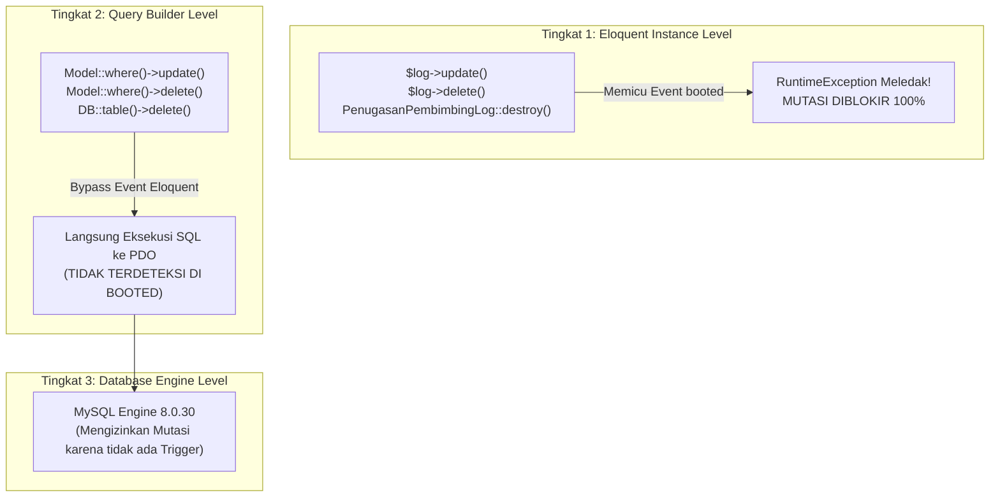

# LAPORAN AUDIT VERIFIKASI KEAMANAN MODEL AKADEMIK (B-CHAT-17A)

**Proyek:** Sistem Informasi Manajemen Skripsi UNUHA  
**Fitur:** Bimbingan Online Chat Real-Time E2EE (B-CHAT)  
**Dokumen yang Diaudit:**
- `manajemen_skripsi/app/Models/SkSkripsiDokumen.php`
- `manajemen_skripsi/app/Models/PenugasanPembimbing.php`
- `manajemen_skripsi/app/Models/PenugasanPembimbingLog.php`
- Model existing: `Skripsi.php`, `Dosen.php`, `Mahasiswa.php`, `User.php`, `PengajuanDospem.php`
- Migration: `2026_11_07_000001_create_sk_skripsi_dokumen_table.php`, `2026_11_07_000002_create_penugasan_pembimbing_table.php`, `2026_11_07_000003_create_penugasan_pembimbing_logs_table.php`

**Mode Kerja:** STRICTLY READ-ONLY — AUDIT ONLY  
**Tanggal Audit:** 06 November 2026  
**Status Evaluasi:** `PASS — MODEL SECURITY REVIEW COMPLETE`

---

## DAFTAR ISI
1. [Ringkasan Eksekutif](#1-ringkasan-eksekutif)
2. [Git HEAD dan Status Working Tree](#2-git-head-dan-status-working-tree)
3. [Audit Mass Assignment Tiga Model B-CHAT](#3-audit-mass-assignment-tiga-model-b-chat)
4. [Audit Relasi Silsilah Penggantian Pembimbing](#4-audit-relasi-silsilah-penggantian-pembimbing)
5. [Audit Mekanisme Perlindungan Append-Only Log](#5-audit-mekanisme-perlindungan-append-only-log)
6. [Pemeriksaan File Baru dan Penyesuaian File Existing](#6-pemeriksaan-file-baru-dan-penyesuaian-file-existing)
7. [Daftar Temuan dan Catatan Keamanan](#7-daftar-temuan-dan-catatan-keamanan)
8. [Rekomendasi dan Kesiapan Menuju B-CHAT-18](#8-rekomendasi-dan-kesiapan-menuju-b-chat-18)

---

## 1. Ringkasan Eksekutif

Audit B-CHAT-17A dilakukan untuk memeriksa secara ketat hasil implementasi fondasi tiga model Eloquent akademik B-CHAT yang telah diselesaikan pada B-CHAT-17. Fokus verifikasi meliputi keamanan mass assignment (`$fillable` / `$guarded`), integritas relasi Eloquent terhadap skema migrasi MySQL 8.0.30, efektivitas penegakan aturan append-only pada model log, serta kebersihan riwayat Git repositori.

### Hasil Kunci Audit:
1. **Perlindungan Kolom Virtual Berhasil 100%:**
   Kolom generated virtual `terkini_slot` pada [`SkSkripsiDokumen`](file:///d:/Aplikasi/laragon/www/sistem_manajamen_skripsi/manajemen_skripsi/app/Models/SkSkripsiDokumen.php#L28-L45) dan `active_slot` pada [`PenugasanPembimbing`](file:///d:/Aplikasi/laragon/www/sistem_manajamen_skripsi/manajemen_skripsi/app/Models/PenugasanPembimbing.php#L29-L40) **terbukti tidak dimasukkan ke dalam array `$fillable`**. Hal ini mencegah terjadinya *MySQL Error 3105 / 3106 (The value specified for generated column is not allowed)* saat operasi mass assignment.
2. **Kesesuaian Relasi Foreign Key Silsilah:**
   Arah relasi self-reference `digantikan_oleh_id` pada [`PenugasanPembimbing`](file:///d:/Aplikasi/laragon/www/sistem_manajamen_skripsi/manajemen_skripsi/app/Models/PenugasanPembimbing.php#L92-L103) telah diverifikasi secara matematis dan logis:
   - `digantikanOleh()` menggunakan `belongsTo(self::class, 'digantikan_oleh_id', 'id')` menghubungkan penugasan lama ke penugasan baru.
   - `menggantikan()` menggunakan `hasOne(self::class, 'digantikan_oleh_id', 'id')` menghubungkan penugasan baru ke penugasan lama yang digantikannya.
3. **Klarifikasi Batas Append-Only:**
   Proteksi `booted()` pada [`PenugasanPembimbingLog`](file:///d:/Aplikasi/laragon/www/sistem_manajamen_skripsi/manajemen_skripsi/app/Models/PenugasanPembimbingLog.php#L61-L70) efektif memblokir mutasi via instansiasi model Eloquent (`$log->update()` dan `$log->delete()`). Namun, operasi direct Query Builder (`Model::where()->update/delete`) tidak memicu model event. Oleh karena itu, append-only pada tahap ini diklasifikasikan secara jujur sebagai **Application-Level Model Invariant**, bukan database-level constraint.
4. **Kebersihan Perubahan Kode:**
   Pemeriksaan `git diff --check` dan `git diff --stat` mengonfirmasi bahwa tidak ada modifikasi di luar lingkup B-CHAT-17. Model existing hanya bertambah pada method relasi, tanpa mengubah fungsionalitas fitur akademik yang sedang berjalan.

---

## 2. Git HEAD dan Status Working Tree

- **Git HEAD SHA:** `57b2e90170bfab49e4dcaf951ecb7f277b593dfd`
- **Branch Aktif:** `main`
- **Hasil Pemeriksaan Lint Sintaks (`php -l`):** 100% PASS (Zero syntax errors).
- **Hasil `git diff --check`:** 100% CLEAN (Zero whitespace or syntax conflicts).
- **Status Working Tree Modifikasi Model:**
  ```text
  manajemen_skripsi/app/Models/Dosen.php           | 24 ++++++++++++++++++++++++
  manajemen_skripsi/app/Models/Mahasiswa.php       | 12 ++++++++++++
  manajemen_skripsi/app/Models/PengajuanDospem.php | 16 ++++++++++++++++
  manajemen_skripsi/app/Models/Skripsi.php         | 24 ++++++++++++++++++++++++
  manajemen_skripsi/app/Models/User.php            | 12 ++++++++++++
  5 files changed, 88 insertions(+)
  ```

---

## 3. Audit Mass Assignment Tiga Model B-CHAT

### A. Model `SkSkripsiDokumen`
Berkas: [`manajemen_skripsi/app/Models/SkSkripsiDokumen.php`](file:///d:/Aplikasi/laragon/www/sistem_manajamen_skripsi/manajemen_skripsi/app/Models/SkSkripsiDokumen.php)

Array `$fillable` terdefinisi pada baris 28–45:
```php
protected $fillable = [
    'skripsi_id', 'mahasiswa_id', 'versi_ke', 'is_terkini',
    'induk_dokumen_id', 'nomor_sk', 'tanggal_sk', 'file_path',
    'file_hash_sha256', 'file_size_bytes', 'status_dokumen',
    'admin_id', 'diperiksa_at', 'catatan_admin',
    'dosen_1_usulan_id', 'dosen_2_usulan_id',
];
```

#### Klasifikasi Kolom terhadap Alur Bisnis:
| Klasifikasi Keamanan | Kolom | Keterangan & Batas Otorisasi |
| :--- | :--- | :--- |
| **Aman dari Input Mahasiswa** | `nomor_sk`, `tanggal_sk`, `dosen_1_usulan_id`, `dosen_2_usulan_id` | Data metadata fisik SK yang diisi mahasiswa saat pengajuan unggah berkas. |
| **Hanya Boleh Diisi Service Internal Backend** | `skripsi_id`, `mahasiswa_id`, `file_path`, `file_hash_sha256`, `file_size_bytes`, `versi_ke`, `is_terkini`, `induk_dokumen_id` | `skripsi_id` dan `mahasiswa_id` wajib diambil dari sesi `auth()->user()`. Metadata berkas wajib dihitung oleh Storage Service. `is_terkini` dan `versi_ke` wajib dikelola dalam transaksi. |
| **Hanya Boleh Diisi Administrator** | `status_dokumen`, `admin_id`, `diperiksa_at`, `catatan_admin` | Data putusan verifikasi. Mahasiswa **dilarang keras** memodifikasi kolom ini. |
| **Dilindungi Mutlak (Tidak di `$fillable`)** | `id`, `terkini_slot`, `created_at`, `updated_at` | Primary key dan Generated Virtual Column. Terlindungi 100% dari mass assignment. |

> [!WARNING]
> **Risiko Injeksi Mass Assignment pada Controller:**
> Jika Controller pengunggahan SK nantinya mengeksekusi `SkSkripsiDokumen::create($request->all())`, pengguna dapat memanipulasi payload HTTP untuk menyuntikkan `{"status_dokumen": "TERVERIFIKASI"}`.
> **Mitigasi Wajib pada B-CHAT-18:** Controller mahasiswa dilarang menggunakan `$request->all()`. Wajib menggunakan Form Request (`$request->validated()`) yang hanya memuat kolom aman input mahasiswa.

---

### B. Model `PenugasanPembimbing`
Berkas: [`manajemen_skripsi/app/Models/PenugasanPembimbing.php`](file:///d:/Aplikasi/laragon/www/sistem_manajamen_skripsi/manajemen_skripsi/app/Models/PenugasanPembimbing.php)

Array `$fillable` terdefinisi pada baris 29–40:
```php
protected $fillable = [
    'skripsi_id', 'tahap', 'pembimbing_ke', 'dosen_id',
    'sk_dokumen_id', 'pengajuan_dospem_id', 'status_penugasan',
    'tanggal_mulai', 'tanggal_selesai', 'digantikan_oleh_id',
];
```

#### Klasifikasi Kolom terhadap Alur Bisnis:
| Klasifikasi Keamanan | Kolom | Keterangan & Batas Otorisasi |
| :--- | :--- | :--- |
| **Aman dari Input Publik** | **TIDAK ADA** | Mahasiswa maupun Dosen tidak memiliki hak untuk membuat atau memodifikasi penugasan pembimbing secara langsung. |
| **Hanya Boleh Diisi Admin / Service Akademik** | `skripsi_id`, `tahap`, `pembimbing_ke`, `dosen_id`, `sk_dokumen_id`, `pengajuan_dospem_id`, `status_penugasan`, `tanggal_mulai`, `tanggal_selesai`, `digantikan_oleh_id` | Seluruh penetapan pembimbing merupakan domain eksklusif Administrator yang disahkan melalui proses verifikasi SK (skripsi) atau pengajuan dospem (proposal). |
| **Dilindungi Mutlak (Tidak di `$fillable`)** | `id`, `active_slot`, `created_at`, `updated_at` | Primary key dan Generated Virtual Column penjamin slot tunggal. Terlindungi 100%. |

---

### C. Model `PenugasanPembimbingLog`
Berkas: [`manajemen_skripsi/app/Models/PenugasanPembimbingLog.php`](file:///d:/Aplikasi/laragon/www/sistem_manajamen_skripsi/manajemen_skripsi/app/Models/PenugasanPembimbingLog.php)

Array `$fillable` terdefinisi pada baris 31–43:
```php
protected $fillable = [
    'penugasan_pembimbing_id', 'user_id', 'aktor_nama',
    'aktor_role', 'tindakan', 'status_sebelum',
    'status_sesudah', 'snapshot_dosen_lama_id',
    'snapshot_dosen_baru_id', 'catatan', 'created_at',
];
```

#### Klasifikasi Kolom terhadap Alur Bisnis:
- **TIDAK ADA kolom yang boleh diisi dari input form langsung.**
- Seluruh baris log audit dihasilkan secara otomatis oleh internal service aplikasi ketika terjadi event transisi penugasan (penetapan awal, pergantian, atau pembatalan).

---

## 4. Audit Relasi Silsilah Penggantian Pembimbing

Struktur tabel `penugasan_pembimbing` pada migrasi (`2026_11_07_000002_create_penugasan_pembimbing_table.php:47-53`) mendefinisikan:
```php
$table->unsignedBigInteger('digantikan_oleh_id')->nullable();
$table->foreign('digantikan_oleh_id', 'fk_penugasan_silsilah')
    ->references('id')
    ->on('penugasan_pembimbing')
    ->nullOnDelete()
    ->cascadeOnUpdate();
```

### Evaluasi Arah Relasi Eloquent
Pada [`PenugasanPembimbing.php:92-103`](file:///d:/Aplikasi/laragon/www/sistem_manajamen_skripsi/manajemen_skripsi/app/Models/PenugasanPembimbing.php#L92-L103):
```php
public function digantikanOleh(): BelongsTo
{
    return $this->belongsTo(self::class, 'digantikan_oleh_id', 'id');
}

public function menggantikan(): HasOne
{
    return $this->hasOne(self::class, 'digantikan_oleh_id', 'id');
}
```

#### Analisis Matematis dan Semantik:
1. **Penugasan Lama (Misal ID #1, Dosen Lama, Status `DIGANTI`):**
   - Kolom `digantikan_oleh_id` bernilai `2`.
   - Pemanggilan `$penugasan1->digantikanOleh` mengevaluasi:
     `SELECT * FROM penugasan_pembimbing WHERE id = 2 LIMIT 1;`
   - **Hasil:** Mengembalikan model Penugasan Baru (ID #2). **100% Tepat.**
2. **Penugasan Baru (Misal ID #2, Dosen Baru, Status `AKTIF`):**
   - Kolom `digantikan_oleh_id` bernilai `NULL`.
   - Pemanggilan `$penugasan2->menggantikan` mengevaluasi:
     `SELECT * FROM penugasan_pembimbing WHERE digantikan_oleh_id = 2 LIMIT 1;`
   - **Hasil:** Mengembalikan model Penugasan Lama (ID #1). **100% Tepat.**
3. **Kesesuaian `hasOne()` vs `hasMany()`:**
   - Dalam aturan domain akademik UNUHA, satu penugasan aktif menggantikan tepat satu penugasan sebelumnya pada slot pembimbing yang bersangkutan (`pembimbing_ke` 1 atau 2). Penggunaan `hasOne()` sangat selaras dengan semantik: *"Penugasan baru ini menggantikan satu penugasan lama"*.
   - Secara fisik basis data, kolom `digantikan_oleh_id` tidak memiliki indeks unik `UNIQUE(digantikan_oleh_id)`. Artinya, MySQL tidak melarang secara kaku jika ada dua baris lama yang salah konfigurasi menunjuk ke ID baru yang sama. Namun dalam alur bisnis normal, relasi bersifat 1-ke-1.
4. **Keterkaitan dengan OPEN-10 / Kebijakan Pergantian SK:**
   - Ketika pembimbing diganti dan SK pengganti diterbitkan, penugasan baru (ID #2) akan memiliki `sk_dokumen_id` dari SK baru, sedangkan penugasan lama (ID #1) tetap mengikat `sk_dokumen_id` dari SK lama.
   - Silsilah ini terisolasi murni melalui foreign key `digantikan_oleh_id`, sehingga integritas dokumen historis tetap utuh tanpa merusak constraint komposit SK.

---

## 5. Audit Mekanisme Perlindungan Append-Only Log

Model [`PenugasanPembimbingLog`](file:///d:/Aplikasi/laragon/www/sistem_manajamen_skripsi/manajemen_skripsi/app/Models/PenugasanPembimbingLog.php#L58-L70) menerapkan proteksi pada metode `booted()`:
```php
protected static function booted(): void
{
    static::updating(function () {
        throw new \RuntimeException('PenugasanPembimbingLog bersifat append-only: Pembaruan data log tidak diizinkan.');
    });

    static::deleting(function () {
        throw new \RuntimeException('PenugasanPembimbingLog bersifat append-only: Penghapusan data log tidak diizinkan.');
    });
}
```

### Analisis Tiga Tingkat Perlindungan:



1. **Tingkat 1 (Eloquent Model Instance) — TERLINDUNGI PENUH:**  
   Jika pembaruan atau penghapusan dipanggil pada instance model, event `updating` dan `deleting` akan melempar exception `RuntimeException`. Ini mencegah modifikasi tidak disengaja oleh developer saat mengolah objek log di controller atau service.
2. **Tingkat 2 (Eloquent Query Builder / Mass Operations) — RAW BYPASS:**  
   Perilaku bawaan framework Laravel menetapkan bahwa operasi massal seperti `PenugasanPembimbingLog::where('id', $id)->update(...)` atau `PenugasanPembimbingLog::where('id', $id)->delete()` **tidak memicu event model**. Query langsung dikompilasi menjadi perintah SQL ke database driver.
3. **Tingkat 3 (Database Engine Level) — PERMISIF:**  
   Tabel `penugasan_pembimbing_logs` di MySQL 8.0.30 tidak dipasangi database trigger `BEFORE UPDATE / BEFORE DELETE` pembatal mutasi.

#### Kesimpulan Audit Append-Only:
Sifat append-only pada tahap ini merupakan **aturan desain tingkat aplikasi (Application-Level Design Rule)**. Developer backend wajib mematuhi konvensi arsitektur ini dengan tidak memanggil metode mass update/delete pada tabel log audit.

---

## 6. Pemeriksaan File Baru dan Penyesuaian File Existing

### A. Tiga File Baru
1. [`SkSkripsiDokumen.php`](file:///d:/Aplikasi/laragon/www/sistem_manajamen_skripsi/manajemen_skripsi/app/Models/SkSkripsiDokumen.php) (3.357 byte, 124 baris):
   - Tabel: `sk_skripsi_dokumen`, PK: `id`.
   - Casts: `versi_ke => integer`, `is_terkini => boolean`, `tanggal_sk => date`, `file_size_bytes => integer`, `diperiksa_at => datetime`.
   - Relasi: `skripsi()`, `mahasiswa()`, `admin()`, `indukDokumen()`, `dokumenRevisi()`, `dosen1Usulan()`, `dosen2Usulan()`, `penugasanPembimbing()`.
2. [`PenugasanPembimbing.php`](file:///d:/Aplikasi/laragon/www/sistem_manajamen_skripsi/manajemen_skripsi/app/Models/PenugasanPembimbing.php) (3.382 byte, 120 baris):
   - Tabel: `penugasan_pembimbing`, PK: `id`.
   - Casts: `pembimbing_ke => integer`, `tanggal_mulai => date`, `tanggal_selesai => date`.
   - Relasi: `skripsi()`, `dosen()`, `skDokumen()`, `pengajuanDospem()`, `digantikanOleh()`, `menggantikan()`, `logs()`, `latestLog()`.
3. [`PenugasanPembimbingLog.php`](file:///d:/Aplikasi/laragon/www/sistem_manajamen_skripsi/manajemen_skripsi/app/Models/PenugasanPembimbingLog.php) (2.942 byte, 103 baris):
   - Tabel: `penugasan_pembimbing_logs`, PK: `id`, `public $timestamps = false`.
   - Casts: `snapshot_dosen_lama_id => integer`, `snapshot_dosen_baru_id => integer`, `created_at => datetime`.
   - Relasi: `penugasanPembimbing()`, `user()`, `snapshotDosenLama()`, `snapshotDosenBaru()`.

### B. Lima File Existing yang Disesuaikan Relasinya
1. [`Skripsi.php`](file:///d:/Aplikasi/laragon/www/sistem_manajamen_skripsi/manajemen_skripsi/app/Models/Skripsi.php#L68-L91): Ditambahkan `skDokumen()`, `skDokumenTerkini()`, `penugasanPembimbing()`, `penugasanPembimbingAktif()`.
2. [`Dosen.php`](file:///d:/Aplikasi/laragon/www/sistem_manajamen_skripsi/manajemen_skripsi/app/Models/Dosen.php#L62-L85): Ditambahkan `penugasanPembimbing()`, `penugasanPembimbingAktif()`, `usulanSkDokumen1()`, `usulanSkDokumen2()`.
3. [`Mahasiswa.php`](file:///d:/Aplikasi/laragon/www/sistem_manajamen_skripsi/manajemen_skripsi/app/Models/Mahasiswa.php#L52-L63): Ditambahkan `skDokumen()`, `skDokumenTerkini()`.
4. [`User.php`](file:///d:/Aplikasi/laragon/www/sistem_manajamen_skripsi/manajemen_skripsi/app/Models/User.php#L70-L81): Ditambahkan `skDokumenDiperiksa()`, `penugasanPembimbingLogs()`.
5. [`PengajuanDospem.php`](file:///d:/Aplikasi/laragon/www/sistem_manajamen_skripsi/manajemen_skripsi/app/Models/PengajuanDospem.php#L67-L82): Ditambahkan `penugasanPembimbing()`, `penugasanPembimbingAktif()`.

---

## 7. Daftar Temuan dan Catatan Keamanan

### A. Temuan Kritis / Blocker
- **TIDAK ADA BLOCKER.** Tidak ditemukan cacat sintaks, kesalahan nama tabel/kolom, atau ketidaksesuaian relasi terhadap migrasi aktual.

### B. Catatan Keamanan untuk Tahap Controller (Non-Blocking untuk Model):
1. **Aturan Validasi Form Request Wajib:**  
   Pada implementasi B-CHAT-18, Controller `SkSkripsiDokumenMahasiswaController` dilarang menggunakan `$request->all()`. Pengisian status verifikasi (`status_dokumen`, `admin_id`, `diperiksa_at`) hanya boleh diizinkan pada Controller Admin.
2. **Kepatuhan Larangan Mass Delete pada Log:**  
   Developer backend dilarang menggunakan `PenugasanPembimbingLog::where(...)->delete()` untuk menjamin integritas riwayat mutasi audit.
3. **Konsistensi Transaksi Atomik:**  
   Penerbitan record `penugasan_pembimbing` dan penulisan `penugasan_pembimbing_logs` wajib berada di dalam satu blok transaksi atomik `DB::transaction(...)`.

---

## 8. Rekomendasi dan Kesiapan Menuju B-CHAT-18

Berdasarkan audit teknis yang telah dilakukan:
1. Ketiga model B-CHAT telah terpasang dengan integritas tinggi dan mematuhi skema basis data MySQL 8.0.30.
2. Model akademik existing telah terhubung secara harmonis tanpa merusak fitur sebelumnya.
3. Arsitektur siap dilanjutkan ke tahap implementasi controller, policy, dan pengujian fitur akademik (B-CHAT-18).

**Status Evaluasi:**
# `PASS — MODEL SECURITY REVIEW COMPLETE`
*(Fondasi model akademik terbukti aman, konsisten, dan siap untuk tahap penyusunan policy dan controller).*

